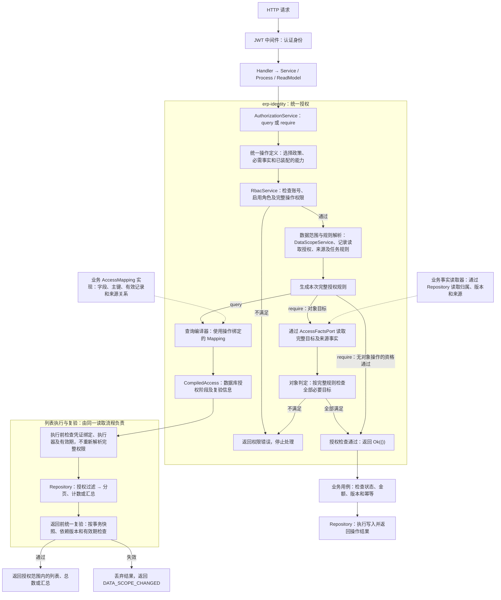

# erp-identity

负责账号登录、角色权限、组织成员、数据范围及指定记录读取授权。业务授权统一使用 `AuthorizationService`。

所有权限判断必须统一通过本 crate 执行；业务模块只提供业务事实并调用授权入口，不得自行实现、解释或组合权限规则。

本 crate 不依赖其他业务领域。业务模块提供事实读取器和 Mapping，组合根统一装配，identity 统一维护操作定义和授权政策。

本文描述共享授权服务的目标接口，状态为待实施。实施要求见 [授权服务改进](docs/authorization-service-improvement.md)。

## 权限处理架构

下图规定管理端接口的目标处理流程。HTTP 层通过 JWT 认证身份，业务用例调用 `query` 或 `require`，由 identity 统一检查功能权限及操作要求的数据资格。目标架构删除 `with_permission` 鉴权中间件。



| 模块 | 处理要求 |
| --- | --- |
| HTTP 认证与业务入口 | JWT 确认请求身份，Handler 调用受保护的业务用例。HTTP 层不安装 `with_permission` 鉴权中间件，不重复检查 RBAC。 |
| 统一操作定义与 `RbacService` | 根据操作确定授权政策和必需能力；检查当前账号及启用角色。额外必需权限由同一有效角色提供，独立入口资格按各自操作检查。 |
| 数据范围与规则解析 | identity 内部通过 `DataScopeService` 解析本次操作的有效范围及个人上限；按操作定义启用历史参与、记录读取授权、来源或任务资格。公司共享操作不读取无关范围。 |
| 记录读取授权 | 仅在操作允许时加入有效记录读取分支。对象检查按本次目标读取授权；列表编译时由 identity 使用 Mapping 提供的资源主键，在数据库内关联有效授权及来源，不预加载账号全部授权 ID。 |
| 查询编译器与 `AccessMapping` | identity 决定条件如何组合；Mapping 提供字段条件、有效记录和来源连接，并在原执行器读取所需事实版本。编译结果绑定身份、操作、Mapping、有效期及执行器会话。 |
| 对象判定与 `AccessFactsPort` | 事实读取器提供真实对象及完整来源；identity 检查必需事实并执行同一套授权规则。无对象操作只执行该操作要求的资格检查；只做对象检查不执行查询编译。 |
| 统一读取流程与业务仓储 | 领域公共读取方法统一负责 `query`、仓储执行及返回前复验。执行前检查凭证绑定、执行器和有效期；业务层与仓储不分别追加完整授权复验。授权过滤先于分页、计数和汇总。写操作在业务事务内完成授权、业务校验及写入，沿用同一执行器。 |

每个受保护的公共业务用例必须调用对应操作的 `query` 或 `require`，所有执行路径均须在返回业务数据或执行写入前完成授权。只需功能权限的操作使用 `require` 和 `AccessTarget::Operation`，不另设 HTTP 入口检查分支。CLI、worker 调用相同的受保护业务用例，不依赖 HTTP 中间件。

权限目录用于角色权限配置、按钮展示及前端权限生成，直接引用 identity 的统一操作定义，不依赖 `with_permission` 承载。

读取流程生成凭证后立即执行查询，不在编译完成后再追加一次完整复验。执行前的凭证绑定检查不重复读取账号、角色和数据范围。返回前由同一读取流程调用 `validate`；同一事务内按原快照及有效期检查，非事务读取按完整依赖版本复验，不以同一事务快照内的重复读取证明已发现事务外撤权。凭证延后使用或切换执行器时，必须重新取得相应读取阶段的授权。

普通范围读取按以下关系组合，是否启用读取补充由统一操作定义固定：

```text
基础范围 =（有效范围条款 OR 已开启的历史参与）AND 个人上限
读取范围 = 基础范围 OR 已开启的有效记录读取授权
最终数据资格 = 读取范围 AND 操作要求的其他独立范围
```

未配置个人上限时该条件为真，未开启的读取补充分支为假。记录读取授权不授予原单据的修改、提交资格；来源和任务操作按各自定义判断。

账号、权限或对象资格不满足时返回错误，不继续执行后续读取或写入。具备列表功能权限但数据范围为空时返回空结果。缺少操作、Mapping、事实或必需维度时返回接入错误；数据库错误保持原类别。复验失败时丢弃查询结果，授权状态变化按 `DATA_SCOPE_CHANGED` 处理。

## 共享服务

每个进程启动时构造一个 `Arc<AuthorizationService>`，保存在 `Application`。`HttpState` 通过 `Application` 使用它；业务 Service、Process 和 ReadModel 通过构造函数接收共享实例。

事实读取器和 Mapping 由 `erp-authorization-wiring` 统一装配，HTTP、worker 和需要业务授权的 CLI 通过其统一入口构造共享实例。`Application::authorization()` 只克隆共享 `Arc`，请求处理期间不再创建授权服务或登记政策。

共享服务不保存当前账号、事务、候选对象或授权结果。每次检查使用本次调用的执行器读取权限、范围和对象事实。

## 业务授权 API

| 用途 | 方法 | 返回 |
| --- | --- | --- |
| 操作、单条、批量对象检查 | `AuthorizationService::require` | `Result<()>` |
| 列表、计数、汇总、查询式导出，含条件编译 | `AuthorizationService::query` | `Result<CompiledAccess>` |
| 统一读取流程返回前复验 | `AuthorizationService::validate` | `Result<()>` |
| 单项功能资格查询、按钮展示 | `AuthorizationService::has_permission` | `Result<bool>` |
| 批量功能资格 | `AuthorizationService::permissions` | `Result<Option<QualifiedPermissions>>` |

`has_permission` 检查账号有效及启用角色授予的单个功能权限，不包含对象资格。业务用例仍执行 `require` 或 `query`。数据库或策略读取错误不转换为 `false`。

`permissions` 批量读取各项功能资格，账号失效时返回 `None`；身份设施、策略版本或非法权限错误直接返回。批量结果不代表同一角色具备全部权限，需要此约束时使用 `QualifiedPermissions::same_role`。功能资格不能替代 `require` 或 `query` 的对象授权。

业务不得直接调用 `RbacService::enforce`、`DataScopeService`、`ResourceAccessService`，也不得手工合并基础范围和记录授权。范围解析和查询编译由 identity 内部执行。

供应商门户继续使用 `PortalIdentityService`，按供应商绑定和门户岗位检查。

## 对象与命令

```rust
use erp_identity::{AccessTarget, permissions};

authorization.require(
    actor,
    &permissions::sales_inquiry::UPDATE,
    AccessTarget::record(inquiry_id)?,
    executor,
).await?;
```

- 单条和批量使用同一入口。目标集合最多 1000 项，空集合拒绝。
- 事实端口必须返回完整根目标及实际来源。缺失、重复、额外或资源错配的根对象导致整次失败。
- 来源保留全部引用 ID 和实际读取对象。`AllNonEmpty` 要求集合非空、全部来源存在且有权。
- 无对象操作使用 `AccessTarget::Operation`，仅接受统一定义中的无对象操作。
- 创建使用服务端确认的候选归属；归属变更同时检查原对象操作资格和目标归属。候选事实不得替代已有记录的当前事实。
- 任务操作必须提供所需的精确任务身份及版本，不能只提供关联业务 ID。
- 对象及来源事实展开最多 1000 项、最多 8 层，超限失败，不截断。
- 写入前在业务事务内执行检查，授权读取、业务读取和写入使用同一执行器。状态、金额、业务版本、幂等及所需并发冲突保护由业务用例负责。

## 列表查询

```rust
use erp_identity::permissions;

let access = authorization
    .query(
        actor,
        &permissions::sales_inquiry::LIST,
        executor,
    )
    .await?;

// 仓储检查凭证绑定，并将 access.stages() 放在分页、计数、汇总之前执行。
let page = repository.list(&filter, &access, executor).await?;
// 由当前读取流程统一复验，仓储不另行重复调用 validate。
authorization.validate(&access, executor).await?;
```

`query` 根据统一操作定义取得该操作绑定的 Mapping 并完成编译。每个查询操作绑定一个 Mapping，同一 Mapping 可以由多个操作复用。调用方不传模型标识，不提供 `models` 常量或模型选择接口。领域公共读取方法封装查询生成、仓储执行及返回前复验；业务调用不再取得或传入 Mapping。

业务筛选只收窄候选集合，不能先用部分权限条件排除记录。列表、总数、汇总和导出使用同一完整授权条件。

`CompiledAccess` 不可由业务构造或修改，绑定共享服务、账号、入口、资源、Mapping、授权时点、身份版本及 Mapping 事实和有效期。只用于当前读取阶段，禁止跨请求或事务缓存。

跨页游标使用 `CompiledAccess::version()`，包含身份和业务映射依赖。复验发现账号停用、权限撤销、版本变化或有效期到达时返回 `DATA_SCOPE_CHANGED`，丢弃结果并重新查询；数据库和接入错误保留原类别。

`MappingFacts` 仅携带业务映射的修订号与有效期。查询指纹使用 `authorization-query-v3` 格式；升级前的分页版本按 `DATA_SCOPE_CHANGED` 合同失效，调用方须重新查询。

记录授权在数据库内按有效来源关联，不预加载账号全部授权 ID。关联采用存在性查询，不增加根记录数量。事务读取以原事务快照为准；非事务映射必须提供完整修订号，不能用前后读取代替缺失的版本证据。

## 操作定义与事实装配

不再使用 `AuthorizationRegistry` 和 `AccessRegistration`。操作编码、额外必需权限、授权方式及必需事实由 identity 统一定义，操作与 Mapping 的绑定由组合根装配。业务模块与权限目录引用同一份操作常量；权限目录保留说明和分组。

组合根通过 `AuthorizationService::builder` 装配事实读取器和 Mapping，`build()` 校验后固定服务。未知操作、重复装配、Mapping 与操作资源不匹配及缺少必需能力均拒绝。

| 位置 | 职责 |
| --- | --- |
| identity | 统一操作定义、功能资格、数据范围和完整授权判断 |
| 业务 crate 的 `AccessFactsPort` 实现 | 使用 repository 读取真实对象归属、版本及来源 |
| 业务 crate 的 `AccessMapping` 实现 | 映射查询字段、有效记录及实际来源关系 |
| 组合根 | 集中装配实现，创建共享实例并注入业务服务 |

事实读取器可以由 repository 直接实现，也可以组合本域仓储；跨域事实通过窄 Port 获取。事实读取器不判断权限，不依赖需要授权服务的业务 Service，不保存请求对象。

全部必需权限须由同一个有效角色提供。固定角色资格只接受启用角色，身份判断绑定同次账号、策略及角色版本。

独立入口分别证明功能资格，并只用授予各自入口的有效角色解释范围。不同独立入口允许由不同角色满足。同资源的独立读取必须与根操作范围求交，不能替代修改等根操作范围。查询编译和对象判定使用相同动作上下文，交付前复验全部身份、映射版本和有效期。

文件材料转授先检查账号有效性，再检查有效上传者或通用预览资格，不要求额外的转授权限。此政策不能免除已有业务资源的入口权限。文件所有者事实必须完整读取，预览分支不能掩盖事实缺失。

后台任务中心按本人发起或启用管理员角色授权。全部取消在每个写事务内复验入口权限与管理员角色；角色停用、设施读取失败不得降级为普通账号后继续处理。

只做对象检查时不执行查询准备和编译。对象及来源的判定要求由统一操作定义固定，不由调用方通过模型选择改变。

## Mapping

| Mapping 能力 | 职责 |
| --- | --- |
| `model` | 提供资源、集合、行主键和支持的事实维度，供内部查询编译与复验使用 |
| `key` | 返回授权资源 ID 表达式，供记录授权和来源连接使用；支持字段引用及计算表达式 |
| `prepare` | 在原执行器读取本次事实、修订号和有效期 |
| `records` | 限定实际存在且未删除的模型记录；根查询、来源关联均应用 |
| `predicate` | 将一个 `AccessFact` 转成字段条件或关联存在性查询 |
| `relation` | 提供完整来源 ID 表达式及来源 Mapping |

所有者事实在销售单中映射到负责销售字段，在客户中映射到有效负责人分配。字段不同，语义相同。Mapping 不决定权限条件的与或关系、个人上限或是否接受记录授权。

Mapping 只提供业务字段、有效记录和实际来源关系，不通过模型选择改变授权政策或输出份额。数据范围、记录读取授权及来源资格由 identity 按统一操作定义判断。

统一操作定义声明根对象及来源的必需事实，Mapping 在 `QueryModel.facts` 中声明支持的维度。对象字段使用 `FactValue`：`Missing` 表示未读取；`Known(None)` 或已知空集合表示确认没有值。必需事实缺失时返回接入错误，其他授权分支命中不能掩盖缺失。

查询缺少映射、对象检查缺少事实端口、未知事实、Mapping 与操作资源不匹配或不支持维度均返回错误，不能降级成全量查询。Mapping 与事实端口执行相同责任定义，并验证对象判定与列表成员判断一致。

## 授权规则

1. 账号和同角色完整操作权限先于数据判断。
2. 历史参与和记录读取补充由统一操作定义固定，默认关闭。基础数据范围为有效条款或已开启的历史参与，再与个人上限求交。
3. 销售单、采购单的列表和详情开启记录读取补充后增加有效记录授权分支；该分支不放行原单据修改、提交。
4. 独立范围继续与读取结果求交。
5. 来源业务默认检查入口权限及实际来源数据资格。独立来源入口资格由统一操作定义固定，不由调用方临时追加。
6. 任务可见、资料可读、任务可办理分别定义；业务状态不由授权服务判断。
7. 公司共享资源仍检查账号和操作权限，不读取无关的人员范围或记录授权。

## 管理记录读取授权

人工授权使用 `ResourceGrantService`：`grant` 创建或更新，`revoke` 永久撤销一个来源，`sources` 查询账号的授权来源。这些方法会检查管理员权限。

自动授权在业务事务内调用 `append_event`。事件中的接收账号必须来自实际任务分配，不能由客户端自选：

- 销售单、采购单审批分配分别使用 `SalesOrderApprovalAssigned`、`PurchaseOrderApprovalAssigned`。
- 开票最终审批通过并创建执行任务后，使用 `InvoiceApproved`。
- 开票任务转派使用 `InvoiceTaskReassigned`。

各事件必填字段见 [GrantEventPayload](src/entity/resource_access/event.rs)。`append_event` 必须加入业务事务：新事件返回 `true`，相同内容重放返回 `false`；内容非法、幂等冲突或写库失败时，业务事务也必须失败。

`erp-worker` 调用 `erp-resource-grants` 处理事件，再通过 `ResourceGrantService::apply_source` 写入授权。写入前会通过 `ResourceGrantFacts` 重新检查业务数据。事件已追加不代表授权已生效。

## 代码位置

| 位置 | 内容 |
| --- | --- |
| [service/auth/](src/service/auth/) | 后台登录、密码检查 |
| [service/iam/](src/service/iam/) | 账号、角色、Casbin 权限 |
| [service/organization.rs](src/service/organization.rs) | 组织和成员管理 |
| [service/portal/](src/service/portal/) | 供应商门户账号和登录 |
| [service/access_control/](src/service/access_control/) | 数据范围配置、解析和检查 |
| [service/resource_access/](src/service/resource_access/) | `ResourceGrantService` 管理授权；`GrantEventService` 处理事件队列 |
| [service/authorization/](src/service/authorization/) | 统一操作、对象、查询与复验 |
| [repository/authorization/](src/repository/authorization/) | 查询编译及不可伪造的查询结果类型 |
| [entity/](src/entity/) | 数据结构和不访问数据库的判断规则 |
| [repository/](src/repository/) | MongoDB 读写和查询条件 |
| [ports/](src/ports/) | 由外部实现的业务查询和审计接口 |
| [dto/](src/dto/) | 请求和返回数据 |
| [indexes.rs](src/indexes.rs) | MongoDB 索引 |

## 测试

在 `backend/` 下执行：

```bash
env -u ERP_TEST_MONGO_URI cargo test -p erp-identity --lib --locked
```
