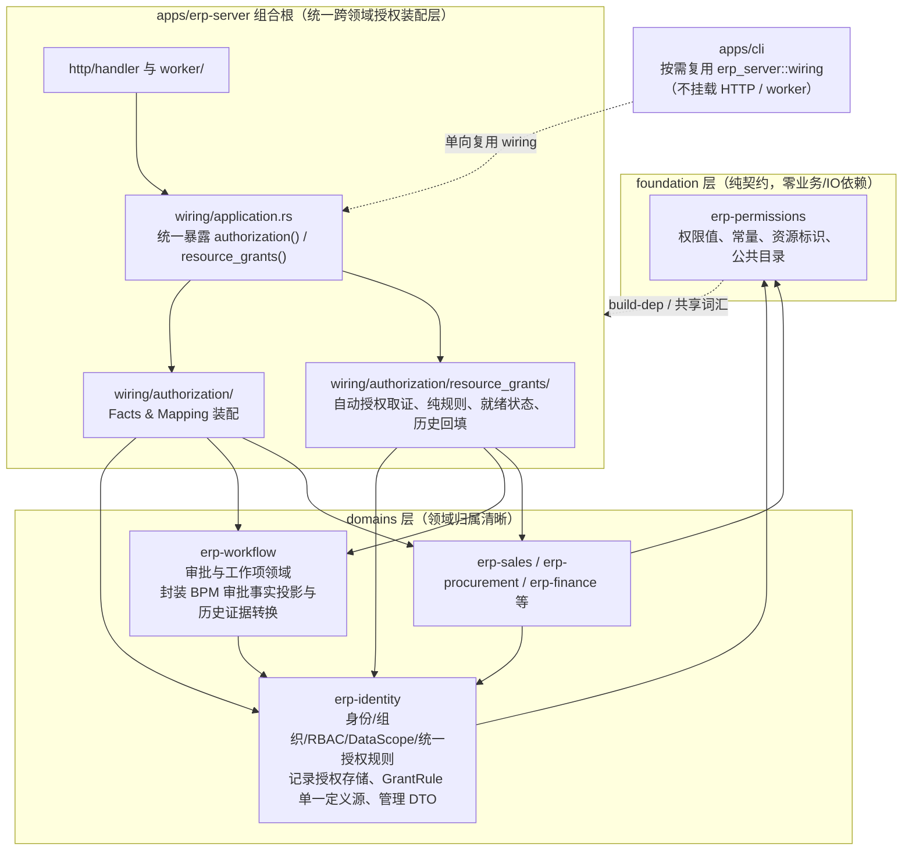

# 权限模块 Crate 边界收敛与改造方案

本文针对当前权限体系分散在 `foundation/erp-permissions`、`domains/erp-identity`、`orchestration/erp-resource-grants` 以及 `apps/erp-server/src/wiring/authorization/` 四处带来的割裂问题，给出可分阶段落地的改造方案、依赖门禁调整、改动清单及验收口径。

相关基线文档：

- [ERP 权限系统设计](authorization-system-design.md)
- [ERP 统一权限与行级授权改造](resource-authorization-design.md)
- [后端 Crate 导航](../backend/crates/README.md)

---

## 1. 背景与现状诊断

当前权限相关代码分布如下（含单测物理行）：

| 位置 | 层次 | 体量（行） | 当前职责 | 消费方 |
| --- | --- | ---: | --- | --- |
| `crates/foundation/erp-permissions` | `foundation` | ~6,867 | `Permission` 值类型、常量、资源标识、公共目录 | 几乎全部业务/编排/读模型、`erp-server`（含 `build-dependencies`） |
| `crates/domains/erp-identity` | `domains` | ~47,692 | 账号/登录/组织/门户 + RBAC + DataScope + `AuthorizationService` 规则引擎 + 记录授权存储与事件队列 | 全部 20 个业务域、13 个编排库、`erp-read-models`、`erp-server`、`cli` |
| `crates/orchestration/erp-resource-grants` | `orchestration` | ~998 | 记录授权事实取证、校验规则、就绪状态、历史回填、管理请求 DTO、`worker` tick 包装 | **仅 `apps/erp-server`**（4 个文件） |
| `apps/erp-server/src/wiring/authorization/` | `apps` | ~2,277 | `AuthorizationService` 的全量业务 `Facts` 与 `Mapping` 装配 | `web-api` 与 `erp-worker` |

### 1.1 真正导致“割裂感”的四个具体问题

1. **记录授权被“腰斩”在 `erp-identity` 与 `erp-resource-grants` 之间，存在多处重复定义与漂移**
   - `erp-identity/src/entity/resource_access/event.rs` 硬编码了 4 个具体业务事件载荷（`InvoiceApproved`、`InvoiceTaskReassigned`、`SalesOrderApprovalAssigned`、`PurchaseOrderApprovalAssigned`）；
   - `erp-identity/src/repository/resource_grants/queue.rs` 再次硬编码了 `GrantRule` 枚举与规则到资源的映射；
   - **已发生真实漂移**：`queue.rs` 中 `GrantEventRepository::grant_health()` 的 `$in` 列表只写了 3 条规则，遗漏了 `"invoice_task_reassigned"`；
   - `apps/erp-server/src/wiring/workflow/resource_access.rs` 与 `erp-resource-grants/src/readiness.rs` 又分别手写字符串构造 `SourceKey`。
2. **管理面 DTO 与服务跨 crate 分离**
   - `ResourceGrantService`（`grant` / `revoke` / `sources` / `recompute_managed`）和响应 DTO `GrantSourcePage` 位于 `erp-identity`；
   - 对应的请求 DTO（`ManualGrantRequest`、`RevokeRequest`、`SourcesQuery`、`RecomputeRequest`）与游标校验却在 `erp-resource-grants/src/management.rs`，这些类型**零外域依赖**，纯属身份域自身接口契约，却要经 `ResourceGrantProcess::management()` 透传。
3. **同类机制架构不对称，且调用方每次重复装配**
   - `AuthorizationService` 同样通过 `erp-identity` 定义 Port（`AccessFactsPort`、`AccessMapping`），而跨领域实现直接收敛在 `apps/erp-server/src/wiring/authorization/`，由 `Application::authorization()` 统一持有；
   - `ResourceGrantService` 同样在 `erp-identity` 定义了 `ResourceGrantFacts` Port，却另起了一个不到 1,000 行且仅有 `erp-server` 消费的 `orchestration/erp-resource-grants` crate；`http/handler`、`worker`、`wiring/workflow`、`wiring/funds_data_scope` 四处每次都在手动 `ResourceGrantProcess::new(...)`。
4. **`erp-resource-grants` 直接渗透 `bpm` 内部模型，与 `erp-approval-runtime` 逻辑重复**
   - `erp-resource-grants/src/backfill.rs` 中的 `assignment_events` 与 `erp-approval-runtime/src/resource_grants.rs` 中的 `assignment_evidence` 重复解析 `bpm::model::{ApprovalProcessInstance, ApprovalNodeExecution}`；
   - `erp-workflow/src/repository/grant_history.rs` 将原始 `bpm::model` 类型直接暴露给上游调用方。

---

## 2. 目标架构与边界约定

改造目标是把权限体系收敛为清晰的三段式结构：**`erp-permissions`（词汇与目录） → `erp-identity`（核心域、规则引擎与存储） → `erp-server/wiring/authorization`（全量跨领域授权装配与记录授权编排）**，同时**退役 `orchestration/erp-resource-grants` crate**，并**放开 `cli -> erp-server` 的单向 Cargo 依赖**，让 `cli` 在需要时可直接复用 `erp_server::wiring` 的完整授权与回填能力。

### 2.1 目标拓扑



### 2.2 架构红线与门禁调整口径

| 边界项 | 约束说明 | 门禁与实现处理 |
| --- | --- | --- |
| **保留 `foundation/erp-permissions` 独立** | `erp-server/Cargo.toml` 的 `[build-dependencies]` 与 `scripts/generate-permissions.py` 依赖其零 IO 特性；`crate_layers.py` 仅允许 `serde`、`thiserror` | 保持独立，不合并回 `erp-identity` |
| **`erp-identity` 不反向依赖业务域** | 全部 20 个业务域依赖 `erp-identity`，反向依赖会形成 Cargo 循环依赖并被 `domain_boundaries.py` 阻断 | 跨领域事实读取继续走 `ResourceGrantFacts` Port，在 `erp-server` 组合根实现 |
| **`erp-server` 与 `cli` 均不直接依赖 `bpm`** | `scripts/bpm_workspace.py`（L31-L33）禁止应用层直接依赖 `bpm` | 将 BPM 实例/节点执行的事实快照与历史证据转换下沉至 `erp-workflow`，`erp-server` 不新增 `bpm` 依赖 |
| **放开 `cli -> erp-server` 单向依赖** | 允许 `cli` 直接调用 `erp_server::wiring` 复用授权装配与记录授权能力（如 `backfill` / `reconcile`） | 同步调整 `crate_layers.py`、`bpm_workspace.py`、`cutover_tool_selftests.py` 及相关 README；**继续禁止 `erp-server -> cli` 反向依赖**，且约定 `cli` 仅消费 `erp_server::wiring`，不挂载 `http` 或启动 `worker` 常驻循环 |

---

## 3. 分阶段改造计划

所有阶段均保持 **MongoDB 集合名、字段结构、索引、HTTP 路由与 JSON 协议、错误码、worker 租约语义 100% 兼容**，无需停机或数据迁移。

---

### 阶段一：拉齐 `erp-identity` 与 `erp-workflow` 内部边界（零 crate 增删，可独立合并）

本阶段先把重复定义、错位 DTO 与 BPM 内部模型泄漏清理干净。

#### 1.1 在 `erp-identity` 建立 `GrantRule` 单一定义源并修复 `grant_health` 漂移

- **新增/调整文件**：
  - 新增 `backend/crates/domains/erp-identity/src/entity/resource_access/rule.rs`（并由 `entity/resource_access/mod.rs` 导出），定义 `GrantRule`：
    - 保留原序列化格式 `#[serde(rename_all = "snake_case")]`，四个变体不变：`InvoiceTaskReassigned`、`InvoiceApproved`、`SalesOrderApprovalAssigned`、`PurchaseOrderApprovalAssigned`。
    - 提供单一元数据方法：
      - `pub const ALL: &'static [Self]`
      - `pub const fn code(self) -> &'static str`
      - `pub const fn business_type(self) -> &'static str`
      - `pub const fn target_resource(self) -> ResourceKind`
      - `pub fn codes_for_resource(resource: ResourceKind) -> Vec<&'static str>`
      - `pub fn source_key(self, business_id: impl Into<String>, recipient: impl Into<String>) -> SourceKey`
- **消除重复硬编码**：
  - `backend/crates/domains/erp-identity/src/entity/resource_access/event.rs`：
    - 新增 `GrantEventPayload::rule(&self) -> GrantRule`。
    - `GrantEventPayload::source()` 与 `identity()` 统一复用 `self.rule().code()` 和 `self.rule().business_type()`。
  - `backend/crates/domains/erp-identity/src/repository/resource_grants/queue.rs`：
    - 删除本地重复的 `GrantRule` 定义，改为 `pub use crate::entity::resource_access::GrantRule;`（保持 `erp_identity::service::resource_access::GrantRule` 公开路径不变）。
    - `GrantRecompute::query()` 中 `Self::Resource(kind)` 改为通过 `GrantRule::codes_for_resource(kind)` 生成，不再手写规则数组。
    - **修复既有漂移**：`GrantEventRepository::grant_health()`（原 L121）改为基于 `GrantRule::ALL` 生成 `$in` 列表，补齐遗漏的 `"invoice_task_reassigned"`，并补充单元测试验证四类规则全覆盖。

#### 1.2 将管理请求 DTO 与游标校验收回 `erp-identity`

- **目标文件**：`backend/crates/domains/erp-identity/src/dto/resource_access.rs`（当前仅 10 行，含 `GrantSourcePage`）。
- **迁入内容**（原位于 `erp-resource-grants/src/management.rs`）：
  - `ManualGrantRequest`（含 `into_update()`）
  - `RevokeRequest`
  - `SourcesQuery`（含 `validate()`）
  - `RecomputeRequest`（含 `validate()`）
  - `pub fn validate_grant_cursor(after: Option<&str>) -> Result<()>`（供 `SourcesQuery`、`RecomputeRequest` 及 `BackfillRequest` 共用）
- **同步动作**：
  - 保留原 `#[serde(deny_unknown_fields)]` 与全部校验错误文案，将原 `management.rs` 的单元测试一并迁入 `dto/resource_access.rs`。
  - 经 `erp-identity/src/dto/mod.rs` 与 `erp-identity/src/lib.rs` 导出。
  - 删除 `erp-identity` 历史遗留空目录 `backend/crates/domains/erp-identity/src/permissions/`。

#### 1.3 在 `erp-workflow` 封装 BPM 审批取证与历史证据投影（消除上游对 `bpm` 的直接依赖）

这是把记录授权编排迁入 `erp-server` 且严守 `check-bpm-boundaries.sh` 的关键前置步骤：

- **目标文件**：`backend/crates/domains/erp-workflow/src/repository/grant_history.rs`（必要时拆分 `backend/crates/domains/erp-workflow/src/authorization/grant_facts.rs`，严格遵守单文件 ≤ 1200 行、单函数 ≤ 50 行体积门禁）。
- **新增纯 ERP 事实快照与读取接口（不暴露任何 `bpm::*` 类型）**：
  - `ApprovalGrantSnapshot`：`id: String`、`version: u64`、`approved: bool`、`subject_kind: String`、`subject_id: String`、`subject_version: u32`。
  - `NodeExecutionGrantSnapshot`：`process_instance_id: String`、`node_key: String`、`blocked: bool`、`has_recipient: bool`。
  - `find_approval_snapshot(db, approval_id, executor) -> Result<Option<ApprovalGrantSnapshot>>`
  - `find_latest_invoice_approval_snapshot(db, request_id, executor) -> Result<Option<ApprovalGrantSnapshot>>`（内部构造 `bpm::SubjectRef::new("sales_invoice_request", request_id)` 并调用 `BpmWorkflowRepository::find_latest_by_subject`）
  - `find_assignment_snapshots(db, instance_id, execution_id, recipient, executor) -> Result<Option<(ApprovalGrantSnapshot, NodeExecutionGrantSnapshot)>>`
- **收拢 `GrantHistoryEntry` 的 BPM 细节**：
  - `GrantHistoryEntry` 不再向外暴露原始 `bpm::model::{ApprovalProcessInstance, ApprovalNodeExecution}`，改为只暴露纯业务标识或已转换的 `GrantEventEvidence`：
    - `Invoice { id: String, invoice_request_id: String }`
    - `Assignment { id: String, events: Vec<GrantEventEvidence> }`（在 `erp-workflow` 内部完成 `Blocked` 过滤、冻结参与人去重、`assigned_to` 核验与 `GrantEventEvidence` 构造；原 `backfill.rs` 的 `historical_orders_use_frozen_recipients_and_distinct_sources` 单测顺势迁入 `erp-workflow`）
    - `Reassignment { id: String, receipt: WorkItemCommandReceipt }`
- **顺手消除重复映射**：
  - 在 `erp-workflow` 提供公开函数构造单条订单审批分配的 `GrantEventEvidence`（校验 `execution.process_instance_id == instance.base.id` 与 `has_participant`），供 `erp-approval-runtime/src/resource_grants.rs` 与 `grant_history.rs` 共用。

---

### 阶段二：收编 `erp-resource-grants` 至 `erp-server`，退役该 crate 并放开 `cli -> erp-server`

在阶段一完成后，原 `erp-resource-grants` 剩余逻辑仅约 500 行且不再依赖 `bpm`，与 `wiring/authorization/` 性质完全一致，均为“跨领域读取业务仓储、实现 `erp-identity` Port 并供应用层消费”。

#### 2.1 目标目录布局

在 `backend/apps/erp-server/src/wiring/authorization/` 下新增 `resource_grants/` 子模块：

```text
backend/apps/erp-server/src/wiring/authorization/
├── mod.rs                           # 原有 AuthorizationService 装配 + pub mod resource_grants;
├── approvals.rs / commerce.rs / ... # 原有 Facts & Mapping 装配
└── resource_grants/
    ├── mod.rs                       # ResourceGrantRuntime（原 ResourceGrantProcess：tick / reconcile / health / management）
    ├── facts.rs                     # impl ResourceGrantFacts for Facts（仅依赖 erp-workflow / erp-finance / erp-sales / erp-procurement）
    ├── rules.rs                     # 纯校验规则 InvoiceEvidence / AssignmentEvidence 及全部单测
    ├── readiness.rs                 # GrantReadiness / source_readiness / invoice_pending（使用 GrantRule::*.source_key）
    └── backfill.rs                  # BackfillRequest / BackfillReport / BackfillProblem / backfill 分页执行
```

> 模块边界要求：`wiring/authorization/resource_grants/` 遵守 `apps/erp-server/README.md` 规范，**不得引用 `crate::http` 或启动后台循环**，便于 `http/`、`worker/` 与 `cli` 统一复用。

#### 2.2 在 `Application` 统一装配入口，消除 4 处重复构造

在 `backend/apps/erp-server/src/wiring/application.rs` 新增公开方法：

```rust
pub fn resource_grants(&self) -> ResourceGrantRuntime
```

（`ResourceGrantRuntime` 仅持有 `Database`、`ResourceGrantService` 与 `GrantEventService`，全部为轻量的 `Arc`/句柄克隆。）

同步改造 4 个调用点：

| 原调用文件 | 改造前 | 改造后 |
| --- | --- | --- |
| `apps/erp-server/src/worker/resource_grants.rs` | `ResourceGrantProcess::new(state.db(), state.authorization())` | `state.resource_grants()` |
| `apps/erp-server/src/http/handler/access_control/resource_grants.rs` | 从 `erp_resource_grants` 导入 DTO，每次 `ResourceGrantProcess::new(...)` | 管理 DTO 直接从 `erp_identity::dto` 导入，调用 `state.application().resource_grants()`；`BackfillRequest` / `BackfillReport` 从 `crate::wiring::authorization::resource_grants` 导入 |
| `apps/erp-server/src/wiring/workflow/resource_access.rs` | 手写字符串构造 `SourceKey`，并新建 `ResourceGrantProcess` | 用 `GrantRule::SalesOrderApprovalAssigned.source_key(...)` / `GrantRule::PurchaseOrderApprovalAssigned.source_key(...)`，调用 `crate::wiring::authorization::resource_grants::source_readiness` |
| `apps/erp-server/src/wiring/funds_data_scope.rs` | 每次调用新建 `ResourceGrantProcess` | 直接调用 `crate::wiring::authorization::resource_grants` 的 `invoice_pending` |

#### 2.3 移除 `erp-resource-grants` crate

按 [后端 Crate 导航](../backend/crates/README.md#目录与登记要求) 同步更新以下文件：

1. 删除目录：`backend/crates/orchestration/erp-resource-grants/`
2. 更新 `backend/Cargo.toml`：
   - `[workspace.members]` 移除 `"crates/orchestration/erp-resource-grants"`
   - `[workspace.dependencies]` 移除 `erp-resource-grants = { path = "crates/orchestration/erp-resource-grants" }`
3. 更新 `backend/apps/erp-server/Cargo.toml`：
   - 移除 `erp-resource-grants = { workspace = true }`
   - **确认不引入 `bpm`**
4. 更新 `backend/scripts/crate-layers.json`：
   - 移除 `"erp-resource-grants"` 条目
5. 更新 `backend/Cargo.lock`：
   - 运行 `cargo check --workspace` 刷新锁文件，随后所有验证统一使用 `--locked`

#### 2.4 放开 `cli -> erp-server` 单向依赖（门禁、自测与文档同步）

1. **`backend/scripts/crate_layers.py`（L107-L108）**：
   - 移除 `if src == "cli" and dst == "erp-server"` 的禁令；
   - 改为新增反向保护 `if src == "erp-server" and dst == "cli"`（禁止 `erp-server` 反向依赖 `cli`）。
2. **`backend/scripts/bpm_workspace.py`（L34）**：
   - 将 `for start, targets in (("bpm", forbidden), ("cli", {"erp-server"})):` 收敛为只检查 `("bpm", forbidden)`；
   - **保留** L31-L33 的 `for entry in ("erp-server", "cli"): if "bpm" in graph.get(entry, set()):`，继续禁止应用层直接依赖 `bpm`。
3. **`backend/scripts/cutover_tool_selftests.py`（L209、L279）**：
   - 从负向用例中移除 `("cli", "erp-server")`；
   - 新增正向用例确认 `cli -> erp-server` 被允许，同时新增负向用例确认 `erp-server -> cli`、`cli -> bpm`、`erp-server -> bpm` 仍被阻断。
4. **`backend/Cargo.toml` / `backend/apps/cli/Cargo.toml`**：
   - 在 `[workspace.dependencies]` 登记 `erp-server = { path = "apps/erp-server" }`（若立即在 `cli` 接入回填/对账命令则在 `apps/cli/Cargo.toml` 启用；暂未新增子命令时也可先仅放开规则，待新增命令时接入，避免空引入增加 `cli` 编译体积）。
   - 明确约定：`cli` 仅消费 `erp_server::wiring` 下的装配能力，禁止导入 `erp_server::http` 或启动 `worker` 常驻循环。

#### 2.5 文档同步清单

- `docs/authorization-system-design.md`：更新职责表、Mermaid 拓扑图、记录授权时序图以及 CLI 依赖说明；
- `docs/resource-authorization-design.md`：更新实现位置引用（由 `orchestration/erp-resource-grants` 指向 `apps/erp-server/src/wiring/authorization/resource_grants/`）；
- `backend/crates/README.md`：移除文末 L173 的孤立条目，并将 L137 规则 3 更新为允许 `cli` 单向复用 `erp-server::wiring`（禁止反向依赖）；
- `backend/crates/domains/erp-identity/README.md`：更新 L13（CLI 说明）与 L202（记录授权调用路径）；
- `backend/apps/erp-server/README.md`：在 `wiring/authorization/` 目录说明中纳入 `resource_grants/`；
- `backend/apps/cli/README.md`：将 L3“禁止依赖 `web-api`”更新为“允许按需单向复用 `erp-server::wiring` 装配能力，不挂载 HTTP 或启动 worker 常驻循环”。

---

### 阶段三：中长期治理与演进护栏（按触发条件执行，不强行前置）

完成阶段一与阶段二后，权限系统已经收敛为清晰的三段式结构。中长期仍需关注两处潜在膨胀点，设立治理规则与拆分触发阈值，避免过早大改：

#### 3.1 约束 `erp-permissions/src/internal.rs` 的膨胀

- **现状**：`internal.rs` 已有 416 行大量内部派生动作常量，实质上承担了“授权规则函数路由键”的作用。
- **治理规则**：
  - 可配置菜单权限、跨 crate 业务入口权限、策略文件白名单权限继续留在 `erp-permissions`；
  - 仅为单条内部流程服务的派生变体，优先检查是否能通过 `AccessTarget` 或已有主权限表达，不再无节制新增 `internal::*` 符号；
  - 定期核对并清理 `internal.rs` 中已无调用方的废弃常量。

#### 3.2 `erp-identity`（~47.7k 行）的内部模块整理与拆分触发条件

- **短期（仅整理，不拆 crate）**：
  - 在 `erp-identity` 的 `README.md` 与 `lib.rs` 导出分层中，明确区分两大子域：
    1. **身份与组织域**：`auth`、`portal`、`organization`、`person_directory`、`account_core`
    2. **授权引擎与治理域**：`iam`（RBAC/Casbin）、`access_control`（DataScope）、`authorization`（统一判定与查询编译）、`resource_access`（记录授权）、`authorization_bundle`
  - 禁止在“身份与组织域”内部反向依赖 `service/authorization/rules` 的具体业务规则，保持内部单向依赖，为未来拆分留好接缝。
- **中长期拆包触发条件（满足任一项再启动）**：
  1. 修改一条具体业务授权规则（如 `service/authorization/rules.rs`）导致 `cargo check --workspace` 增量编译时间成为日常开发显著瓶颈（因全 workspace 20 个 domain 依赖 `erp-identity`）；
  2. 身份/组织模块与业务授权引擎需要独立的发布节奏或不同团队并行演进。
- **届时目标方向**：仅保留精简的授权调用接口/凭证类型（或基础身份域）给各业务域依赖，将高频变动的业务授权规则库独立，避免改一行销售授权规则触发全仓重编。

---

## 4. 风险清单与对策

| 风险 | 影响 | 预防与应对措施 |
| --- | --- | --- |
| `erp-server` 意外引入 `bpm` 依赖 | 触发 `./scripts/check-bpm-boundaries.sh` 失败 | 阶段一先在 `erp-workflow` 封装全部 `bpm::model` 与 `SubjectRef` 访问，`erp-server` 只消费纯结构体与 `GrantEventEvidence` |
| 单文件或单函数超过体积门禁 | 触发 `./scripts/check-rust-size.sh` 失败（单文件 ≤ 1200 行、单函数 ≤ 50 行） | 按 `mod.rs` / `facts.rs` / `rules.rs` / `readiness.rs` / `backfill.rs` 保持细粒度文件拆分；`dto/resource_access.rs` 与 `grant_history.rs` 同步检查函数行数 |
| 放开 `cli -> erp-server` 后引入 `http` 耦合或 `cli` 编译变慢 | `cli` 意外引用 HTTP 层或带入不必要构建成本 | 门禁继续阻止 `erp-server -> cli` 与 `cli -> bpm`；代码审查约定 `cli` 只用 `erp_server::wiring`，且在真实新增运维子命令时再在 `cli/Cargo.toml` 声明依赖 |
| 门禁脚本自测用例未同步更新 | `check-domain-boundaries.sh` 或 `check-bpm-boundaries.sh` 的内建夹具自检失败 | 同步修改 `crate_layers.py`、`bpm_workspace.py` 与 `cutover_tool_selftests.py`，先跑 `--self-test-only` 再跑全量检查 |
| HTTP 管理接口 JSON 协议或错误语义变化 | 破坏前端或运维脚本调用 | 所有请求 DTO 保留原字段名、`#[serde(deny_unknown_fields)]`、默认 `dry_run = true` 与既有校验错误信息；保留原 HTTP 单元测试验证 |

---

## 5. 验证与验收清单

每个阶段合入前，在 `backend/` 目录按顺序执行以下检查（遵循 [后端开发规则](../backend/AGENTS.md#验证)）：

### 5.1 阶段一验收命令

```bash
cargo fmt --all -- --check
cargo clippy -p erp-identity -p erp-workflow -p erp-approval-runtime -p erp-resource-grants -p erp-server --lib --bins --locked -- -D warnings
env -u ERP_TEST_MONGO_URI cargo test -p erp-identity -p erp-workflow -p erp-approval-runtime -p erp-resource-grants -p erp-server --lib --locked
./scripts/check-bpm-boundaries.sh
./scripts/check-domain-boundaries.sh --cutover
./scripts/check-rust-size.sh
git diff --check
```

阶段一必须额外核对的单元测试断言：
- `GrantRule::ALL` 覆盖所有 `GrantEventPayload` 变体；
- `grant_health` 的规则筛选集合包含 `invoice_task_reassigned`；
- `GrantRecompute::Resource(SalesOrder)` 与 `GrantRecompute::Resource(PurchaseOrder)` 结果与改造前一致；
- `ManualGrantRequest` / `RevokeRequest` / `SourcesQuery` / `RecomputeRequest` 保留原反序列化拒绝未知字段与游标校验行为。

### 5.2 阶段二验收命令（退役 `erp-resource-grants` 并放开 `cli -> erp-server` 后）

先运行一次 `cargo check --workspace` 更新 `Cargo.lock`，再执行全量门禁：

```bash
cargo fmt --all -- --check
./scripts/check-permissions-drift.sh
cargo check --workspace --locked
cargo clippy --workspace --all-targets --all-features --locked -- -D warnings
env -u ERP_TEST_MONGO_URI cargo test --workspace --lib --locked
./scripts/check-bpm-boundaries.sh --self-test-only
./scripts/check-bpm-boundaries.sh
python3 ./scripts/domain_boundaries.py --backend . --self-test-only
./scripts/check-domain-boundaries.sh --cutover
./scripts/check-rust-size.sh
git diff --check
```

阶段二验收通过标准：
- `backend/crates/orchestration/erp-resource-grants` 目录及 workspace/层登记完全清除；
- `erp-server` 与 `cli` 依赖闭包中均**不存在**对 `bpm` 的直接依赖；
- `cli -> erp-server` 门禁放开且自测夹具通过，`erp-server -> cli` 仍被拒绝；
- 原 `erp-resource-grants` 中全部纯规则、回填预览、管理契约单测 100% 保留并在 `erp-identity` / `erp-workflow` / `erp-server` 下通过；
- 文档索引、架构图与代码入口链接全部一致，无悬空路径。
