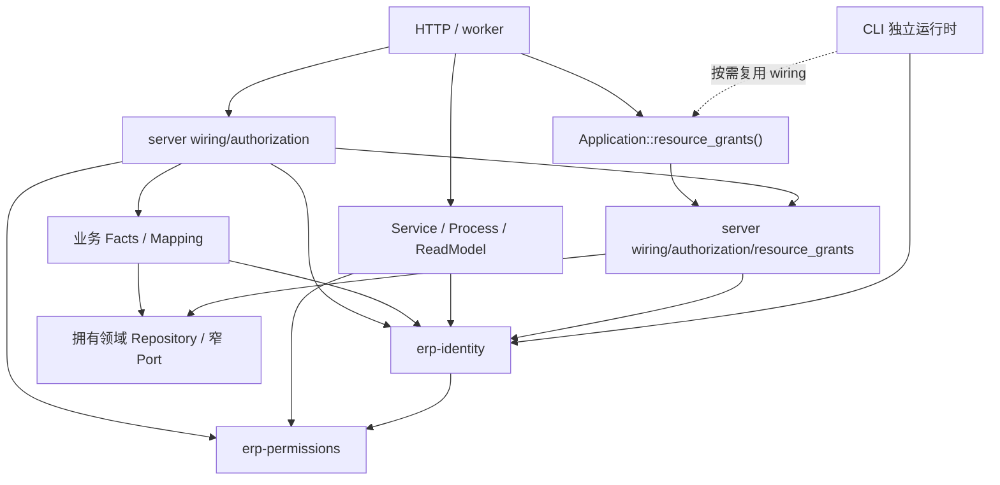
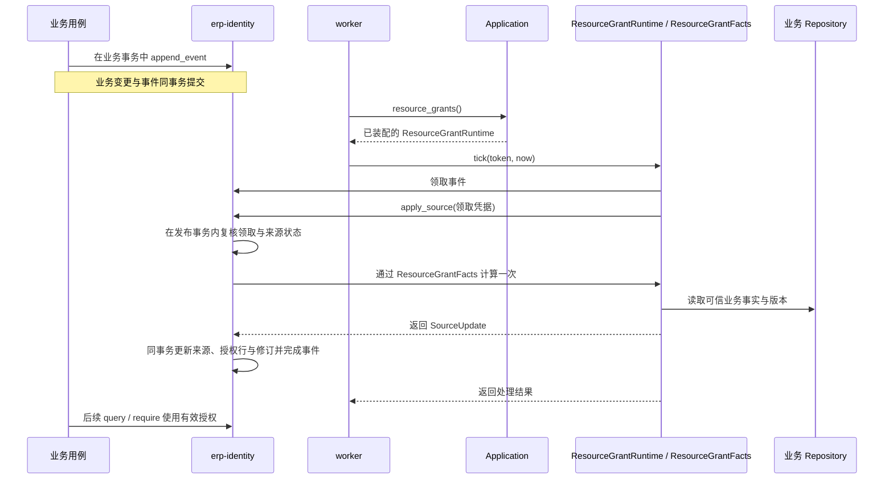

# ERP 权限系统设计

本文规定公共权限、业务授权、服务装配和记录读取授权的职责及执行合同。接口、迁移清单和验收条件见 [授权服务改进](../backend/crates/domains/erp-identity/docs/authorization-service-improvement.md)。

## 模块职责与依赖

| 模块 | 职责 | 依赖边界 |
| --- | --- | --- |
| [erp-permissions](../backend/crates/foundation/erp-permissions/README.md) | 公共 `Permission` 值、内置权限常量、资源标识、分组及说明目录 | 不依赖 identity、业务领域或应用，不访问数据库。 |
| [erp-identity](../backend/crates/domains/erp-identity/README.md) | 身份资格、范围配置与解析、固定授权规则、对象判断、查询编译及授权持久化 | 依赖公共权限和基础设施，不依赖其他业务领域、编排库、ReadModel 或应用。 |
| [server wiring/authorization](../backend/apps/erp-server/src/wiring/authorization/mod.rs) | 创建并连接身份设施、真实 Facts 和 Mapping，构造共享授权服务 | 位于现有 server 组合根，只装配实现，不声明授权政策或启动后台循环。 |
| 业务领域、Process、ReadModel | 提供归属、来源、指派和版本，执行业务校验、读写及结果交付 | 调用 identity 的公开接口；跨域事实经窄 Port 接入。 |
| [server wiring/authorization/resource_grants](../backend/apps/erp-server/src/wiring/authorization/resource_grants/mod.rs) | 根据业务事件与可信事实计算记录读取授权，编排发布、重算、对账与回填 | 依赖 identity 的公开事件和来源服务，通过拥有领域仓储读取事实。 |
| HTTP 与 worker | 启动时构造共享服务并注入业务用例 | HTTP 认证身份；worker 驱动消费和调度，不挂载业务 HTTP。 |
| CLI | 使用独立运行时执行运维命令，可按需复用 `erp_server::wiring` | 依赖方向为 `cli → erp-server`；CLI 不挂载业务 HTTP、不启动 worker 常驻循环。 |



identity 决定当前账号能否执行操作或访问对象；`wiring/authorization/resource_grants/` 计算业务事件应产生的记录读取来源。记录授权发布后，最终访问仍由 identity 判断。请求查询不触发自动授权消费。

## 共享服务装配

HTTP 和 worker 分别调用 `wiring::authorization::build(db, rbac)`，各自取得进程内共享的 `Arc<AuthorizationService>`。装配顺序固定为：

1. 创建身份设施和拥有领域 Repository。
2. 创建真实事实读取器、Mapping 和所需跨域适配器。
3. 使用 `AuthorizationService::builder(db, rbac)`，按资源调用 `facts(resource, facts)?`，按查询权限调用 `mapping(&permission, mapping)?`。
4. 调用 `build()?`，校验全部固定规则要求的绑定。
5. 将共享服务保存在 `Application`，注入 Service、Process、ReadModel 和业务 Port。`Application::authorization()` 只克隆 `Arc`。

绑定缺失、重复、未知资源、事实能力不足、来源错配或输出粒度不符时必须拒绝构造。禁止空实现、部分生产绑定或绕过校验的临时工厂。

Builder 只连接实现。固定授权组合、必需资格和范围来源归 identity；装配层不得登记政策。事实读取器不得依赖需要授权服务的业务 Service。

共享服务可以保存数据库句柄、身份设施、不可变规则及实现绑定；不得保存当前账号、事务、候选对象或授权结果。请求状态均按本次调用传入或生成。

## 公共权限与路由目录

所有层使用 `erp-permissions::Permission`。内置权限直接引用模块常量；数据库、配置、请求及反序列化输入通过 `Permission::parse` 校验。权限沿用 `resource:action` 字符串格式和通配覆盖语义。

公共目录通过 `&'static Permission` 引用常量，不维护第二份编码字符串。server 的 `route_descriptions.rs` 只补充不同于默认值的接口说明；`build_route_overrides.rs` 只补充分组及既有展示差异。

路由使用 `permission_route(route, &permission)` 提供公共权限元数据。该 helper 在运行时原样返回路由，不执行 RBAC。`build.rs` 从路由及公共目录生成合同、权限白名单和前端目录；业务入口授权不依赖该包装。

新增权限和接口按以下顺序接入：

1. 在 `erp-permissions` 所属模块定义并登记常量。内部派生入口沿用隐藏目录合同，不加入角色展示目录。
2. 在 identity 维护对应固定规则、范围要求及支持的目标和查询能力。
3. 补齐 Facts、Mapping 和业务入口授权；需要查询时为权限绑定唯一根 Mapping。
4. 在路由引用公共主常量；新增路由模块加入构建扫描清单。
5. 执行 `python3 scripts/generate-permissions.py --test`、独立生成及权限漂移检查，review 生成结果。

生成物不得手改。接口差异引用不存在的路由或重复登记同一字段时，生成必须失败。

## 业务入口与授权 API

HTTP 使用 JWT 确认身份。Handler 只提取输入、传递身份、调用受保护用例并包装响应。worker 调用相应业务用例。每个受保护的公共业务入口都必须在返回业务数据或执行写入前完成授权。

| 用途 | 接口 | 结果 |
| --- | --- | --- |
| 具体对象、批量对象、创建或归属变更 | `require(actor, permission, target, executor)` | `Result<()>` |
| 仅功能权限的操作 | `require`，目标为 `AccessTarget::Operation` | `Result<()>` |
| 列表、计数、汇总、查询式导出 | `query(actor, permission, executor)` | `Result<CompiledAccess>` |
| 读取交付检查 | `validate(access, executor)` | `Result<()>` |
| 单项或批量功能资格、按钮展示 | `has_permission`、`permissions` | 功能资格，不作为对象授权凭证 |

```rust
use erp_identity::AccessTarget;
use erp_permissions::sales_inquiry;

authorization
    .require(
        actor,
        &sales_inquiry::COMMANDS_SALES_SAVE,
        AccessTarget::record(inquiry_id)?,
        executor,
    )
    .await?;
```

业务不得自行组合 RBAC、DataScope、历史参与或记录授权，不得通过选择主体或模型改变授权方式。静态选项、字典候选、期间口径和审计日志均须执行对应入口授权；审计展示使用 `AuditLogReadService`，内部审计写入保持独立。协议读取和技术票据使用 identity 的固定对象入口，在同一快照中检查完整资格并读取真实连接及来源。供应商门户和既有公开入口沿用各自认证及业务校验合同。

账号无效、资格或数据条件不满足时立即返回错误。缺少必要规则、事实或绑定时返回接入错误；数据库错误保留原类别。完整资格由同一角色满足的要求归 identity；独立入口按各自角色取证，不能相互替代。

## 对象、事务与查询交付

业务附件先通过所属用例的固定准备入口，以内部权限和 `AccessTarget::Operation` 检查完整功能资格，通过后才能写入对象存储。准备只覆盖功能资格，不证明具体对象、来源或任务可操作；文件存储后的业务写事务必须重新执行完整授权。业务附件不额外要求独立 `file_asset:upload` 菜单权限，直接文件上传入口仍执行自己的权限合同。

对象授权执行以下合同：

- 已有记录通过真实 ID 读取完整事实；创建使用服务端确认的候选归属；归属变更同时检查原对象和目标归属。
- 任务办理使用精确任务身份和版本。任务种类、来源、指派及版本以持久化事实为准。
- 事实缺失与已知空值必须区分。其他并集分支命中不能掩盖必需事实缺失。
- 对象与来源必须完整返回，缺失、重复、额外或资源错配时整次失败。目标和事实展开遵守 identity 的数量与深度上限，不得截断放行。
- 写入授权、决定写入的业务读取和写入使用同一事务执行器。业务负责状态、金额、幂等、业务版本及冲突保护；授权服务不替代这些检查。
- 本事务内修改归属、来源、指派或权限后，后续受保护操作重新授权。

列表、计数、汇总及导出按以下顺序执行：

```rust
use erp_permissions::sales_inquiry;

let access = authorization
    .query(actor, &sales_inquiry::QUERY_SALES_LIST, executor)
    .await?;
let page = repository.list(&filter, &access, executor).await?;
authorization.validate(&access, executor).await?;
```

仓储执行前通过 `CompiledAccess::ensure_current` 检查服务、执行器、读取阶段和有效期；数据库先执行完整授权过滤，再执行分页、计数和汇总。无有效数据范围时生成空结果条件，不退化为只检查功能权限。

读取用例在全部补齐完成后调用一次 `validate`，通过后才能交付；流式导出按批次检查。复验失败时丢弃未交付结果。非事务身份、范围或读取授权修订变化按 `DATA_SCOPE_CHANGED` 处理。

事务读取按原快照判断，交付检查不重读同一批快照依赖，不宣称已观察事务外撤权。非事务读取使用可核验的读取阶段并复验依赖。跨服务、跨事务或跨读取阶段不得复用凭证；同一会话的新事务也属于不同边界。

## Facts 与 Mapping

| 接口 | 实现提供的内容 | identity 的处理 |
| --- | --- | --- |
| `AccessFactsPort` | 对象身份、归属、版本、任务分配及完整来源 | 验证完整性和必需事实，执行对象授权 |
| `AccessMapping` | 固定集合、主键、有效记录条件、事实字段与来源关系 | 编译完整授权条件，保持与或关系及输出粒度 |
| `ResourceGrantFacts` | 记录授权目标与自动来源的可信业务事实 | 发布前重验目标、来源、业务版本和终止状态 |

所有 I/O 使用本次执行器。`model()`、`relations()` 和固定关联阶段不依赖请求；Builder 校验后冻结描述。Mapping 不执行查询外取数；静态条件的最早有效期纳入查询凭证。

Mapping 只提供字段与关系，不决定权限条件的组合、个人上限或读取补充。关联准备不得提前过滤、展开、分页或写入，不得扩大根记录数量。

`QueryOutput::Object` 用于完整对象；份额和存在性视图遵守其固定投影及来源边界，不能据此授权整个对象。对象判断与完整对象查询必须使用同一归属语义。

## 人员范围与权限检查

identity 内部以公共权限为键维护私有 `ScopeSpec`。配置候选、保存校验、运行解析、初始化和导入导出使用同一定义。

| 范围来源 | 配置与解析要求 |
| --- | --- |
| `Current` | 允许独立人员配置；无配置时按定义采用本人基础或空范围。 |
| `Permission` | 只复用指定 `Current` 来源的范围条款和默认行为；当前入口资格及当前对象归属仍独立检查。 |
| `Company` | 不接受独立人员配置，不读取遗留个人范围或限制；仍执行当前功能资格及必要记录关系检查。 |

来源无效、循环、维度不兼容或必需定义缺失时拒绝。来源复用不证明来源业务对象可访问；没有范围定义不能被解释为只检查 RBAC。

人员范围目录不返回 `authorization_policy` 总分类。前端以 `configurable_actions` 决定可编辑动作，以 `dimensions` 展示支持维度，以 `default_self_actions` 说明本人基础。维度并集只供展示，保存仍须逐动作验证；任一动作不支持时拒绝整次保存。

`policy_description` 按动作展示实际要求，不参与权限判定。不可独立配置的历史记录保留为退役项。公司共享、来源复用、纯任务和仅功能资格操作不得保存独立范围。

管理员权限检查复用统一入口。检查步骤返回已检查、被拒绝或待检查状态；缺少具体对象、任务、来源或命令内容时保留待检查条件，不报告对象授权通过。具体单据检查沿用销售单详情及修改的现有范围；检查结果不能复用于后续业务请求。

## 记录读取授权的生成与使用

记录读取授权分为生成、发布和访问使用三个阶段。identity 保存授权来源、授权行、修订号和事件状态；服务端记录授权模块读取业务事实并计算授权；worker 驱动消费循环。HTTP 管理端与 worker 均通过 `Application::resource_grants()` 获取 `ResourceGrantRuntime`。



发布及访问必须满足以下要求：

1. 事件证据来自服务端确认的实际业务事实，事件与业务变更使用同一执行器。事件追加失败使业务事务失败。
2. 追加成功只表示待处理，不表示授权生效。就绪状态查询不替代实际访问授权。
3. `ResourceGrantRuntime` 使用 `ResourceGrantService::apply_source` 发布。identity 核验领取与来源，经可信端口计算结果、核验写入目标，并执行幂等、业务版本、终止来源和修订控制。
4. 发布失败只重试授权步骤，不重放审批或派工等原业务命令。事实读取失败不得转换为空授权；旧事件不得覆盖新事实。
5. 终止来源不得被重试、重算或回填恢复。撤销一个来源不删除其他有效来源；来源状态、授权行和修订同事务更新。
6. 人工授予、撤销、来源查询和受控重算须通过管理员资格检查；后台对账入口不得直接作为管理端接口。
7. 记录授权只补充固定规则允许的读取范围，不替代功能资格，不授予原单据的修改或提交资格。

worker 负责消费、恢复、有界对账、队列观测和停止排空。记录授权装配只提供单轮处理及维护能力。实现与扩展方式见 [记录读取授权装配](../backend/apps/erp-server/README.md#记录读取授权装配)。

## 验证与文档维护

新增或调整授权须覆盖真实生产逻辑的成功、拒绝及边界单元测试。装配测试须使用完整真实绑定；编译通过不得替代授权行为验证。依赖边界和权限漂移检查按 [后端规则](../backend/AGENTS.md) 执行。

库测试、静态检查和完整装配构造不证明真实 MongoDB 事务、服务启动或生产验收。前端类型、构建检查不证明浏览器配置及展示流程已验收。

本文维护模块职责、装配及执行合同。各 crate README 维护调用方式、扩展入口和代码导航；[授权服务改进](../backend/crates/domains/erp-identity/docs/authorization-service-improvement.md) 维护迁移和验收要求；[记录授权改造](resource-authorization-design.md) 维护记录授权业务接线合同。
