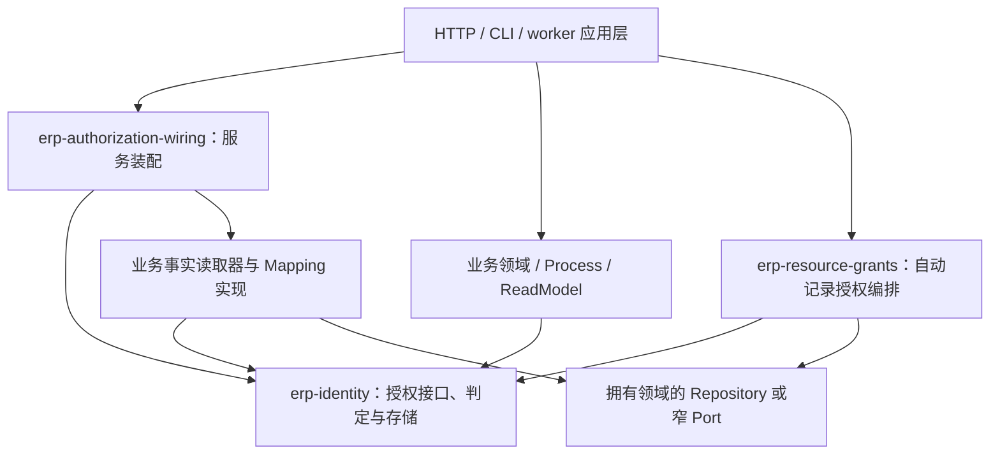
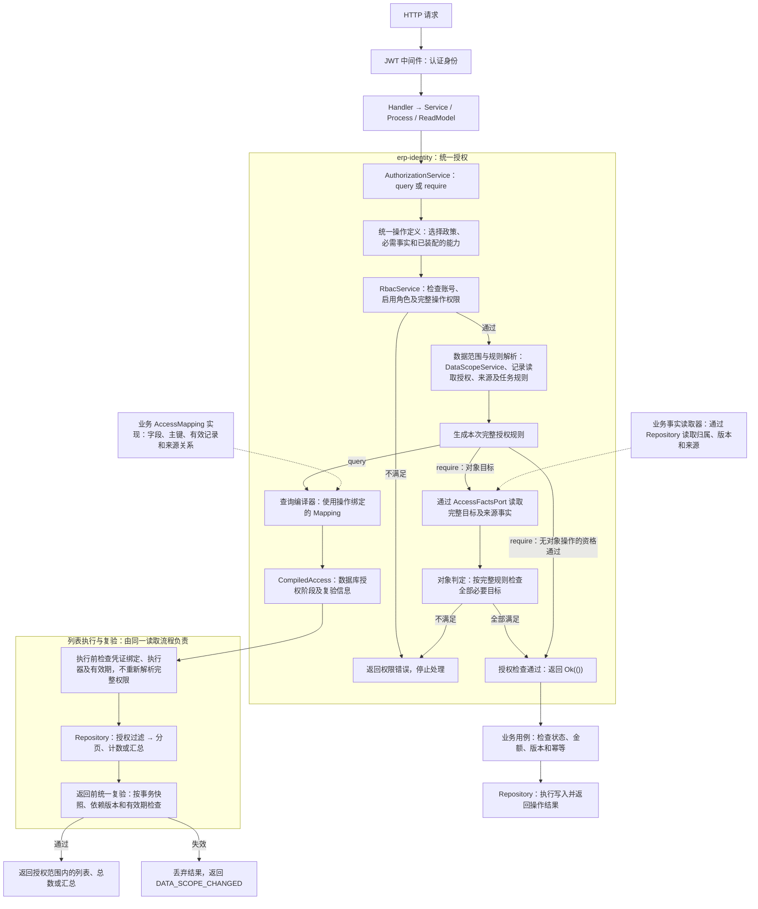
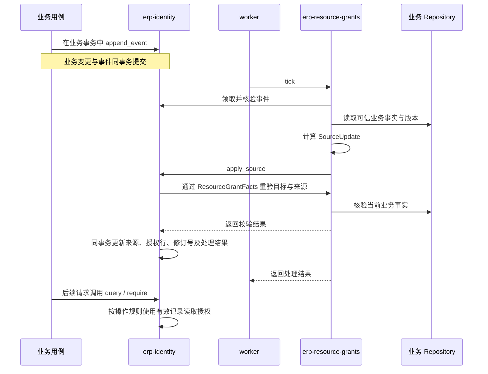

# ERP 权限系统设计

本文描述权限系统的目标架构、模块职责、依赖及运行时处理流程。当前代码与目标架构的差异、待改内容、实施顺序和验收条件见 [授权服务改进](../backend/crates/domains/erp-identity/docs/authorization-service-improvement.md)。

`erp-identity` 和 `erp-resource-grants` 已有实现；`erp-authorization-wiring` 为待建立的应用装配层。本文中的目标架构不表示当前代码已完成切换。

## 模块职责与依赖

| 模块 | 职责 | 接口与边界 |
| --- | --- | --- |
| [erp-identity](../backend/crates/domains/erp-identity/README.md) | 账号、角色、组织、操作定义、数据范围、访问判定、查询编译及授权持久化 | 提供 `AuthorizationService`、事实与 Mapping 端口、事件及来源管理；不得依赖业务领域、编排库、ReadModel 或应用。 |
| [erp-resource-grants](../backend/crates/orchestration/erp-resource-grants/README.md) | 根据业务事件和可信事实计算应有记录读取授权，编排发布、重算、对账与回填 | 依赖 identity 的公开事件及来源服务，通过拥有领域仓储读取业务事实，并实现 `ResourceGrantFacts`。不替代请求访问判定。 |
| `erp-authorization-wiring` | 集中装配事实读取器及 Mapping，构造进程共享的授权服务 | 位于 `backend/apps/erp-authorization-wiring/`，只负责应用装配；不定义授权政策或自动授权规则，不运行消费循环。 |
| 业务领域、Process、ReadModel | 提供真实归属、来源和版本，执行业务用例及查询 | 调用 identity 的 `query / require`；事实读取器及 Mapping 不自行组合权限规则。 |
| HTTP、CLI、worker 运行时 | 构造并持有共享服务，启动业务入口及后台循环 | HTTP 负责 JWT 认证；worker 调用 `ResourceGrantProcess`，管理启停、重试与对账循环。 |

下图为目标代码依赖方向，箭头表示“依赖”，不表示请求执行顺序。业务领域之间的事实读取继续遵守仓库的窄 Port 边界。



identity 定义“当前账号是否可以执行操作、读取对象”的规则；resource-grants 定义“业务事件应给哪个账号增加哪些记录读取来源”的自动授权规则。两类规则分别维护，最终的访问判定仍由 identity 执行。

装配层将业务提供的事实接口接入 identity，解决 identity 不能依赖业务领域的问题。worker 独立装配并调用 `ResourceGrantProcess`；自动授权计算不放入 authorization-wiring，访问查询不触发自动授权消费。

## 请求授权流程

下图规定管理端接口的目标处理流程。HTTP 层通过 JWT 认证身份，业务用例调用 `query` 或 `require`，由 identity 统一检查功能权限及操作要求的数据资格。目标架构由业务用例承担完整授权，HTTP 层只执行身份认证；权限目录和前端权限生成独立维护。



| 模块                         | 处理要求                                                                                                                                                                                                                   |
| ---------------------------- | -------------------------------------------------------------------------------------------------------------------------------------------------------------------------------------------------------------------------- |
| HTTP 认证与业务入口          | JWT 确认请求身份，Handler 调用受保护的业务用例。HTTP 层不安装 `with_permission` 鉴权中间件，不重复检查 RBAC。                                                                                                              |
| 统一操作定义与 `RbacService` | 根据操作确定授权政策和必需能力；检查当前账号及启用角色。额外必需权限由同一有效角色提供，独立入口资格按各自操作检查。                                                                                                       |
| 数据范围与规则解析           | identity 内部通过 `DataScopeService` 解析本次操作的有效范围及个人上限；按操作定义启用历史参与、记录读取授权、来源或任务资格。公司共享操作不读取无关范围。                                                                  |
| 记录读取授权                 | 仅在操作允许时加入有效记录读取分支。对象检查按本次目标读取授权；列表编译时由 identity 使用 Mapping 提供的资源主键，在数据库内关联有效授权及来源，不预加载账号全部授权 ID。                                                 |
| 查询编译器与 `AccessMapping` | identity 决定条件如何组合；Mapping 提供字段条件、有效记录和来源连接，并在原执行器读取所需事实版本。编译结果绑定身份、操作、Mapping、有效期及执行器会话。                                                                   |
| 对象判定与 `AccessFactsPort` | 事实读取器提供真实对象及完整来源；identity 检查必需事实并执行同一套授权规则。无对象操作只执行该操作要求的资格检查；只做对象检查不执行查询编译。                                                                            |
| 统一读取流程与业务仓储       | 领域公共读取方法统一负责 `query`、仓储执行及返回前复验。执行前检查凭证绑定、执行器和有效期；业务层与仓储不分别追加完整授权复验。授权过滤先于分页、计数和汇总。写操作在业务事务内完成授权、业务校验及写入，沿用同一执行器。 |

每个受保护的公共业务用例必须调用对应操作的 `query` 或 `require`，所有执行路径均须在返回业务数据或执行写入前完成授权。只需功能权限的操作使用 `require` 和 `AccessTarget::Operation`，不另设 HTTP 入口检查分支。CLI、worker 调用相同的受保护业务用例，不依赖 HTTP 中间件。

权限目录用于角色权限配置、按钮展示及前端权限生成，直接引用 identity 的统一操作定义，不依赖 `with_permission` 承载。

读取流程生成凭证后立即执行查询，不在编译完成后再追加一次完整复验。执行前的凭证绑定检查不重复读取账号、角色和数据范围。返回前由同一读取流程调用 `validate`；同一事务内按原快照及有效期检查，非事务读取按完整依赖版本复验，不以同一事务快照内的重复读取证明已发现事务外撤权。凭证延后使用或切换执行器时，必须重新取得相应读取阶段的授权。

普通范围读取按以下关系组合，是否启用读取补充由统一操作定义固定：

```text
基础范围 =（有效范围条款 OR 已开启的历史参与）AND 个人上限
读取范围 = 基础范围 OR 已开启的有效记录读取授权
最终数据资格 = 读取范围 AND 操作要求的其他独立范围
```

未配置个人上限时该条件为真，未开启的读取补充分支为假。记录读取授权不授予原单据的修改、提交资格；来源和任务操作按各自定义判断。

账号、权限或对象资格不满足时返回错误，不继续执行后续读取或写入。具备列表功能权限但数据范围为空时返回空结果。缺少操作、Mapping、事实或必需维度时返回接入错误；数据库错误保持原类别。复验失败时丢弃查询结果，授权状态变化按 `DATA_SCOPE_CHANGED` 处理。

## 共享服务

需要业务授权的进程启动时调用 `erp-authorization-wiring` 的统一入口，完成事实读取器和查询映射的装配，构造一个进程内共享的 `Arc<AuthorizationService>`。

HTTP、worker 将实例保存在 `Application`，需要业务授权的 CLI 命令将实例保存在自身命令运行时。`HttpState` 通过 `Application` 使用该实例；业务 Service、Process 和 ReadModel 通过构造函数接收共享实例。`Application::authorization()` 只克隆 `Arc`。

共享服务只保存数据库句柄、身份设施、固定操作定义、事实读取器和查询映射。账号、事务、候选对象和授权结果按调用传入或生成，不保存在共享服务中。账号权限、数据范围和对象事实每次检查时读取。

## 操作定义与业务接入

操作标识、权限编码、授权方式、额外必需权限及必需事实由 identity 统一定义。业务模块与权限目录引用同一份操作常量。权限目录维护说明及展示分组，权限生成器据此生成前端权限。

| 调用用途 | identity 接口 | 结果 |
| --- | --- | --- |
| 列表、计数、汇总及查询式导出 | `query(actor, permission, executor)` | 已编译的查询约束 `CompiledAccess` |
| 具体对象及批量对象操作 | `require(actor, permission, target, executor)` | `Result<()>` |
| 仅功能权限的操作 | `require`，目标为 `AccessTarget::Operation` | `Result<()>` |
| 查询功能资格、展示按钮 | `has_permission` 或 `permissions` | 功能资格，不代替业务授权 |
| 读取流程返回前复验 | `validate(access, executor)` | 凭证仍有效或返回错误 |

每个查询操作绑定一个 Mapping，同一 Mapping 可以由多个操作复用。调用方不传模型标识，不通过模型选择不同授权政策。对象与来源的必需事实由操作定义固定。

## 装配层设计

`erp-authorization-wiring` 位于 `backend/apps/erp-authorization-wiring/`，依赖 identity 及业务提供的事实读取器和 Mapping。应用运行时通过统一 `build` 入口取得共享的 `Arc<AuthorizationService>`，再注入业务服务。

装配层负责连接实现，identity 的 Builder 负责校验并固定服务。每个查询操作绑定一个 Mapping；事实读取器按资源接入。同一资源的事实读取器重复、操作重复绑定、资源不匹配及必需能力缺失均拒绝构造。

装配顺序为 Repository、事实读取器与 Mapping、授权服务、业务服务。事实读取器不得依赖需要授权服务的业务 Service。业务领域、Process 和 ReadModel 不依赖装配 crate；identity 不反向依赖装配 crate。

装配层不保存请求账号、事务或授权结果，不定义授权政策，不执行自动授权计算，不运行 HTTP 或 worker 循环。

## 业务事实与 Mapping

| 接口 | 业务实现提供的内容 | identity 的处理 |
| --- | --- | --- |
| `AccessFactsPort` | 对象身份、归属、版本、任务分配及完整来源关系 | 校验必需事实，执行具体对象的授权判定 |
| `AccessMapping` | 集合、主键、有效记录、事实字段条件及来源连接 | 编译列表授权条件，组合数据范围与有效记录读取授权 |
| `ResourceGrantFacts` | 记录授权目标及自动来源的可信业务事实 | 发布授权前校验目标与来源，控制事实版本和终止状态 |

事实通过本次执行器读取，不保存请求候选对象。业务实现只提供事实及查询映射，访问条件的与或组合、个人上限和读取补充由 identity 决定。

## 记录读取授权的生成与使用

记录读取授权分为生成、发布和访问使用三个阶段。identity 保存授权来源、授权行、修订号和事件状态；resource-grants 读取业务事实并计算授权结果；worker 驱动消费循环。



发布及访问必须满足以下要求：

1. 业务事件证据来自服务端确认的实际业务事实，事件与业务变更使用同一执行器提交。事件追加失败必须使业务事务失败。
2. 事件追加成功只表示待处理，不表示记录授权已经生效。需要区分就绪状态的业务入口通过 `source_readiness` 等能力查询，仍须独立执行访问授权。
3. resource-grants 按来源计算授权，使用 identity 的 `ResourceGrantService::apply_source` 发布。identity 通过 `ResourceGrantFacts` 重验目标及来源，执行幂等、事实版本、终止来源和修订号控制。
4. 授权发布失败只重试授权步骤，不重放审批、派工等原业务命令。事实读取失败必须返回错误，不得转换为空授权结果；乱序事件不得覆盖较新事实。
5. 明确终止的来源不得被重试、重算或回填恢复。多来源分别维护；撤销一个来源不删除其他有效来源。授权行、来源状态及受影响修订号必须同事务更新。
6. 管理端的人工授予、撤销、来源查询和受控重算继续经过 identity 的管理员资格检查；resource-grants 提供管理请求适配与业务事实校验。后台对账入口不得直接作为管理端接口。
7. 记录授权只补充统一操作定义允许的读取范围，不能替代功能权限，也不授予原单据的修改或提交资格。

worker 负责消费、失败恢复、有界对账、队列观测及停止时排空当前事务。resource-grants 不启动常驻循环，authorization-wiring 不管理 worker 生命周期。扩展入口与调用示例见 [erp-resource-grants README](../backend/crates/orchestration/erp-resource-grants/README.md)。

## 文档职责

本文维护模块职责、依赖、共享服务装配及请求和自动授权的运行时流程。[授权服务改进](../backend/crates/domains/erp-identity/docs/authorization-service-improvement.md) 独立维护待实施问题、目标接口、改造步骤、阶段通过条件及完成条件。

各 crate README 维护本模块的调用方式、扩展入口和代码导航。记录授权的业务接线与场景验收见 [记录授权改造](resource-authorization-design.md)。
