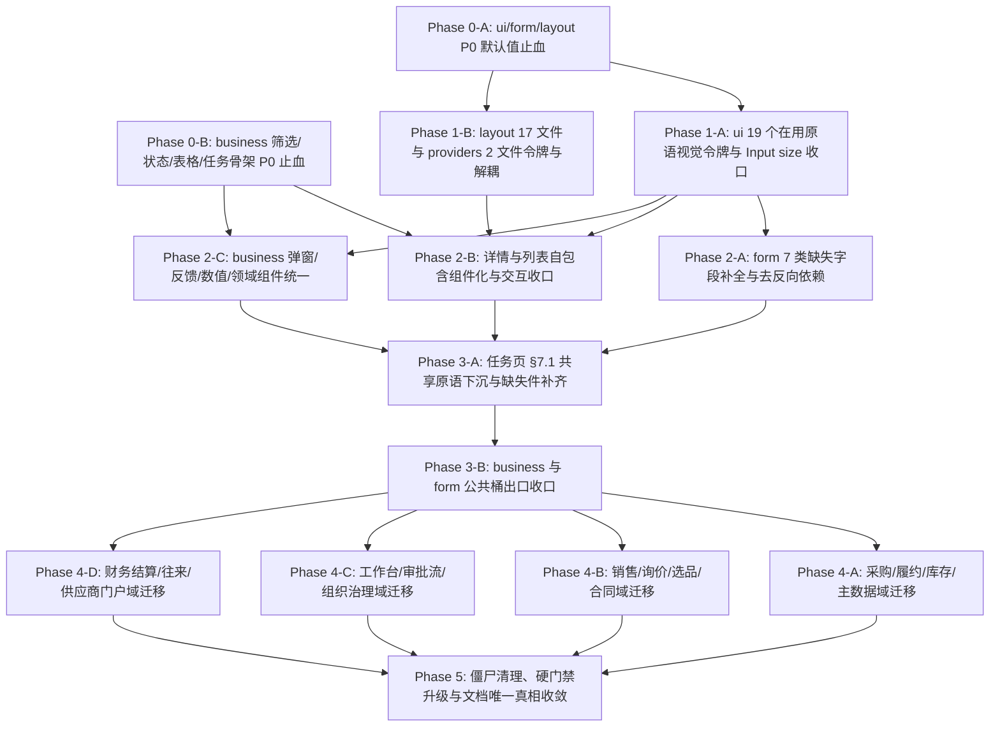

# ERP 共享组件设计系统统一封装全阶段重构实施计划（Multi-Agent Playbook）

> **配套权威规范**：[`docs/typography-design-system.md`](./typography-design-system.md)、[`docs/list-table-design-system.md`](./list-table-design-system.md)、[`docs/detail-page-design-system.md`](./detail-page-design-system.md)、[`docs/task-page-design-system.md`](./task-page-design-system.md)  
> **前置基线**：[`docs/typography-refactoring-plan.md`](./typography-refactoring-plan.md)、`erp-client/app/globals.css`、`erp-client/scripts/check-ui-theme.mjs`、`erp-client/scripts/check-feature-cycles.mjs`  
> **目标目录**：`/Users/huangjiajiang/Development/erp/erp-client`  
> **审计基线**：基于 `erp-client/components/` 全量 **186 / 186** 文件（`ui/` 68 + `business/` 80 + `form/` 19 + `layout/` 17 + `providers/` 2）及 `features/`（2,151 文件）与 `app/`（124 文件）实证消费审计编制。  
> **核心目标**：系统性消除**组件默认即违约**、**依赖 `globals.css` 祖先注入（967 行，占 57%）**、**跨层多轨分裂**、**任务页核心原语 67% 滞留 `features/*`**、**静态门禁豁免 `components/`** 五大根因，实现“任意业务页引用共享组件即可默认保证四套设计系统一致”且每阶段独立绿灯交付。

---

## 0. 全局执行铁律（所有执行 Agent 必读）

任何认领本方案某个 Phase 或 Batch 的 Agent，在动手修改前必须严格遵守以下约束：

1. **严格按阶段边界与文件所有权修改**：只修改当前 Batch 明确授权的文件，不得顺手重构无关业务逻辑、接口契约或后端状态机；涉及跨目录迁移的原语，必须先在旧路径保留 1 行 `export * from ...` 兼容代理，待全仓迁移完成后的收口阶段再统一移除。
2. **保护自动化 DOM `id`、E2E 契约与权限显隐**：修改 `data-slot` 或自动化 DOM `id` 默认派生前，必须先全局检索 `e2e/` 与 `erp-client/features/` 引用；未经明确授权不得改动仓库根目录 `e2e/`。
3. **不新增前端单元测试文件**：`erp-client` 无前端单元测试体系，禁止新增 `*.test.*` / `*.spec.*`。
4. **守住排版豁免边界**：保护 `components/ui/input.tsx` 与 `components/ui/textarea.tsx` 的 `text-base md:text-body-compact`（iOS 防缩放特例）；保护 `components/business/paper-document.tsx` 非紧凑打印分支（[`docs/typography-design-system.md`](./typography-design-system.md) §5.2 白名单）；不修改根 `html` 字号。
5. **零循环依赖与金额精度红线**：严禁 `components/` 反向导入 `@/features/*`，严禁 `form/` 反向整桶导入 `@/components/business`；金额计算必须保持 `BigInt` / `FixedDecimal`。
6. **每阶段 / 每 Batch 合并前必过全量前端门禁**（在 `erp-client/` 目录执行）：
   ```bash
   npm run lint && npm run format:check && npx tsc --noEmit && npm run build
   ```
   若格式未对齐，先执行 `npm run format` 再重新检查。

---

## 1. 现状基线与重构目标指标看板

| 审计维度 | 当前实证基线（重构前） | 重构目标（Phase 5 收口后） | 主要落地阶段 |
| :--- | :--- | :--- | :--- |
| **共享组件覆盖基线** | `components/` 全量 **186** 文件（`ui/` 68、`business/` 80、`form/` 19、`layout/` 17、`providers/` 2） | 在用组件 100% 对齐 4 套设计系统，23 个零引用僵尸清零 | Phase 0 – Phase 5 |
| **默认即违约 P0 项** | **9 项**（日期 36px 错高、必填 `*` 漂离 8px、9 实体/多选树缺冰蓝态、列表 1200–1359px 错位 4px、筛选条默认旧内联、`BusinessFailureState` 丢预设、金额缺 `.num`/`compact` 覆盖色、任务原语外置+门禁漏检、`PersonPickerDialog` 失范） | **0 项**（全部默认值即符合规范） | Phase 0 |
| **`globals.css` 祖先强耦合** | **967 行**（`globals.css:630-1597`，占全文件 **57%**）依赖 `.erp-detail-workspace-page` / `.erp-list-workspace-page` / `[data-slot]` 注入 | 核心表单网格、内联编辑表等样式内聚为自包含组件，消除脱离宿主即失样式的隐患 | Phase 2 + Phase 4 + Phase 5 |
| **任务页 §7.1 原语沉淀率** | 18 个源码文件中仅 **6 个（33%）** 在 `components/business/`，**12 个（67%）** 及主壳 `WorkspaceProcessingPane` 滞留 `features/*` | 通用任务页原语与缺失的 `DecisionKpiBar` / `TaskRiskSummaryBar` / `FulfillmentRouteBadge` 100% 沉淀至 `components/business/task/` | Phase 3 |
| **`business/index.ts` 出口治理** | 仅导出 **33 / 77** 非索引代码文件，漏出 6 个核心任务/预览模块且混入 7 个零引用死导出 | 全量规范组件统一收口导出，0 死导出，过渡旧组件明确标注 `@deprecated` | Phase 3 + Phase 5 |
| **跨层反向依赖** | `layout/` 6 文件 + `providers/query-provider.tsx` + `business/` 2 文件反向依赖 `@/features/*`；`form/` 2 文件反向整桶导入 `business` | **0 处**反向依赖，纳入 `check-feature-cycles.mjs` 自动拦截 | Phase 1 + Phase 2 + Phase 3 + Phase 5 |
| **`features/` 绕过与覆写** | 裸 `ui/select`（17 文件/24 处）、无图标状态 `ui/badge`（109 文件/193 处）、`Input` 高度/字号覆写（69+30 处）、`MoneyValue` 排版覆写（159 处）、非豁免 `font-bold`（30 处）、多余 `leading-*`（165 处）、幽灵类 `h-control-md`（1 处） | 业务绕过与违规覆写全部清零，仅保留设计系统允许的结构性传参 | Phase 4 |
| **静态门禁盲区** | `check-ui-theme.mjs:443` `isFeature` 豁免 `components/` / `app/` / `lib/`，漏检 `hooks/`，未检 `ui/select`、无图标 `Badge`、`font-bold`、`leading-*` 与无效 spacing 令牌 | 解除目录豁免，升级为覆盖全仓的 8 项硬门禁规则 | Phase 5 |

---

## 2. 全阶段总览与依赖拓扑



> **为什么采用该推进顺序？**
> - **Phase 0 先修共享原语默认即违约**：不改动任何 `features/` 业务页即可立即修复全站日期控件错高、必填星号漂离、9 个实体选择器不亮冰蓝、列表 1200–1359px 错位、`BusinessFailureState` 丢预设等 P0 缺陷，投入产出比最高。
> - **Phase 1 → Phase 2 先强壮底座再补缺口**：先在 `ui/` 补齐 `Input size` 变体、清理巨圆角/双透明焦点环并统一 `layout/` 骨架，再在 `form/` 与 `business/` 补全缺失字段与自包含组件，避免在旧原语上重复打补丁。
> - **Phase 3 集中处理任务页原语下沉与 `business/index.ts` 收口**：先保留旧路径 `export *` 代理再切换调用方，确保跨 feature 迁移全程编译绿灯。
> - **Phase 4 将全仓 48 个 `features/*` 目录严格切分为 4 个零重叠 Batch**，支持 4 个 Agent 完全并行迁移存量绕过调用点。
> - **Phase 5 最后拔掉僵尸代码、清理兼容代理、升级全仓硬门禁并同步 4 处漂移文档**，彻底锁死防回流。

---

## 3. 分阶段详细执行说明书

### Phase 0：P0 止血——修复“默认即违约”与跨页高危 Bug

- **前置依赖**：无
- **并行方式**：Batch 0-A 与 Batch 0-B 文件完全互斥（仅 `app/globals.css` 按行段划分，建议 0-B 在 0-A 提交 `globals.css` 后再合入 L1247 单行，或由协调者合并），可 2 路并行。
- **目标**：不改业务页面，仅修正共享组件自身的错误默认值、隐藏契约失效与跨宿主断点缺陷。

#### Batch 0-A：`ui` / `form` / `layout` 核心 P0 止血

- **独占文件**：`components/ui/date-picker.tsx`、`components/ui/field.tsx`、`components/ui/input.tsx`、`components/ui/textarea.tsx`、`components/ui/tabs.tsx`、`components/ui/description-list.tsx`、`components/ui/switch.tsx`、`components/ui/toast.tsx`、`components/form/date-field.tsx`、`components/form/field-frame.tsx`、`components/form/money-input.tsx`、`components/form/text-field.tsx`、`components/form/textarea-field.tsx`、`components/form/select-field.tsx`、`components/form/multi-select-field.tsx`、`components/form/single-file-field.tsx`、`components/business/shell.tsx`、`components/layout/workspace-frame.tsx`、`components/layout/workspace-tabs.tsx`、`app/globals.css`（L239–252、L682、L1565–1595 暗色阴影段）。

1. **日期控件默认高度 32px 统一与筛选契约补齐**
   - `components/ui/date-picker.tsx`（L123、L308、L438、L445、L455–462、L680、L687、L700–707）与 `components/form/date-field.tsx`（L69–85、L148–164）：
     - 无 `fieldLabel` 时 `DatePicker`、`DateRangePicker`、`DateField` 默认 `size` 从 `"lg"`（36px）收口为 `"default"`（32px `h-control`）；
     - `DateTimePicker`、`DateTimeRangePicker`、`DateTimeField` 开放 `size?: "sm" | "default" | "lg"`，默认 `"default"`，解除 `size="lg"` 硬编码；
     - 4 类日期选择器展示值文本统一补 `.num`；
     - `DateTimePicker`（L438, L455）与 `DateTimeRangePicker`（L680, L700）补齐 `data-has-value` 与 `data-slot="date-picker-value"`，激活 `globals.css:750,838,1248,1523` 柔底与冰蓝高亮。
   - **兼容性扫描**：提交前检索全仓明确需要 36px 的独立表单，如有特殊大按钮表单显式保留 `size="lg"`。

2. **表单必填 `*` 贴合 2px、禁用标签置灰与无效态文本保护**
   - `components/form/field-frame.tsx:44,47`：将裸写 `<span className="text-destructive">*</span>` 替换为 `<RequiredMark />`（`ui/required-mark.tsx:5-6` 自带 `data-slot="required-mark"`、`leading-none` 与 `aria-hidden="true"`）；同时新增 `disabled?: boolean` 并向 `<Field>` 透传 `data-disabled={disabled ? "true" : undefined}`。
   - `components/ui/field.tsx:109,166`：`FieldLabel` 间距从 `gap-2`（8px）收敛为 `gap-1.5`（6px），配合 `ui/label.tsx:14` 的 `[&>[data-slot=required-mark]]:-ml-1`（-4px）严格落地 **2px** 贴合规则；内嵌卡片态 `rounded-2xl` 改 `rounded-lg`；`FieldSeparator`（L166）移除硬写浅灰 `bg-background`，改用 `bg-card` 或继承纯白/浮层背景变量，避免纯白详情页/弹窗内露灰块。
   - `components/form/{text,textarea,select,multi-select,date,single-file}-field.tsx`：统一向 `FieldFrame` 传入 `disabled`，并移除 `multi-select-field.tsx:58` 私有 `opacity-60` 补丁。
   - `components/ui/input.tsx:12` & `components/ui/textarea.tsx:10`：显式补 `text-foreground`（保留 `text-base md:text-body-compact`），防止 `Field` 无效态 `data-[invalid=true]:text-destructive` 渗入用户输入文字。

3. **金额输入默认 `.num` 与小数键盘**
   - `components/form/money-input.tsx:21-30` & `components/form/text-field.tsx:91-112`：`MoneyInput` 及 `TextField`（当 `money={true}` 或 `type="number"` 时）默认合并 `num` 类，并默认附带 `inputMode="decimal"`（允许外部覆盖）。

4. **Tabs 焦点环修复、DescriptionList 容器查询与 Switch/Toast 令牌修复**
   - `components/ui/tabs.tsx:84-86`：去掉 `!important` 的 `border-transparent!`，改为普通 `border-transparent`，恢复 `focus-visible:border-primary` 与 `dark:data-active:border-input`。
   - `components/ui/description-list.tsx:11-12`：根节点补 `@container`，将 `columns="three"` / `"four"` 的视口断点 `lg:grid-cols-3` / `xl:grid-cols-3` / `xl:grid-cols-4` 改为 `@container` 容器查询断点（对齐 `WorkspaceFactGrid`）。
   - `components/ui/switch.tsx:31`：将滑块 `bg-white` 改为语义令牌 `bg-primary-foreground`。
   - `components/ui/toast.tsx:102`：`ToastDescription` 补 `whitespace-pre-line`（修复 `query-provider.tsx:32-35` 多行报错换行被折叠）。

5. **非 iframe 容器查询、暗色同步与快捷键透传**
   - `components/business/shell.tsx:87-99`：在 `ErpAppShell` 的 `<SidebarInset>` / `[data-slot="erp-shell-content"]` 补声明 `@container/workspace`。
   - `components/layout/workspace-frame.tsx:75-86`：iframe 键盘桥接补转发 `Cmd/Ctrl+B` 至宿主侧栏切换。
   - `components/layout/workspace-tabs.tsx:162-185`：与 `data-viewport-density` 同构，将宿主 `html.dark` 状态同步到所有子 iframe。
   - `app/globals.css:239-252,682,1565-1595`：为 `.dark` 块补齐 `--shadow-2xs..xl`、`--shadow-footer` 及滚动微影暗色阴影变量。

#### Batch 0-B：`business` 筛选、反馈、数值、表格与任务骨架 P0 止血

- **独占文件**：`components/business/selectors.tsx`、`components/business/entity-comboboxes.tsx`、`components/business/tree-combobox.tsx`、`components/business/list-workspace-styles.ts`、`components/business/list-workspace-filter-bar.tsx`、`components/business/feedback-states.tsx`、`components/business/values.tsx`、`components/business/funds-scope-banner.tsx`、`components/business/table-row-actions.tsx`、`components/business/data-table-controls.tsx`、`components/business/data-table.tsx`、`components/business/data-table-header.tsx`、`components/business/workspace-task-pane.tsx`、`components/business/unified-task-workbench.tsx`、`app/globals.css`（仅 L1247 补充 1 条 `[data-slot="multi-tree-combobox"]` 规则）。

1. **9 个实体选择器 & 树形选择器补齐冰蓝态与防闪烁**
   - `components/business/selectors.tsx:139,151,161`：`BusinessObjectCombobox` 补输出 `data-has-value={selected ? "true" : undefined}`，`InputGroupAddon` 补 `data-filter-label=""` 与 `pr-0 text-muted-foreground/80`；`showClear` 在 `disabled` 时自动抑制。
   - `components/business/entity-comboboxes.tsx:52-510`：清理 `:227,339,391,443` 4 处缺编码时回退展示内部 UUID 的行为；清理 `:230,286,342,394` 4 处默认噪声徽章 `{ label: "可选", tone: "neutral" }`。
   - `components/business/tree-combobox.tsx:369-372,395,598,617,673`：`TreeCombobox` 的 `onInputValueChange` 接入 `remoteSearchFromInputChange`；`disabled` 时隐藏清除按钮并补 `allowClear`/`size`/`onBlur`；`MultiTreeCombobox` 补 `filterLabel`、空摘要淡灰占位（L617）及 `ComboboxEmpty` 感知 `loading`（L673）；同步在 `app/globals.css:1247` 补入 `[data-slot="multi-tree-combobox"] > [data-slot="combobox-trigger"]`。

2. **列表通栏断点对齐与筛选条默认托盘模式**
   - `components/business/list-workspace-styles.ts:3`：`min-[75rem]:px-page-inline-lg` → `@[70rem]/workspace:px-page-inline-lg`（与 `detail-workspace-styles.ts:6`、`globals.css:663-669` 严格一致，消除 1200–1359px 左右 4px 缝隙）。
   - `components/business/list-workspace-filter-bar.tsx:267-268`：先检索全仓 `<ListWorkspaceFilterBar`（约 44 处），仅对确需旧版内联布局的调用点显式补 `morePresentation="inline"`，随后将组件默认值改设为 `"popover"`（同时支持语义别名 `"tray"`），删除死属性 `_moreSize`。

3. **恢复 `BusinessFailureState` 语义渲染 & 修复金额双缺陷**
   - `components/business/feedback-states.tsx:250-315,361,383-481,556-564`：渲染层真实消费 8 类失败预设的 `icon`、`variant`、`tone`、`label`（语义柔和底/边框、`StatusBadge`，故障类用 `role="alert"`）；折叠细节改为显式 `collapsibleDetails`（默认可折叠，解除 `id`/`idPrefix` 突变耦合）；`AsyncSectionState:556-564` 透传 `error` 给 `BusinessFailureState`。
   - `components/business/values.tsx:143,362,372-377,452-454,469,504,546-556`：`MoneyValue` 在 `inheritColor={true}` 时禁止 `moneyMagnitudeClasses` 覆盖颜色；新增 `size="compact"`（`text-value-compact font-semibold tracking-tight`，20px）并替换 `funds-scope-banner.tsx:131,148` 的外层手写排版；删除 L469 `leading-5` 补丁；`StatusTrackSummary` 开放 `appearance="quiet"`；`QuantityValue`/`RateValue` 补齐 `inheritColor` 与完整 `tone`。

4. **表格与任务骨架真实 Bug 修复**
   - `components/business/table-row-actions.tsx:21,93-106`：`destructive` 动作保护 `text-destructive group-hover/row:text-destructive` 防止行悬停染蓝；移除 L101 向 `<Link />` 多余透传的 `type="button"`。
   - `components/business/data-table-controls.tsx:337`：`Object.keys(rowSelection).length` → `Object.values(rowSelection).filter(Boolean).length`。
   - `components/business/data-table.tsx:442`：`scrollable={true}` 时 `thead` 的 `z-40` 收敛为 `z-20`（解除与悬浮 Dock `z-40` 冲突）。
   - `components/business/data-table-header.tsx:161-168,189-212`：键盘调宽复用 `data-table-resize.ts:56-68` 读取 DOM 实际列宽与语义 `min-width`，修复骤缩跳变。
   - `components/business/workspace-task-pane.tsx:173-199,308-310`：嵌入式分支（`!layout`）补传 `footerSummaryHostRef`。
   - `components/business/unified-task-workbench.tsx:35,296-298,414,508,592`：删除死字段 `defaultTab`；修正默认右轨宽度回落逻辑为 `28%`；`fillBody` 的视口 `lg:` 改为 `@container`。

#### Phase 0 验收标准
- `rg "bg-white|border-transparent!|min-\[75rem\]" erp-client/components/` 返回 **0 命中**（不含合法注释）。
- 全站 `<DateField>` / `<DateTimeField>` 默认渲染高度均为 32px（`h-control`），全站必填 `AppField` `*` 紧贴标签 2px；9 个实体选择器筛选有值即亮冰蓝。
- `npm run lint && npm run format:check && npx tsc --noEmit && npm run build` 全部通过。

---

### Phase 1：底层 `ui/` 与 `layout/` / `providers/` 视觉令牌深度收口

- **前置依赖**：Phase 0-A 完成
- **并行方式**：Batch 1-A 与 Batch 1-B 目录完全正交，2 路并行。
- **目标**：消除 `ui/` 19 个在用原语的圆角/焦点环/弹窗越权与 `Input` 缺尺寸变体问题；统一 `layout/` 17 文件与 `providers/` 2 文件的骨架、加载态与分层解耦。

#### Batch 1-A：`components/ui/` 19 个生产在用原语收口

- **独占文件**：`components/ui/{input,skeleton,item,attachment,accordion,calendar,calendar-navigation,empty,scroll-area,progress,avatar,chart,file-upload,file-upload-selection,command,sidebar,input-group,dropdown-menu,context-menu,select,alert,button,table,kbd}.tsx`。

1. **为 `ui/input.tsx` 新增 `size` 变体（根除高覆写诱因）**：支持 `size?: "sm" | "default" | "lg"`（对应 `h-control-sm` 28px、`h-control` 32px、`h-control-lg` 36px），三档均保留 `text-base md:text-body-compact` 与 `text-foreground`。
2. **清除 shadcn 遗留 `rounded-2xl`/`3xl` 与双重透明 `ring-ring/30..50`**：
   - `skeleton.tsx:7`（`rounded-md`）、`item.tsx:38,90,132,145`（`rounded-lg` + 标准 `border-primary ring-3` + `ItemDescription` 降为 `text-xs`）、`attachment.tsx:10,17,51,189`（`rounded-md`/`rounded-lg`、`bg-destructive-soft`、清 `scrollbar-none`）、`accordion.tsx:12,55`（`rounded-lg` + 为 `AccordionTrigger` 补回键盘焦点环）、`calendar.tsx:59,106,135,312` & `calendar-navigation.tsx:63,80,233,254,337`（`rounded-md`、标准焦点环、补 `.num`）、`empty.tsx:10,37,74-76`（`rounded-lg`、修正 `EmptyDescription` 渲染 `<p>`）、`scroll-area.tsx:21`（标准焦点环、替换 `rounded-[inherit]`）、`progress.tsx:32`（`rounded-full`）、`avatar.tsx:94`（补 `.num`）、`chart.tsx:194,284,351`（Tooltip 改 `rounded-lg border-border/90 shadow-md`，数值改无衬线 `.num` 取代 `font-mono`）。
3. **上传与命令弹窗合规化**：
   - `file-upload.tsx:308,322,384,424,433,592,603`、`file-upload-selection.tsx:54,68,103,174`、`command.tsx:53,183`：弹窗改用标准 `DialogContent size="xl"` / `size="md"`（删 `sm:max-w-4xl`/`sm:max-w-lg`）；拖拽聚焦用 `border-primary ring-3`；移除 `--overlay` 二次透明稀释；`selectionError` 改 `text-xs`；文件大小与计数补 `.num`；快捷键改 `text-tiny`。
4. **微件与菜单细节收口**：
   - `sidebar.tsx:187,258,331,455,507-518,599,624,649,656,717`：子菜单项统一 `rounded-md`、交互底与焦点环；`SidebarMenuBadge` 改 `text-tiny num`；移动端抽屉改 `showCloseButton={false}`。
   - `input-group.tsx:68,100`：修复 `InputGroupButton size="sm"` 空串映射为 `h-control-xs`；`InputGroupText` 补 `data-slot="input-group-text"`。
   - `dropdown-menu.tsx:106,159,271` & `context-menu.tsx:115,162,265`：破坏项聚焦改 `bg-destructive-soft`；修复 `ContextMenuSubContent` `className` 覆盖顺序；快捷键改 `text-tiny`；去掉 `min-w-[96px]`。
   - `select.tsx:171`（分隔线 `bg-grid`）；`alert.tsx:64`（无 `AlertTitle` 单段升为 `text-body-compact`）；`button.tsx:21`（删冗余 `dark:bg-destructive/20`）；`table.tsx:79`（不可排序列取消默认 `hover:bg-muted`）；`kbd.tsx:16-18`（对齐 `KbdGroup` 类型与渲染标签）。

#### Batch 1-B：`components/layout/` 与 `components/providers/` 收口与解耦

- **独占文件**：`components/layout/` 全部 17 个文件、`components/providers/` 全部 2 个文件、`lib/` 新增共享常量（如 `erp.token` 键名与壳层 z-index 常量）、`app/globals.css` 壳层交互令牌段。

1. **快捷搜索与系统反馈面板**：
   - `layout/workspace-quick-search.tsx:189,289,296`：`display.secondary` 与单据类型标签升为 `text-xs`，`⌘K` 复用 `ui/kbd.tsx`。
   - `layout/system-feedback-panel.tsx:137,211,227,231,272,358`：删 `leading-5`/`leading-relaxed`；卡片与分段容器 `rounded-xl` → `rounded-lg`；分段按钮与 `<summary>` 改统一焦点环。
2. **加载占位纯白化与令牌收口**：
   - `layout/page-pulse.tsx:8,46-54` & `layout/route-loading.tsx:4`：替换为纯白通栏骨架（消费 `ui/skeleton.tsx`，去除旧灰底 `max-w-shell`/`p-5`/`animate-pulse`/`h-[28rem]`），与 `DetailWorkspaceSkeleton` 对齐。
   - `layout/workspace-{top-nav,tab-bar,quick-search,sidebar-nav}.tsx`：将 8 档硬编码 `bg-foreground/[0.038..0.1]` 收敛至 `globals.css` 统一交互底色令牌；`w-15` → `w-nav-icon`、`h-7` → `h-control-sm`；`workspace-tab-bar.tsx:304` 计数补 `.num`；`nav-delivery-overlay.tsx:100` 收敛 `z-[100]`。
3. **`providers/` 收口与 `layout/` 反向依赖解耦**：
   - `providers/auth-session-provider.tsx:67,84,120`：补 `role="status"`；提取共享 `"erp.token"` 常量与 `workspace-tabs.tsx:448` 复用。
   - 将 `providers/query-provider.tsx:15` 及 `layout/` 6 个文件对 `@/features/*` 的直接静态导入改为通过 `lib/` 纯注册器/上下文接口或回调注入解耦（`components/layout` 与 `providers` 不再静态依赖具体 feature 模块）。

#### Phase 1 验收标准
- `components/ui/` 在用原语及 `components/layout/`、`components/providers/` 内零 `rounded-2xl`/`rounded-3xl`（除全站唯一允许的列表底部悬浮胶囊容器）与双重透明 `ring-ring/30..50`。
- `rg 'from "@/features/' erp-client/components/layout erp-client/components/providers` 结果为 **0 命中**。
- `npm run lint && npm run format:check && npx tsc --noEmit && npm run build` 全部通过。

---

### Phase 2：表单体系补全、解耦 `globals.css` 魔法契约与业务弹窗/组件统一

- **前置依赖**：Phase 0 + Phase 1 完成
- **并行方式**：Batch 2-A、Batch 2-B、Batch 2-C 文件互斥，3 路并行（注：2-A 若需下沉无业务耦合的单/多选 Combobox 基元，可新建独立文件 `components/ui/option-combobox.tsx` 或由协调者安排 2-A 在 2-B 之后调整 import）。
- **目标**：补全 `form/` 缺失字段与去倒置；将详情表单网格与内联表升级为自包含组件；全面统一 `business/` 弹窗、反馈、单元格与列表微件。

#### Batch 2-A：`components/form/` 全覆盖补齐与去倒置

- **独占文件**：`components/form/` 全部 19 文件 + 新增 7 个字段文件 + `components/ui/option-combobox.tsx`（若抽离无业务耦合 Combobox 底座供 `form/` 与 `business/` 共享）。

1. **补齐 7 类缺失高频表单字段**（统一基于 `FieldFrame` + `useFieldA11y` + `useAppForm`）：
   - `CheckboxField`（收编 67 个业务文件裸用 `ui/checkbox`）
   - `SwitchField`（收编 `ui/switch`）
   - `RadioGroupField`（收编 `ui/radio-group` 分段/单选）
   - `MoneyField`（整合 `MoneyInput` 与 `TextField(money)`，默认 `.num` + `inputMode="decimal"` + 可选 `¥` 前缀）
   - `DateRangeField`（对齐 32px 默认高度与 `.num`）
   - `MultiFileField`（承接 `business/invoice-files-field.tsx` 通用多文件能力）
   - `ReadOnlyField`（落地 [`docs/detail-page-design-system.md`](./detail-page-design-system.md) 法则 5“带锁只读轻表面”）
2. **修复现有 8 类字段一致性与自动聚焦**：
   - `SelectField`/`MultiSelectField`/`DateField`/`DateTimeField`/`SingleFileField` 补齐 `name={field.name}`，确保 `api-errors.ts:139-141` 服务端校验报错自动聚焦全覆盖。
   - 统一 `single-file-field.tsx`、`pdf-upload-field.tsx`、`evidence-upload-field.tsx` props 契约（均开放 `className`、`density`、`hideLabel`、`selectedDescription`、`uploadLabel`，删除 `pdf-upload-field.tsx:33` 硬编码 `"上传合同 PDF"`）。
   - `MultiSelectField` 补 `hideLabel`、`size`、`inputClassName`、`onValueChange`；`TextareaField` 补可选 UTF-8 字节/字符计数（`.num` + 85% 预警）与 `Ctrl/Cmd+Enter`；`field-a11y.ts:12` 放宽 `description?: ReactNode` 并以 `useId()` 防撞。
3. **修复 `SubmitButton`、`FormValidationSummary` 与反向依赖**：
   - `submit-button.tsx:38-50`：取消默认硬编码 `id="form-submit"`（仅显式传 `id` 时输出）；避免在横排 footer 中用 Fragment 注入 `<FormError>` 撑坏布局（改为显式 `errorPlacement`）。
   - `form-validation-summary.tsx:6-24`：支持直接读取 `useFormContext()`、开放 `className`/`id`，复用 `toFieldErrors` 修复 `{ message }` 对象渲染为 `[object Object]` 的 Bug。
   - 将无业务耦合的 `OptionCombobox`/`MultiOptionCombobox` 底层提取至独立模块（`form/` 与 `business/` 共同引用），彻底切断 `form/select-field.tsx:5` 与 `form/multi-select-field.tsx:5` 对 `@/components/business` 整桶的反向导入；同步在 `form/index.ts` 补齐全部公共导出。

#### Batch 2-B：详情/列表自包含组件化与表格/筛选微件收口

- **独占文件**：`components/business/detail-workspace.tsx`、`detail-workspace-styles.ts`、`list-workspace.tsx`、`list-workspace-filter-bar.tsx`、`list-workspace-styles.ts`、`list-filter-popover.tsx`、`list-data-table.tsx`、`list-selection-bar.tsx`、`data-table*.ts(x)`、`table-cells.tsx`、`table-toolbar.tsx`、`filter-chip.tsx`、`multi-option-combobox.tsx`、`selector-query-feedback.tsx`、`icon-action-button.tsx`、`combobox-refresh.tsx`。

1. **详情页自包含组件化（消除 `globals.css` 魔法 `data-slot` 依赖）**：
   - 在 `detail-workspace.tsx` 新增并导出 `DetailFormGrid`（内聚原 `globals.css:744-840` 柔底网格与只读输入样式，脱离 `.erp-detail-workspace-page` 仍生效）与 `DetailInlineTable`（内聚原 `globals.css:841-890` 无框内联编辑表样式）；`globals.css` 暂保留旧选择器至 Phase 4 全站迁移完再删。
   - `DetailWorkspaceMetrics`（L635）与 `DetailWorkspaceFacts`（L641）由视口断点改用 `@container` 容器查询；标记废弃 `DetailWorkspaceChrome` 吸顶 `summary` 槽（L191,426-433）；新增 `DetailWorkspaceActionButton`（`tier="primary" | "quiet" | "quiet-danger"`）统一动作分级；`detail-workspace-styles.ts:41` `h-7` → `h-control-sm`。
2. **列表与 DataTable 契约收口**：
   - `data-table-layout.ts:3-25` 新增 `"actions"` 语义列宽档位，消除每个列表页在 `tableClassName` 手写 `[&_[data-column-id=actions]]:w-32`。
   - `data-table.tsx:131` 将 `showToolbarSummary` 默认值改为 `false`（符合 §8.3 不与分页条重复展示总数）；`data-table-body.tsx:118-123,308-322` 默认空/错态复用 `BusinessEmptyState` 与 `BusinessFailureState(error)`。
   - `list-workspace.tsx:269-273,544-550`：默认按 `Boolean(selectionBar)` 启用悬浮 Dock（消除漏传 `selectionBarOpen` 静默退化风险）；以显式 `data-slot="list-work-surface"` 撑满高度规则替代脆性 `:last-child`；将 `list-workspace-styles.ts` / `table-toolbar.tsx:152` / `list-filter-popover.tsx:204` 的 `px-4` 收敛为 `--scaffold-px`。
   - `table-cells.tsx:75-216`：`TableSwitchCell` 补中间态 `text-tiny` 琥珀微标槽位，无写权分支支持 `appearance="quiet"` 与 `className`；新增 `TableStatusActionCell` 封装可点击状态按钮与 `stopPropagation()`；`TableIdentityCell` 自动字符串 `title` 兜底；`TableTextCell` 补 `text-foreground/90`。
   - `list-selection-bar.tsx:199` 修正「全选本页」为 13px，并封装零可执行项自动降级 `variant="secondary"`。
   - 物理高度与微件细节：`table-row-actions.tsx`（`h-control-sm`/`min-h-control`）、`multi-option-combobox.tsx`（`min-h-control-sm`、补省略号）、`filter-chip.tsx`（`h-control-xs`、`ring-3`、复用 `XIcon`）、`data-table-controls.tsx:87,347,371`（`py-table-pagination-block`、`PopoverTitle` 15px、去 `w-[4.5rem]`）、`list-filter-popover.tsx:72` & `list-workspace-styles.ts:22` & `ListFilterRangeField`（`tabular-nums` → `.num`、补 `htmlFor`）、`selector-query-feedback.tsx:22-42`（改 `text-xs`、`failed` 用 `text-destructive`、`noScope` 隐藏重试）、`icon-action-button.tsx:14-45`（改 `next/link`、支持 `href+disabled`、原生 `id` 为主、去重复 `id` 透传）、`combobox-refresh.tsx:63-65`（补 `aria-hidden`/`size-3.5`）。
   - DOM ID §7.2 对齐（`list-workspace-filter-bar.tsx:342,414`、`list-filter-popover.tsx:141`、`list-data-table.tsx:87-91`）：先检索 `e2e/` 测试断言，若存在旧 ID 断言则同步更新或提供过渡兼容配置，绝不静默破坏自动化测试。

#### Batch 2-C：`business/` 弹窗、反馈、值、编辑与单据组件统一

- **独占文件**：`components/business/{person-picker-dialog.tsx,person-picker-dialog.md,person-picker-tree.tsx,work-item-responsibility-dialog.tsx,financial-request-dialog.tsx,reason-textarea-field.tsx,invoice-files-field.tsx,audit-import.tsx,feedback.tsx,domain.tsx,domain-interface-errors.tsx,domain-shared.tsx,values.tsx,funds-scope-banner.tsx,funds-scope-columns.tsx,sales-line-price-comparison.tsx,delivery-allocation-overview.tsx,change-order-blockers.tsx,change-order-section.tsx,change-order-void-button.tsx,inquiry-customer-template-button.tsx,financial-preview.tsx,money-change-phrase.tsx,editor.tsx,workflow.tsx,document.tsx,page.tsx,paper-document.tsx}`（若 `values.tsx` 在 0-B 已合入，此处仅做 2-C 增补）。

1. **弹窗与业务字段统一**：
   - `person-picker-dialog.tsx` & `person-picker-tree.tsx` & `person-picker-dialog.md`：重构为 `DialogContent size="lg" scroll="body"` + `DialogBody` + `DialogFooter` + `BusinessEmptyState`/`BusinessFailureState`；树行改紧凑行高、选中态改冰蓝 `bg-sidebar-accent`，计数补 `.num`，同步 `person-picker-dialog.md`。
   - `work-item-responsibility-dialog.tsx`：补 `size`/`scroll="body"`/`DialogBody`、Alert 补图标、计数补 `.num`。
   - `financial-request-dialog.tsx`：`<dt>` 改 `text-xs font-medium`、报错改 `<Alert>`、原因输入复用 `ReasonTextareaField`、修复 `useEffect` 因父刷新静默清空草稿 Bug、`sourceLabel` 补 `.num`。
   - `reason-textarea-field.tsx`：改用 `ui/field` + `<RequiredMark />` + `<Kbd>`（或整合为 `form/TextareaField` 计数模式）。
   - `invoice-files-field.tsx`：移除页面专属默认 `idPrefix`（`customer-receivables-session-invoice-files`），修正 `required` 与默认文案冲突，空 `description` 不渲染空 `<FieldDescription>`。
2. **圆角、双编码、行高与无障碍统一**：
   - 清除 `audit-import.tsx`/`feedback.tsx`/`domain.tsx`/`values.tsx` 剩余 `rounded-2xl`/`rounded-xl` 与 `ring-ring/50`；
   - 将 `funds-scope-banner.tsx`、`audit-import.tsx:745-848`、`sales-line-price-comparison.tsx:43` 无图标状态 `<Badge>` 升级为 `StatusBadge`；
   - 删除 `delivery-allocation-overview.tsx:715`、`change-order-section.tsx:31`、`page.tsx:207`、`paper-document.tsx:440` 手写 `leading-5`/`leading-relaxed`；
   - 合并 `values.tsx:34-54` 与 `audit-import.tsx:547-586` 冲突的中文状态兜底映射表为唯一数据源；
   - 修复 `feedback-states.tsx:110-122` `GuardedBusinessAction` 非法嵌套交互角色、`change-order-blockers.tsx:31,40-54` 焦点环与 `role="alert"`、`inquiry-customer-template-button.tsx:42-56`（改 `LoadingButton` + `aria-hidden` + 不破行内布局）；
   - `editor.tsx:535-596`（`AllocationWorkspace` 去套娃 `<Card>` 并将数值字号改为 KPI 语义字号、`StickyTotalBar` 改容器查询）、`workflow.tsx:109-157`（`BatchImpactPreview` `<dt>` 改 `text-xs font-medium`）、`document.tsx:347`（`RelatedDocumentList` 改容器查询）；
   - `money-change-phrase.tsx` & `funds-scope-columns.tsx`（使用 `display="compact"` 防止 4 行撑断）、`change-order-void-button.tsx`（改 `quietDangerButton` + `void` 态）、`feedback.tsx`（为 `SensitiveValue` 按任务页规范补齐一键复制按钮，并清理 `ResultState` 中页面私有字段与重复幂等键）。

#### Phase 2 验收标准
- `form/` 与 `business/` 双向零循环依赖（`npm run lint:feature-cycles` 通过）；`form/index.ts` 导出覆盖全部字段原语。
- `DetailFormGrid` 与 `DetailInlineTable` 可在弹窗/抽屉内独立正确渲染，不依赖 `.erp-detail-workspace-page` 祖先。
- `npm run lint && npm run format:check && npx tsc --noEmit && npm run build` 全部通过。

---

### Phase 3：任务页设计系统共享原语下沉与出口统一

- **前置依赖**：Phase 2 全部 Batch 完成
- **执行方式**：Batch 3-A → Batch 3-B 串行执行
- **目标**：彻底解决 [`docs/task-page-design-system.md`](./task-page-design-system.md) §7.1 核心原语 67% 滞留 `features/*`、3 类规范组件全仓缺失、`business/` 反向依赖 `features/` 以及 `business/index.ts` 出口断裂问题。

#### Batch 3-A：下沉 §7.1 共享原语、补齐缺失组件与切断反向依赖

1. **下沉 12 个跨区共享任务页原语**（新建 `erp-client/components/business/task/`，原 `features/*` 路径保留 1 行 `export * from ...` 兼容代理）：
   - 页头与工作区主壳：`WorkspaceCompactTaskHeader`、`WorkspaceTaskIdentityHeader`、`WorkspaceTaskHeaderActions`、`WorkspaceDocumentBadge`（自 `features/workspace/components/workspace-task-identity-header.tsx`、`workspace-task-context.tsx`、`workspace-document-badge.tsx`）、`WorkspaceProcessingPane`（自 `features/workspace/components/workspace-processing-layout.tsx`）；
   - 审批与重办原语：`ApprovalActionBar`（ADR-1）、`ApprovalRouteStepper`（自 `features/approval-workflow/components/`）、`WorkspaceApprovalContextRail`、`WorkspaceApprovalResubmissionBanner`、`WorkspaceApprovalTableControls`、`WorkspaceReworkCommandCard`（自 `features/workspace/components/`）；
   - 视觉编码与快捷键：`ProfitValue`（下沉自 `features/workspace/components/workspace-purchase-amount-details.tsx` 的 `PurchaseProfitValue` 并保留别名导出）、`source-palette.ts`（下沉至 `erp-client/lib/sourcing-palette.ts` 或 `components/business/task/source-palette.ts`）、`useWorkspaceHotkeys`（下沉至 `erp-client/hooks/use-workspace-hotkeys.ts`）。
2. **新建文档已定义但全仓 0 封装的 3 类任务页组件**（置于 `components/business/task/`）：
   - `DecisionKpiBar`：收编 62 处手写 `bg-surface-sunken rounded-lg` 决策 KPI 栏，内置口径副标、公式 Tooltip 与覆盖脚注；
   - `TaskRiskSummaryBar`：收编 4 处各自手写的风险聚合直达条；
   - `FulfillmentRouteBadge`（落地 [`docs/task-page-design-system.md`](./task-page-design-system.md) L191）与零图表库微可视化条（`CoverageRatioBar`、`CostMarginBar`）；
   - 在 `UnifiedTaskWorkbench` / `WorkspaceTaskPane` 底栏补齐「处理后自动下一项」标准可选槽位/偏好开关。
3. **彻底切断 `components/business/` 对 `@/features/*` 的反向依赖**：
   - `unified-material-viewer.tsx:10,533`：抽离内置 `useQuery`，改为外部注入材料数据 / `loadMaterials` 回调（恢复纯粹 UI 原语边界）；
   - 将强耦合业务域 API 的包装组件（`work-item-responsibility-dialog.tsx` 的 W29 查询/变更、`delivery-allocation-overview.tsx` 的 `features/regions` 依赖）拆分为“纯 UI 展示/交互原语留 `components/business/` + 业务数据绑定回迁各自 `features/`”。

#### Batch 3-B：公共桶出口收口与跨 feature 反向导入清理

1. **收口 `erp-client/components/business/index.ts`**：
   - 补齐现役核心模块导出：`unified-task-workbench`、`workspace-split-queue`、`task-action-sheet`、`unified-material-viewer`、`pdf-document-canvas`、`reason-textarea-field`、`table-toolbar`、`list-data-table`、`list-search-field`、`list-selection-bar`、`list-workspace-filter-bar`、`DetailFormGrid`、`DetailInlineTable` 及 `task/*` 全部下沉原语。
2. **清理典型跨 feature 重复与耦合**：
   - 将 `features/purchase-payment-requests/components/request-rework-workspace.tsx:1223` 重复手写的 `data-slot="rework-command-card"` 替换为统一 `WorkspaceReworkCommandCard`；
   - 将 `features/approval-copies/*` 等跨区导入 `features/workspace/*` 的路径切换至 `@/components/business` 与 `@/hooks/use-workspace-hotkeys`。

#### Phase 3 验收标准
- `rg 'from "@/features/' erp-client/components/` 返回 **0 命中**。
- `docs/task-page-design-system.md §7.1` 清册所列通用原语 100% 可从 `@/components/business` 或 `@/hooks/use-workspace-hotkeys` 直接导入使用。
- `npm run lint && npm run format:check && npx tsc --noEmit && npm run build` 全部通过。

---

### Phase 4：存量 `features/` 绕过与覆写调用点分域并行迁移（4 路并行）

- **前置依赖**：Phase 3 完成
- **并行方式**：将 `erp-client/features/` 下全部 **48 个目录**切分为 4 个互不重叠的 Batch，可由 4 个 Agent 同步执行、零合并冲突。
- **目标**：消除全站业务页面对 `ui/*` 的违规裸用、手写 `data-slot` 魔法契约及旧壳残留。

#### 4 个并行批次（覆盖全部 48 个 `features/*` 目录）

| Batch | 独占目录范围（`erp-client/features/...`） | 目录数 |
| :--- | :--- | :---: |
| **Batch 4-A：采购、履约、库存与主数据域** | `purchase-orders`、`purchase-payment-requests`、`fulfillment-operations`、`delivery-arrangements`、`inventory`、`master-data`、`demo-master-data`、`procurement-responsibilities`、`regions`、`file-assets`、`document-timeline` | 11 |
| **Batch 4-B：销售、询价、选品与合同域** | `sales-orders`、`sales-inquiries`、`sales-selection`、`contracts`、`customers`、`customer-quality`、`party-selector` | 7 |
| **Batch 4-C：工作台、审批流与组织治理域** | `workspace`、`approval-workflow`、`approval-processes`、`approval-copies`、`admin`、`organization`、`access-audit`、`audit`、`auth`、`companies`、`data-scope`、`notifications`、`background-jobs`、`integration-errors`、`work-items`、`entity-selectors` | 16 |
| **Batch 4-D：财务结算、往来与供应商门户域** | `actual-profit-loss`、`customer-receivables`、`finance-responsibilities`、`financial-draft-edit`、`import-opening`、`invoice-requests`、`supplier-api-connections`、`supplier-deposits`、`supplier-offerings`、`supplier-orders`、`supplier-payables`、`supplier-portal`、`supplier-portal-admin`、`supplier-settlements` | 14 |

#### 各 Batch 统一执行的 6 项迁移清单（仅在所辖目录内操作）

1. **清零违规裸 `ui/select`**：将全部 `<Select>`（全仓共 17 文件 / 24 处）迁移为 `OptionCombobox`（筛选/检索）或 `SelectField`（表单）。
2. **清零无图标状态裸 `ui/badge`**：将表达状态/告警的 `<Badge variant="success|warning|info|destructive">`（全仓 109 文件 / 193 处中状态类）迁移为 `StatusBadge` / `BusinessStatusBadge`（强制双编码）。
3. **消除 `Input`、`MoneyValue` 覆写与排版残留**：
   - 裸 `<Input>` 改高/改字号（69 + 30 处）→ 统一使用 Phase 1-A 新增的 `<Input size="sm" />` 或 `TextField` / `MoneyField`；
   - `MoneyValue` 排版覆写（159 处）→ 改用标准 `size="compact"` 等语义档位；
   - 清理非豁免 `font-bold`（全仓 30 处，含 `features/sales-selection/components/preview-grid.tsx:95`）、多余 `leading-*`（165 处）、任务页红线 `flex-wrap ... text-xs`（11 处/6 文件）及幽灵类 `features/approval-copies/detail-page.tsx:554`（`h-control-md` → `h-control`）。
4. **迁移 `data-slot` 魔法网格/内联表**：将手写 `data-slot="detail-form-grid"`（17 文件）与 `data-slot="detail-inline-table"`（35 文件）替换为 Phase 2-B 导出的 `<DetailFormGrid>` 与 `<DetailInlineTable>`；将自建金额输入（如 `features/master-data/components/product/product-editor-media.tsx:35`）收敛至标准 `MoneyField`。
5. **迁移旧壳与重用新建任务原语**：
   - 将残余旧壳 `BusinessTableFrame`（`preview-grid.tsx`）、`DocumentSummary`（2 处）、`DocumentSection`（2 处）、`MetricStrip`/`MetricItem`（9/8 处）迁移至 `ListWorkspace*` / `DetailWorkspace*`；
   - 将审批/任务页中内联手写的决策 KPI 栏、风险条切换至 `DecisionKpiBar`、`TaskRiskSummaryBar`、`FulfillmentRouteBadge`；
   - 将旧 `features/*` 重导出代理路径统一改为直接导入 `@/components/business` / `@/components/form` / `@/hooks/use-workspace-hotkeys`。
6. **高漂移 `ui/table` 与 `PageScaffold` 渐进收口**：所辖目录内能直切 `ListDataTable` / `DetailInlineTable` / `DetailWorkspacePage` 的页面优先切换，确属局部轻量辅助表的保留规范传参并消除 `text-xs`/旧圆角覆写。

#### Phase 4 验收标准
- 各 Batch 所辖非豁免目录内：`from "@/components/ui/select"` 为 0；非豁免 `font-bold` 为 0；`h-control-md` 为 0；手写 `data-slot="detail-form-grid"` / `data-slot="detail-inline-table"` 为 0；`BusinessTableFrame`/`DocumentSummary`/`DocumentSection` 为 0。
- `npm run lint && npm run format:check && npx tsc --noEmit && npm run build` 全部通过。

---

### Phase 5：僵尸清理、静态门禁全面升级与文档唯一真相收敛

- **前置依赖**：Phase 4 全部 4 个 Batch 合并完成
- **推荐指派**：1 个 Agent 串行收口
- **目标**：清零 23 个零引用僵尸原语与过渡兼容层；升级静态门禁覆盖全仓并锁死所有盲区；同步修正 4 份文档漂移，确立单一可信数据源。

#### 具体修改清单

1. **清理 23 个零引用僵尸组件 / 导出 + 清除过渡兼容层**：
   - 经全仓 `rg` 二次确认 0 引用后，删除 `components/ui/` **16 个死文件**：`aspect-ratio.tsx`、`breadcrumb.tsx`、`bubble.tsx`、`button-group.tsx`、`carousel.tsx`、`direction.tsx`、`input-otp.tsx`、`marker.tsx`、`menubar.tsx`、`message.tsx`、`message-scroller.tsx`、`native-select.tsx`、`navigation-menu.tsx`、`pagination.tsx`、`slider.tsx`、`toggle-group.tsx`（同步核对 `erp-client/package.json` 是否可安全移除 `embla-carousel-react`、`input-otp` 等孤立依赖）。
   - 删除 `components/business/` **7 个零引用导出**：`FilterSelect`（`filter-select.tsx`）、`DetailSummary` / `DetailSummaryItem` / `DetailRecordSection` / `detailApprovalSummaryClassName`（`detail-presentation.tsx` 仅留 `DetailHint` 或将其并入 `detail-workspace.tsx`）、`surfaceFlatClassName`（`page.tsx`）、`ConflictResolutionDialog`（`workflow.tsx:220`）。
   - 删除 Phase 3 遗留的 `features/*` 重导出兼容代理文件，并删除 `app/globals.css` 中已全量迁入 `DetailFormGrid`/`DetailInlineTable` 的旧祖先选择器规则（显著瘦身 `globals.css`）。
   - 为若仍存少量历史调用的过渡原语（如 `FixedOptionCheckboxFilter`、`ListWorkspaceInlineFilter`、`listWorkspaceFilterStatusText`、`listWorkspaceStyles.exportButton`）补充 `@deprecated` JSDoc 与规范替代说明。

2. **升级 `scripts/check-ui-theme.mjs` 与 `scripts/check-feature-cycles.mjs` 为全仓硬门禁**：
   - 解除 `check-ui-theme.mjs:443` `isFeature` 对 `components/`、`app/`、`lib/` 的豁免，并将 `hooks/` 纳入 `scanDirectories`（对合法豁免区如 `paper-document.tsx`、`input.tsx`/`textarea.tsx`、`public-selection-*`、`login-*` 保持精确白名单）。
   - 补齐 **8 项新增硬门禁规则**：
     1. 禁止业务代码导入 `@/components/ui/select`（与 `NativeSelect` 同级报错）；
     2. 禁止 `<Badge variant="success|warning|info|destructive">` 无图标直接表达状态（强制改用 `StatusBadge`/`BusinessStatusBadge`）；
     3. 禁止非豁免区使用 `font-bold` / `font-black` 与手工 `leading-*` 行高覆盖；
     4. 将 Rule-1 扩展至 `w-[...]`、`AlertDialogContent`、`SheetContent` 与 `CardContent` 的 `vh/svh`；
     5. 将 Rule-6（`xl:grid-cols-`）从仅扫 `features/workspace/**` 扩展至全仓工作区页面与 `components/`；
     6. 校验 `h-control-*` / `text-*` 仅允许使用 `globals.css` 已声明的有效令牌（彻底杜绝 `h-control-md` 幽灵类）；
     7. 补齐 `MoneyValue` 直接 `className` 排版/字重覆盖拦截、Rule-4 属性调用 `.toLocaleString()` 拦截与 Rule-5B 非标准抽屉内边距拦截；
     8. 在 `check-feature-cycles.mjs` 新增“禁止 `components/` 反向导入 `@/features/*`，禁止 `form/` 导入 `@/components/business`”规则。

3. **同步修正 4 处文档漂移（恢复唯一真相）**：
   - `erp-client/components/business/README.md`：修正 L184 次要/危险按钮规范冲突（改与 `detail-page-design-system.md:83-84` 一致的无框 `ghost` 轻按钮）；顶部 L3–4 补齐 `task-page-design-system.md` 与 `typography-design-system.md` 索引；更新导出清册与纯 UI 分层说明。
   - [`docs/task-page-design-system.md`](./task-page-design-system.md)：修正 L605 `SensitiveValue` 路径与一键复制能力；更新 §7.1 清册为下沉后的 `components/business/task/*` 与 `hooks/use-workspace-hotkeys.ts`；补录 `DecisionKpiBar`、`TaskRiskSummaryBar`、`FulfillmentRouteBadge`。
   - [`docs/detail-page-design-system.md`](./detail-page-design-system.md)：对齐 L17 宽屏 `--scaffold-px` 容器断点（`@container workspace (min-width: 70rem)`，即 1120px 容器 ≈ 1360px 视口）；补录 `DetailFormGrid`、`DetailInlineTable`、`ReadOnlyField` 用法模板。
   - [`docs/list-table-design-system.md`](./list-table-design-system.md)：对齐 `ListWorkspaceFilterBar` 默认托盘模式、`actions` 语义列宽档位与 §7.2 DOM ID 契约。

---

## 4. Multi-Agent 派单排期与文件所有权防冲突矩阵

| Batch | 阶段定位 | 并行度 | 独占文件所有权范围 | 影响面 / 回滚策略 |
| :--- | :--- | :---: | :--- | :--- |
| **0-A** | P0 止血 | 与 0-B 并行 | `ui/{date-picker,field,input,textarea,tabs,description-list,switch,toast}.tsx`、`form/{date-field,field-frame,money-input,text-field,textarea-field,select-field,multi-select-field,single-file-field}.tsx`、`business/shell.tsx`、`layout/{workspace-frame,workspace-tabs}.tsx`、`globals.css`(暗色阴影段) | 高收益中影响；单批次 PR 可独立回滚 |
| **0-B** | P0 止血 | 与 0-A 并行 | `business/{selectors,entity-comboboxes,tree-combobox,list-workspace-styles,list-workspace-filter-bar,feedback-states,values,funds-scope-banner,table-row-actions,data-table-controls,data-table,data-table-header,workspace-task-pane,unified-task-workbench}.tsx`、`globals.css`(L1247) | 高收益；筛选条切换前需确认显式 `inline` 调用点 |
| **1-A** | `ui/` 收口 | 与 1-B 并行 | `ui/` 其余 19 个在用原语 + `ui/input.tsx` | 仅改 `ui/`，无外部调用签名破坏 |
| **1-B** | `layout/` 收口 | 与 1-A 并行 | `layout/` 17 文件 + `providers/` 2 文件 + `lib/` 常量 + `globals.css`(壳层交互令牌) | 需同步验证宿主 + iframe 加载与路由切换 |
| **2-A** | `form/` 补全 | 与 2-B/2-C 并行 | `form/` 全部文件 + 新增 7 个字段 + `ui/option-combobox.tsx` | 增量导出 + 修复焦点/必填，零破坏 |
| **2-B** | 列表/详情化 | 与 2-A/2-C 并行 | `business/{detail-workspace*,list-workspace*,list-filter-popover,list-data-table,list-selection-bar,data-table*,table-cells,table-toolbar,filter-chip,multi-option-combobox,selector-query-feedback,icon-action-button,combobox-refresh}.ts(x)` | 保留旧 `globals.css` `data-slot` 兼容层至 Phase 4 |
| **2-C** | 弹窗/领域统一 | 与 2-A/2-B 并行 | `business/` 其余 28 个业务/弹窗/反馈/单据文件 | 统一弹窗尺寸与语义态，单文件改动边界清晰 |
| **3-A** | 任务原语下沉 | 串行 | `components/business/task/*`、`hooks/use-workspace-hotkeys.ts`、`unified-material-viewer.tsx`、12 个原 `features/*` 文件留代理 | 原路径留 `export *` 代理，零编译中断 |
| **3-B** | 桶出口收口 | 串行（3-A 后） | `business/index.ts`、典型跨 feature 清理 | 统一导入入口，不破坏未迁移旧页面 |
| **4-A ~ 4-D** | 存量业务迁移 | **4 路并行** | 各自独占 `features/*` 子目录（11 + 7 + 16 + 14 = 48 目录，零重叠） | 按领域独立验收并合并 |
| **5** | 清零与硬门禁 | 串行收口 | 23 个零引用死文件删除、`globals.css` 瘦身、`scripts/check-*.mjs`、4 份设计文档 | 在全仓干净基线上锁死门禁，防止后续回流 |

---

## 5. 验收清单与回归检查命令模板

每个 Phase / Batch 合并前，在 `/Users/huangjiajiang/Development/erp/erp-client` 目录执行完整门禁：

```bash
npm run lint && npm run format:check && npx tsc --noEmit && npm run build
```

配合定向回归检索（Phase 5 收口后应全部为 **0 命中**）：

```bash
# 1. 禁止裸色、强制 !important 焦点禁用与视口 4px 缝隙回归
rg "bg-white|border-transparent!|min-\[75rem\]" erp-client/components/

# 2. 禁止 components/ 反向依赖 features/，禁止 form/ 反向整桶导入 business
rg 'from "@/features/' erp-client/components/
rg 'from "@/components/business"' erp-client/components/form/

# 3. 禁止业务代码裸用 ui/select 与幽灵 spacing 类名
rg 'from "@/components/ui/select"' erp-client/features/
rg "h-control-md" erp-client/

# 4. 禁止非豁免区使用 font-bold
rg "\bfont-bold\b" erp-client/components/ erp-client/features/
```

---

## 6. 给调度者的 Agent 派单提示词模板

```text
请先阅读 docs/component-design-system-refactoring-plan.md、erp-client/AGENTS.md 及对应设计系统文档。
本次任务负责执行【Phase X / Batch Y】：<填写具体阶段名称与范围>。

要求：
1. 严格按照 docs/component-design-system-refactoring-plan.md 对应 Batch 的独占文件范围与修改清单执行；
2. 严禁修改职责范围以外的文件，严禁修改自动化 DOM id 契约（除非清单明确授权且已核对 e2e/）、无关业务逻辑与 e2e/，不新增单元测试；
3. 完成后在 erp-client 目录运行 `npm run lint && npm run format:check && npx tsc --noEmit && npm run build` 并汇报修改文件清单与验证结果。
```
