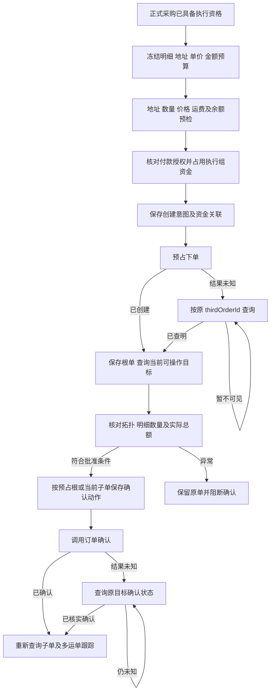

# 京东 VOP 供应商接入技术实施方案

> 当前交付状态（2026-10-30 工作区核对）：**未完成，禁止按完整京东自动履约接入放行。** 正式启动仅装配商品读取；订单执行装配及账号执行资料接入未完成。续做从[实施状态与未完成项](#implementation-status)开始，不能将本文的目标要求视为已实现或已验收。

## 1. 实施范围与约束

1. 本方案适用于京东 VOP 开放平台 `jingdong.vop.*` 接口，技术基线为 2026-10-29 仓库提交 `3aba038b6` 及当日读取的官方接口文档。不得混用旧版 VOP、京东到家或其他京东开放平台的认证和业务协议。
2. 京东复用现有供应商主档、API 连接、供应商品库、公司商品及 SKU、采购供给、正式采购和履约体系。协议类型新增为 `jd_vop`，中文名称为“京东 VOP”。
3. 首期交付普通实物商品的目录同步、选品入库、采购预检、预占下单、订单确认、父子单跟踪、物流查询、订单取消及适用订单的真实收货通知。支付方式固定采用合同开通的预存款，京东请求使用 `paymentType=4`。
4. 首期不启用虚拟商品、安装及预约服务、赠品选购、延保、混合支付、金采、未税价下单、自动充值、自动售后申请和自动开票。供应商要求附加履约流程而系统尚不支持的商品必须阻断自动发单，不得降级为普通快递单。订单自带附件须保留来源证据，不作为新增收费商品或采购行。
5. 采用通用架构扩展：新增独立订单确认能力、供应商父子订单关系及数量映射，发单与跟踪统一按连接类型分派；在现有财务体系内增加通用供应商预存款账户、资金占用和使用核销，不建立京东专用账本或重复银行付款流程。
6. 继续执行[供应商 API 商品与自动履约执行合同](supplier-api-product-contract.md)及[批量选品入库执行合同](supplier-api-batch-adoption-contract.md)。采购审批、已批准金额、公司销售价格、资料人工维护、未知结果调查及财务记账边界保持有效。
7. 本方案规定开发目标与执行约束；实现及验收状态以第 11 节状态台账和第 12 节验收矩阵为准。已实现模块不得继续笼统记为待实现，未接入正式启动或未取得验收证据的功能不得记为交付完成。凭据开通、数据库迁移、真实供应商联调和发布分别记录，不以文档核对代替上线验收。
8. 线下销售单沿用现有业务主流程；京东接入必须完成第 2.2、2.3 节规定的采购执行、履约回写及变更衔接。仅增加京东 HTTP 客户端或目录同步不得认定为线下销售自动履约接入完成。
9. 首期纳入“充值登记一次、按订单占用、扣款核实后核销”的预存款改造。保留逐单采购付款申请审批；自动余额执行还须取得财务明确授权。第 9.1—9.6 节规定预存款支付的专项规则，允许合格资金占用作为发单依据，但不将占用视为正式付款核销。实施时须同步更新受影响的采购付款安排、付款执行和履约门槛合同，普通银行付款规则保持有效。

## 2. 架构基线与实施落点

以下路径均相对仓库根目录。本节的已有责任及第 2.1 节限制描述采用第 1 节技术基线，用于规定改造范围，不作为当前实现状态；当前已核实状态见第 11 节。

| 当前入口 | 已有责任 | 本期实施要求 |
| --- | --- | --- |
| `backend/crates/erp-supply/src/ports/connector/` | 标准商品、可供、配送、订单、支付通知等窄接口 | 扩展订单确认、按数量预检、订单树及包裹数量表达 |
| `backend/crates/erp-processes/src/connectors/registry.rs` | 按类型分派目录、健康及配置引用 | 增加已绑定连接的履约适配器解析入口 |
| `backend/crates/erp-processes/src/connectors/dangaoshushu/` | 已有协议实现 | 保持其独立协议实现，作为行为回归对象 |
| `backend/crates/erp-processes/src/supplier_api_orders/` | 冻结正式采购意图、地址、创建及支付通知 | 移除对蛋糕叔叔具体运行时与客户端的依赖，接入通用能力 |
| `backend/crates/erp-processes/src/supplier_order_tracking/` | 查询观察、回调唤醒、真实履约应用 | 支持订单树刷新、叶子订单观察和部分数量应用 |
| `backend/crates/erp-supply/src/api_order/` | 持久化执行步骤、动作指纹及采购关联 | 扩展订单发现、确认与恢复状态 |
| `backend/crates/erp-finance/src/entity/payable/`、`service/payable/` | 供应商付款、留抵及应付核销 | 新增预存款账户、充值批次、占用、使用及冲回，复用财务金额和核销不变式 |
| `backend/crates/erp-processes/src/finance_posting/payable/`、`fulfillment_execution/purchase_context.rs` | 付款申请执行及实付门槛 | 增加受控余额执行与发单资金保障判断，区分占用和实付 |
| `backend/crates/erp-supply/src/entity/supplier_catalog.rs` | 来源目录、采购报价与公司关联 | 复用身份和版本机制，补充来源分组策略及采购限制 |
| `backend/crates/erp-processes/src/supplier_catalog_adoption/` | 自动匹配、建品、供给和资料同步 | 复用既有流程，不在京东适配器内建品 |
| `backend/crates/erp-integration/src/entity/supplier_callback.rs` | 已认证推送证据和补查意图 | 增加独立的拉取消息收件箱，不把拉取消息伪装成已验签回调 |
| `backend/apps/web-api/src/app_state.rs`、`core/supplier_order_worker.rs` | 生产装配与后台运行 | 仅配置京东时也必须启动发单、跟踪及消息处理 |
| `erp-client/features/supplier-api-connections/` | 连接设置、商品库、单项及批量选品 | 复用入口，补充京东只读状态和失败原因 |

### 2.1 必须消除的架构差异

| 差异 | 基线限制 | 规定处理 |
| --- | --- | --- |
| 订单协议分派 | 正式发单及跟踪直接持有 `DangaoshushuRuntime` | 注册表返回绑定连接的 `SupplierConnector`，流程只依赖窄 trait |
| 预占后确认 | `CreationNext` 仅有观察、支付通知；恢复创建会按支付状态推导下一步 | 增加独立确认步骤，由协议事实及能力决定后续动作，禁止把“未支付”统一解释为需要支付通知 |
| 父子单和再次拆单 | `OrderReference` 只有单个外部单号 | 保存原始根订单、历次父子关系和当前叶子订单，按叶子单执行确认、取消及跟踪 |
| 按数量和地址核验 | `AvailabilityQuery` 只有 SKU 和地区；不携带采购数量 | 新增下单预检合同，输入完整冻结行、数量及地址上下文 |
| 部分发货 | `Shipment` 只有行 ID；当前履约应用核对整行覆盖 | 按最终子单发货声明及已校验明细应用数量，支持累计守恒；运单独立关联 |
| 消息消费 | 现有入口面向供应商主动回调 | 增加拉取、持久化、补查应用和远端确认删除的独立流程 |
| 充值及资金保障 | 普通付款绑定采购付款申请；留抵来源为退款；履约门槛只累计正式付款核销 | 新增真实充值依据和账户占用，扩展发单资金资格；扣款核实前不减少应付或冒充已付 |

以上扩展不得削弱旧供应商的状态语义。实现阶段须同步更新标准 connector 合同说明，清除与当前商品合同冲突的旧描述，禁止照搬过时注释形成新规则。

### 2.2 线下销售链路的复用边界

1. 正式链路继续使用“线下销售单 → 供给选择与采购需求 → 采购单审批生效 → API 执行任务 → 供应商履约 → ERP 发货记录 → 客户验收及后续结算”。销售单提交或生效不得直接调用京东下单，仍须满足现有采购及履约资格。
2. 销售录入、公司商品及 SKU、销售成交价、销售审批、客户回款和销售开票规则继续复用。京东外部 SKU、订单确认及预存款状态不得成为另一套销售单身份或审批规则。
3. 采购行继续冻结所选供给及修订。复用 `procure_to_pay/review.rs` 的采购生效入口和 `supplier_api_orders/enqueue.rs` 的 API 任务生成入口；手工供给继续走原流程，API 供给按连接执行。来源销售行、采购修订行及地址数量必须可追溯。
4. 供应商直发复用 `supplier_api_orders/delivery_drafts.rs` 的采购销售分配和发货草稿入口，按第 9 节扩展部分数量应用。采购入仓继续经过实际收货、仓储及后续出库流程，不把京东物流直接当作客户发货。
5. 销售改单、采购改单、取消及销售交付进度必须适配京东子单事实；不重建业务主流程，但不得以销售主表未变为由省略下游联动和展示验收。

### 2.3 线下销售自动履约的必做改造

以下各项均为首期完成条件；代码路径相对 `backend/crates/erp-processes/src/`，前端展示由对应销售、采购和履约页面承接。

| 编号 | 必须改造的环节 | 实施落点与交付要求 | 对应验收 |
| --- | --- | --- | --- |
| M01 | 正式采购后的协议分派 | `supplier_api_orders/`、`supplier_order_tracking/` 及应用装配按连接解析适配器；京东配置独立可运行，原采购审批及入队时机不变 | JD01、JD20、JD22 |
| M02 | 履约资料和按量预检 | 冻结采购行、数量、单位、四级地址、开票资料和配送条件；资料不足产生明确补齐入口；地址或数量改变后重新核验 | JD09、JD10、JD22 |
| M03 | 已批准运费进入执行预算 | `supplier_api_orders/snapshot.rs` 及采购费用关联补齐商品金额、批准运费和分组预算，执行第 8.5 节；不得只计算商品金额或直接接受京东新增费用 | JD11、JD23、JD24 |
| M04 | 发单资金保障与正式付款分别校验 | `fulfillment_execution/purchase_context.rs` 及发单流程增加预存款资金资格：真实到账、付款授权、执行组专属占用和京东可执行条件共同满足后允许发单；扣款核实后才正式核销 | JD25、JD31、JD32 |
| M05 | 预占、确认及父子单恢复 | `supplier_api_orders/` 增加独立确认动作、当前子单集合和稳定原单号恢复；部分确认、重复拆单和未知结果分别处理 | JD12、JD13、JD14 |
| M06 | 部分发货回写现有交付体系 | `supplier_order_tracking/delivery.rs` 及 `fulfillment_execution/` 按来源子单、销售分配及可证明数量应用发货，多包裹不触发整行提前发货 | JD15、JD26 |
| M07 | 销售及采购变更联动 | `procure_to_pay/change/`、`supplier_api_orders/change_guard.rs` 及既有销售变更衔接核对全部相关子单；已发送、未知、已发货和取消待返款分别阻断或进入原处理流程 | JD16、JD27 |
| M08 | 原单据进度和异常展示 | 原销售、采购及履约详情准确展示部分确认、部分发货、部分取消和待核实；可定位采购及供应商履约记录，沿用权限和成本可见范围 | JD19、JD28 |
| M09 | 通用供应商预存款管理 | `erp-finance` 拥有账户、充值、占用和使用核销；`finance_posting/payable/` 编排审批授权、并发占用、扣款核实、返款冲回及对账；不得把充值伪装为退款留抵 | JD29—JD37 |

各项实现须包含从既有业务入口到结果应用的验证。供应商客户端调用成功、来源状态保存成功及 ERP 发货事实应用成功必须分别记录，不得以其中一项代替整条链路验收。

## 3. 京东接口清单

接口名、字段与适用条件以相应官方 API 及专项方案为准；[整体对接流程](https://vop.jd.com/doc/guide?id=73211295-f641-4db7-a710-abc5cd1bc7b9)用于检查业务环节覆盖，不将总表的全部接口转为首期接入要求。综合可采已经覆盖的校验不重复接入，赠品、延保、自动售后及自动开票继续执行第 1 节排除范围。文档可读不等于当前账号已获调用权限，开发前须形成账号实际授权清单。

| 用途 | 官方接口及文档 | 接入要求 |
| --- | --- | --- |
| 授权商品池 | [`goods.getSkuPoolInfo`](https://vop.jd.com/doc/api?id=5850) | 枚举当前合同商品池，不按全站类目抓取商品 |
| 池内分页 | [`goods.querySkuByPage`](https://vop.jd.com/doc/api?id=6741) | 使用新分页接口；保存 `bizPoolId`、返回 `offset` 和剩余页信息 |
| 商品详情 | [`goods.getSkuDetailInfo`](https://vop.jd.com/doc/api?id=5832) | 取得 SKU、SPU、单位、规格、品牌、分类、采购限制及图片详情 |
| 图片 | [`goods.getSkuImageList`](https://vop.jd.com/doc/api?id=5845) | 保留主图标记、有效标记和顺序，进入既有素材归档流程 |
| 分类 | [`goods.getChildCategoryList`](https://vop.jd.com/doc/api?id=5851)、[分类详情](https://vop.jd.com/doc/api?id=5846) | 只维护来源类目与名称，不直接覆盖公司分类 |
| 报价 | [`goods.getSellPrice`](https://vop.jd.com/doc/api?id=5847) | 优先按 `skuInfos` 传 SKU 及数量，以实际采购报价核验 |
| 全局销售资格 | [上下架](https://vop.jd.com/doc/api?id=5852)、[可售验证](https://vop.jd.com/doc/api?id=5844) | 区分上下架、可售、区域可达与实际库存 |
| 地址 | [四级地址列表](https://vop.jd.com/doc/api?id=5680)、[地址有效性验证](https://vop.jd.com/doc/api?id=5710)、[地址转换](https://vop.jd.com/doc/api?id=5726) | 显式映射京东四级地址，转换结果不得直接当作已确认地址 |
| 库存 | [`goods.getNewStockById`](https://vop.jd.com/doc/api?id=5834) | 使用真实订购数量和收货地区，禁止把请求满足量当库存总量 |
| 可采校验 | [`goods.getSkusAllSaleState`](https://vop.jd.com/doc/api?id=7003) | 仅用于下单前综合资格检查，另行核对库存和价格 |
| 运费 | [`order.querySkuFreight`](https://vop.jd.com/doc/api?id=5855) | 使用相同明细、数量、地址和 `paymentType=4` |
| 创建 | [`order.submitOrder`](https://vop.jd.com/doc/api?id=5856) | `submitStateType=0`，稳定 `thirdOrderId`，显式提交核验后的单价 |
| 订单详情 | [`order.queryOrderDetail`](https://vop.jd.com/doc/api?id=5824) | 支持原第三方单号恢复；发现父子关系、数量、金额及确认状态 |
| 确认 | [`order.confirmOrder`](https://vop.jd.com/doc/api?id=5839) | 独立持久化动作；按当前有效子单和京东实际确认规则执行 |
| 物流 | [一单多运单轨迹](https://vop.jd.com/doc/api?id=100086)、[配送信息](https://vop.jd.com/doc/api?id=5838) | 配送信息提供运单号及承运信息，轨迹提供运输观察；按子单和运单身份合并，缺少商品数量时不得自行分摊 |
| 取消 | [批量可取消校验](https://vop.jd.com/doc/api?id=8081)、[`order.cancelOrder`](https://vop.jd.com/doc/api?id=5840)、[取消进度](https://vop.jd.com/doc/api?id=9685) | 已支付订单先按当前真实目标核验可取消资格，预占按原可操作根单处理；申请受理与取消完成分离 |
| 真实收货通知 | [`order.confirmReceiveByOrder`](https://vop.jd.com/doc/api?id=5836) | 仅对官方规则适用的订单，依据 ERP 真实验收或合格入仓收货形成独立动作，不依据物流或京东完成状态代办 |
| 消息 | [消息查询](https://vop.jd.com/doc/api?id=5871)、[消息删除](https://vop.jd.com/doc/api?id=5787) | 先落本地证据和处理意图，再补查应用，最后确认删除 |
| 预存款 | [账户余额](https://vop.jd.com/doc/api?id=5854)、[余额变动](https://vop.jd.com/doc/api?id=5853) | 余额预警及订单扣减、取消返款证据，不直接创建 ERP 付款凭证 |

## 4. 配置、认证与运行时

1. 在 `backend/config/src/` 新增 `JdVopConfig` 并纳入 `SafeConfig`；部署配置负责网关地址、应用凭据、授权令牌引用、账号范围、超时、限流、同步和轮询参数。采购页面不重复配置地址、密钥或环境。
2. 在 `erp-processes/src/connectors/jd_vop/` 实现 `runtime`、`transport`、`auth`、`wire`、`catalog`、`transform`、`delivery`、`preflight`、`order`、`tracking`、`messages` 模块。目录名为职责划分，允许按仓库大小门禁继续拆分。
3. 原始京东 DTO、字段类型兼容和响应封装只留在适配器；标准领域模型不得包含任意京东 JSON。`OfferTransform` 必须为纯转换，不执行 HTTP、数据库或文件上传。
4. 请求签名执行[官方 HTTP 调用指南](https://vop.jd.com/doc/guide?id=93e984c4-2fd3-4b5b-9745-1b197d30d6ab)：除 `sign` 外的实际请求参数按名称升序排列，顺序拼接参数名与原始值，首尾加 `appSecret`，以 UTF-8 字节计算 MD5 并输出大写十六进制。`360buy_param_json` 只序列化一次，签名与发送使用同一字符串；签名完成后再进行 URL 编码，不得以 ERP 内部 HMAC 凭据代替京东签名。G0 阶段仍须冻结本账号适用的网关、公共参数、时间格式、授权和令牌续期机制及错误码样本；固定向量须保存同一次请求的完整非敏感测试输入和预期摘要，离线算法测试不替代账号授权及真实调用验收。
5. 技术账号、合同授权范围与连接绑定。首期一个京东采购账号只允许一个负责消费该账号消息的连接；同账号多消费者必须共享账号级租约与收件箱，禁止相互删除未处理消息。更换账号不得复用原来源身份及历史订单命名空间。
6. OAuth 凭据按第 4.1 节保存到 MongoDB 技术凭据记录；配置使用固定 `credential_id`，不保存令牌正文。刷新使用账号级单次领取和版本控制；同账号令牌轮换不得改变引用或使历史订单失去查询资格。
7. 只读连接检查验证认证和已授权的商品读取入口；不得通过测试下单、确认或扣款判断健康。未实现的能力返回缺失，不因官方存在接口就声明已支持。
8. 解析必须分别处理 HTTP 失败、网关错误、方法响应封装及业务结果。使用接口实际响应键，兼容文档出现的 `responce` 拼写；不同方法的 `openRpcResult`、`vopOrderRpcResult` 不得硬套一个封装。
9. 金额使用十进制定点值；外部 ID 以字符串保存，解析数字响应时不得经过浮点数。业务成功、缺项和未知错误分别处理，未知业务码保留脱敏原码并失败关闭。
10. 读请求实施有界退避、连接级并发和账号级配额。创建、确认、取消及其他可能产生副作用的调用不得在 HTTP 客户端隐藏重试。

### 4.1 技术凭据存储与续期

1. `credential_id` 唯一指向 `erp-integration` 拥有的供应商技术凭据记录，不解释为 Redis key、文件路径或 Vault URI。记录必须绑定京东供应商类型、`account_scope` 与 `app_key`；读取、导入及续期均核对同一绑定，不允许复用 ID 切换采购账号。
2. 访问令牌与刷新令牌使用部署提供的独立 `credential_encryption_key` 加密；不得复用 JWT 密钥或将加密密钥保存在凭据集合中。认证密文须包含凭据身份并在解密后核对，防止记录之间替换令牌。令牌、密文及密钥不得进入日志、审计投影、普通业务响应或命令行参数。
3. 初次接入支持第 4.3 节页面授权、第 4.4 节页面令牌配置，以及受控 CLI 从本地凭据文件导入京东已授权结果。CLI 默认只预览校验，显式应用后才写入；记录已存在时不得覆盖，替换必须携带预期版本。三种入口共用凭据身份、加密保存和并发规则，不通过真实下单验证令牌，不承担申请接口权限。
4. 每次业务请求从凭据提供器取得当前账号的有效令牌。技术连接启用后，后台周期检查同一配置凭据，在无业务请求时仍维护授权；按官方建议在 6—8 小时内续期，有效期更短时提前处理。进入刷新窗口时，先以数据库条件更新取得唯一刷新身份，并在事务中保存可能已发送状态和审计，再在事务外调用京东刷新接口。进程内互斥不得替代跨进程协调；刷新响应按原身份及版本保存，不得覆盖新授权或其他任务的新结果。
5. 网络超时、响应无法解释或刷新结果保存未知时保留原动作，不以租约到期推导可以重发刷新请求。官方授权规则规定生成新令牌后原令牌仅保留约 10 秒有效期；因此登记已发送后不得继续按旧 `expires_at` 使用旧令牌，必须等新结果持久化或完成明确新授权恢复。仅未发送领取阶段允许使用仍有效的旧访问令牌。过期、账号不符、解密失败、明确授权失效及未知记录均明确拒绝业务发送。
6. 刷新未知后的恢复须取得新的京东授权，按原凭据 ID、原账号与预期版本执行专用重新授权替换，并等待原刷新发送期限结束。普通导入不得绕过此条件；旧刷新任务的迟到结果不得覆盖新授权。凭据记录及未知动作不得配置 TTL 自动删除。
7. 启动时根据数据库、技术配置及独立加密密钥构造凭据提供器，并注入实际京东 HTTP 传输。只读传输装配不自动授予下单、确认、资金核销或消息删除能力；写能力继续满足账号执行资料和业务授权门槛。
8. 运维状态仅输出凭据 ID、账号绑定、版本、到期时间、刷新状态及脱敏失败原因。部署前须核对唯一索引和独立加密密钥可用性；回滚必须保留凭据记录、原刷新身份及能够读取这些状态的兼容版本。密钥不得直接替换，密钥轮换须先完成密文迁移并验证读取。

### 4.2 凭据配置与导入操作

1. 在受控配置的 `[jd_vop]` 中填写 `credential_id`、`account_scope`、`app_key`、`app_secret` 和独立 `credential_encryption_key`。`credential_id` 限 1—128 位 ASCII 字母、数字、下划线或短横线。旧字段名 `access_token_reference` 仅作为同义字段兼容；不得同时填写两个字段，旧 Vault URI 或路径值必须改成实际凭据 ID。
2. `gateway_url` 缺省使用 `https://api.jd.com/routerjson`。`[jd_vop]` 下的 `source_type` 为可选调用渠道，缺省采用官方默认值 `3`，仅在确有接入差异时覆盖。`pin`、`remoteIp` 和业务结构中的 `appKey` 按官方系统参数交由京东网关处理，ERP 不在业务 JSON 中注入，不要求部署人员填写；HTTP 公共参数 `app_key`、`access_token` 仍由应用配置和凭据提供器生成并参与签名。本系统传输层统一以 UTC+8 格式化请求时间戳，不读取宿主机时区，不提供部署时区配置。旧 `[jd_vop.request_context]` 整段必须删除，残留配置明确拒绝，不静默忽略。
3. 独立加密密钥至少 32 字节，并且不得与应用签名密钥或 JWT 密钥相同。所有处理同一凭据记录的进程必须使用同一有效密钥。文件配置与 Nacos 均遵守已有配置来源规则；不通过临时环境变量覆盖凭据身份。
4. 授权文件仅保存于受控本地位置，最大 65,536 字节，不得提交 Git。输入格式如下；`expires_at` 必须替换为该次京东授权的真实 Unix 秒到期时间，模板值 `0` 不可导入。

```json
{
  "credential_id": "jd-vop-main-token",
  "account_scope": "jd-vop-main",
  "app_key": "<与部署一致的应用标识>",
  "access_token": "<已取得的访问令牌>",
  "refresh_token": "<同次授权的刷新令牌>",
  "expires_at": 0
}
```

5. 以下命令从 `backend/` 执行。`enabled=false` 时也允许凭据导入与状态查看。默认导入仅校验并预览，不创建凭据或触发刷新；追加 `--apply` 才写入。`--file -` 从标准输入读取同一格式，禁止将令牌正文放入命令参数。

```bash
cargo run -p cli -- --config-path ./config.toml jd-vop-credential-status
cargo run -p cli -- --config-path ./config.toml jd-vop-credential-import --file ./jd-vop-authorization.json
cargo run -p cli -- --config-path ./config.toml jd-vop-credential-import --file ./jd-vop-authorization.json --apply
```

6. 替换现有有效记录时，必须追加状态查询所得的 `--expected-version`；不得自动覆盖版本冲突。刷新未知或明确授权失效后，必须先取得新授权，再使用 `--reauthorized --expected-version <原版本> --evidence-reference <新授权依据引用>` 预览，核对通过后追加 `--apply`。普通更新不得代替此恢复入口，原刷新期限和账号绑定由后端重验。
7. 状态命令只查询本地凭据，不续期、不调用京东、不输出令牌或密文。启用读取后，应另行执行只读连接健康检查；凭据导入成功及本地状态正常不得作为真实账号调用验收。
8. 删除旧请求上下文后，已有连接须重新绑定新的技术引用并执行只读健康检查；不得自动覆盖历史订单的原绑定。正常令牌续期不改变凭据 ID 或技术绑定，修改实际调用渠道时必须重新核对连接。

### 4.3 页面账号授权

1. 京东连接的“API 设置”页在“连接测试”前提供“京东账号授权”分区，显示本地授权状态、令牌到期时间与下一步操作。本地令牌可用不等于真实接口健康；授权与只读连接测试分别显示结果。其他供应商不显示京东授权入口。
2. 首次授权与重新授权使用同一弹窗，采集企业采购账号、密码、京东应用登记的回调地址和 RSA 私钥文件。应用标识、应用密钥、凭据 ID、账号范围及加密密钥从服务端部署配置读取，不接受页面覆盖。私钥输入支持京东提供的 Base64 PKCS8 内容及兼容 PEM 文件；文件大小和内容格式必须在发送前校验。
3. 账号与密码须使用京东运营提供的企业采购资料；回调地址须与京东应用登记值一致。密码按官方规则执行小写 MD5、RSA 私钥处理、Base64 和 URL 编码。首次授权只调用固定京东 OAuth 地址，不跟随任意重定向，不访问用户填写的回调地址；仅从验证通过的官方重定向结果提取授权码，再于服务端换取令牌。
4. 密码、私钥、授权码、访问令牌和刷新令牌不得进入普通响应、日志、审计正文、浏览器持久化存储或浏览器地址栏。服务端按官方 GET 协议发送的敏感查询参数不得进入 HTTP 客户端错误或访问日志。页面关闭或提交结束后清除敏感输入及变更缓存；服务器仅在本次授权期间使用密码与私钥。授权结果只返回脱敏状态。
5. 授权查询与授权执行必须校验登录、对应操作权限、京东连接类型及连接访问范围；提交入口实行请求体上限和频率限制。无权限用户不得通过直接调用接口绕过页面限制。授权成功不修改自动下单开关，不授予采购或资金执行权限。
6. 授权请求必须在远端发送前取得可持久化的账号级操作身份，并与自动刷新、CLI 导入和其他页面请求互斥。重复提交、页面超时或进程重启不得隐式重发可能已经生效的授权。网络结果未知时显示待核对状态并保留操作依据；迟到结果不得覆盖后续授权。
7. 同一凭据不得切换实际京东采购账号；重新授权必须核对已绑定账号。历史 CLI 凭据缺少可验证账号身份时，不得仅凭相同 `account_scope` 推定属于同一账号。首次绑定、账号不符和恢复条件必须分别给出明确结果，不自动覆盖历史订单的账号关系。
8. 令牌保存与脱敏审计遵守第 4.1 节，保存后刷新页面状态并提供只读连接测试。授权失败、保存失败和连接测试失败须分别提示；不得将提交成功、HTTP 成功或本地凭据存在显示为真实京东接口调用成功。
9. 状态查询为 `GET /admin/supplier-api-connections/{id}/jd-vop-authorization`，使用连接详情权限；授权提交为同路径 `POST`，使用独立 `supplier_api_connection:authorize` 权限。提交携带页面生成的操作编号和当前凭据版本；服务端受理后立即返回处理中状态，页面轮询状态接口至终态。查询可携带 `operation_id` 核对原操作回执，当前凭据状态与被查询操作结果分别表达；后来授权成功不能代替此前操作的处理结果。相同操作编号再次提交只能读取原结果，不得重复调用京东。
10. 账号身份以专用密钥计算的 HMAC 绑定，不以可自行填写的账号范围代替；取得京东账号标识时同时核对。历史 CLI 凭据无法证明实际账号身份时，页面禁止直接重新授权并提示管理员核验；不得将首次输入的新账号直接认定为历史凭据所属账号。
11. 新增授权身份及操作历史字段对历史记录使用缺省值，不新增或替换原凭据唯一索引。产生 `AUTHORIZATION_*` 状态后，旧程序不能继续处理该凭据；回滚须停用相关任务并使用能够识别新状态的兼容版本。不得删除待核对记录、清空操作历史或改回普通可用状态绕过恢复条件。迁移审计脚本仅执行只读结构核对，不能代替真实授权验收。

### 4.4 页面直接配置令牌

1. 京东连接的“API 设置 → 京东账号授权”提供“配置令牌”，采集同次授权的 `access_token`、`refresh_token` 及访问令牌的实际到期时间。到期时间按浏览器本地时间输入，以 Unix 秒传给服务端；不得从保存时间推算或使用刷新令牌有效期替代。服务端拒绝缺项、已到期、超长或含空白及控制字符的令牌。
2. 令牌必须属于此连接的原采购账号，以及服务端 `app_key`、`app_secret` 对应的同一应用。页面不能修改应用、凭据 ID、账号范围或加密密钥。保存仅核验格式、固定部署绑定及权限，不宣称已通过京东账号身份或接口权限核验；操作人须核对令牌来源，保存后执行只读连接测试。
3. 配置入口为 `POST /admin/supplier-api-connections/{id}/jd-vop-tokens`，复用 `supplier_api_connection:authorize` 权限、供应商访问范围、48 KiB 正文上限及授权限流。请求必须携带唯一 `operation_id` 和页面所见 `expected_version`；仅首次新建允许版本为空。正文提取失败只返回固定脱敏错误。
4. 保存必须在同一事务内重新检查连接权限和绑定，更新原 `credential_id` 的加密记录并写入 `supplier_credential.configure_tokens` 审计。不新增第二份令牌来源，不通过部署配置或浏览器本地存储覆盖数据库。已有授权或刷新仍处于有效操作期限时拒绝覆盖；所见版本变化时须刷新状态后重新提交。
5. 授权或刷新结果未知且原操作期限已结束时，操作人可在核实原账号后配置新取得的有效授权结果。该操作显式替换令牌、恢复可用状态并推进版本；保留原账号指纹、候选账号、授权与刷新历史，不伪造账号核验结果。迟到远端响应不得覆盖新配置；普通 CLI 导入仍遵守原有限制。
6. 接口调用及后台自动续期共用该加密记录。续期使用已保存的 `refresh_token`，成功后在原记录同时写回新访问令牌、刷新令牌和有效期；后续调用读取新值。由 ERP 统一管理该授权的刷新，其他系统不得独立刷新同一授权后仍让 ERP 使用旧值。配置保存不修改自动下单开关或增加连接能力。
7. 保存后页面显示“令牌已配置”及有效期，不回显 token。令牌不得进入查询键、变更变量、持久化缓存、响应、日志或审计正文；关闭弹窗及请求结束清空敏感输入。保存响应不明时，使用第 4.3 节状态接口携带原操作编号查询；相同操作同内容只读返回回执，不覆盖期间已经刷新的新令牌。
8. `manually_configured` 和 `configuration_history` 对历史记录使用缺省值，不增加唯一索引。配置回执记录操作人、原版本、时间及密钥保护的载荷指纹，不包含令牌明文。保留回执以防旧请求重放；回执达到容量上限时拒绝继续配置并转受控处理，不静默丢弃历史。回滚版本须保留并识别这些字段。使用 `backend/scripts/migrations/20261030-supplier-credentials-audit.mongosh.js` 对批准的单个凭据执行只读结构核对；缺字段按缺省值读取，无需写入回填。

## 5. 商品同步和字段映射

### 5.1 身份与资料

| 京东字段或事实 | ERP 映射规则 |
| --- | --- |
| `skuId` | `SupplierSku.spec_id`；始终作为订货身份，不作为实际条码 |
| 已核实的 `spuId` | `SupplierSku.product_id`；以带类型前缀的稳定值区分 SPU 和回退 SKU 分组 |
| 无有效 SPU | 使用带 `sku:` 前缀的单 SKU 来源分组；后续补出 SPU 时先核验身份，不自动改键或合并已入库商品 |
| `skuName`、`spuName` | SKU 来源名称和商品共有名称分开处理；不得用某个规格名反复覆盖整个 SPU |
| `saleUnit` | 来源单位原文，按现有精确映射执行；重量及包装数量不替代订购单位 |
| `seoModel`、结构化规格属性 | 生成完整规格及可核验规格签名；仅型号不足以证明颜色、尺寸、包装一致时不得自动跨来源合并 |
| `brandName`、`category` | 品牌来源名称和三级类目路径；公司分类仍经选品映射确认 |
| `imagePath`、图片列表、详情内容 | 经过纯解析和安全展示处理，图片进入现有异步素材归档及差异同步；不在页面直接执行来源 HTML |
| 实际条码 | 仅在取得明确实际条码字段时填写；不得从 SKU、SPU、ISBN 或任意参数猜测 |
| `lowestBuy`、购买倍数 | 保存为来源采购约束，在目录提示并在下单前按当前数量复核；不复制为公司集采起订量 |

商品详情及其扩展字段来源见[商品详情接口](https://vop.jd.com/doc/api?id=5832)。同一 SPU 的共有资料选择须稳定；不同 SKU 返回共有资料不一致时保留各自证据并进入资料核验，不采用最后一次写入覆盖。

### 5.2 采购价格

1. 在已核实的人民币含税价格体系下，以 `salePrice` 映射来源采购报价；`jdPrice`、`marketPrice` 不得替代采购成本。报价返回空值或负值时保存“暂无报价”，禁止置零；明确零值仍按既有金额规则校验。
2. 京东文档支持按数量查询价格，并存在促销及未税价扩展。目录必须保存本次报价的数量、时间和适用上下文；目录报价不得承诺适用于任意数量。首期不启用需要 `cid` 等用户资格的个性促销价格，遇此类商品须阻断并记录原因。
3. 税率按已验证的实际字段单位转换，保留原文证据。不得把全部京东商品强制映射为 13%；来源税率缺失时沿用现有选品补齐规则并显式提示。
4. `marketPrice` 在京东文档中具有展示限制。首期不将其自动填入公司市场价；`jdPrice` 也不作为替代值。公司销售参考价继续由采购明确维护或按既有批量规则主动计算。
5. 首期仅形成已核验的一件代发采购条款；京东一次允许购买多件不等于提供独立集采报价。不根据数量大于一自动生成集采能力。
6. 报价变化生成 API 采购供给修订，保留历史成本；不覆盖公司销售价格、历史采购快照或人工停用状态。

价格字段、缺报价和扩展口径见[批量查询商品售卖价](https://vop.jd.com/doc/api?id=5847)。

### 5.3 全量、定向刷新与恢复

1. 全量流程为“商品池清单 → 池内 SKU 分页 → SKU 去重 → 详情、报价及销售资格 → 标准 Offer → 目录保存”。不得使用分类接口代替授权商品池。
2. 游标包含版本、账号范围指纹、冻结的池清单引用、当前池、来源返回的 offset 及页内处理位置；较大清单存入检查点记录，不无限扩张游标。`offset` 不是页码，不用本地行数递增替代。
3. 单页详情及报价查询有界并发；一项映射失败记录来源 SKU 和脱敏原因，继续处理其他项。认证、限流、整页网络失败不得跳过整页或推进检查点。
4. 当前目录项、后续补齐意图及检查点按既有事务规则提交，沿用采集租约、心跳及发布恢复机制。图片归档独立执行，不阻断原始目录采集。
5. 一个 SKU 出现在多个商品池时只保存一个来源订货身份，同时保留池成员关系。从一个池移除不表示退出全部授权范围；仅在核实所有有效成员关系和当前可采资格后撤回供给。
6. 京东消息消费不能冒充按固定时间窗口完整重放的 `OfferSource::scan`。首期扫描能力声明 `IncrementalSupport::Unsupported`，使用消息驱动定向刷新和周期全量校对；共用调度不得因此按短周期持续跑全量。
7. 分页完成不保证并发变化下的一致全量快照；缺项、查询不可见和消息中断不得直接删除商品。来源无可信版本时记录观察时间，按对象串行补查，不伪造来源更新时间或单调版本。
8. 目录中的销售资格、精确库存、按地址的可供结果分别表达。未取得全国无条件供给证明时不得把某地址库存写成全局库存；无精确数量时保持未提供，禁止填无限库存。

商品池分页依据[商品池清单](https://vop.jd.com/doc/api?id=5850)和[池内分页接口](https://vop.jd.com/doc/api?id=6741)。

## 6. 消息收件箱与补偿

1. 新增通用 `SupplierMessageSource` 窄接口，提供消息拉取及确认方法；接收方式与 `Callbacks` 分开声明。京东首期采用主动拉取，不新增没有官方依据的公网回调入口。
2. 收件箱由 `erp-integration` 持有，至少保存账号范围、连接、来源消息 ID、类型、内容指纹、加密正文、接收时间、处理状态、重试时间和远端确认状态。唯一键使用“账号范围 + 来源消息 ID”；同 ID 异载荷进入冲突处理。
3. 消费顺序固定为：拉取 → 保存证据和处理意图 → 定向查询最新事实 → 按领域规则应用或持久化隔离处理结果 → 登记待确认 → 调用远端消息删除 → 标记已确认。
4. 数据库保存失败不得删除远端消息；进程重启通过本地记录恢复。删除结果未知时保留 `ACK_UNKNOWN`，核实或按已经证实的删除幂等规则恢复；不得重新执行业务应用。
5. 拉取消息是刷新线索，不直接修改采购、取消、退款、库存或财务事实。无效正文也须保留原始证据和隔离状态，禁止在未可靠接收时直接删除。
6. 首期订阅商品变更、订单拆分、配送、妥投、完成、取消、支付异常、等待真实收货及地址变化相关类型。至少核对 `1/2/4/5/6/10/12/14/15/16/18/31/48/50/126/132` 的账号实际开通情况；税率变化按授权增加，税率消息不能承担全部税率同步。取消与支付异常消息仅唤醒原单调查，不要求消息携带官方正文中不存在的资金交易号；真实扣款及返款继续通过余额变动明细核实。地址变化按连接级提示可靠处理，每次选址和新创建继续读取并验证官方地址，不修改已发送原订单地址。
7. 调度以商品消息最长两分钟的消费目标配置，实际配额和并发在 G0 确定。监控最老未处理消息年龄、失败队列、定向刷新延迟和全量基线年龄；超限告警并限制使用过期供给。
8. 首次初始化前先建立消息收件箱，扫描期间持续接收，完成后补查期间变化。消息长期停收、订阅变更或恢复超过保留窗口时，必须重新全量建立基线。

官方说明指出消息最多保存 30 天，部分商品消息长期不消费会被限制生成；拆单消息可能多次发生，并以原始父单提示重新查询当前子单。不得将空队列作为目录完整证明。见[消息类型说明](https://vop.jd.com/doc/guide?id=268f772f-833a-40a5-8ca0-6629d6955aae)、[消息查询](https://vop.jd.com/doc/api?id=5871)和[消息删除](https://vop.jd.com/doc/api?id=5787)。

## 7. 地址、数量与下单预检

1. 新增标准 `OrderPreflight` 能力；输入绑定连接、冻结采购行及数量、收件地址上下文、配送选项、批准单价与批准总额。输出逐行可采结果、核验价格及数量上下文、运费、观察时间和阻断原因，不创建订单。
2. 现有 `AvailabilitySource` 保留一般可供查询职责。京东不接受以默认数量 1 核验任意采购数量，不以“状态有货”推导当前数量足够。
3. 京东四级地址作为类型化的供应商地址上下文保存，并绑定收件地址指纹；公共 `Recipient` 不塞入京东字段或任意 JSON。ERP 地区编码不能直接充当京东编码。
4. 优先维护明确的四级地址映射。地址转换接口仅产生候选结果，须校验省市区镇及有效性；歧义、缺少必需四级地址或地址过长时进入履约资料补齐。仅官方乡镇候选确为空且有效性校验通过时允许 `townId=0`，省、市、县不得使用 `0`。用户修改地址后原核验与运费失效。
5. 预检依次核对采购执行资格、连接启用、来源供给版本、单位、采购数量精度及倍数、四级地址、综合可采、按量库存、当前报价、运费和总额；创建前重新执行时效敏感核验。
6. 库存 `remainNum=-1` 为未知；文档存在按请求数量返回、并非真实库存的情况。仅在满足已验证语义的分支映射精确数量，其余返回“本次请求可满足/不可满足/未知”。任何结果均不代表预占成功。
7. 普通实物首期不自动接受预订及无货预订。仅明确现货状态 `33` 且请求数量可满足时自动放行；在途 `39`、可配货 `40` 缺少可核验批准交期依据时阻断，未知状态码阻断，不按中文描述关键词猜测。促销一口价、用户资格或限购所需字段尚未纳入本期采购合同的报价，必须保存采购限制并阻断，不将其作为普通报价发送。
8. 批量库存、报价、可采和运费请求遵守各接口上限。创建请求最多 100 个商品项；超过上限须在编排层形成独立执行组、单号和各组金额预算，逐组重算运费，不在适配器内拆成多次提交。
9. 余额查询仅作预警和预检，不构成锁款或并发余额保证。余额不足、无法核实价格或总额超批均阻断；后续京东明确支付失败或结果未知分别处理，不自动充值。

地址规则见[地址转换](https://vop.jd.com/doc/api?id=5726)和[地址验证](https://vop.jd.com/doc/api?id=5710)；数量语义见[库存接口](https://vop.jd.com/doc/api?id=5834)；综合可采和费用分别依据[可采接口](https://vop.jd.com/doc/api?id=7003)及[运费接口](https://vop.jd.com/doc/api?id=5855)。

## 8. 预占、父子单和订单确认

### 8.1 状态与能力

1. 新增 `OrderConfirmation` 能力及独立确认状态；`PaymentConfirmation` 继续只表示原有供应商支付结果通知，京东预占确认不得实现为该能力。
2. `CreationNext` 扩展为可表达“发现当前子单并确认”的后续动作；`ApiOrderStage` 增加 `DiscoverOrders`、`ConfirmOrder`、`ConfirmationUnknown`。创建恢复必须由协议当前事实重建下一步，不再使用“支付状态未确认则进入支付通知”的通用推断。
3. 每个可操作预占根或待确认叶子单保存独立动作身份、载荷指纹、真实目标订单及拓扑版本。根执行状态只汇总进度，不代替具体目标动作结果。
4. 下列流程图表达主路径；所有远端写调用前必须先可靠保存未知状态和原动作身份。



### 8.2 创建与金额

1. `thirdOrderId` 由持久化执行组身份生成，遵守 100 字符限制；重试和恢复保持原值。提交 `submitStateType=0`、`paymentType=4`，并对每行显式传递已核验的 `skuUnitPrice`。不得省略单价以接受任意最新价格。
2. 下单所需 `invoiceInfo` 仍是必需的采购资料；首期不自动开票不等于可以缺少下单发票参数。复用采购主体的经核验开票资料，冻结发票类型、开票方式及必要收票信息；资料不足时阻断，不从客户销售开票信息推导。
3. 赠品请求显式关闭，不发送延保、虚拟或服务类扩展字段；若供应商回传额外收费项或不可识别商品，保留原单并阻断后续确认。
4. 创建成功后先保存外部订单身份和实际金额，再判断是否继续。不能因金额异常把已创建结果返回成“未下单失败”。父单金额和子单金额分别存证，禁止父单与子单重复累计。
5. 单价条件校验不代表运费和总额具备远端原子上限保障。确认前再次核对完整当前子单集合、商品及费用合计与已批准预算；缺少可信金额、数量不守恒或超额均阻断确认。
6. 预占是否冻结或扣减预存款、确认时是否重计费用、预占有效期及价格锁定范围必须在 G0/G6 核实。在此之前不得宣称预占无资金副作用，也不得宣称预查可保证最终不会超额。已发生冻结或扣减时保留证据，进入原单异常及取消处理。

预占参数和单价校验依据[提交预占订单](https://vop.jd.com/doc/api?id=5856)；独立确认依据[确认订单](https://vop.jd.com/doc/api?id=5839)。

### 8.3 父子关系与数量守恒

1. 新增供应商订单节点记录，至少包含连接、执行组、外部订单号、原始根单号、直接父单号（来源提供时）、节点角色、当前/历史拓扑版本及来源观察。根订单号不得被后续子单号覆盖。
2. 京东可能再次拆分子单。每次拆单提示须按原始根单重新查询当前叶子集合；新拓扑原子保存，旧节点及动作保留历史。仅收到一条拆单消息不得判定拓扑已完整。
3. 新增“ERP 冻结采购行 → 来源订货 SKU → 当前叶子单行 → 数量”的关联。各有效叶子数量合计必须等于原批准数量；同一 SKU 对应多条 ERP 行时需保存确定性的分配明细，禁止只靠 SKU 号丢失行归属。
4. SKU 采购单价、单位或关键属性不一致的 ERP 行不得在提交前合并。相同条件允许聚合请求，但必须保存可逆数量分配，限制售后或发货应用不得超出对应行余额。
5. 确认前按当前可操作预占根或已拆分叶子集合核对批准数量和金额，二者不得重复累计；发货覆盖只使用真实物流叶子。历史父节点不重复形成应付、成本或发货事实。发现缺单、未知数量、重复节点、循环关系或无归属 SKU 时停止确认与自动事实应用。
6. 订单确认按当前明确可操作目标执行。官方明确为待确认预占父单且尚无子单时，以 `RESERVATION_ROOT` 保存原根目标并确认；拆单后使用当前有效子单。动作发送前校验拓扑版本，成功后重新查询实际拆分关系；已确认、结果未知和被拆分节点均不得盲目重发或把成功复制给新子单。
7. 只有根订单且来源已明确证明其为物流叶子单时，允许该节点同时承担根和叶子角色；预占根单不作为发货叶子。父单尚未返回子单不等于无需拆分，不得伪造子单号或发货数量，未取得完整可操作节点时继续调查。
8. 确认资格使用刚查询的原订单完整拓扑、冻结行单价和数量、当前实际费用及本地执行组资金保障共同核验。不得复用创建时配送凭据的有效期，也不得用未预占库存或当前全额可用余额代替原订单资金核实。仅支持已经独立核实确认使用原单既有冻结资金的账号规则；缺少该规则证据或可能额外扣款时阻断新增创建及确认，原单调查、取消和资金接收继续运行。

父子订单查询依据[订单详情](https://vop.jd.com/doc/api?id=5824)，再次拆单依据[消息类型说明](https://vop.jd.com/doc/guide?id=268f772f-833a-40a5-8ca0-6629d6955aae)。

### 8.4 恢复、关闭开关与采购变更

1. 创建超时按原 `thirdOrderId` 查单；暂不可见保持未知，不更换单号、不重新下单。确认超时按原目标查询确认状态；取消超时调查原取消结果。
2. `ReplayProtection` 在未取得官方保证前为 `Unverified`。ERP 幂等键不能替代京东远端幂等保证；安全重放窗口及重复请求语义须形成独立测试证据。
3. 关闭自动下单阻止新的创建及尚未发送的京东订单确认；不阻止商品同步、选品、已发送动作调查、取消处理和订单跟踪。已预占未确认单显示处理期限及原因，不静默放行确认。
4. 存在任何可能已送达的创建、确认或取消动作时，采购变更必须复核全部受影响叶子单。所有相关订单取消已核实且已应用、无发货及未决返款冲突后，才能按既有采购变更规则重排；不得只看根单一个状态。
5. 同一执行组在多 worker 下使用有期租约及 fencing 版本领取；后续动作、拓扑修改和查询结果应用均校验持有权。租约过期只允许接手调查未知步骤，不允许再次发送原写请求。

### 8.5 采购运费与执行预算衔接

1. 当前 `supplier_api_orders/snapshot.rs` 的 `build_snapshot` 仅以商品单价乘数量构造 `approved_total`。本期必须改为读取当前生效采购依据中已批准且归属于本次供应商履约的费用，不得把所有采购费用无差别加入京东预算。
2. 执行快照分别冻结批准商品金额、批准运费、其他已明确允许的费用及批准总额，并记录采购修订、费用来源和分配依据。首期未支持的收费类型必须阻断，不自动建立新的费用项目。
3. 按地址、数量或接口限制形成多个执行组时，费用预算须明确分配并保存。各组商品数量及费用分配不得重复占用同一批准额度；定点分配后的尾差必须有确定归属，各组分配合计须与获分配的批准费用一致。现有费用仅有销售行归属时，只允许在该费用范围内全部商品由同一 API 连接完整执行的前提下，按各组批准商品金额比例分配，稳定排序末个正权重组承担尾差；手工供给混入、跨连接或缺少正金额依据时阻断，须先明确费用归属，不把局部商品范围当作整笔批准额度。
4. 无批准运费时不得自行增加预算。有正运费的订单必须先通过现有采购补充或变更审批取得有效依据，再更新尚未发送的执行快照；不得把差额写入商品单价、公司销售价或静默扩大采购总额。
5. 运费预检与确认前复核使用同一组明细、地址及支付方式。实际费用超出相应批准范围时停止后续写步骤；若原订单已经创建，必须保留原单并按第 8.2、8.4 节调查或取消，不新建订单规避超额。
6. 采购版本或费用分配变化时，旧预算失效。未发送执行可沿既有变更流程退役并重建；存在创建、确认未知或已履约事实时，先处理原供应商订单。实际成本继续由既有正式成本流程确认，批准预算不作为实际扣费凭证。

## 9. 物流、取消与预存款证据

1. 每个有效子单独立保存确认、履约、取消及支付观察。根执行通过明确聚合规则展示“部分确认”“部分发货”“部分取消”等进度；不得用任一子单完成标记全部完成。
2. 普通实物订单（`orderType=1`）和厂家直送订单（`orderType=5`）以完整订单树中的最终叶子单为发货单位。`orderState.jdOrderState=16`（等待确认收货）构成子单发货声明；`19`（已完成）允许补记漏掉的发货，均按该子单已校验的 `skuInfoList.skuNum` 映射至冻结 ERP 行。状态依据为[订单详情接口](https://vop.jd.com/doc/api?id=5824)及[订单状态 FAQ](https://vop.jd.com/doc/faq?categoryid=8d42c8fe-054d-48b9-8191-d257ea157433&id=faef0136-9376-4d35-84b3-404a4592026e)。此规则属于 ERP 接受供应商子单发货声明的业务口径，不声明京东提供逐运单实际装箱数量。
   - `6/7/8/9/10/29/30/31` 不构成发货；仅有 `deliveryState=1` 且未返回订单阶段时可作为补充发货依据。拒收、配送退回、取消与发货并存、待发货与已妥投并存时停止自动应用并要求核实；类型缺失或未支持时不得自动发货。
   - 必须先验证根单、父子关系、最终叶子身份、明细映射、单价及逐行数量守恒。父单和历史拆分节点不产生发货事实；同 SKU 无法唯一映射冻结行时继续阻断，不按名称或均分数量猜测。
   - 多运单按真实运单身份归档，保留承运方、轨迹及来源子单。运单关联该子单对应的销售行，不声明每个运单包含哪些件数；没有运单或没有逐运单数量不阻断已核实的子单发货。
3. 京东发货事实采用稳定身份 `jd-order-dispatch:{子单号}`，在同一执行内按子单去重，不随运单数量、轨迹变化或 `16→19` 重复发货。该身份仅用于内部去重，不作为真实运单展示。已发子单按其明细数量形成部分交付，其他子单继续跟踪；累计数量不得超出冻结行。运单后补或增加时仅合并原交付物流记录。来源观察、发货过账、剩余草稿及应用凭据须在同一事务提交。
   - 复用已有 `Shipment.quantity_lines`、`AppliedShipment` 持久化结构，不新增数据库字段或索引，不重写历史交付。旧的无数量观察须经重新查询取得完整子单事实后应用；不得通过修改历史状态直接补造发货。
   - 回退版本前先停止自动跟踪并核对已经形成的交付；回退代码不得删除已过账交付及去重凭据。
4. 供应商直发不增加公司仓库库存。入仓订单只更新运输状态，库存仍以真实收货为准。京东妥投或订单完成不自动代替公司客户验收。
5. 取消执行[新版取消方案](https://vop.jd.com/doc/guide?id=735d91fb-19cd-4f35-991e-42adda53b787)：预占使用原可操作父单；已支付订单先核验当前父单或拆分子单的可取消资格，再逐目标持久化并发送动作。取消目标不得在适配器内偷偷换号。价格异常可阻断后续确认，但不得阻断对原异常订单的取消调查。接口返回成功仅作为申请受理，以可信取消结果或进度最终状态核实，不把部分取消显示为全部取消。
6. 取消与返款分离。已取消但预存款尚未返还时保留返款待核实；不能据取消结果直接生成供应商退款、冲销成本或减少应付。
7. 查询余额变动按稳定交易号、京东订单号、金额及业务类型保存来源证据；同一交易不重复归集。来源缺失稳定身份或金额无法解释时保留待核对，禁止用余额差倒推出某订单支付成功。
8. 充值按批准的真实付款登记；订单扣减和取消返款经第 9.1—9.6 节核实后形成预存款使用、应付核销或冲回，不重复生成银行付款。仅订单确认、取消或退款消息不得形成资金到账事实。正式采购、付款授权及金额控制继续有效。
9. 首期售后由既有人工业务流程处理，系统保留子单、SKU、数量及资金证据供后续扩展。退款消息仅触发调查，不自动完成一笔无法定位的退款。
10. 适用订单的收货通知独立于预占订单确认。本期仅对官方 `orderType=5` 厂家直送订单自动通知；已核实 `orderType=1` 普通商品订单记录为本期无需通知，其他或缺失类型保留人工核实，不推定适用性。直发必须核对本执行来源交付与客户验收净通过数量，入仓必须核对原采购修订下的合格实际收货；撤销、尚未解决的短少或拒收、待检、退货或数量归属不明均不得放行，历史短少经后续合法验收补齐后按净有效事实重验。ERP 事实事务只登记或唤醒通知意图，远端调用在事务外执行；发送前保存稳定目标和结果未知状态，超时只查询原目标，不自动重发。京东收货观察不得反向生成 ERP 客户验收或库存。

物流依据[多运单接口](https://vop.jd.com/doc/api?id=100086)，取消依据[取消接口](https://vop.jd.com/doc/api?id=5840)和[取消进度](https://vop.jd.com/doc/api?id=9685)，资金证据依据[余额变动接口](https://vop.jd.com/doc/api?id=5853)。

### 9.1 预存款账户与充值依据

1. 新增通用供应商预存款账户，以“我方付款主体 + 供应商 + 外部资金账号 + 币种”唯一确定。京东首期使用人民币；不得跨主体、供应商或资金账号调用余额。API 连接绑定资金账号，凭据轮换不改变账户身份。
2. `erp-finance` 拥有账户、充值批次、不可变资金流水、额度占用、使用及冲回记录。供应商查询适配器仅提供外部资金证据，跨域 Process 负责将证据交给财务领域核实应用。
3. 充值必须先有批准的充值申请，再登记实际付款凭证并核对供应商到账。充值记录保存付款主体、供应商收款账户、目标资金账号、金额、币种、批准依据、银行凭证及外部入账关联。仅申请批准、已提交银行付款或京东余额增加均不足以单独证明可用到账。
4. 普通 `SupplierPayment` 目前要求绑定采购付款申请。实施须增加明确的充值付款用途及对应批准依据，按用途校验必填字段；不得通过放宽所有付款的申请约束来接纳充值。充值形成一次真实银行付款，未分配给采购时不核销某张采购应付。
5. 现有 `SupplierCredit` 只表达退款形成的留抵。预存款单独建模，复用其同主体限制、金额校验、核销及冲正机制；禁止伪造退款来源。已存在的留抵或原付款不得同时计入留抵余额和预存款可用余额。
6. 账面余额按已确认充值、已确认返款、已核实扣减及批准的纠正流水计算；未到账充值和待返款不计入可用余额。`可用额度 = 账面余额 − 尚未消耗或释放的占用 − 其他不可用额度`；同一金额只扣减一次。
7. “待核对金额”须保留原因和与原占用的关系。未知扣款仍由原占用保护，不再重复扣减一份不可用额度；无法界定影响范围的资金差异暂停整个账户的新增使用。所有纠正追加正式记录，不直接修改历史流水或根据远端余额覆盖本地账本。
8. 充值不自动代表未来采购已获付款授权。取消或冲正充值时必须检查已占用及已消耗金额；资金已被使用时先处理关联订单及正式资金纠正，不删除原充值或产生可重复使用的额度。

### 9.2 付款审批和余额执行授权

1. 首期保留现有逐单采购付款申请及审批规则；原有合法合并申请继续按采购单分别约束批准额度。采购审批、充值审批和采购付款申请审批不得相互替代。
2. 付款申请新增“供应商预存款”执行方式，冻结资金账号及预存款使用金额。选择此方式时使用已核验的预存款账户，不要求伪造本次订单的银行流水或回单；普通银行付款仍执行原收款账户和凭证要求。
3. 财务须对指定账户明确授权自动余额执行，授权记录包含我方主体、供应商、资金账号、适用范围、单笔/累计限额、有效期、状态、授权人及版本。授权不替代付款申请，只允许系统在已批准且未被其他方式执行的额度内占用和使用余额。
4. 付款申请批准且自动授权有效后，系统可自动占用资金并进入发单。授权缺失或失效时保留待执行任务，由有权限的指定出纳明确执行余额方式；不得自动转银行付款、自动充值或冒用出纳身份。自动操作保存系统执行身份、授权版本及关联审批，人工执行保存实际操作人。
5. 付款执行任务增加余额占用、待扣款核实、部分核销及已核销状态。资金占用不计入已付；同一批准额度存在有效占用时，禁止人工银行付款、留抵和其他 worker 重复执行该部分。
6. 撤销自动授权阻止新的占用及尚未发送的写步骤；已发送动作继续调查，已核实资金事实继续入账。付款申请撤回、关闭或改换执行方式须先检查原占用和外部执行结果，不能释放仍可能产生扣款的额度。

### 9.3 按执行组占用与发单资金保障

1. 占用绑定资金账户、充值来源批次、付款申请及版本、采购单及修订、API 执行组、批准商品金额与运费、使用授权及版本。来源批次按到账时间和稳定身份依次分配并固化，重放不得换用其他批次。
2. 占用和批准未执行额度的锁定必须在同一事务完成，核对账户可用金额、来源批次剩余额度、采购资格及申请余额。采用账户及来源批次版本竞争和稳定幂等键，保证多实例下不超占、不跨账号、同操作异载荷拒绝。
3. 京东首期为全额预存款支付，须为本执行组全部已批准商品及运费预算取得可执行资金保障，不得仅占用采购预付比例即发送全额京东订单。已核实属于同一执行组的真实扣款可纳入保障，其他采购付款不能被推断为该京东订单已付款；不得二次占用或二次提交已扣款订单。
4. 在 `fulfillment_execution/purchase_context.rs` 相关调用链中区分“发单资金保障”与“正式实付门槛”。普通银行付款沿用现有净核销规则；预存款发单允许真实到账、有效付款授权及本执行组专属占用共同形成资金资格。不能仅查询京东余额后绕过本地批准和占用。
5. 占用期间不得登记 `PaymentAllocation::Apply`、减少正式应付或标记付款任务完成。占用转正式核销时，同额占用与实付保障原子切换，不允许两边重复累计。后续要求真实付款事实的判断继续读取正式核销，不能全局将占用视为已付。
6. 原 `ensure_prepay_gate` 在发单和确认入口的调用须改为能识别上述资金资格的窄接口；不得简单删除检查，也不得仍要求先有订单扣款核销才能下单。付款条件开关不被自动修改；无论原采购是否启用预付款门槛，京东余额执行均须有本执行组授权和资金保障。
7. 资金占用提交后，再登记创建意图并在事务外调用供应商。若两步不在同一事务，须以持久化关联和幂等恢复补齐；只有证明从未登记或发送外部写动作时才能释放未使用占用。创建、确认未知时不得因任务租约、授权或占用时间到期自动释放。
8. 供应商拆单后，叶子单在原执行组额度内分配使用金额，父单、历史子单和新叶子单不得重复占用。采购或费用版本变更时，未发送占用可按原控制释放并重新审批；已发送、未知及已扣款部分先处理原外部事实。

### 9.4 扣款核实、核销和返款

1. 实际资金核实独立于订单创建、确认及发货步骤。按账户、稳定外部交易身份、订单关联、币种、方向和金额确认扣款；京东可能在预占或确认阶段扣款，处理顺序不得硬编码为仅确认之后才读取资金事实。
2. 已确认扣款与执行组、采购应付和充值来源批次关联后，在同一财务事务内追加预存款使用流水、减少账面余额、消耗相同金额占用、写入采购付款核销及更新付款任务。重放返回原使用回执，不重复扣减或核销，不生成第二笔银行付款。
3. 当前付款核销固定引用 `SupplierPaymentId`。须将资金来源扩展为可验证的“普通付款／预存款使用”等类型，预存款使用进一步追溯真实充值凭证；同步调整核销、冲正、付款申请进度及实付统计。旧核销按原付款来源解释，不伪造一个已付款订单来满足类型限制，也不同时核销原充值和本次使用。
4. 本次核销不得超过已批准且属于当前采购的未核销应付；已确认远端扣款超批、金额无归属或无法核销时，必须保存真实资金扣减及待核对事实，限制账户新增使用，不得把真实扣款丢弃或强行核销以消除差异。已匹配原执行组的扣款须同额消耗原资金占用，避免账面扣减后再次扣除同额占用；尚未核销的已扣款金额继续锁定对应付款申请额度，禁止改用其他方式重复支付。无法匹配原占用时保留调查关联并暂停新增使用，不推算可释放额度。补充审批、应付调整或退款沿正式异常流程处理。
5. 实际金额低于占用额时按真实扣款核销；仅在确认本执行组全部应扣费用已结清、无冻结及后续扣款风险后释放剩余额度。来源交易缺少稳定身份、订单映射或金额依据时保持待核实，不以订单支付状态或余额差替代。
6. 明确下单失败且已证明无远端订单、无扣款和无冻结时解除占用。订单取消受理、取消完成或某次查不到订单均不能单独证明可以释放资金。
7. 已扣款订单取消后，等待真实返款及账号到账证据。核实返款后追加账户入账流水，并引用原预存款使用及核销记录办理相应反向核销；取消引起的采购应付调整仍走既有正式变更或退款流程。返入京东账户不记为银行现金退款，不再同时增加一份通用退款留抵。
8. 部分取消及部分返款按原子单和使用明细处理，累计冲回不超过原核实扣款和核销。银行提现或退回我方银行账户属于独立现金回流处理，首期不由京东订单取消自动触发。

| 场景 | 账户及占用处理 | 采购和任务处理 |
| --- | --- | --- |
| 充值 10,000 元已核实到账 | 账面 10,000，可用 10,000 | 不核销具体采购应付 |
| 已批准执行组占用 1,020 元 | 账面 10,000，占用 1,020，可用 8,980 | 资金已保障，未计入已付 |
| 核实扣款 1,020 元且完成匹配 | 账面 8,980，原占用同额消耗，可用仍为 8,980 | 使用及核销 1,020，更新付款任务 |
| 创建或扣款结果未知 | 保留原占用和调查关联 | 不重发、不提前核销、不自动释放 |
| 明确失败且无扣款、无冻结 | 释放对应未消耗占用 | 解除本次执行占用，保留原审批及失败证据 |
| 已扣款后取消，返款尚未到账 | 不增加可用余额 | 取消与返款分别展示 |
| 返款 1,020 元已核实到账并关联原使用 | 账面增加 1,020，记录唯一返款流水 | 引用原核销冲回，采购应付调整另走正式流程 |

### 9.5 对账、授权撤销和恢复

1. 对账同时比较本地资金流水、供应商交易明细及同一时间范围的余额；保存远端观察时间、覆盖范围和未决交易，不把不同采样时刻的余额差直接判定为损失或充值。
2. 京东后台人工操作、其他系统下单、未识别充值和迟到返款形成差异任务。只读补查可持续运行；无法解释且可能影响可用资金时暂停新增占用和发单，由财务核实。不得自动修改本地余额、制造充值或消除历史占用。
3. 已发送动作的调查、订单跟踪、资金明细接收、已发生扣款入账和必要取消不受账户停用、授权撤销或新增下单关闭影响。无法完成核销时先保存证据和资金异常，不用丢弃真实事实维持表面余额。
4. 占用、使用、返款、核销及冲回均使用独立稳定操作身份，并保存原始证据关联。远端查询失败保持原状态；数据库提交未知时按原幂等键查回执，不重做充值或重复使用。
5. 账户、来源批次及付款申请的额度争用在财务领域统一仲裁；供应商任务租约不能替代资金并发控制。恢复任务必须区分未发送、已发送未知、已扣款待核销、取消待返款及已完成状态。

### 9.6 现有合同和业务入口适配

1. 实施阶段同步修订[采购付款安排衔接合同](purchase-payment-arrangement-contract.md)：付款申请保留审批，执行方式区分银行付款和预存款；预存款账户替代该方式的收款银行账户选择。明确申请额度占用、账户资金占用、正式核销三类事实，未核销占用不能被其他付款方式再次使用。
2. [财务责任合同](finance-responsibility-contract.md)继续约束人工任务责任。补充自动余额执行的授权配置、系统执行身份及失败转人工规则；自动处理不得占用人工轮次后冒充该人员操作，已有人工任务不得被无依据改派或关闭。
3. 新增供应商预存款账户及明细入口，提供充值登记/到账核对、资金占用、订单使用、返款、对账差异和自动执行授权。详情可以追溯充值凭证、付款申请、采购单、京东执行组和原资金流水；权限覆盖主体、供应商及账户范围。
4. 采购及履约页面分别显示“付款待批准”“余额待占用”“资金已占用”“扣款待核实”“已核销”“返款待核实”。余额不足、授权失效、采购变更、对账差异不得统一显示为未付款；销售端仍只展示有权限的交付及异常摘要。
5. 初始上线不得把京东余额直接导入为可用充值。存量余额必须按真实资金来源、已扣款/冻结/返款及既有 ERP 付款逐笔核对，经批准登记期初依据并防止重复核销；未完成核对的账户不得开放自动执行。
6. 本期不取消逐单采购付款申请，不新增自动充值或无限额授权。若后续采用完全免逐单付款申请的额度制度，须另行定义和批准，不属于本期自动余额执行权限。

## 10. 持久化、索引与前端

### 10.1 数据归属和索引

| 数据 | 归属及索引要求 |
| --- | --- |
| 京东账号技术引用、令牌 | 配置/受控凭据存储；版本化更新，业务响应不可返回密钥 |
| 池清单与 SKU 成员关系 | `erp-supply`；按连接、池、SKU 唯一，支持按 SKU 查询所有有效池 |
| 目录采购限制、报价上下文 | `erp-supply`；关联现有来源身份及映射版本，不建第二套商品主档 |
| 供应商订单节点 | `erp-supply`；连接 + 外部订单号唯一，索引执行组及当前叶子状态 |
| 外部行数量关联 | `erp-supply`；节点 + 外部行标识 + ERP 冻结行唯一；版本化校验数量守恒 |
| 订单确认、取消、真实收货通知动作 | `erp-supply`；执行组 + 目标节点 + 动作类型 + 操作身份唯一；到期任务索引，收货通知另外保留 ERP 事实和数量依据 |
| 执行组批准费用分配 | `erp-supply` 执行快照引用采购拥有领域的正式费用依据；按采购修订、费用来源及执行组保存分配，事务内核对总额度不被重复占用 |
| 拉取消息收件箱 | `erp-integration`；账号范围 + 来源消息 ID 唯一；处理状态/下次尝试索引 |
| 余额变动证据 | `erp-supply` 的供应商来源证据；账号范围 + 来源交易身份去重，财务解释经既有流程 |
| 预存款账户及来源批次 | `erp-finance`；主体 + 供应商 + 外部资金账号 + 币种唯一；充值凭证及外部到账身份去重，账户与批次余额使用版本条件更新 |
| 预存款占用及使用授权 | `erp-finance`；占用操作身份唯一，按账户、付款申请、采购修订和执行组查询；同一执行组仅有一组有效资金覆盖，授权含版本、范围和限额 |
| 预存款资金流水及使用核销 | `erp-finance`；账户 + 外部交易身份唯一；使用、返款和冲回引用原流水与充值批次，核销以资金来源类型及身份追溯，不重复统计银行付款 |
| 预存款对账及差异 | `erp-finance`；账户、对账范围及操作身份索引，保存外部证据引用和处理历史；未决记录不得通过 TTL 删除 |

1. 跨域写事务由 Process 编排，拥有领域提供 Repository/Port；外部 HTTP、素材读取和远端消息删除均在事务外。
2. 身份映射、拓扑变化、动作状态及必要审计须原子保存。禁止把接口返回 JSON 直接当作不受约束的业务实体。
3. 新集合及索引经领域公开入口登记；迁移提供只读核对、显式应用、有界批次和回滚说明。外部订单、来源证据和幂等记录不得因代码回滚删除。
4. 旧蛋糕叔叔单据按原语义读取；缺少新字段不得误认为京东订单树或待确认订单。若新状态已写入，旧二进制不能安全读取时禁止直接回退。
5. 当前标准报价及目录记录不足以完整保存购买倍数、税率和按量报价上下文。新增类型化的采购约束与报价上下文，贯通 `Offer`、目录持久化、选品预览、供给修订及冻结采购快照；缺省字段表示未取得，不用默认数量或默认税率补造来源事实。新字段须参与来源指纹和版本核验，并测试序列化往返及旧记录读取。
6. `DeliveryContext` 当前仅有引用字符串。四级地址明细和版本保存于加密执行快照，引用绑定该快照、连接和地址指纹；公共流程经窄接口传递，不能依赖解析任意引用字符串取得地址。恢复地址步骤须读取原快照，不重复执行可能改变地址的转换。
7. `erp-supply` 通过窄资金资格 Port 请求占用或查询本执行组保障结果，不直接依赖 `erp-finance`。实现由 Process/adapter 装配；跨域授权重验、占用与付款申请额度锁定通过同一入口事务完成，京东 HTTP 调用在事务外。
8. 核销资金来源扩展须同时更新正式实付统计、付款执行任务、冲正和历史展示。旧记录缺少新字段时仅按原供应商付款来源解释；不得默认推断为预存款使用。迁移核对原付款、留抵和新账户不存在重复可用金额，并校验流水可重建账户投影。

### 10.2 页面与权限

1. 复用 API 连接及商品库页面，增加“京东 VOP”类型和只读能力。显示配置缺失、授权不足、消息延迟及余额异常的业务原因，不展示签名、令牌或技术账号明文。
2. 商品库复用单项及批量选品流程，展示京东 SKU、采购报价观察时间、起购/倍数限制、来源类目和资料核验状态；不新增人工目标 SKU 匹配入口。
3. 正式采购履约详情补充预占、确认、部分确认、根单/子单、多运单和取消进度；操作旁明确涉及的子单及数量。结果未知时展示“查询原结果”，不得提供可直接重发的按钮。
4. 地址补齐使用京东四级地址候选及确认状态，不在整个流程新增重复供应商设置表单。
5. 所有读写复用现有供应商、采购、履约权限和数据范围；根单、子单、消息和资金证据读取须反查所属连接及来源业务单据，不信任前端提交的归属。
6. 新增或修改路由需同步权限生成物和调用端。前端新页面状态须先给出设计并确认，再进入界面实现；本方案不替代页面确认。
7. 销售详情的交付进度必须由已应用的 ERP 交付数量汇总，京东预占、确认或根单完成状态不得直接将销售行标记已发货或已完成。采购和履约入口须展示运费超批、付款授权不足、预存款占用不足、京东余额不足及原请求待核实等独立原因；销售可见信息仍遵守原成本和供应商信息权限。
8. 财务账户页区分账面余额、已占用、可用和待核对金额，待核对项说明是否已包含在占用或其他不可用额度中；不得把重叠金额重复扣减。充值、订单资金使用及银行付款报表分别展示来源，禁止把每笔余额使用再累计为一笔现金支出。

## 11. 实施顺序与完成条件

以下状态依据 2026-10-30 工作区代码、当日检查结果及用户提供的页面观察，不代表已提交或已部署版本。未完成逐项核对的范围统一标记为“待核验”，不得以缺少记录推定已完成或代码全部缺失。

| 阶段 | 交付内容 | 进入下一阶段的条件 | 当前状态 |
| --- | --- | --- | --- |
| G0 协议冻结 | 账号授权矩阵、认证/签名样本、含税价格口径、预存款资金节点、预占期限、重复请求规则、发票参数、状态码及配额；充值依据、付款审批、自动执行授权及资金证据规则 | 所有影响写操作和金额的规则有官方资料或账号联调证据；账户归属和资金证据可核验，未明确项不进入生产发单 | 部分协议规则已核实；账号授权、写操作及资金资料未完整验收 |
| G1 通用履约及资金接口 | 注册表履约解析、订单确认、按量预检、订单树、数量映射、消息 Port、资金资格 Port、核销来源类型及迁移设计 | 蛋糕叔叔及普通付款行为回归通过，京东只读能力可独立装配，预存款资金边界明确 | 已有接口及只读装配；通用履约、资金接口待逐项核验 |
| G2 商品及消息 | 商品池全量、来源映射、定向刷新、消息收件箱、补偿和可观测指标 | 中断恢复、重复池、缺报价、来源变更不覆盖公司价格等单元验收通过 | 目录读取已装配；消息执行未接入，目录及消息矩阵待核验 |
| G2F 预存款资金闭环 | M09：账户、充值、到账核对、付款方式、自动执行授权、占用、使用核销、返款冲回、对账及受影响合同更新 | 重复资金不入账、并发不超占、占用不计已付、核销来源可追溯；未完成不得开启 G4 真实资金执行 | 待逐项核验；无完整真实资金闭环验收记录 |
| G3 页面与选品 | 既有入口适配、资料补齐、来源采购限制；销售交付、财务账户、付款方式及履约异常状态设计 | 关键页面状态已确认，权限和批量工作流回归通过 | 已有页面及静态检查；完整页面状态和真实交互待验收 |
| G4 正式订单 | M01—M05：采购生效衔接、地址及按量预检、批准运费分配、资金保障、预占创建、根单恢复、叶子发现与确认 | 结果未知零重复写、费用及资金不重复占用、批准范围和金额数量守恒、再次拆单等替身测试通过 | 未完成；正式启动未装配订单执行 |
| G5 跟踪与取消 | M06—M09：部分数量发货、多运单、销售及采购变更、取消返款及资金冲回、原单据进度与异常处理 | 重复乱序不重复履约或记账，未知事实不自动完成或释放，销售数量、资金及变更阻断准确 | 子单发货规则已实现并有离线验证；正式订单通道未接入，完整跟踪取消待验收 |
| G6 授权联调与灰度 | 从充值到账、付款申请批准、线下销售采购关联到资金占用、京东执行、扣款核销、ERP 发货及取消返款的完整链路验收；迁移核对和回滚演练 | M01—M09 均有验收结果；真实验证记录独立归档，在明确授权范围内完成，生产自动资金执行及新增下单保持关闭直至放行 | 未验收；无完整真实账号、迁移及灰度放行证据 |

G0 可与纯模型设计并行；未核实认证协议不得编造可用签名实现，未核实资金或确认规则不得通过生产写请求试探。首期不以只完成目录适配作为整项接入完成。
G2F 依赖 G0 的资金口径和 G1 的接口模型，可与 G2 并行开发；正式发单必须同时满足资金闭环、页面确认和协议验收要求。

<a id="implementation-status"></a>

### 11.1 实施状态台账

1. 本台账是续做与交付判断的唯一状态入口；第 2、3、9 节及设计预览用于规定行为，不独立证明完成。
2. “已实现”仅表示存在代码；“离线验证通过”仅覆盖列出的测试或静态检查；“正式装配完成”要求实际启动入口使用该实现；“真实验收通过”要求有绑定环境、账号、执行范围和结果的验收记录。四者不得互相替代。
3. 剩余工作以本台账及第 11.2 节已知阻断项为依据。未逐项核验的范围必须继续审查；完成该审查前，不得宣称已穷尽全部剩余项。

| 编号 | 当前已核实状态 | 后续必须完成的动作 | 关闭依据 |
| --- | --- | --- | --- |
| M01 | **未完成。** `backend/apps/web-api/src/app_state/supplier_connectors.rs` 使用 `jd_read_runtime()` → `with_verified_transport()`；`with_verified_execution()` 仅在测试中被调用，正式连接只声明商品目录及价格 | 完成账号执行资料接入及正式订单读写装配，核对注册表、发单和跟踪 worker 的实际调用路径；更新只读装配测试的适用范围 | JD01、JD20、JD22 的分层验证记录；授权成功或页面标签变化不能关闭此项 |
| M02 | 已有 `connectors/jd_vop/address.rs`、`preflight.rs`、`order_payload.rs`；账号执行资料尚未接入正式启动，完整资料补齐到预检路径待核验 | 核对采购主体开票资料、四级地址、冻结数量、配送条件及失效重验；明确执行资料的可信来源和补齐入口 | JD09、JD10、JD22 逐项证据，缺资料时仍须阻断 |
| M03 | 待逐项核验；不得按完整 crate 单测总数确认批准运费预算已验收 | 核对原费用行、批准运费、执行组分摊及采购变更后的失效处理 | JD11、JD23、JD24 逐项证据 |
| M04 | 待逐项核验；真实资金闭环未验收 | 核对到账依据、付款批准、自动执行授权、专属占用、确认资金规则及正式核销边界 | JD25、JD31、JD32；依赖 G2F |
| M05 | 已有 `connectors/jd_vop/order.rs`、`order_mapping.rs` 等协议及订单树实现；正式启动未接入 | 接通并验证预占、确认、原单恢复、再次拆单与未知结果；禁止以测试构造的运行时代替正式装配 | JD12、JD13、JD14；依赖 M01 |
| M06 | **子单发货规则已实现并通过离线验证。** `order_dispatch.rs` 按最终子单 16/19 及已校验明细生成数量；`shipment_tracking.rs` 独立补充运单。正式订单跟踪通道未接入，未做真实账号验收 | 复用第 9 节规则接入正式跟踪；核对正确销售分配、重复观察、入仓隔离及真实交付；不得重新以逐运单件数作为必要条件 | JD15、JD26 的逐项证据；现有单元验证不能关闭正式装配及真实验收 |
| M07 | 待逐项核验；订单取消代码存在不证明销售、采购变更已完整衔接 | 从原销售及采购变更入口验证已发送、未知、已发货、取消待返款的限制与恢复 | JD16、JD27 |
| M08 | 已有连接、授权、订单及运单展示；静态检查不证明所有页面状态和权限范围正确 | 核对原单据进度、异常原因、成本可见性及页面交互；能力列表须来自实际装配，不手工补标签 | JD19、JD28 及 G3 页面验收 |
| M09 | 待逐项核验；无完整真实资金闭环验收记录 | 按第 9.1—9.6 节逐项核对账户、充值、授权、占用、核销、返款、对账及迁移；不得因已有模块判定全部完成 | JD29—JD37；G2F 与 G6 均不得跳过 |

### 11.2 已知阻断项与处理要求

| 编号 | 类别与状态 | 必须处理的事项 | 完成条件 |
| --- | --- | --- | --- |
| B01 | 开发缺口；未完成 | 正式启动仍为 `jd_read_runtime()`，未装配订单执行通道。需要修改正式装配及对应测试；不得通过扩大能力标签或开启自动下单开关绕过 | 在正常启动入口构造具备经核实执行资料的运行时，确认下单、查单、确认、取消、跟踪等能力及缺资料阻断行为；M01 验证通过 |
| B02 | 开发及资料缺口；未完成 | `JdVopExecutionProfile` 已定义，但没有正式配置/业务资料到执行运行时的完整接入。须明确开票资料、预存款账户绑定、确认资金规则、普通实物范围及消息/资金能力资料的来源和校验 | 服务端从可信来源读取并验证资料；未知字段不得填测试值或伪造核实依据；未具备资料时准确列出缺项；与 B01 一起验证 |
| B03 | 当前账号运行异常；待核实 | 2026-10-30 用户页面显示“授权结果待核实”，连接测试显示令牌无效、过期或无法读取。已增加第 4.4 节直接配置令牌入口；该页面观察尚未完成日志和凭据状态诊断，新增入口不等于账号已恢复 | 按原连接及原授权操作核查脱敏状态、时间及失败阶段，完成合法恢复并取得真实只读连接成功证据。不得盲目重放授权/刷新；解决授权不会自动补齐 B01 |
| B04 | 实施核对缺口；未完成 | M01—M09、G0—G6、JD01—JD37 尚无逐项完整证据台账 | 对照正式业务入口核查实现、装配、测试和未验证范围；每项记录证据后再更新状态，不将总测试数分摊为所有场景通过 |
| B05 | 发布验收缺口；未验收 | 真实账号完整链路、真实数据库事务并发、迁移回滚和页面交互尚无完整验收记录 | 按 G6 和第 13 节，在获准环境及账号、金额、订单范围内形成验收及发布记录；未经放行保持新增下单及自动资金执行关闭 |

授权回调使用第 4.3 节已实现的后台处理：提供与京东应用登记一致的 `redirect_uri`，校验并读取官方 302 的 `Location`，由后台换取并加密保存令牌，不访问回调地址。当前无需新增浏览器回调接收页；真实账号授权仍受 B03 约束。不得把回调入口形式或前端能力标签作为 B01 的修复方案。

### 11.3 已取得的验证证据及适用边界

以下为 2026-10-30 工作区验证记录，不对应已发布版本。临时终端日志不作为长期唯一证据；续做时以对应测试代码和命令重新取得当前结果，并在交付记录中登记版本。

| 范围 | 证据入口或命令 | 已记录结果 | 不覆盖的范围 |
| --- | --- | --- | --- |
| 订单及流程库回归 | `backend/` 下 `env -u ERP_TEST_MONGO_URI cargo test -p erp-processes --lib` | 1,279 通过、6 忽略、0 失败 | 忽略项、真实外部接口、数据库事务并发、正式启动接通及发布 |
| 子单数量及重复观察 | `connectors/jd_vop/order_mapping.rs` 内 `shipped_children_apply_once_independently_of_waybills_and_parent_state`、`dispatch_requires_supported_leaf_state_and_consistent_details`；`order.rs` 内 `completed_leaf_uses_validated_child_quantities_without_waybill_quantities` | 随上述库单测通过；覆盖部分子单、16→19 去重、缺运单、不完整数量及异常状态等规则 | 真实京东账号发货及真实 ERP 过账 |
| 最终物流补录改动 | `env -u ERP_TEST_MONGO_URI cargo test -p erp-processes --lib supplier_order_tracking`；包含 `shipment_tracking.rs` 的运单关联测试 | 最终定向复验 12 通过、0 失败 | 真实数据库提交、失败回滚及页面展示验收 |
| 数量守恒领域规则 | `env -u ERP_TEST_MONGO_URI cargo test -p erp-supply --lib order_tracking` | 16 通过、0 失败 | 全部财务或采购场景 |
| 页面授权后台流程 | `env -u ERP_TEST_MONGO_URI cargo test -p erp-processes --lib connectors::jd_vop::credential::authorization` | 15 通过、0 失败；含回调匹配、换取与保存编排、未知结果、账号绑定及迟到结果限制 | 真实账号授权；不能据此关闭 B03 |
| Rust 格式及 lint | `cargo fmt --all --check`；`cargo clippy -p erp-processes -p erp-supply --all-targets` | 通过；依赖 `proc-macro-error2` 存在未来 Rust 兼容性提示 | 所有 workspace 目标及运行验收 |
| 领域边界 | `./scripts/check-domain-boundaries.sh --cutover` | 通过 | 业务场景验收 |
| 代码体积 | `./scripts/check-rust-size.sh`；使用同一脚本扫描函数核对本次涉及的 9 个 Rust 文件 | 全仓不通过：7 个文件及 94 个方法超限；本次 9 个文件无超限 | 不得记录为全仓体积门禁通过；后续改动须重新核查 |
| 前端静态及构建 | `erp-client/` 下 `npm run lint`、`npm run format:check`、`npx tsc --noEmit`、`npm run build` | 通过 | 浏览器视觉、真实交互、账号权限及服务端运行版本 |

### 11.4 后续执行顺序

1. **先处理 B01/B02。** 从 `backend/apps/web-api/src/app_state/supplier_connectors.rs`、`backend/config/src/jd_vop.rs`、`connectors/jd_vop/order_payload.rs` 和 `runtime.rs` 核对资料来源及正式装配合同；区分已有实现与缺失入口后实施，不复制测试账号资料、不直接放开写能力。
2. **单独处理 B03。** 先只读诊断原授权操作及凭据状态，再按已核实结果恢复；记录真实授权和只读连接测试。账号问题与正式装配问题分别关闭。
3. **完成 B04。** 逐项核查 M01—M09 及 JD01—JD37，记录代码位置、正式入口、实际执行的验证和剩余动作。优先核查采购预算与资金资格、原订单恢复、履约回写、变更和取消返款，保留所有尚未验证项。
4. **执行获准的 G6。** 在范围明确后核对真实账号、数据迁移、数据库事务、页面和回滚；常规单元测试及本次文档更新不授权真实下单、扣款或生产变更。
5. 每完成一项，同时更新阶段状态、M 台账、B 阻断项和对应 JD 验收状态，并登记日期、版本、证据入口及仍未验证范围。只有全部适用完成条件均有证据时才能记录完整接入完成；提交、重启、部署及验收分别记录。

## 12. 验收矩阵

当前状态仅记录已取得证据的层级；“待逐项核验”不表示代码不存在。全部场景均尚未取得完整 G6 放行证据。

| 编号 | 场景 | 必须证明的结果 | 当前验收状态 |
| --- | --- | --- | --- |
| JD01 | 仅配置京东运行时 | 目录、订单与跟踪能够装配，不依赖蛋糕叔叔配置 | 未完成：B01/B02 阻断，当前仅商品读取装配 |
| JD02 | 无授权、过期令牌、限流 | 原因准确脱敏，失败关闭；写请求不隐藏重试 | 部分离线规则已验证；当前账号异常 B03 待核实，完整矩阵未关闭 |
| JD03 | 多池、空页、断点及进程重启 | 来源身份不重复，检查点不跳页，失败页不推进 | 待逐项核验；未取得完整验收证据 |
| JD04 | 某池移除 SKU | 仍在其他授权池时不误撤回；未知范围不冒充删除 | 待逐项核验；未取得完整验收证据 |
| JD05 | 缺价格、负值、明确零、税率变化 | 保留真实语义，不猜零，不统一 13%，不改公司销售价 | 待逐项核验；未取得完整验收证据 |
| JD06 | SPU 缺失、分组变化、规格不完整 | 来源身份稳定，冲突进入核验，不自动合并错误 SKU | 待逐项核验；未取得完整验收证据 |
| JD07 | 单项及批量选品 | 沿用自动匹配、严格条码、公司编号、供给及资料差异合同 | 待逐项核验；未取得完整验收证据 |
| JD08 | 多副本消息消费、保存后崩溃、确认删除未知 | 消息不提前丢失，业务不重复应用，账号消费者不争删 | 正式消息执行未接入；多副本及故障恢复待逐项核验 |
| JD09 | 地址无四级、地址变化、转换歧义 | 阻断或重新确认，不用 ERP 地区 ID 猜测京东地址 | 待逐项核验；未取得完整验收证据 |
| JD10 | 数量 1 与大数量、倍数、起购限制 | 按实际请求核验；请求满足量不写成精确全局库存 | 待逐项核验；未取得完整验收证据 |
| JD11 | 报价变化、运费上涨、余额不足 | 不扩大批准金额、不自动充值，异常保留来源证据 | 待逐项核验；未取得完整验收证据 |
| JD12 | 创建已成功但响应丢失 | 按原第三方单号恢复，外部创建调用不重复 | 待逐项核验；未取得完整验收证据 |
| JD13 | 一父多子、子单再次拆分、部分确认 | 拓扑和明细数量守恒；不重复累计父子金额或确认已处理节点 | 待逐项核验；未取得完整验收证据 |
| JD14 | 确认超时、查询未确认或暂不可见 | 不推导安全重发，不触发原支付通知接口 | 待逐项核验；未取得完整验收证据 |
| JD15 | 最终子单16/19、未发子单、缺运单、多运单及运单后补 | 按已发子单校验数量应用一次；未发子单不应用；物流变化不重复发货；拒收、退回及状态冲突阻断 | 子单发货规则离线验证通过；正式装配及真实发货验收待完成 |
| JD16 | 取消受理、失败、部分成功、返款延迟 | 取消与返款分开；采购变更须核实所有受影响子单 | 待逐项核验；未取得完整验收证据 |
| JD17 | 重复资金明细及退款消息 | 不重复归集，不自动生成未核实付款或退款事实 | 待逐项核验；未取得完整验收证据 |
| JD18 | 关闭自动下单 | 新建与未发确认被阻断，目录、调查、取消及跟踪继续 | 待逐项核验；未取得完整验收证据 |
| JD19 | 越供应商/采购范围查询子单、消息或资金证据 | 服务端拒绝，不泄露成本、地址及账号数据 | 待逐项核验；未取得完整验收证据 |
| JD20 | 蛋糕叔叔和手工采购回归 | 原支付通知、创建恢复、审批、履约及价格行为保持 | 待逐项核验；未取得完整验收证据 |
| JD21 | 历史数据升级及回退 | 默认值诚实，新增状态兼容受控，历史外部证据完整保留 | 待迁移及回退核验；无完整真实验收记录 |
| JD22 | 线下销售关联采购审批生效、API 与手工供给并存 | 销售审批不直接发单；采购生效按原入口生成正确执行及交付关联，手工行不进入京东任务 | 待逐项核验；未取得完整验收证据 |
| JD23 | 有批准运费、零运费及运费未获批准 | 快照保存可追溯的费用依据；已批准运费正确计入，未批准正运费阻断，不改商品单价或销售价 | 待逐项核验；未取得完整验收证据 |
| JD24 | 多地址及多执行组分摊运费、采购费用变更 | 费用分配定点守恒且不重复占用；旧版本预算失效，已发送或未知执行不得直接重排 | 待逐项核验；未取得完整验收证据 |
| JD25 | 普通付款实付门槛与预存款发单资金资格 | 普通付款规则不变；预存款有真实到账、付款授权及专属占用时可发单但不计已付；仅远端余额不放行，不自动改付款条件 | 待逐项核验；未取得完整验收证据 |
| JD26 | 同一销售行分批发货、同 SKU 多销售行及入仓采购 | 仅按有证据数量回写正确销售分配；不超发、不重复过账；入仓物流不直接形成客户发货或库存 | 部分数量及销售行关联离线验证通过；完整场景和入仓路径待逐项核验 |
| JD27 | 销售数量或地址变更触发采购处理，子单已确认、未知或部分取消 | 原变更链路定位全部受影响子单；不孤立改销售状态，不重复采购，不绕过发货及返款冲突 | 待逐项核验；未取得完整验收证据 |
| JD28 | 原销售、采购及履约详情查看部分履约和异常 | 进度与已应用 ERP 事实一致；可定位有权限的原记录，成本和供应商信息不越权暴露 | 有静态检查；完整权限及页面交互待验收 |
| JD29 | 充值申请、银行已付未到账、重复到账及存量余额导入 | 仅核实到账且来源唯一的资金可用；不虚构退款留抵，不直接用京东余额生成充值，不重复登记现金付款 | 待逐项核验；未取得完整验收证据 |
| JD30 | 跨主体/账号使用、多任务并发占用、同请求重放 | 原子锁定账户和付款批准额度，不超占、不串账；同键同载荷返回原结果，异载荷拒绝 | 待逐项核验；未取得完整验收证据 |
| JD31 | 付款申请未批准、授权失效、人工与自动执行竞争 | 充值批准不替代订单付款批准；未获自动授权转指定人工任务，同一额度不能被银行、留抵和预存款重复执行 | 待逐项核验；未取得完整验收证据 |
| JD32 | 先占用后发单、扣款先于确认、扣款部分匹配及重复通知 | 占用不核销；真实扣款、余额减少、占用消耗、核销及任务进度原子应用，原充值与本次使用不重复计付 | 待逐项核验；未取得完整验收证据 |
| JD33 | 占用后崩溃、创建/确认未知、授权撤销或任务超时 | 未发送动作可受控恢复或释放；可能已发送时持续调查，不因超时释放，不因撤销丢弃已发生资金事实 | 待逐项核验；未取得完整验收证据 |
| JD34 | 实际费用少于占用、扣款超批、再次拆单 | 真实金额核销且尾款安全释放；超额保留资金事实并转异常，不强行核销；子单共享原预算而非重复占用 | 待逐项核验；未取得完整验收证据 |
| JD35 | 取消待返款、部分返款、重复返款及银行现金退款 | 未到账不增加可用；返款引用原使用和核销且冲回不超额，不同时生成留抵，不把京东账户返款记为银行退款 | 待逐项核验；未取得完整验收证据 |
| JD36 | 外部人工下单、未识别充值、采样时差及资金对账差异 | 保留时间范围和未决证据；无法解释的风险限制新增使用，既有调查继续，不自动覆盖本地余额 | 待逐项核验；未取得完整验收证据 |
| JD37 | 资金来源迁移、充值冲正、回滚及旧付款回归 | 历史付款和留抵语义不变，新资金仅计一次；已占用/消耗充值不能直接撤销，回滚保留调查和资金流水 | 待迁移、回滚及旧付款回归逐项核验 |

1. 实现阶段按仓库规则只新增内联库单元测试，使用替身执行真实编排逻辑，覆盖写入顺序、动作次数、失败停止及恢复；不得用源码文本断言替代行为测试。
2. 后端执行相应 crate 的库测试、公开接口变更后的 workspace check，以及完成阶段的 fmt、Clippy、领域边界和权限漂移门禁；前端执行 lint、format、TypeScript 和 build，不新增前端单元测试。
3. 常规实现不得自行新增或执行真实 MongoDB、供应商集成测试或浏览器操作。真实验收属于 G6，需独立执行授权并限定账号、金额、订单和环境；替身通过不标记为真实供应商验收。
4. 实施交付须逐项记录代码落点、库单元及静态检查证据、未完成项和未验证范围。协议替身通过不得记为账号协议冻结、真实供应商、数据库并发事务、页面交互或生产资金验收；未完成的 G0、G3、G6 门槛必须持续保留，不得以编译通过或仅完成目录适配认定整项接入完成。

## 13. 发布和回滚

1. 发布前完成迁移只读核对、重复身份检查和必要备份。先部署兼容读取及新索引，再启用京东只读连接、目录与消息；自动下单默认关闭。
2. 完成商品及选品验收后，按已授权的有限供应商账号、SKU 和订单范围灰度。预检、预占、确认、物流、取消及资金证据必须分别具备验收记录。
3. 新增写动作上线后，回滚首先停止新增创建和未发送确认，保留未知动作调查、既有订单跟踪及取消能力。不得通过关闭整个 worker 遗留无人跟踪的预占单。
4. 新状态或订单树已写入后，只能回退到能读取并处理这些事实的版本；若旧版不兼容，保留新版恢复 worker，先消解进行中动作，再制定数据兼容回退。不得清除外部单号、动作指纹或消息证据来恢复旧格式。
5. 预存款充值、已经发生的扣减、退回及真实供应商订单不随代码回滚撤销。所有资金和业务纠正沿既有正式流程处理。
6. 账户自动余额执行与新增下单分别控制，初始均关闭；只有存量资金核对、审批授权和 G2F/G6 验收完成后才能开放。回滚先停止新增占用和未发送写步骤，保留充值证据、未知占用、扣款核实、返款及对账处理。
7. 核销已采用预存款使用来源时，禁止回退到只能识别普通付款来源的版本。新旧账本核对必须覆盖原付款、留抵、预存款批次及使用明细；不得通过补造银行付款、删除占用或重设余额实现兼容。
8. 已写入 `RESERVATION_ROOT` 或独立收货通知动作后，只能回退到能够读取这些角色和动作的版本。旧记录缺少收货通知字段时按未登记读取，不回填为已确认；迁移不得从京东妥投、订单完成或历史发货记录猜造 ERP 实收依据。停止新增收货通知时仍须保留已发送未知动作的查询和原证据。
