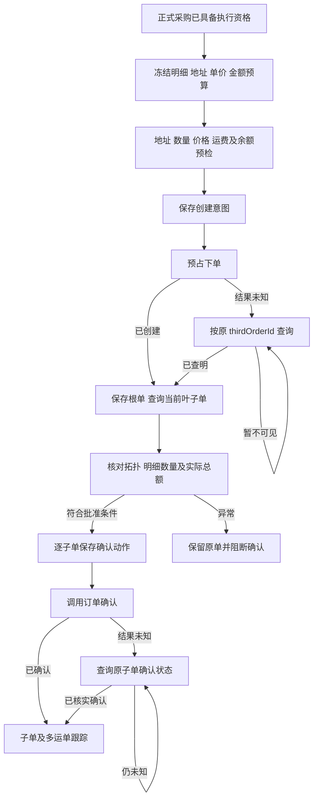

# 京东 VOP 供应商接入技术实施方案

## 1. 实施范围与约束

1. 本方案适用于京东 VOP 开放平台 `jingdong.vop.*` 接口，技术基线为 2026-10-29 仓库提交 `3aba038b6` 及当日读取的官方接口文档。不得混用旧版 VOP、京东到家或其他京东开放平台的认证和业务协议。
2. 京东复用现有供应商主档、API 连接、供应商品库、公司商品及 SKU、采购供给、正式采购和履约体系。协议类型新增为 `jd_vop`，中文名称为“京东 VOP”。
3. 首期交付普通实物商品的目录同步、选品入库、采购预检、预占下单、订单确认、父子单跟踪、物流查询及订单取消。支付方式固定采用合同开通的预存款，京东请求使用 `paymentType=4`。
4. 首期不启用虚拟商品、安装及预约服务、赠品选购、延保、混合支付、金采、未税价下单、自动充值、自动售后申请和自动开票。供应商要求附加履约流程而系统尚不支持的商品必须阻断自动发单，不得降级为普通快递单。订单自带附件须保留来源证据，不作为新增收费商品或采购行。
5. 采用通用架构扩展：新增独立订单确认能力、供应商父子订单关系及数量映射，发单与跟踪统一按连接类型分派。不得复制一套京东专用采购、审批或财务流程。
6. 继续执行[供应商 API 商品与自动履约执行合同](supplier-api-product-contract.md)及[批量选品入库执行合同](supplier-api-batch-adoption-contract.md)。采购审批、已批准金额、公司销售价格、资料人工维护、未知结果调查及财务记账边界保持有效。
7. 本方案规定开发目标；新增类型、模块及状态均为待实现项。凭据开通、生产订单、数据库迁移和真实供应商联调须在各自执行阶段完成，不以文档核对代替上线验收。

## 2. 当前架构与实施落点

以下路径均相对仓库根目录。

| 当前入口 | 已有责任 | 本期实施要求 |
| --- | --- | --- |
| `backend/crates/erp-supply/src/ports/connector/` | 标准商品、可供、配送、订单、支付通知等窄接口 | 扩展订单确认、按数量预检、订单树及包裹数量表达 |
| `backend/crates/erp-processes/src/connectors/registry.rs` | 按类型分派目录、健康及配置引用 | 增加已绑定连接的履约适配器解析入口 |
| `backend/crates/erp-processes/src/connectors/dangaoshushu/` | 已有协议实现 | 保持其独立协议实现，作为行为回归对象 |
| `backend/crates/erp-processes/src/supplier_api_orders/` | 冻结正式采购意图、地址、创建及支付通知 | 移除对蛋糕叔叔具体运行时与客户端的依赖，接入通用能力 |
| `backend/crates/erp-processes/src/supplier_order_tracking/` | 查询观察、回调唤醒、真实履约应用 | 支持订单树刷新、叶子订单观察和部分数量应用 |
| `backend/crates/erp-supply/src/api_order/` | 持久化执行步骤、动作指纹及采购关联 | 扩展订单发现、确认与恢复状态 |
| `backend/crates/erp-supply/src/entity/supplier_catalog.rs` | 来源目录、采购报价与公司关联 | 复用身份和版本机制，补充来源分组策略及采购限制 |
| `backend/crates/erp-processes/src/supplier_catalog_adoption/` | 自动匹配、建品、供给和资料同步 | 复用既有流程，不在京东适配器内建品 |
| `backend/crates/erp-integration/src/entity/supplier_callback.rs` | 已认证推送证据和补查意图 | 增加独立的拉取消息收件箱，不把拉取消息伪装成已验签回调 |
| `backend/apps/web-api/src/app_state.rs`、`core/supplier_order_worker.rs` | 生产装配与后台运行 | 仅配置京东时也必须启动发单、跟踪及消息处理 |
| `erp-client/features/supplier-api-connections/` | 连接设置、商品库、单项及批量选品 | 复用入口，补充京东只读状态和失败原因 |

### 2.1 必须消除的架构差异

| 差异 | 当前实际限制 | 规定处理 |
| --- | --- | --- |
| 订单协议分派 | 正式发单及跟踪直接持有 `DangaoshushuRuntime` | 注册表返回绑定连接的 `SupplierConnector`，流程只依赖窄 trait |
| 预占后确认 | `CreationNext` 仅有观察、支付通知；恢复创建会按支付状态推导下一步 | 增加独立确认步骤，由协议事实及能力决定后续动作，禁止把“未支付”统一解释为需要支付通知 |
| 父子单和再次拆单 | `OrderReference` 只有单个外部单号 | 保存原始根订单、历次父子关系和当前叶子订单，按叶子单执行确认、取消及跟踪 |
| 按数量和地址核验 | `AvailabilityQuery` 只有 SKU 和地区；不携带采购数量 | 新增下单预检合同，输入完整冻结行、数量及地址上下文 |
| 部分发货 | `Shipment` 只有行 ID；当前履约应用核对整行覆盖 | 增加来源子单及行数量，支持累计数量守恒；证据不足时仅保存轨迹 |
| 消息消费 | 现有入口面向供应商主动回调 | 增加拉取、持久化、补查应用和远端确认删除的独立流程 |

以上扩展不得削弱旧供应商的状态语义。实现阶段须同步更新标准 connector 合同说明，清除与当前商品合同冲突的旧描述，禁止照搬过时注释形成新规则。

## 3. 京东接口清单

接口名与参数以相应官方页面为准；文档可读不等于当前账号已获调用权限。开发前须形成账号实际授权清单。

| 用途 | 官方接口及文档 | 接入要求 |
| --- | --- | --- |
| 授权商品池 | [`goods.getSkuPoolInfo`](https://vop.jd.com/doc/api?id=5850) | 枚举当前合同商品池，不按全站类目抓取商品 |
| 池内分页 | [`goods.querySkuByPage`](https://vop.jd.com/doc/api?id=6741) | 使用新分页接口；保存 `bizPoolId`、返回 `offset` 和剩余页信息 |
| 商品详情 | [`goods.getSkuDetailInfo`](https://vop.jd.com/doc/api?id=5832) | 取得 SKU、SPU、单位、规格、品牌、分类、采购限制及图片详情 |
| 图片 | [`goods.getSkuImageList`](https://vop.jd.com/doc/api?id=5845) | 保留主图标记、有效标记和顺序，进入既有素材归档流程 |
| 分类 | [`goods.getChildCategoryList`](https://vop.jd.com/doc/api?id=5851)、[分类详情](https://vop.jd.com/doc/api?id=5846) | 只维护来源类目与名称，不直接覆盖公司分类 |
| 报价 | [`goods.getSellPrice`](https://vop.jd.com/doc/api?id=5847) | 优先按 `skuInfos` 传 SKU 及数量，以实际采购报价核验 |
| 全局销售资格 | [上下架](https://vop.jd.com/doc/api?id=5852)、[可售验证](https://vop.jd.com/doc/api?id=5844) | 区分上下架、可售、区域可达与实际库存 |
| 地址 | [四级地址列表](https://vop.jd.com/doc/api?id=5680)、[地址有效性验证](https://vop.jd.com/doc/api?id=5710)、[地址转换](https://vop.jd.com/doc/api?id=5726) | 显式映射京东四级地址，转换结果不得直接当作已确认地址 |
| 库存 | [`goods.getNewStockById`](https://vop.jd.com/doc/api?id=5834) | 使用真实订购数量和收货地区，禁止把请求满足量当库存总量 |
| 可采校验 | [`goods.getSkusAllSaleState`](https://vop.jd.com/doc/api?id=7003) | 仅用于下单前综合资格检查，另行核对库存和价格 |
| 运费 | [`order.querySkuFreight`](https://vop.jd.com/doc/api?id=5855) | 使用相同明细、数量、地址和 `paymentType=4` |
| 创建 | [`order.submitOrder`](https://vop.jd.com/doc/api?id=5856) | `submitStateType=0`，稳定 `thirdOrderId`，显式提交核验后的单价 |
| 订单详情 | [`order.queryOrderDetail`](https://vop.jd.com/doc/api?id=5824) | 支持原第三方单号恢复；发现父子关系、数量、金额及确认状态 |
| 确认 | [`order.confirmOrder`](https://vop.jd.com/doc/api?id=5839) | 独立持久化动作；按当前有效子单和京东实际确认规则执行 |
| 物流 | [一单多运单查询](https://vop.jd.com/doc/api?id=100086) | 按实际返回分组保留多运单，缺少商品数量时不得自行分摊 |
| 取消 | [`order.cancelOrder`](https://vop.jd.com/doc/api?id=5840)、[取消进度](https://vop.jd.com/doc/api?id=9685) | 申请受理与取消完成分离，结合查询及消息核实最终结果 |
| 消息 | [消息查询](https://vop.jd.com/doc/api?id=5871)、[消息删除](https://vop.jd.com/doc/api?id=5787) | 先落本地证据和处理意图，再补查应用，最后确认删除 |
| 预存款 | [账户余额](https://vop.jd.com/doc/api?id=5854)、[余额变动](https://vop.jd.com/doc/api?id=5853) | 余额预警及订单扣减、取消返款证据，不直接创建 ERP 付款凭证 |

## 4. 配置、认证与运行时

1. 在 `backend/config/src/` 新增 `JdVopConfig` 并纳入 `SafeConfig`；部署配置负责网关地址、应用凭据、授权令牌引用、账号范围、超时、限流、同步和轮询参数。采购页面不重复配置地址、密钥或环境。
2. 在 `erp-processes/src/connectors/jd_vop/` 实现 `runtime`、`transport`、`auth`、`wire`、`catalog`、`transform`、`delivery`、`preflight`、`order`、`tracking`、`messages` 模块。目录名为职责划分，允许按仓库大小门禁继续拆分。
3. 原始京东 DTO、字段类型兼容和响应封装只留在适配器；标准领域模型不得包含任意京东 JSON。`OfferTransform` 必须为纯转换，不执行 HTTP、数据库或文件上传。
4. 官方页面样例使用 `appKey`、`appSecret`、`accessToken`，但本方案不据此推导签名字符串、授权端点或刷新机制。G0 阶段必须取得本账号适用的官方 SDK/接入指南，冻结网关、公共参数、签名算法、编码、时间格式、令牌续期及错误码样本，完成固定向量测试后才允许连接联调。
5. 技术账号、合同授权范围与连接绑定。首期一个京东采购账号只允许一个负责消费该账号消息的连接；同账号多消费者必须共享账号级租约与收件箱，禁止相互删除未处理消息。更换账号不得复用原来源身份及历史订单命名空间。
6. OAuth 或令牌刷新如需持久化，保存到服务端受控凭据存储并使用单飞刷新及版本控制；不写业务连接明文字段。可刷新令牌轮换不得使同账号的历史订单失去查询资格。
7. 只读连接检查验证认证和已授权的商品读取入口；不得通过测试下单、确认或扣款判断健康。未实现的能力返回缺失，不因官方存在接口就声明已支持。
8. 解析必须分别处理 HTTP 失败、网关错误、方法响应封装及业务结果。使用接口实际响应键，兼容文档出现的 `responce` 拼写；不同方法的 `openRpcResult`、`vopOrderRpcResult` 不得硬套一个封装。
9. 金额使用十进制定点值；外部 ID 以字符串保存，解析数字响应时不得经过浮点数。业务成功、缺项和未知错误分别处理，未知业务码保留脱敏原码并失败关闭。
10. 读请求实施有界退避、连接级并发和账号级配额。创建、确认、取消及其他可能产生副作用的调用不得在 HTTP 客户端隐藏重试。

## 5. 商品同步和字段映射

### 5.1 身份与资料

| 京东字段或事实 | ERP 映射规则 |
| --- | --- |
| `skuId` | `SupplierSku.spec_id`；始终作为订货身份，不作为实际条码 |
| 已核实的 `spuId` | `SupplierSku.product_id`；以带类型前缀的稳定值区分 SPU 和回退 SKU 分组 |
| 无有效 SPU | 使用带 `sku:` 前缀的单 SKU 来源分组；后续补出 SPU 时先核验身份，不自动改键或合并已入库商品 |
| `skuName`、`spuName` | SKU 来源名称和商品共有名称分开处理；不得用某个规格名反复覆盖整个 SPU |
| `saleUnit` | 来源单位原文，按现有精确映射执行；重量及包装数量不替代订购单位 |
| `seoModel`、结构化规格属性 | 生成完整规格及可核验规格签名；仅型号不足以证明颜色、尺寸、包装一致时不得自动跨来源合并 |
| `brandName`、`category` | 品牌来源名称和三级类目路径；公司分类仍经选品映射确认 |
| `imagePath`、图片列表、详情内容 | 经过纯解析和安全展示处理，图片进入现有异步素材归档及差异同步；不在页面直接执行来源 HTML |
| 实际条码 | 仅在取得明确实际条码字段时填写；不得从 SKU、SPU、ISBN 或任意参数猜测 |
| `lowestBuy`、购买倍数 | 保存为来源采购约束，在目录提示并在下单前按当前数量复核；不复制为公司集采起订量 |

商品详情及其扩展字段来源见[商品详情接口](https://vop.jd.com/doc/api?id=5832)。同一 SPU 的共有资料选择须稳定；不同 SKU 返回共有资料不一致时保留各自证据并进入资料核验，不采用最后一次写入覆盖。

### 5.2 采购价格

1. 在已核实的人民币含税价格体系下，以 `salePrice` 映射来源采购报价；`jdPrice`、`marketPrice` 不得替代采购成本。报价返回空值或负值时保存“暂无报价”，禁止置零；明确零值仍按既有金额规则校验。
2. 京东文档支持按数量查询价格，并存在促销及未税价扩展。目录必须保存本次报价的数量、时间和适用上下文；目录报价不得承诺适用于任意数量。首期不启用需要 `cid` 等用户资格的个性促销价格，遇此类商品须阻断并记录原因。
3. 税率按已验证的实际字段单位转换，保留原文证据。不得把全部京东商品强制映射为 13%；来源税率缺失时沿用现有选品补齐规则并显式提示。
4. `marketPrice` 在京东文档中具有展示限制。首期不将其自动填入公司市场价；`jdPrice` 也不作为替代值。公司销售参考价继续由采购明确维护或按既有批量规则主动计算。
5. 首期仅形成已核验的一件代发采购条款；京东一次允许购买多件不等于提供独立集采报价。不根据数量大于一自动生成集采能力。
6. 报价变化生成 API 采购供给修订，保留历史成本；不覆盖公司销售价格、历史采购快照或人工停用状态。

价格字段、缺报价和扩展口径见[批量查询商品售卖价](https://vop.jd.com/doc/api?id=5847)。

### 5.3 全量、定向刷新与恢复

1. 全量流程为“商品池清单 → 池内 SKU 分页 → SKU 去重 → 详情、报价及销售资格 → 标准 Offer → 目录保存”。不得使用分类接口代替授权商品池。
2. 游标包含版本、账号范围指纹、冻结的池清单引用、当前池、来源返回的 offset 及页内处理位置；较大清单存入检查点记录，不无限扩张游标。`offset` 不是页码，不用本地行数递增替代。
3. 单页详情及报价查询有界并发；一项映射失败记录来源 SKU 和脱敏原因，继续处理其他项。认证、限流、整页网络失败不得跳过整页或推进检查点。
4. 当前目录项、后续补齐意图及检查点按既有事务规则提交，沿用采集租约、心跳及发布恢复机制。图片归档独立执行，不阻断原始目录采集。
5. 一个 SKU 出现在多个商品池时只保存一个来源订货身份，同时保留池成员关系。从一个池移除不表示退出全部授权范围；仅在核实所有有效成员关系和当前可采资格后撤回供给。
6. 京东消息消费不能冒充按固定时间窗口完整重放的 `OfferSource::scan`。首期扫描能力声明 `IncrementalSupport::Unsupported`，使用消息驱动定向刷新和周期全量校对；共用调度不得因此按短周期持续跑全量。
7. 分页完成不保证并发变化下的一致全量快照；缺项、查询不可见和消息中断不得直接删除商品。来源无可信版本时记录观察时间，按对象串行补查，不伪造来源更新时间或单调版本。
8. 目录中的销售资格、精确库存、按地址的可供结果分别表达。未取得全国无条件供给证明时不得把某地址库存写成全局库存；无精确数量时保持未提供，禁止填无限库存。

商品池分页依据[商品池清单](https://vop.jd.com/doc/api?id=5850)和[池内分页接口](https://vop.jd.com/doc/api?id=6741)。

## 6. 消息收件箱与补偿

1. 新增通用 `SupplierMessageSource` 窄接口，提供消息拉取及确认方法；接收方式与 `Callbacks` 分开声明。京东首期采用主动拉取，不新增没有官方依据的公网回调入口。
2. 收件箱由 `erp-integration` 持有，至少保存账号范围、连接、来源消息 ID、类型、内容指纹、加密正文、接收时间、处理状态、重试时间和远端确认状态。唯一键使用“账号范围 + 来源消息 ID”；同 ID 异载荷进入冲突处理。
3. 消费顺序固定为：拉取 → 保存证据和处理意图 → 定向查询最新事实 → 按领域规则应用或持久化隔离处理结果 → 登记待确认 → 调用远端消息删除 → 标记已确认。
4. 数据库保存失败不得删除远端消息；进程重启通过本地记录恢复。删除结果未知时保留 `ACK_UNKNOWN`，核实或按已经证实的删除幂等规则恢复；不得重新执行业务应用。
5. 拉取消息是刷新线索，不直接修改采购、取消、退款、库存或财务事实。无效正文也须保留原始证据和隔离状态，禁止在未可靠接收时直接删除。
6. 首期订阅商品变更、订单拆分、配送、妥投、完成、取消和支付异常相关类型。至少核对 `1/2/4/5/6/10/12/14/15/16/31/48/126/132` 的账号实际开通情况；地址变化与税率变化按授权增加，税率消息不能承担全部税率同步。
7. 调度以商品消息最长两分钟的消费目标配置，实际配额和并发在 G0 确定。监控最老未处理消息年龄、失败队列、定向刷新延迟和全量基线年龄；超限告警并限制使用过期供给。
8. 首次初始化前先建立消息收件箱，扫描期间持续接收，完成后补查期间变化。消息长期停收、订阅变更或恢复超过保留窗口时，必须重新全量建立基线。

官方说明指出消息最多保存 30 天，部分商品消息长期不消费会被限制生成；拆单消息可能多次发生，并以原始父单提示重新查询当前子单。不得将空队列作为目录完整证明。见[消息类型说明](https://vop.jd.com/doc/guide?id=268f772f-833a-40a5-8ca0-6629d6955aae)、[消息查询](https://vop.jd.com/doc/api?id=5871)和[消息删除](https://vop.jd.com/doc/api?id=5787)。

## 7. 地址、数量与下单预检

1. 新增标准 `OrderPreflight` 能力；输入绑定连接、冻结采购行及数量、收件地址上下文、配送选项、批准单价与批准总额。输出逐行可采结果、核验价格及数量上下文、运费、观察时间和阻断原因，不创建订单。
2. 现有 `AvailabilitySource` 保留一般可供查询职责。京东不接受以默认数量 1 核验任意采购数量，不以“状态有货”推导当前数量足够。
3. 京东四级地址作为类型化的供应商地址上下文保存，并绑定收件地址指纹；公共 `Recipient` 不塞入京东字段或任意 JSON。ERP 地区编码不能直接充当京东编码。
4. 优先维护明确的四级地址映射。地址转换接口仅产生候选结果，须校验省市区镇及有效性；歧义、缺少必需四级地址或地址过长时进入履约资料补齐。用户修改地址后原核验与运费失效。
5. 预检依次核对采购执行资格、连接启用、来源供给版本、单位、采购数量精度及倍数、四级地址、综合可采、按量库存、当前报价、运费和总额；创建前重新执行时效敏感核验。
6. 库存 `remainNum=-1` 为未知；文档存在按请求数量返回、并非真实库存的情况。仅在满足已验证语义的分支映射精确数量，其余返回“本次请求可满足/不可满足/未知”。任何结果均不代表预占成功。
7. 普通实物首期不自动接受预订及无货预订。现货、在途和可配货须结合批准交付条件判定；未知状态码阻断，不按中文描述关键词猜测。
8. 批量库存、报价、可采和运费请求遵守各接口上限。创建请求最多 100 个商品项；超过上限须在编排层形成独立执行组、单号和各组金额预算，逐组重算运费，不在适配器内拆成多次提交。
9. 余额查询仅作预警和预检，不构成锁款或并发余额保证。余额不足、无法核实价格或总额超批均阻断；后续京东明确支付失败或结果未知分别处理，不自动充值。

地址规则见[地址转换](https://vop.jd.com/doc/api?id=5726)和[地址验证](https://vop.jd.com/doc/api?id=5710)；数量语义见[库存接口](https://vop.jd.com/doc/api?id=5834)；综合可采和费用分别依据[可采接口](https://vop.jd.com/doc/api?id=7003)及[运费接口](https://vop.jd.com/doc/api?id=5855)。

## 8. 预占、父子单和订单确认

### 8.1 状态与能力

1. 新增 `OrderConfirmation` 能力及独立确认状态；`PaymentConfirmation` 继续只表示原有供应商支付结果通知，京东预占确认不得实现为该能力。
2. `CreationNext` 扩展为可表达“发现当前子单并确认”的后续动作；`ApiOrderStage` 增加 `DiscoverOrders`、`ConfirmOrder`、`ConfirmationUnknown`。创建恢复必须由协议当前事实重建下一步，不再使用“支付状态未确认则进入支付通知”的通用推断。
3. 每个待确认叶子单保存独立动作身份、载荷指纹、目标订单及拓扑版本。根执行状态只汇总进度，不代替子单动作结果。
4. 下列流程图表达主路径；所有远端写调用前必须先可靠保存未知状态和原动作身份。

### 8.2 创建与金额

1. `thirdOrderId` 由持久化执行组身份生成，遵守 100 字符限制；重试和恢复保持原值。提交 `submitStateType=0`、`paymentType=4`，并对每行显式传递已核验的 `skuUnitPrice`。不得省略单价以接受任意最新价格。
2. 下单所需 `invoiceInfo` 仍是必需的采购资料；首期不自动开票不等于可以缺少下单发票参数。复用采购主体的经核验开票资料，冻结发票类型、开票方式及必要收票信息；资料不足时阻断，不从客户销售开票信息推导。
3. 赠品请求显式关闭，不发送延保、虚拟或服务类扩展字段；若供应商回传额外收费项或不可识别商品，保留原单并阻断后续确认。
4. 创建成功后先保存外部订单身份和实际金额，再判断是否继续。不能因金额异常把已创建结果返回成“未下单失败”。父单金额和子单金额分别存证，禁止父单与子单重复累计。
5. 单价条件校验不代表运费和总额具备远端原子上限保障。确认前再次核对完整当前子单集合、商品及费用合计与已批准预算；缺少可信金额、数量不守恒或超额均阻断确认。
6. 预占是否冻结或扣减预存款、确认时是否重计费用、预占有效期及价格锁定范围必须在 G0/G6 核实。在此之前不得宣称预占无资金副作用，也不得宣称预查可保证最终不会超额。已发生冻结或扣减时保留证据，进入原单异常及取消处理。

预占参数和单价校验依据[提交预占订单](https://vop.jd.com/doc/api?id=5856)；独立确认依据[确认订单](https://vop.jd.com/doc/api?id=5839)。

### 8.3 父子关系与数量守恒

1. 新增供应商订单节点记录，至少包含连接、执行组、外部订单号、原始根单号、直接父单号（来源提供时）、节点角色、当前/历史拓扑版本及来源观察。根订单号不得被后续子单号覆盖。
2. 京东可能再次拆分子单。每次拆单提示须按原始根单重新查询当前叶子集合；新拓扑原子保存，旧节点及动作保留历史。仅收到一条拆单消息不得判定拓扑已完整。
3. 新增“ERP 冻结采购行 → 来源订货 SKU → 当前叶子单行 → 数量”的关联。各有效叶子数量合计必须等于原批准数量；同一 SKU 对应多条 ERP 行时需保存确定性的分配明细，禁止只靠 SKU 号丢失行归属。
4. SKU 采购单价、单位或关键属性不一致的 ERP 行不得在提交前合并。相同条件允许聚合请求，但必须保存可逆数量分配，限制售后或发货应用不得超出对应行余额。
5. 仅用当前叶子单计算金额和履约覆盖；历史父节点不重复形成应付、成本或发货事实。发现缺单、未知数量、重复节点、循环关系或无归属 SKU 时停止确认与自动事实应用。
6. 订单确认按当前有效子单执行。动作发送前校验拓扑版本；远端可能并发拆单时，保存原目标及响应，再刷新拓扑。已确认、结果未知和被拆分节点均不得盲目重发或把成功复制给新子单。
7. 只有根订单且来源已明确证明其为可操作叶子单时，允许该节点同时承担根和叶子角色；父单尚未返回子单不等于无需拆分。不得伪造子单号，未取得完整可操作节点时继续调查。

父子订单查询依据[订单详情](https://vop.jd.com/doc/api?id=5824)，再次拆单依据[消息类型说明](https://vop.jd.com/doc/guide?id=268f772f-833a-40a5-8ca0-6629d6955aae)。

### 8.4 恢复、关闭开关与采购变更

1. 创建超时按原 `thirdOrderId` 查单；暂不可见保持未知，不更换单号、不重新下单。确认超时按原目标查询确认状态；取消超时调查原取消结果。
2. `ReplayProtection` 在未取得官方保证前为 `Unverified`。ERP 幂等键不能替代京东远端幂等保证；安全重放窗口及重复请求语义须形成独立测试证据。
3. 关闭自动下单阻止新的创建及尚未发送的京东订单确认；不阻止商品同步、选品、已发送动作调查、取消处理和订单跟踪。已预占未确认单显示处理期限及原因，不静默放行确认。
4. 存在任何可能已送达的创建、确认或取消动作时，采购变更必须复核全部受影响叶子单。所有相关订单取消已核实且已应用、无发货及未决返款冲突后，才能按既有采购变更规则重排；不得只看根单一个状态。
5. 同一执行组在多 worker 下使用有期租约及 fencing 版本领取；后续动作、拓扑修改和查询结果应用均校验持有权。租约过期只允许接手调查未知步骤，不允许再次发送原写请求。

## 9. 物流、取消与预存款证据

1. 每个有效子单独立保存确认、履约、取消及支付观察。根执行通过明确聚合规则展示“部分确认”“部分发货”“部分取消”等进度；不得用任一子单完成标记全部完成。
2. 多运单按供应商运单身份归档并保留承运方、轨迹及来源子单。标准包裹行扩展 `line_id + quantity`；来源不能证明包裹包含哪些商品和数量时只更新轨迹，不猜测发货数量。
3. 真实发货应用按未处理来源事件/观察和累计行数量去重。部分数量先形成相应交付事实；累计数量不得超出冻结行数量。旧逻辑中的“整单发货即整行覆盖”分支须改为显式完整覆盖证明。
4. 供应商直发不增加公司仓库库存。入仓订单只更新运输状态，库存仍以真实收货为准。京东妥投或订单完成不自动代替公司客户验收。
5. 取消先核对当前叶子单集合及允许取消的范围，逐单保存动作。接口返回成功仅作为申请受理；以可信取消结果或进度最终状态核实，不把整单部分取消显示为全部取消。
6. 取消与返款分离。已取消但预存款尚未返还时保留返款待核实；不能据取消结果直接生成供应商退款、冲销成本或减少应付。
7. 查询余额变动按稳定交易号、京东订单号、金额及业务类型保存来源证据；同一交易不重复归集。来源缺失稳定身份或金额无法解释时保留待核对，禁止用余额差倒推出某订单支付成功。
8. 充值、订单扣减和取消返款进入已有财务核对流程。本期不自动生成 ERP 银行流水、供应商付款或退款单，不以接口订单确认伪造资金到账。已有采购预付款控制继续有效，不因使用京东预存款被绕过。
9. 首期售后由既有人工业务流程处理，系统保留子单、SKU、数量及资金证据供后续扩展。退款消息仅触发调查，不自动完成一笔无法定位的退款。

物流依据[多运单接口](https://vop.jd.com/doc/api?id=100086)，取消依据[取消接口](https://vop.jd.com/doc/api?id=5840)和[取消进度](https://vop.jd.com/doc/api?id=9685)，资金证据依据[余额变动接口](https://vop.jd.com/doc/api?id=5853)。

## 10. 持久化、索引与前端

### 10.1 数据归属和索引

| 数据 | 归属及索引要求 |
| --- | --- |
| 京东账号技术引用、令牌 | 配置/受控凭据存储；版本化更新，业务响应不可返回密钥 |
| 池清单与 SKU 成员关系 | `erp-supply`；按连接、池、SKU 唯一，支持按 SKU 查询所有有效池 |
| 目录采购限制、报价上下文 | `erp-supply`；关联现有来源身份及映射版本，不建第二套商品主档 |
| 供应商订单节点 | `erp-supply`；连接 + 外部订单号唯一，索引执行组及当前叶子状态 |
| 外部行数量关联 | `erp-supply`；节点 + 外部行标识 + ERP 冻结行唯一；版本化校验数量守恒 |
| 确认、取消动作 | `erp-supply`；执行组 + 目标节点 + 动作类型 + 操作身份唯一；到期任务索引 |
| 拉取消息收件箱 | `erp-integration`；账号范围 + 来源消息 ID 唯一；处理状态/下次尝试索引 |
| 余额变动证据 | `erp-supply` 的供应商来源证据；账号范围 + 来源交易身份去重，财务解释经既有流程 |

1. 跨域写事务由 Process 编排，拥有领域提供 Repository/Port；外部 HTTP、素材读取和远端消息删除均在事务外。
2. 身份映射、拓扑变化、动作状态及必要审计须原子保存。禁止把接口返回 JSON 直接当作不受约束的业务实体。
3. 新集合及索引经领域公开入口登记；迁移提供只读核对、显式应用、有界批次和回滚说明。外部订单、来源证据和幂等记录不得因代码回滚删除。
4. 旧蛋糕叔叔单据按原语义读取；缺少新字段不得误认为京东订单树或待确认订单。若新状态已写入，旧二进制不能安全读取时禁止直接回退。
5. 当前标准报价及目录记录不足以完整保存购买倍数、税率和按量报价上下文。新增类型化的采购约束与报价上下文，贯通 `Offer`、目录持久化、选品预览、供给修订及冻结采购快照；缺省字段表示未取得，不用默认数量或默认税率补造来源事实。新字段须参与来源指纹和版本核验，并测试序列化往返及旧记录读取。
6. `DeliveryContext` 当前仅有引用字符串。四级地址明细和版本保存于加密执行快照，引用绑定该快照、连接和地址指纹；公共流程经窄接口传递，不能依赖解析任意引用字符串取得地址。恢复地址步骤须读取原快照，不重复执行可能改变地址的转换。

### 10.2 页面与权限

1. 复用 API 连接及商品库页面，增加“京东 VOP”类型和只读能力。显示配置缺失、授权不足、消息延迟及余额异常的业务原因，不展示签名、令牌或技术账号明文。
2. 商品库复用单项及批量选品流程，展示京东 SKU、采购报价观察时间、起购/倍数限制、来源类目和资料核验状态；不新增人工目标 SKU 匹配入口。
3. 正式采购履约详情补充预占、确认、部分确认、根单/子单、多运单和取消进度；操作旁明确涉及的子单及数量。结果未知时展示“查询原结果”，不得提供可直接重发的按钮。
4. 地址补齐使用京东四级地址候选及确认状态，不在整个流程新增重复供应商设置表单。
5. 所有读写复用现有供应商、采购、履约权限和数据范围；根单、子单、消息和资金证据读取须反查所属连接及来源业务单据，不信任前端提交的归属。
6. 新增或修改路由需同步权限生成物和调用端。前端新页面状态须先给出设计并确认，再进入界面实现；本方案不替代页面确认。

## 11. 实施顺序与完成条件

| 阶段 | 交付内容 | 进入下一阶段的条件 |
| --- | --- | --- |
| G0 协议冻结 | 账号授权矩阵、认证/签名样本、含税价格口径、预存款资金节点、预占期限、重复请求规则、发票参数、状态码及配额 | 所有影响写操作和金额的规则有官方资料或账号联调证据；未明确项不进入生产发单 |
| G1 通用履约扩展 | 注册表履约解析、订单确认、按量预检、订单树、数量映射、消息 Port 和迁移设计 | 蛋糕叔叔行为回归通过，京东只读能力可独立装配 |
| G2 商品及消息 | 商品池全量、来源映射、定向刷新、消息收件箱、补偿和可观测指标 | 中断恢复、重复池、缺报价、来源变更不覆盖公司价格等单元验收通过 |
| G3 页面与选品 | 既有入口适配、资料补齐、来源采购限制及操作状态 | 关键页面状态已确认，权限和批量工作流回归通过 |
| G4 正式订单 | 地址及按量预检、预占创建、根单恢复、叶子发现与确认 | 结果未知零重复写、金额和数量守恒、再次拆单等替身测试通过 |
| G5 跟踪与取消 | 部分数量发货、多运单、取消及返款证据、异常处理 | 重复乱序不重复履约或记账，未知事实不自动完成 |
| G6 授权联调与灰度 | 指定测试账号/订单范围的真实协议验收、迁移核对、灰度开关及回滚演练 | 真实验证记录独立归档；在明确授权范围内完成，生产新增下单保持关闭直至放行 |

G0 可与纯模型设计并行；未核实认证协议不得编造可用签名实现，未核实资金或确认规则不得通过生产写请求试探。首期不以只完成目录适配作为整项接入完成。

## 12. 验收矩阵

| 编号 | 场景 | 必须证明的结果 |
| --- | --- | --- |
| JD01 | 仅配置京东运行时 | 目录、订单与跟踪能够装配，不依赖蛋糕叔叔配置 |
| JD02 | 无授权、过期令牌、限流 | 原因准确脱敏，失败关闭；写请求不隐藏重试 |
| JD03 | 多池、空页、断点及进程重启 | 来源身份不重复，检查点不跳页，失败页不推进 |
| JD04 | 某池移除 SKU | 仍在其他授权池时不误撤回；未知范围不冒充删除 |
| JD05 | 缺价格、负值、明确零、税率变化 | 保留真实语义，不猜零，不统一 13%，不改公司销售价 |
| JD06 | SPU 缺失、分组变化、规格不完整 | 来源身份稳定，冲突进入核验，不自动合并错误 SKU |
| JD07 | 单项及批量选品 | 沿用自动匹配、严格条码、公司编号、供给及资料差异合同 |
| JD08 | 多副本消息消费、保存后崩溃、确认删除未知 | 消息不提前丢失，业务不重复应用，账号消费者不争删 |
| JD09 | 地址无四级、地址变化、转换歧义 | 阻断或重新确认，不用 ERP 地区 ID 猜测京东地址 |
| JD10 | 数量 1 与大数量、倍数、起购限制 | 按实际请求核验；请求满足量不写成精确全局库存 |
| JD11 | 报价变化、运费上涨、余额不足 | 不扩大批准金额、不自动充值，异常保留来源证据 |
| JD12 | 创建已成功但响应丢失 | 按原第三方单号恢复，外部创建调用不重复 |
| JD13 | 一父多子、子单再次拆分、部分确认 | 拓扑和明细数量守恒；不重复累计父子金额或确认已处理节点 |
| JD14 | 确认超时、查询未确认或暂不可见 | 不推导安全重发，不触发原支付通知接口 |
| JD15 | 子单少发、分批发货、多运单缺少数量 | 只应用可证明的数量；无证据仅记录物流，不全单发货 |
| JD16 | 取消受理、失败、部分成功、返款延迟 | 取消与返款分开；采购变更须核实所有受影响子单 |
| JD17 | 重复资金明细及退款消息 | 不重复归集，不自动生成未核实付款或退款事实 |
| JD18 | 关闭自动下单 | 新建与未发确认被阻断，目录、调查、取消及跟踪继续 |
| JD19 | 越供应商/采购范围查询子单、消息或资金证据 | 服务端拒绝，不泄露成本、地址及账号数据 |
| JD20 | 蛋糕叔叔和手工采购回归 | 原支付通知、创建恢复、审批、履约及价格行为保持 |
| JD21 | 历史数据升级及回退 | 默认值诚实，新增状态兼容受控，历史外部证据完整保留 |

1. 实现阶段按仓库规则只新增内联库单元测试，使用替身执行真实编排逻辑，覆盖写入顺序、动作次数、失败停止及恢复；不得用源码文本断言替代行为测试。
2. 后端执行相应 crate 的库测试、公开接口变更后的 workspace check，以及完成阶段的 fmt、Clippy、领域边界和权限漂移门禁；前端执行 lint、format、TypeScript 和 build，不新增前端单元测试。
3. 常规实现不得自行新增或执行真实 MongoDB、供应商集成测试或浏览器操作。真实验收属于 G6，需独立执行授权并限定账号、金额、订单和环境；替身通过不标记为真实供应商验收。
4. 本次仅交付方案文件，验证文档链接、源代码落点和 `git diff --check`，不运行编译或业务测试。

## 13. 发布和回滚

1. 发布前完成迁移只读核对、重复身份检查和必要备份。先部署兼容读取及新索引，再启用京东只读连接、目录与消息；自动下单默认关闭。
2. 完成商品及选品验收后，按已授权的有限供应商账号、SKU 和订单范围灰度。预检、预占、确认、物流、取消及资金证据必须分别具备验收记录。
3. 新增写动作上线后，回滚首先停止新增创建和未发送确认，保留未知动作调查、既有订单跟踪及取消能力。不得通过关闭整个 worker 遗留无人跟踪的预占单。
4. 新状态或订单树已写入后，只能回退到能读取并处理这些事实的版本；若旧版不兼容，保留新版恢复 worker，先消解进行中动作，再制定数据兼容回退。不得清除外部单号、动作指纹或消息证据来恢复旧格式。
5. 预存款充值、已经发生的扣减、退回及真实供应商订单不随代码回滚撤销。所有资金和业务纠正沿既有正式流程处理。
