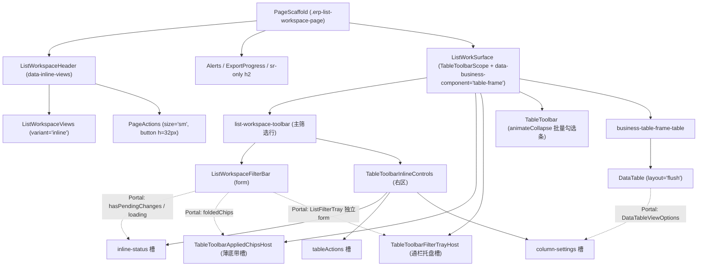

# ERP 表格列表页设计系统（List & Table Design System）

> **设计基准标杆**：[`erp-client/features/master-data/pages/products-list-page.tsx`](../erp-client/features/master-data/pages/products-list-page.tsx)（商品列表）  
> **主题体系**：飞书 Universe Design / 飞书多维表格风格（清澈商务蓝 + 纯白通栏工作面 + 无框柔底轻工具栏）  
> **适用范围**：所有桌面端高密度数据列表页（主数据、单据列表、台账、治理记录等），确保未来新建或改版表格页在视觉层级、控件密度、交互反馈、状态表达与代码组织上完全一致。

---

## 目录

1. [设计理念与黄金法则](#1-设计理念与黄金法则)
2. [设计令牌系统（Design Tokens）](#2-设计令牌系统design-tokens)
3. [页面架构与 7 层垂直解剖](#3-页面架构与-7-层垂直解剖)
4. [核心区域逐项视觉规范](#4-核心区域逐项视觉规范)
5. [表格结构、列宽与 8 类单元格规范](#5-表格结构列宽与-8-类单元格规范)
6. [全生命周期状态与交互规范](#6-全生命周期状态与交互规范)
7. [权限显隐与自动化 DOM ID 契约](#7-权限显隐与自动化-dom-id-契约)
8. [复用架构与新列表页实施蓝图](#8-复用架构与新列表页实施蓝图)
9. [视觉与交互验收清单（QA Checklist）](#9-视觉与交互验收清单qa-checklist)

---

## 1. 设计理念与黄金法则

`products-list-page.tsx` 代表当前 ERP 列表工作面的最新设计标准，其核心目标是在 **1440px 桌面基准宽度**（同时兼容 `≤960px` / `≤720px` 矮屏与窄窗）下实现**最高首屏数据占比**与**最低视觉噪声**。

### 五条黄金法则

1. **纯白通栏工作面 + 无框通栏表格，靠水平细线建立秩序**
   - 页面级骨架（`erp-list-workspace-page`）铺满纯白底色（`bg-card`），左侧导航自带 `1px` 右细线（`border-sidebar-border/80`）确立主次边界；
   - 页头、筛选栏、已选条件带、高级筛选托盘、表格首尾列内容外沿、分页条全部沿同一水平基准线（`--scaffold-px`）严格对齐；
   - 表格主体（`data-table-surface`）采用**通栏无四周边框**设计，表头覆写为**纯白底色（`--table-header: var(--card)`）**，既彻底杜绝浅灰表头贴死左侧导航造成粘连，又消除“白底套白框”的局促感；批量勾选操作条采用**表格底部居中悬浮胶囊（Floating Dock）**，零表体跳动且与左右操作列自然错开。
2. **压扁表头前纵向层数，首屏让位给数据**
   - 当视图切换仅有 **2~4 个短项**（如「全部 / 当前启用 / 当前停用」）时，必须内联并入页头同行（`ListWorkspaceHeader views={...}` + `variant="inline"`），同时省略冗余 `eyebrow` 与 `description`，把页头压缩为紧凑单行（`48px`）。
3. **色彩克制与视觉降噪**
   - 整页只保留 **1 个强主蓝焦点**（页头最右侧主动作「新建」，或在有未提交筛选时临时亮起的「查询」，或勾选后的批量主动作）。
   - 页头次要动作（导入、导出）降级为无框轻按钮（`variant="ghost"` + `listWorkspaceStyles.quietButton`）。
   - 筛选区的搜索框、常用下拉、高级筛选胶囊统一使用 **无边框浅灰柔底（`bg-muted/65`）**；一旦有选中值，统一转为 **冰蓝柔底（`bg-sidebar-accent/70`）+ 深蓝文字（`text-sidebar-accent-foreground`）**。
4. **静止态极净扁平，滚动时按需显影**
   - 表格外框、工具栏按钮、空态容器默认无阴影（`shadow-none`）；吸顶表头与左右冻结列的投影仅在真实发生纵/横滚动产生遮挡时（`data-scrolled-top/left/right="true"`）显现。
5. **视口撑满与表内独立滚动**
   - `ListWorkSurface` 作为 `PageScaffold` 的直接最后一个子元素时，自动撑满视口剩余高度（下限 `min-height: 16rem` 防止矮屏压扁表格），表格主体在内部独立纵横滚动，表头吸顶、分页条固定吸底。

---

## 2. 设计令牌系统（Design Tokens）

所有视觉值必须消费 `erp-client/app/globals.css` 中定义的语义 token，**禁止在业务列表页硬编码色值或随意指定像素尺寸**。

### 2.1 色彩体系（Light / Dark）

#### 表面、文字与交互色

| 语义角色 | CSS Token / Tailwind 类 | 浅色模式值（参考 Hex） | 深色模式值 | 列表页使用场景 |
| --- | --- | --- | --- | --- |
| 纯白工作面 | `--card` / `bg-card` | `oklch(1 0 0)` (`#ffffff`) | `oklch(0.205 0.007 255)` | 列表页整页背景、页头、筛选栏、表格主体、分页条 |
| 全局画布底 | `--background` / `bg-background` | `oklch(0.98 0.002 252)` (`#f7f8fa`) | `oklch(0.155 0.006 255)` | 非通栏页底层画布 |
| 表头极浅底 | `--table-header` / `bg-table-header` | `oklch(0.984 0.002 252)` (`#f8f9fb`) | `oklch(0.185 0.006 255)` | `<thead>`、冻结列头背景 |
| 浅沉表面 | `--surface-sunken` / `bg-surface-sunken` | `oklch(0.982 0.002 252)` | `oklch(0.175 0.006 255)` | 批量勾选条（`/70`）、表内刷新中提示条 |
| 轻控件柔底 | `--muted` / `bg-muted` | `oklch(0.964 0.003 255)` (`#f2f3f5`) | `oklch(0.25 0.007 255)` | 搜索框/筛选胶囊默认 `bg-muted/65`，悬停 `bg-muted` |
| 主文字（墨黑） | `--foreground` / `text-foreground` | `oklch(0.252 0.011 255)` (`#1f2227`) | `oklch(0.96 0.003 255)` | 页标题、主名称列；普通单元格用 `text-foreground/90`；表头用 `text-foreground/65` |
| 次级文字 | `--muted-foreground` / `text-muted-foreground` | `oklch(0.525 0.013 255)` (`#656b72`) | `oklch(0.68 0.008 255)` | 副身份编号、单位、筛选标签、分页元信息；空值 `—` 用 `/60` |
| 主交互蓝 | `--primary` / `bg-primary` `text-primary` | `oklch(0.562 0.212 261)` (`#1f6aee`) | `oklch(0.66 0.18 260)` | 主按钮「新建/查询/批量操作」、激活视图 Tab、行内操作链、Switch 开启态、Checkbox 选中态 |
| 冰蓝选中柔底 | `--sidebar-accent` / `bg-sidebar-accent` | `oklch(0.955 0.02 258)` (`#e8f1fe`) | `oklch(0.27 0.055 260)` | 有值筛选胶囊（`/70`）、激活高级筛选按钮（`/75`）、行操作按钮悬停（`/70`） |
| 冰蓝选中深字 | `--sidebar-accent-foreground` | `oklch(0.495 0.195 262)` (`#1a57ce`) | `oklch(0.84 0.095 258)` | 搭配冰蓝底的深蓝文字，前缀标签用 `/75` |
| 行悬停底 | `--row-hover` / `bg-row-hover` | `oklch(0.978 0.002 255)` (`#f7f8fa`) | `oklch(0.24 0.006 255)` | 表格行中性灰 hover（把冰蓝专留给选中态）、排序激活列头 |
| 行选中/高亮底 | `--row-selected` / `bg-row-selected` | `oklch(0.955 0.02 258)` (`#e8f1fe`) | `oklch(0.275 0.045 260)` | `data-state="selected"` 与 `highlightedRowId` 行 |
| 焦点光环 | `--ring` / `ring-ring` | `oklch(0.562 0.212 261 / 28%)` | `oklch(0.66 0.18 260 / 32%)` | 所有可聚焦控件 `focus-visible:ring-[3px]` |
| 结构细边线 | `--border` / `border-border` | `oklch(0.922 0.003 255)` (`#e6e8eb`) | `oklch(1 0 0 / 12%)` | 区域底线 `/60`，表头底线 `/75`，浮层描边 `/90` |
| 表格行分隔线 | `--grid` / `border-grid` | `oklch(0.948 0.003 255)` (`#eff0f2`) | `oklch(1 0 0 / 9%)` | 数据行底线 `border-grid/75`，菜单分割线 |
| 控件描边 | `--input` / `border-input` | `oklch(0.892 0.004 255)` (`#dcdfe3`) | `oklch(1 0 0 / 18%)` | 独立输入框、复选框未选描边 |

#### 语义状态色（用于 `StatusBadge` / `BusinessStatusBadge` / 告警）

| 语义族 | 浅底 Token | 文字 Token | 描边 Token | 典型业务含义 |
| --- | --- | --- | --- | --- |
| `success` | `--success-soft` | `--success-soft-foreground` | `--success-border` | 当前启用、已上架、已覆盖、操作成功 |
| `warning` | `--warning-soft` | `--warning-soft-foreground` | `--warning-border` | 部分上架、部分覆盖（如 `2/5`）、待确认资料更新、待生效、`待查询` 胶囊 |
| `info` | `--info-soft` | `--info-soft-foreground` | `--info-border` | 处理中、补齐上架、同步中 |
| `destructive` | `--destructive-soft` | `--destructive-soft-foreground` | `--destructive-border` | 异常失败、错误告警、破坏性菜单项（`text-destructive`）、阻断原因 |
| `neutral` | `--neutral-soft` | `--neutral-soft-foreground` | `--neutral-border` | 未覆盖、已下架、草稿、跳过 |
| `void` | 复用 `neutral` + `line-through opacity-80` | — | — | 已作废、已关闭 |

### 2.2 字体与字号阶梯（Typography）

完整约定见[排版与字号设计系统](./typography-design-system.md)。

- **中文字体栈**：内置 `@fontsource-variable/noto-sans-sc`，完整回退链 `"Noto Sans SC Variable", system-ui, -apple-system, BlinkMacSystemFont, "Segoe UI", Roboto, "PingFang SC", "Hiragino Sans GB", "Microsoft YaHei", sans-serif`，全局开启 `-webkit-font-smoothing: antialiased; text-rendering: optimizeLegibility`。
- **等宽数字工具类 `.num`**：应用 `font-variant-numeric: tabular-nums lining-nums slashed-zero` 与 `"tnum" 1, "lnum" 1, "zero" 1`。所有编号、金额、数量、页码、版本号、计数**必须**加 `.num`（右对齐表格列 `data-align="end"` 已在 `globals.css` 自动附加 `.num`）。

| 视觉角色 | Token / Tailwind 类 | 字号 / 行高 | 字重 | 使用位置 |
| --- | --- | --- | --- | --- |
| 页面主标题 | `text-page-title` | `18px / 26px` (`1.125rem / 1.625rem`) | `font-semibold` (600) + `tracking-tight` | 页头 `<h1>` |
| **工作面核心正文** | `text-body-compact` | `13px / 20px` (`0.8125rem / 1.25rem`) | `font-normal` (400) / 主列 `font-medium` (500) | 表格 `<table>` 全局默认字号、按钮、工具栏输入/下拉、视图页签、批量勾选条、行操作按钮、下拉菜单项 |
| 辅助信息与表头 | `text-xs` | `12px / 18px` (`0.75rem / 1.125rem`) | 表头/徽章/分组 `font-medium`；说明/单位 `font-normal` | 表头 `<th>`、`StatusBadge`、名称下方次身份编号、数量单位、已选 `FilterChip`、分页条、高级筛选分组 `legend`、局部加载/失败态 |
| 微标与计数角标 | `text-tiny` | `11px / 16px` (`0.6875rem / 1rem`) | `font-medium` / 角标 `font-semibold` | `待查询` 胶囊、更多筛选已生效数字角标、Eyebrow 标签 |

> **关键约束**：`<Table>` 根节点已设为 `text-body-compact`（13px）。**单元格内普通文本禁止手写 `text-sm`（14px）**，否则会导致单行字号突兀放大、破坏整体紧凑节奏。

### 2.3 间距、高度与响应式断点

#### 水平通栏基准（`--scaffold-px`）

页头、视图栏、主筛选栏、已选条件带、高级筛选托盘、批量操作条、表格首列左缘与末列右缘、分页条全部严格对齐同一水平边距变量 `--scaffold-px`：

| 视口条件 | `--scaffold-px` 值 | 对应 Token |
| --- | --- | --- |
| 窄窗 `< 768px` (`< 48rem`) | `16px` (`1rem`) | `--spacing-workspace-inline` |
| 中屏 `768px ~ 1199px` (`48rem ~ 74.9rem`) | `20px` (`1.25rem`) | `--spacing-page-inline` |
| 宽屏 `≥ 1200px` (`≥ 75rem`) | `24px` (`1.5rem`) | `--spacing-page-inline-lg` |
| 矮屏自动收紧：`width ≥ 768px && height ≤ 960px` | 中屏 `16px` / 宽屏 `20px` | 由 `globals.css` 媒体查询运行时覆写 |

#### 控件与行高节奏

| Token | 标准桌面值 | 矮屏 `≤960px` | 极矮屏 `≤720px` | 用途 |
| --- | --- | --- | --- | --- |
| `--spacing-control-xs` | `24px` (`1.5rem`) | `24px` | `24px` | 极小图标按钮（列设置移位/固定、FilterChip 高） |
| `--spacing-control-sm` | `28px` (`1.75rem`) | `28px` | `28px` | 表格二级工具条按钮、列设置触发器、分页器每页下拉与翻页按钮、行内操作链（`h-7`） |
| `--spacing-control` | `32px` (`2rem`) | `32px` | `32px` | 页头操作按钮、搜索框、主筛选下拉、高级筛选单行胶囊、「更多筛选 / 查询」按钮 |
| `--spacing-control-lg` | `36px` (`2.25rem`) | `36px` | `36px` | 强调控件 |
| `--spacing-workspace-toolbar-block` | `10px` (`0.625rem`) | `8px` | `6px` | 主筛选栏上下内边距 |
| `--spacing-table-header` | `36px` (`2.25rem`) | `34px` | `34px` | 表头行高 |
| `--spacing-row-comfortable` | `48px` (`3rem`) | `46px` | `42px` | **默认表格行高（`density="comfortable"`）**，适配双行名称与状态堆叠 |
| `--spacing-row` | `36px` (`2.25rem`) | `36px` | `36px` | 高密度账表行高（`density="compact"`） |
| `--spacing-table-cell-inline` | `14px` (`0.875rem`) | `14px` | `14px` | 单元格左右内边距（首尾列外侧由 `--scaffold-px` 接管） |
| `--spacing-table-cell-block-comfortable` | `8px` (`0.5rem`) | `6px` | `6px` | 舒适密度单元格上下内边距 |
| `--spacing-table-toolbar-block` | `8px` (`0.5rem`) | `6px` | `6px` | 批量勾选条上下内边距 |
| `--spacing-table-pagination-block` | `10px` (`0.625rem`) | `8px` | `8px` | 分页条上下内边距 |

### 2.4 圆角与阴影阶梯

| 档位 | Token / 类 | 尺寸 | 对应元素 |
| --- | --- | --- | --- |
| 小圆角 | `rounded-sm` | `4px` | `StatusBadge`、`Badge`、`Checkbox`、筛选计数角标、视图 Tab 聚焦框 |
| 标准圆角 | `rounded-md` | `6px` | `Button`、`InputGroup`、高级筛选胶囊、`FilterChip`、行内操作按钮、菜单项 |
| 浮层圆角 | `rounded-lg` | `8px` | `PopoverContent`、`DropdownMenuContent`、`ComboboxContent`、空态按钮、`BusinessFailureState` |
| 弹窗圆角 | `rounded-xl` | `10px` | `DialogContent` |
| 全圆 | `rounded-full` | `9999px` | `Switch`、`待查询` 胶囊、视图激活下划线、搜索框清除按钮 |

- **阴影策略**：
  - 页面内嵌层（页头、工具栏、表格、分页）：**零阴影**（`shadow-none`）。
  - 下拉浮层（Combobox / Dropdown / Popover）：`shadow-md`（基于墨灰 `rgb(31 35 41 / 0.08)`）。
  - 模态弹窗（Dialog）：`shadow-lg`。
  - 滚动遮挡动态微影（静止态无阴影）：
    - 纵向滚动后吸顶表头底影：`0 2px 6px -2px rgb(31 35 41 / 0.07)`
    - 横向滚动后左冻结边界：`inset -1px 0 0 var(--border), 6px 0 12px -6px rgb(31 35 41 / 0.09)`
    - 横向滚动后右冻结边界：`inset 1px 0 0 var(--border), -6px 0 12px -6px rgb(31 35 41 / 0.09)`

---

## 3. 页面架构与 7 层垂直解剖

### 3.1 视觉版式线框图

```text
┌────────────────────────────────────────────────────────────────────────────────────────────┐
│ [Layer 1] 单行紧凑页头 (min-h: 48px, bg-card, border-b border-border/60, px=--scaffold-px) │
│  商品列表  │  全部商品 128   当前启用 115   当前停用 13           [↑ 导入] [↓ 导出] [+ 新建] │
│               ━━━━━━━━━━ (2px 蓝条贴齐底线)                       (ghost)  (ghost)  (主蓝)  │
├────────────────────────────────────────────────────────────────────────────────────────────┤
│ [Layer 2] 条件告警 / 导出进度条 (无报错或未导出时不渲染，零占位；出现时上下外距 12px)       │
├────────────────────────────────────────────────────────────────────────────────────────────┤
│ [Layer 3] 主筛选与工具栏 (bg-card, py=10px, px=--scaffold-px, border-b*)                   │
│  [🔍 搜索商品 / SKU 名称、编号或条码  ×] [类型：全部 ▾] [分类：全部 ▾] [▽ 更多筛选 2] [查询] │
│                                                           ● 待查询 │ 查询中… │ [⊞ 列设置]  │
├ ─ ─ ─ ─ ─ ─ ─ ─ ─ ─ ─ ─ ─ ─ ─ ─ ─ ─ ─ ─ ─ ─ ─ ─ ─ ─ ─ ─ ─ ─ ─ ─ ─ ─ ─ ─ ─ ─ ─ ─ ─ ─ ─ ─ ─ ┤
│ [Layer 4] 折叠已选条件薄底带 (仅展示「更多筛选」中已生效项，无则隐藏；非空时消去 Layer 3 底线)│
│  已选条件： [上架：已上架 ×] [品牌：XXX ×]  清空                                            │
├ ─ ─ ─ ─ ─ ─ ─ ─ ─ ─ ─ ─ ─ ─ ─ ─ ─ ─ ─ ─ ─ ─ ─ ─ ─ ─ ─ ─ ─ ─ ─ ─ ─ ─ ─ ─ ─ ─ ─ ─ ─ ─ ─ ─ ─ ┤
│ [Layer 5] 通栏高级筛选展开托盘 (点击「更多筛选」平滑滑出，无浮层遮挡；展开时消去上方底线)   │
│  人员    [维护人：全部 ▾]      [采购负责人：全部 ▾]                                         │
│  ────────────────────────────────────────────────────────────────────────────────────────  │
│  状态    [版本：全部 ▾]        [上架：全部 ▾]         [供给覆盖：全部 ▾]                    │
│  ────────────────────────────────────────────────────────────────────────────────────────  │
│  商品    [资料更新：全部 ▾]    [品牌：全部 ▾]         [供应商：全部 ▾]   [含税售价：最低—最高元]│
│  ────────────────────────────────────────────────────────────────────────────────────────  │
│  可组合多个条件，点击「查询」后统一生效。                       [↺ 重置更多条件]  [ 查询 ]  │
├────────────────────────────────────────────────────────────────────────────────────────────┤
│ [Layer 6A] 数据表头 (sticky top-0, h=36px, 纯白 bg-card, border-b border-border/85)         │
│  [☐] │ 名称 (左冻结)   │ 维护人 │ SKU 数量 │ SKU 售价 │  供给  │ 启用状态 │ 上架状态 │ 操作 │ › │
├──────┼─────────────────┼────────┼──────────┼──────────┼────────┼──────────┼──────────┼──────┼───┤
│ [Layer 6B] 表格主体 (flex-1 独立纵横滚动, 行高 48px, border-b border-grid/75)               │
│  [☐] │ 名称 13px 中粗   │ 张三   │     3 个 │ ¥12~¥28  │ ●已覆盖│ ●当前启用 │ [●━━]   │添加供给 ⋯│ › │
│      │ PRD-001 12px 灰 │        │          │          │        │          │          │      │   │
│  [☑] │ 选中行冰蓝底     │ —      │     0 个 │ 未填写   │ —      │ ●当前停用 │ [━━○]   │添加供给 ⋯│ › │
│                                                                                            │
│          ╭────────────────────────────────────────────────────────────────────────╮        │
│ [Dock]   │ 已选 [ 5 ] / 128 件 · 可上架 3 件（2 件将跳过） │ 全选本页 [✓ 批量上架 3] │ × │ │
│          ╰────────────────────────────────────────────────────────────────────────╯        │
├────────────────────────────────────────────────────────────────────────────────────────────┤
│ [Layer 6C] 吸底分页条 (mt-auto, bg-card, border-t border-border/60, py=10px, px=--scaffold) │
│  [ 50 ▾ ] 条 / 页 · 共 128 条                                  第 1 / 3 页 [«][‹][›][»]    │
└────────────────────────────────────────────────────────────────────────────────────────────┘
```

### 3.2 组件与 Portal 协作拓扑

`ListWorkSurface` 内部通过 `TableToolbarScope`（React Context + DOM Portal）解耦「筛选表单」与「表格控件」的物理布局，避免多表串扰与重复挂载：



---

## 4. 核心区域逐项视觉规范

### 4.1 页头与内联视图页签（`ListWorkspaceHeader` + `ListWorkspaceViews`）

| 规范项 | 精确实现要求 |
| --- | --- |
| 容器高度与边线 | 桌面 `md:min-h-12`（48px），`bg-card border-b border-border/60`，通过外层 CSS 负外边距撑满通栏，左右内边距吃 `--scaffold-px` |
| 标题与 Eyebrow | `<h1>` 用 `text-page-title font-semibold tracking-tight text-foreground`（18px）；标准高频列表传 `eyebrow=""`、省略 `description`，保持首行极致精炼 |
| 内联视图分隔线 | 标题与视图 Tab 间由 `md:pl-4` + `md:before:h-4 md:before:w-px md:before:bg-border/80`（16px 高、1px 宽竖细线）柔和区隔 |
| 视图页签规则 | 使用 `variant="inline"`，Tab 间距 `gap-5`（20px），项高度 `md:min-h-12`（贴齐页头底线）；`< 2` 项时自动不渲染 |
| 视图 Tab 交互态 | 常规：`text-body-compact font-normal text-muted-foreground hover:text-foreground`；激活：`font-medium text-primary` + 底部 `h-0.5 rounded-full bg-primary`（`-mb-px` 压盖页头底线）；计数：`text-xs tabular-nums text-muted-foreground/75`，激活时转 `font-medium text-primary` |
| 独立视图栏退化 | 仅当视图项 `≥ 5` 个或包含复杂说明时，才改放到 `ListWorkSurface` 的 `views` 插槽（`variant="bar"`，高度 `36px`），此时 CSS `:has()` 自动去掉页头底线让两行融合 |
| 页头操作按钮 | 容器 `gap-1.5`，内部按钮强制 `h-control`（32px）`px-3`，配合 `PageActions size="sm"` 使图标保持精致 `14px`（`size-3.5`） |
| 按钮视觉主次 | **次要动作**（导入、导出等）：`variant="ghost"` + `className={listWorkspaceStyles.quietButton}`（`text-body-compact font-normal text-muted-foreground shadow-none hover:bg-muted/80 hover:text-foreground`）；**唯一主动作**（新建）：放最右侧，默认 `variant="default"`（实心飞书蓝） |
| 窄屏响应式重排 | `< 768px` 时通过 `max-md:contents` + `order` 变为：首行「标题（左）+ 按钮（右）」，次行「视图页签（通栏横向滚动）」 |

### 4.2 主筛选栏（`ListWorkspaceFilterBar` + `ListSearchField` + `OptionCombobox`）

1. **搜索框（`ListSearchField`）**
   - 宽度响应式：`w-full sm:w-60 lg:w-64 xl:w-72`（240px → 256px → 288px），高度统一 `h-control`（32px）。
   - 左侧内嵌 `SearchIcon`（14px），非空时右侧出现圆形清除钮（`size-control-xs rounded-full`），点击清空并立刻把焦点还回输入框。
   - 视觉状态：
     - 静止：`border-transparent bg-muted/65`
     - 悬停：`hover:bg-muted`
     - 聚焦：`focus-within:border-primary/60 focus-within:bg-card` + `3px` 蓝色光环
2. **常驻主筛选（最多 2~3 个最高频维度）**
   - 位于搜索框之后、「更多筛选」按钮之前；必须使用 `OptionCombobox` / `CategoryCombobox`（**禁止 `Select` / `NativeSelect`**）。
   - 必传 `filterLabel`（如 `filterLabel="类型"`），在输入框左侧渲染常驻前缀 `类型：`，`placeholder="全部"`。
   - 推荐宽度：短枚举 `w-32`（128px），树形分类/实体目录 `w-44`（176px），并带 `max-w-full min-w-0`。
   - **选中高亮态（`data-has-value="true"`）**：自动切换为 `border-primary/25 bg-sidebar-accent/70`（hover `bg-sidebar-accent`），输入值变为 `font-medium text-sidebar-accent-foreground`，前缀标签变为 `text-sidebar-accent-foreground/75`。
   - 列表工具栏外层需附 `[&_[data-slot=list-toolbar-filters]]:min-w-0 [&_[data-slot=list-toolbar-filters]]:shrink [&_[data-slot=list-toolbar-filters]]:self-center` 保证垂直居中与窄窗收缩。
3. **高级筛选触发按钮（`ListFilterTrigger`）**
   - 平时无框：`variant="ghost"`，`font-normal text-foreground/75 hover:bg-muted/80`，图标 `FilterIcon size-3.5`，文案「更多筛选」。
   - 展开或 `moreCount > 0` 时：底色切换为 `bg-sidebar-accent/75 text-sidebar-accent-foreground`，展开时文案变为「收起筛选」；有折叠生效条件时右侧显示数字角标（`rounded-sm bg-primary/12 px-1.5 text-tiny leading-4 font-semibold tabular-nums text-primary`）。
   - **防重复计数原则**：`moreCount` 与已选条件 Chip **仅统计折叠在「更多筛选」里的条件**，主筛选行已直接可见的搜索/类型/分类不重复计入。
4. **查询按钮（`ListFilterQueryButton`）**
   - 顶栏空闲态（`hasPendingChanges === false`）：`variant="ghost" px-2.5 font-normal text-muted-foreground`，不与筛选高亮争抢视觉焦点。
   - 顶栏待提交态（`hasPendingChanges === true`）：自动升格为 `variant="default" px-3.5`（实心飞书蓝）。
   - 展开「更多筛选」托盘时：顶栏查询钮自动隐藏（仅保留隐藏 `<input type="submit" className="sr-only">` 支持回车提交），由托盘页脚的实心主蓝「查询」作为唯一提交入口。
5. **右侧工具区（`TableToolbarInlineControls`）**
   - 与筛选栏同行右对齐（`ml-auto`），内含三个按需显示槽位：**内联状态** → **视图切换动作** → **列设置**；任意相邻两个非空槽位间自动加 `1px` 竖分隔线（`border-l border-border/75 pl-2.5`）。
   - 内联状态：有未提交修改时显示橙色微胶囊 `● 待查询`（`rounded-full bg-warning-soft px-2 py-0.5 text-tiny font-medium text-warning-soft-foreground`，内含 `size-1.5 rounded-full bg-warning` 圆点，完整提示挂 `title`）；查询中/失败时显示 `12px text-muted-foreground` 的 `查询中…` / `查询未完成`。
   - **列设置（`DataTableViewOptions`）**：永久位于右侧最末位，`variant="ghost" size="sm"` + `Columns3Icon` +「列设置」。点击弹出 `PopoverContent align="end"`（`min-w-72`），支持「显示全部列」「恢复默认列」、单列 Checkbox 显隐（至少保留 1 列）、上下调整列顺序（`ArrowUp/Down`）、左/右固定与取消固定（固定态冰蓝高亮）。

### 4.3 已选条件薄底带（`TableToolbarAppliedChipsHost` + `FilterChip`）

- 挂载在主筛选栏正下方、全宽展示，避免挤压筛选控件；无折叠条件时 `empty:hidden` 完全不占位。
- 当本带非空时，CSS `:has()` 自动把主筛选栏底线变透明并把 `padding-bottom` 收紧至 `6px`，让两行融成一整块纯白筛选区。
- 构成：`已选条件：`（`text-xs text-muted-foreground/80`）+ 多个 `FilterChip`（`h-6 rounded-md border border-border/65 bg-muted/65 px-2 text-xs font-normal text-foreground/85`，右侧 `size-4` 独立 `×` 按钮）+ 「清空」轻按钮（`variant="ghost" size="xs" h-6 hover:bg-transparent hover:text-primary`）。

### 4.4 通栏展开式高级筛选托盘（`ListFilterTray`）

- **形态**：`morePresentation="popover"` 配合 `ListWorkSurface` 内的 `TableToolbarFilterTrayHost` 渲染为**纯白通栏展开区**（非遮挡表格的浮动弹窗），由 Base UI `Collapsible`（`keepMounted` 保留草稿）驱动 `height + opacity + translateY` 过渡（展开 `200ms ease-out`，收起 `150ms ease-in`，支持 `motion-reduce`）。
- **无缝视觉融合**：托盘展开（`[data-open]`）时，CSS `:has()` 自动隐去主筛选栏和已选条件带的底线并收紧下边距至 `6px`。
- **分组与网格布局**：
  - 使用语义化 `<fieldset>` + `<legend>` 对低频条件分组（如「人员」「状态」「商品」），相邻分组间用 `border-top: 1px solid color-mix(in oklab, var(--border) 42%, transparent)` + `8px` 间距分隔。
  - `≥ 768px`：`legend` 绝对定位左侧 `52px` 宽（`fieldset` 设 `padding-inline-start: 60px`），行高 `32px` 与首行控件垂直居中对齐。
  - 控件网格断点：`1 列 (<768px) → 2 列 (≥768px) → 3 列 (≥1024px) → 4 列 (≥1280px)`，网格间距 `row-gap: 8px, column-gap: 12px`。
  - 主体滚动上限：`max-h-[min(26rem,44dvh)] overflow-y-auto overscroll-contain`，保证矮屏下不挤没表格。
- **单行内嵌标签胶囊（统一控件外壳）**：
  - 托盘内用 `ListWorkspaceFilterField`（或带 `data-slot="list-filter-field"` 的复合控件如 `PersonDirectoryFilter`、`GrossPriceRangeInputs`）包裹字段。
  - `globals.css` 自动把字段压成 `32px` 单行胶囊（`bg-muted/65 rounded-md`），`label` 自动追加中文冒号 `：`，并彻底剥离内部 `InputGroup / Input / ComboboxChips` 的边框与底色。
  - 胶囊交互态与外层主筛选逐像素同源：hover `bg-muted` → focus-within `border-primary/60 bg-card + 3px ring` → 有值（`:has([data-has-value="true"])` 或输入框非空）切换冰蓝底 `bg-sidebar-accent/70` + `border-primary/25` + 深蓝字！
- **托盘页脚**：`border-t border-border/40 pt-3 pb-3.5`，左放说明文案（`可组合多个条件，点击「查询」后统一生效。`），右放「重置更多条件」（`RotateCcwIcon`，只清空托盘草稿）+ 实心主蓝「查询」按钮。

### 4.5 批量勾选悬浮胶囊（`ListWorkSurface` Dock + `ListSelectionBar`）

- **形态与定位**：当 `ListWorkSurface` 传入 `selectionBarOpen={canBatch && selectedCount > 0}` 时，默认在表格区域底部正中、分页条上方 `14px` 处以**自适应内容宽度的悬浮胶囊（`data-slot="list-selection-dock"`，`z-40`）**平滑上浮呈现，**零表体下推跳动**；容器样式为 `rounded-2xl border border-border/90 bg-popover/95 px-2.5 py-1.5 shadow-xl ring-1 ring-foreground/5 backdrop-blur-md`（与内部 `rounded-md` 28px 按钮形成同心圆角）。
- **底部滚动留白与计数去重**：浮条展开时自动给表格滚动容器追加 `padding-bottom: 4.5rem`，保证滚动至最末行仍完全可见可点且不影响可视行位置；同时由 `TableToolbarScope` 告知分页条与顶栏不重复展示「已选择 N 条」，分页条稳定保持「共 M 条」。
- **入场/退场防闪烁**：通过 `opacity + translateY + scale + visibility` 平滑上浮（200ms ease-out）与收起（150ms ease-in，支持 `motion-reduce`）；`ListSelectionBar` 内置 `useFrozenSelectionSnapshot`，在取消最后一条勾选触发退场动画期间冻结最后一次非零计数，杜绝闪现 `0`。
- **控件排布（左右以 `1px` 竖线分隔）**：
  1. 计数锚点与分流摘要：`已选` + 实心主蓝圆胶囊数字（`bg-primary text-primary-foreground rounded-full`）+ `/ M 单位` + 轻量 `text-xs text-muted-foreground` 附加摘要（如 `· 可上架 3 件（2 件将跳过）`）
  2. `Button variant="ghost" size="sm"`：「全选本页」（弱化灰字，本页已全选时禁用）
  3. 批量主动作按钮：有可执行项时用实心主蓝 `variant="default"` 带图标及实时可执行数（如 `批量上架 3`）；可执行数为 `0` 时降级为中性 `variant="secondary"` 禁用态并通过 `title` 解释原因，避免淡蓝半透明显脏
  4. `Button variant="ghost" size="icon-sm"`：右侧 `×` 清空按钮（保留 `${idPrefix}-clear` 原生 ID 与 `aria-label="清空已选"`，支持无浮层打开时按 `Esc` 快速清空）

---

## 5. 表格结构、列宽与 8 类单元格规范

### 5.1 DataTable 标准配置契约

```tsx
<DataTable
    id={`${prefix}-table`}
    data={state.pageRows}
    columns={columns}
    defaultColumnVisibility={{ /* 低频/辅助列默认 false */ }}
    defaultColumnOrder={[ /* 显式声明列顺序，含 __selection */ ]}
    defaultColumnPinning={{ left: ["name"], right: ["actions"] }}
    getRowId={(row) => row.stableId}      // 必须为 ERP 稳定不透明 ID
    rowLabel={(row) => `${row.name}（${row.stableNo}）`}
    enableRowSelection={canBatchAction}
    rowSelection={state.selection.rowSelection}
    onRowSelectionChange={state.selection.onRowSelectionChange}
    rowCount={state.rows.length}
    pagination={filters.pagination}
    onPaginationChange={filters.changePagination}
    loading={state.listQuery.isFetching}
    layout="flush"                       // 在 ListWorkSurface 内必须为 flush
    // density 默认 "comfortable"（48px 行高），高密度账表才显式传 "compact"（36px）
    errorState={...}
    emptyState={...}
    onRowPreview={canReadDetail ? (row) => openDetail(row.stableId) : undefined}
    onRowOpen={canReadDetail ? (row) => openDetail(row.stableId) : undefined}
/>
```

### 5.2 表头、冻结列、列宽调节与分页条

- **表头**：高 `36px`（矮屏 `34px`），通栏列表工作面覆写为纯白底色（`--table-header: var(--card)`，内嵌卡片表保留 `bg-table-header`），文字 `12px font-medium text-foreground/65`，底线 `border-b border-border/85`，自动 `sticky top-0 z-20`（冻结列头 `z-30`）；首列左距与末列右距吃齐 `--scaffold-px`（`__selection` 与 `__preview` 同步补足定宽，保证 16px 图标外沿与页头/筛选栏严格对齐）。
- **排序**：`manualSorting` 默认 `true`；只有真正传入 `onSortingChange`（或设为 `manualSorting={false}`）时才渲染排序按钮，杜绝点击无反应的伪排序箭头；排序激活列头切换 `bg-row-hover text-primary`。
- **列宽拖拽**：每列右侧内置 `12px`（`w-table-resize-target`）透明拖拽手柄，表头悬停显灰线、当前列悬停显蓝线、拖拽中显 `2px` 实蓝线；双击或聚焦后按 `Enter / Space` 重置默认宽，`ArrowLeft / ArrowRight` 按 `8px` 步进微调。
- **系统列与自动冻结**：
  - `enableRowSelection` 开启时自动在最左注入 `__selection`（固定 `40px`）并自动前置到 `columnPinning.left`。
  - `onRowPreview` 传入时自动在最右注入 `__preview`（固定 `36px`）并自动追加到 `columnPinning.right`；列内 `ChevronRightIcon` 默认 `opacity-0`，仅在行 hover / focus-within / highlighted 时右移 `2px` 显蓝（触屏媒体默认 `opacity-45`）。
  - 冻结单元格强制不透明底色（`bg-card`）并同步响应 `group-hover/row:bg-row-hover` 与 `selected/highlighted:bg-row-selected`，杜绝滚动文字穿透。
- **数字列与后续左对齐列间距保护**：`globals.css` 内置规则 `th[data-align="end"] + th:not([data-align="end"])`（及对应 `td`）自动将下一列左内边距增至 `28px`（`1.75rem`），防止右对齐售价/数量与紧邻左对齐状态列视觉贴脸。
- **吸底分页条**：`mt-auto shrink-0 border-t border-border/60 bg-card text-xs`，默认每页选项 `[20, 50, 100]`（默认 `50`）。
  - 单页（`pageCount <= 1`）：左侧聚拢展示 `[50 ▾] 条 / 页 · 共 N 条（或 已选择 K 条） · 已全部显示`，不渲染无意义翻页钮。
  - 多页（`pageCount > 1`）：左右分散布局，右侧展示 `第 X / Y 页` + 4 枚 `variant="outline" size="icon-sm"` 翻页按钮（首页/上页/下页/末页）。

### 5.3 语义列宽档位与列显隐策略

禁止在 `ColumnDef` 上写死任意像素宽度；通过 `meta.width` 选用主题语义档位，仅特殊列（如操作列、隐藏长文本列）在页面专属 `*-list-styles.ts` 中用 `[&_[data-column-id=...]]` 覆盖：

| `meta.width` 档位 | 默认宽 / 最小宽 | 适用列类型 |
| --- | --- | --- |
| `flex` | `w-full` / `min 256px (16rem)` | **全表最多 1 列**：主身份名称列（吸收剩余水平宽度） |
| `reference` | `320px (20rem)` / `256px (16rem)` | 关联单据摘要、长说明 |
| `tracks` | `288px (18rem)` / `256px (16rem)` | 多轴并行状态轨道 |
| `amount` | `176px (11rem)` / `144px (9rem)` | 金额、价格区间（配 `align: "end", numeric: true`） |
| `default` | `160px (10rem)` / `128px (8rem)` | 编号、人名、普通字段 |
| `status` | `128px (8rem)` / `112px (7rem)` | 状态徽章、开关列 |
| `quantity` | `128px (8rem)` / `112px (7rem)` | 数量、版本号（配 `align: "end", numeric: true`） |
| `rate` | `112px (7rem)` / `96px (6rem)` | 税率、比例（配 `align: "end", numeric: true`） |
| 页面微调（`*-list-styles.ts`） | 如 `actions`: `w-32 min-w-28`（128px / 112px） | 操作列或默认隐藏的长明细列（如 `min-w-40`） |

**默认显隐与冻结原则**：
- 默认显示 **6~8 列核心决策信息**（身份、关键归属、关键数值、状态、直接操作）；独立编号（已并入名称副行）、版本号、版本状态、明细枚举、阻断原因默认设为 `false`，供用户在「列设置」中按需勾选。
- 默认左冻结主身份列 `["name"]`（系统自动加上 `"__selection"`），右冻结操作列 `["actions"]`（系统自动加上 `"__preview"`）。

### 5.4 8 类标准单元格视觉范式（优先直接复用 `@/components/business` 单元格原语）

| 单元格类型 | 视觉规范与推荐原语 |
| --- | --- |
| **1. 主身份双行**（名称 + 编号/主事实） | 使用 `<TableIdentityCell primary={name} secondary={stableNo} secondaryTitle={stableNo} numericSecondary />`（首行 13px 中粗截断，次行 12px 等宽灰字截断并带 `title`） |
| **2. 普通文本 / 长文本** | 使用 `<TableTextCell value={ownerName} />` 或 `<TableTextCell value={label} clamp={2} />`（继承表格 `13px text-foreground/90`，**禁止加 `text-sm`**，空值自动降级 `—`，2 行截断默认 `max-w-56` + `title`） |
| **3. 空值与未填写** | 使用 `<TableEmptyCell />`（默认淡灰全角破折号 `—`，`text-muted-foreground/60`）；业务“未填写”使用 `<TableEmptyCell variant="label" label="未填写" />`（`12px text-muted-foreground`） |
| **4. 异步副查询态** | 使用 `<TableAsyncCell pending={pending} failed={failed}>{children}</TableAsyncCell>`（局部降级为 `12px`「读取中…」「暂不可查」，不阻塞主表） |
| **5. 金额 / 数量数值** | 必配 `meta: { align: "end", numeric: true, width: "amount" \| "quantity" }`；金额用 `<MoneyValue display="compact" />` 或 `.num`；带单位数量用 `<QuantityValue value={String(count)} unit="个" />`（自动分离 13px 等宽数值与 12px 淡灰单位） |
| **6. 语义状态徽章** | 必用 `<BusinessStatusBadge context="list" tone={...} label={...} />`（自动带图标 + 12px `rounded-sm`，禁止纯色圆点与枚举原值）；**常态健康状态**（如已覆盖、当前启用）传 `appearance="quiet"` 渲染无底色语义图标 + 沉稳文字以降低满屏彩块噪点，**异常/待处理状态**（部分覆盖、未覆盖、当前停用、资料更新待确认）使用默认 `appearance="badge"` 浅底胶囊凸显；可下方纵向堆叠 `gap-1` 的 `text-xs leading-4` 阻断说明（`text-destructive`）或定时计划（`text-muted-foreground`）；可点击状态外包 `Button variant="ghost" size="xs" className="h-auto px-0 py-0.5 font-normal"` 且 `event.stopPropagation()` |
| **7. 行内即时开关** | 使用 `<TableSwitchCell id={...} canEdit={canEdit} checked={...} statusLabel={...} statusTone={...} accessibleName={...} onCheckedChange={...} />`（有写权限渲染精致 `Switch size="sm"` `16×28px`，**无写权限自动降级为只读 `BusinessStatusBadge`**；若业务存在「部分上架」等中间态，在开关旁配轻量 `text-tiny` 琥珀微标明示；高风险关闭触发二次确认 Dialog） |
| **8. 行尾操作列** | 使用 `<TableRowActions maxInline={2} ... />`，`meta: { align: "end" }`。最多直出 2 个无框轻按钮（`h-7 px-2 text-body-compact font-normal`，常态沉稳灰 `text-muted-foreground`，行悬停 / 聚焦 / 选中时自动点亮为主蓝 `text-primary`，不显示图标）；溢出项与破坏性动作（`destructive: true`）自动收入 `···` 纯图标下拉菜单，破坏性项以分割线置底并显示红字红图标。所有点击必须 `event.stopPropagation()` 并记录 `lastFocusedRowId` |

---

## 6. 全生命周期状态与交互规范

### 6.1 加载、刷新、空态与错误态决策矩阵

| 状态场景 | 判定条件 | 呈现方式 |
| --- | --- | --- |
| **首屏加载** | `listQuery.isPending` | `ListPageFrame` 渲染页头 + `h-10 animate-pulse rounded-lg bg-muted` 工具栏骨架 + `h-96 animate-pulse bg-muted` 表格骨架 |
| **保留旧数据刷新** | `isFetching && data.length > 0` | 不清空表格行，在表头上方渲染 `bg-surface-sunken` 刷新条（`Spinner + 正在刷新，当前内容会保留`） |
| **表内首次加载** | `isFetching && data.length === 0` | 表体渲染 5 行逐列 `Skeleton className="h-4 w-full"` |
| **查询失败（最高优先）** | `listQuery.isError \|\| !listQuery.data` | 必须传 `errorState={<BusinessFailureState error={...} action={<Button variant="outline" size="sm">重试</Button>} />}`，严禁把接口故障误报成「当前筛选无结果」 |
| **空态①：无数据范围** | `!failed && rows.length === 0 && noScope` | `BusinessEmptyState kind="no-scope"` + `className={listWorkspaceEmptyStateClassName}`，提示联系管理员开通范围，不放操作按钮 |
| **空态②：筛选无结果** | `!failed && rows.length === 0 && hasActiveFilters` | `BusinessEmptyState kind="filter"`，提供 `variant="secondary" size="sm" className="rounded-lg shadow-none"` 的「清除筛选」按钮 |
| **空态③：首次无资料** | `!failed && rows.length === 0` | `BusinessEmptyState kind="no-data"`，有新建权限时提供 `secondary`「新建」按钮 |

> **横向滚动防漂移**：`DataTableBody` 已将 `emptyState` 与 `errorState` 包裹在 `sticky left-0 w-[calc(100cqw-3rem)] max-w-full` 容器内（配合父级 `[container-type:inline-size]`），宽表横滚时状态反馈始终居中可见。

### 6.2 筛选草稿、URL 同步与提交协议

1. **视图页签即时生效**：点击页头内联视图 Tab（如「当前启用」）立即写入 URL、重置页码至第一页、清空跨页勾选。
2. **结构化条件统一提交**：搜索框与主筛选/高级筛选全部写入本地 Draft 状态，点击「查询」或回车后一次性校验（如价格区间上下限）并写回 URL、收起托盘、重置页码。
   - 未提交差异自动计算 `hasPendingChanges`，同时点亮顶栏主蓝「查询」与右侧橙色 `● 待查询` 徽标（提示 `条件已修改，待查询 · 导出仍按已生效条件`）。
   - 关闭/取消/按 `Esc` 收起托盘时，仅回滚低频托盘草稿，保留搜索框与主筛选输入。
   - 点击「重置更多条件」仅清空托盘草稿，保留主筛选与当前列表结果，需点击「查询」才生效。
   - 点击已选 Chip 的 `×` 或「清空」立即移除条件并写回 URL 刷新列表。
3. **URL 一一对应原则**：URL 中的每个筛选参数都必须对应可见控件或 Chip；深链带参打开时只显示已生效 Chip，**不自动弹出**高级筛选托盘。

### 6.3 跨页选择、批量确认与后台任务投递

- **跨页选择（`use*ListSelection`）**：以稳定 ID（`stableId`）为键保存在 `Map` 中支持翻页累计；当筛选条件或视图变化（`resetKey = JSON.stringify(listQueryInput)` 改变）时自动清空，杜绝对不可见记录误操作；每次回显优先取最新查询行，防止持有过期快照。
- **批量执行弹窗**：先预览分流结果（将执行项 / 自动跳过项及原因，支持逐行移出），执行中展示实时进度，全部成功后清空选择并弹 Toast；部分失败时**仅保留失败项勾选态**并支持一键「重试失败项」。
- **异步重任务投递（如导入）**：提交导入后本页不阻塞、不留常驻进度条，调用 `launchNavDelivery("background-task", document.getElementById(IMPORT_ACTION_ID))` 将任务曲线投递到侧栏「后台任务」，同时弹出 `timeout: 6000` 带「查看任务」跳转按钮的成功 Toast。

### 6.4 键盘导航与焦点管理

| 按键 | 行为规范 |
| --- | --- |
| `/` | 通过 `useListPageChrome()` 全局聚焦搜索框（在输入控件内、带 `Cmd/Ctrl/Alt` 修饰键、或 Dialog / Sheet 打开时自动屏蔽） |
| `↑` / `↓` | 聚焦数据行时在相邻行间移动焦点 |
| `Enter` | 在数据行上触发 `onRowOpen`（或回落 `onRowPreview`）；在筛选表单内触发提交查询 |
| `Space` | 在可选数据行上切换行勾选状态（行内按钮/链接/开关/输入框自动拦截，不冒泡触发行动作） |
| `Esc` | 关闭已展开的高级筛选托盘并回滚未提交的低频草稿；无浮层/弹窗打开且存在批量勾选时清空已选 |
| 焦点归还 | 点击行或行操作前把 `row.stableId` 记入 `lastFocusedRowId`；抽屉/弹窗关闭后将焦点还回对应 `[data-row-id="…"]` |

---

## 7. 权限显隐与自动化 DOM ID 契约

### 7.1 权限显隐原则

- **无权限不挂载**：缺少权限的页头按钮（新建、导入、导出）、批量勾选列与批量操作条、表格列（如 SKU、供给）、行内操作项（添加供给、停用）、筛选字段及其 `<label>` **整段不渲染**，不留空壳或无意义占位。
- **权限降级**：有查看权但无写权限的即时开关列（如上架开关），降级为只读 `BusinessStatusBadge`。
- **查询与 URL 清洗**：账户权限加载完成后再按权限决定是否启用副查询；无某维度筛选权时，`useListUrl` 自动从 URL 参数和已选 Chip 中剔除该条件，兼容历史分享链接。
- **业务状态禁用 vs 权限隐藏**：有权但当前业务状态不允许（如无启用 SKU 时不能添加供给、已停用不能再次停用），保留控件为 `disabled` 并通过 `title` / `disabledReason` 明确告知原因。

### 7.2 自动化原生 DOM `id` 约定

所有可点击、可输入、可聚焦、可切换元素必须提供稳定唯一的原生 `id`（小写 kebab-case，禁止使用数组 index、时间戳或 `React.useId`；动态业务 ID 统一经 `@/lib/automation-id` 的 `toAutomationIdSegment()` 清洗）：

| 区域 | ID 命名模式（以 `prefix = "{domain}-{entity}-list"` 为例） |
| --- | --- |
| 页头视图 Tab | `{prefix}-metrics-preset-{key}` |
| 页头动作按钮 | `{prefix}-import`、`{prefix}-export`、`{prefix}-create` |
| 主筛选与搜索 | `{prefix}-toolbar-search-input`、`{prefix}-toolbar-search-input-clear`、`{prefix}-toolbar-{field}`、`{prefix}-toolbar-filter-trigger`、`{prefix}-toolbar-query` |
| 已选条件与托盘 | `{prefix}-toolbar-chip-{key}`、`{prefix}-toolbar-chip-{key}-clear`、`{prefix}-toolbar-clear-filters`、`{prefix}-toolbar-more-panel`、`{prefix}-toolbar-reset`、`{prefix}-toolbar-more-apply` |
| 批量勾选条 | `{prefix}-selection-select-page`、`{prefix}-selection-clear`、`{prefix}-selection-batch-{action}` |
| 表格与分页 | `{prefix}-table`、`{prefix}-table-select-all`、`{prefix}-table-row-{id}`、`{prefix}-table-row-{id}-select`、`{prefix}-table-column-visibility-trigger`、`{prefix}-table-page-size`、`{prefix}-table-prev-page` 等（由 `DataTable` 基于 `id` 自动派生） |
| 行内动作 | `{domain}-{entity}-{id}-{action}`、更多菜单触发器 `{prefix}-row-{id}-more` |
| 空态 / 重试 | `{prefix}-retry`、`{prefix}-empty-clear-filters`、`{prefix}-empty-create` |

---

## 8. 复用架构与新列表页实施蓝图

### 8.1 分层复用边界

| 目录层 | 可直接复用的现成组件 / Hook | 职责 |
| --- | --- | --- |
| **`@/components/business`**（跨全站共享） | `TableIdentityCell`、`TableTextCell`、`TableEmptyCell`、`TableAsyncCell`、`TableSwitchCell`、`TableRowActions`、`BusinessStatusBadge`、`MoneyValue`、`QuantityValue`、`RateValue`、`OptionCombobox`、`BackgroundJobProgress`（同时再导出下方全部 `list-workspace` 组件） | 统一标准单元格原语、状态徽章、数值展示与可搜索下拉 |
| **`@/components/business/list-workspace`**（跨全站列表共享） | `ListWorkspacePage`（含 `tier: "quiet" \| "primary"` 动作分级与自动视图排版）、`ListDataTable`（内置 `flush` + 失败重试 + 三态空态）、`ListSelectionBar` + `useFrozenSelectionSnapshot`、`ListWorkspaceFilterBar`（支持 `foldedChipKeys` 自动去重）、`ListFilterSections` / `ListFilterSection` / `ListFilterRangeField`、`ListSearchField`、`ListWorkspaceFilterField`、`ListWorkspaceHeader`、`ListWorkspaceViews`、`ListWorkSurface`、`listWorkspaceStyles` | **飞书多维表格纯白通栏列表工作面的全部封装积木** |
| **`@/hooks/use-list-selection`**（跨全站共享 Hook） | `useListSelection<T>` | 按稳定 ID 跨页多选、筛选/视图变化即时清空、最新行回显 |
| **`@/features/<domain>/`**（各业务域自建） | `<entity>-list-page.tsx`、`<entity>-list-styles.ts`、`<entity>-list-toolbar.tsx`、`use-<entity>-list-state.ts`、`use-<entity>-list-filters.ts`、`use-<entity>-list-columns.tsx` | 仅承载本业务域的 TanStack Query、URL 参数解析、权限映射、列定义与业务弹窗；不重复写页壳、空/错态、批量防闪烁条和单元格样板 |

### 8.2 新建标准表格页最小骨架模板

```tsx
"use client"

import * as React from "react"
import { DownloadIcon, PlusIcon } from "lucide-react"

import {
    ListDataTable,
    ListFilterRangeField,
    ListFilterSection,
    ListFilterSections,
    ListSearchField,
    ListSelectionBar,
    ListWorkspaceFilterBar,
    ListWorkspaceFilterField,
    ListWorkspacePage,
    OptionCombobox,
} from "@/components/business"
import { Button } from "@/components/ui/button"
import { useListSelection } from "@/hooks/use-list-selection"

const PREFIX = "<domain>-<entity>-list"
const MORE_CHIP_KEYS = ["status", "amountRange"] as const

export function StandardEntityListPage() {
    // 1. 接入键盘 `/` 快捷键、URL 同步筛选、TanStack Query 列表与列定义
    // 2. 跨页多选直接复用 useListSelection({ pageRows, latestRows: rows, getRowId, resetKey })

    return (
        <ListWorkspacePage
            title="单据列表"
            // 结构化视图：auto 模式下 2~4 项自动内联页头，≥5 项自动切为独立视图行，<2 项自动隐藏
            views={{ ariaLabel: "单据状态筛选", items: viewItems }}
            actions={[
                {
                    id: `${PREFIX}-export`,
                    actionKey: "export",
                    label: "导出",
                    icon: DownloadIcon,
                    tier: "quiet", // 自动应用 ghost + quietButton
                    onClick: onExport,
                },
                {
                    id: `${PREFIX}-create`,
                    actionKey: "create",
                    label: "新建",
                    icon: PlusIcon,
                    tier: "primary",
                    hidden: !canCreate,
                    onClick: onCreate,
                },
            ]}
            alerts={actionError ? <p className="text-body-compact text-destructive" role="alert">{actionError}</p> : null}
            resultsLabel={`单据列表 · ${rows.length} 条结果`}
            resultsHeadingRef={resultsHeadingRef}
            loading={listQuery.isPending}
            surface={{
                ariaLabel: "单据列表",
                toolbar: (
                    <ListWorkspaceFilterBar
                        morePresentation="popover"
                        idPrefix={`${PREFIX}-toolbar`}
                        formAriaLabel="单据列表查询"
                        onSubmit={filters.apply}
                        search={
                            <ListSearchField
                                id={`${PREFIX}-toolbar-search-input`}
                                searchInputRef={searchInputRef}
                                value={filters.searchDraft}
                                onChange={filters.setSearchDraft}
                                placeholder="搜索名称或单号"
                            />
                        }
                        primaryFilters={
                            <OptionCombobox
                                id={`${PREFIX}-toolbar-type`}
                                className="w-32 max-w-full min-w-0"
                                filterLabel="类型"
                                aria-label="类型"
                                value={filters.typeDraft}
                                options={TYPE_OPTIONS}
                                placeholder="全部"
                                onValueChange={filters.setTypeDraft}
                            />
                        }
                        moreOpen={filters.moreOpen}
                        onToggleMore={filters.toggleMore}
                        onResetMore={filters.resetMore}
                        morePanel={
                            <ListFilterSections>
                                <ListFilterSection legend="状态">
                                    <ListWorkspaceFilterField
                                        htmlFor={`${PREFIX}-toolbar-status`}
                                        label="审批状态"
                                    >
                                        <OptionCombobox
                                            id={`${PREFIX}-toolbar-status`}
                                            className="w-full min-w-0"
                                            value={filters.statusDraft}
                                            options={STATUS_OPTIONS}
                                            placeholder="全部"
                                            onValueChange={filters.setStatusDraft}
                                        />
                                    </ListWorkspaceFilterField>
                                    <ListFilterRangeField
                                        label="含税金额"
                                        minId={`${PREFIX}-toolbar-amount-min`}
                                        maxId={`${PREFIX}-toolbar-amount-max`}
                                        errorId={`${PREFIX}-toolbar-amount-error`}
                                        min={filters.amountMinDraft}
                                        max={filters.amountMaxDraft}
                                        unit="元"
                                        error={filters.amountError}
                                        onMinChange={filters.setAmountMinDraft}
                                        onMaxChange={filters.setAmountMaxDraft}
                                    />
                                </ListFilterSection>
                            </ListFilterSections>
                        }
                        resultStatus={
                            listQuery.isFetching ? "查询中…" : listQuery.isError ? "查询未完成" : null
                        }
                        chips={appliedChips}
                        foldedChipKeys={MORE_CHIP_KEYS}
                        onClearChip={filters.removeFilter}
                        onClearAll={filters.clearAll}
                        hasPendingChanges={filters.hasPendingChanges}
                        pendingHint="条件已修改，待查询 · 导出仍按已生效条件"
                    />
                ),
                selectionBarOpen: canBatch && selection.selectedCount > 0,
                selectionBar: canBatch ? (
                    <ListSelectionBar
                        idPrefix={`${PREFIX}-selection`}
                        resultCount={rows.length}
                        pageRowCount={pageRows.length}
                        selectedCount={selection.selectedCount}
                        allPageSelected={selection.allPageSelected}
                        busy={batchPending}
                        onSelectPage={selection.selectAllPage}
                        onClear={selection.clear}
                        actions={(display) => (
                            <Button
                                id={`${PREFIX}-selection-batch-submit`}
                                type="button"
                                variant="default"
                                size="sm"
                                disabled={batchPending || display.selectedCount === 0}
                                onClick={onBatchSubmit}
                            >
                                批量处理 {display.selectedCount}
                            </Button>
                        )}
                    />
                ) : undefined,
                tableClassName: "[&_[data-column-id=actions]]:w-32 [&_[data-column-id=actions]]:min-w-28",
                table: (
                    <ListDataTable
                        id={`${PREFIX}-table`}
                        entityName="单据"
                        data={pageRows}
                        columns={columns}
                        defaultColumnVisibility={{ /* 低频列: false */ }}
                        defaultColumnOrder={["__selection", "name", /* ..., */ "actions"]}
                        defaultColumnPinning={{ left: ["name"], right: ["actions"] }}
                        getRowId={(row) => row.stableId}
                        rowLabel={(row) => `${row.name}（${row.stableNo}）`}
                        enableRowSelection={canBatch}
                        rowSelection={selection.rowSelection}
                        onRowSelectionChange={selection.onRowSelectionChange}
                        rowCount={rows.length}
                        pagination={filters.pagination}
                        onPaginationChange={filters.changePagination}
                        loading={listQuery.isFetching}
                        isError={listLoadFailed}
                        error={listQuery.error}
                        onRetry={() => void listQuery.refetch()}
                        noScope={noScope}
                        hasActiveFilters={hasActiveFilters}
                        onClearFilters={filters.clearAll}
                        canCreate={canCreate}
                        onCreate={onCreate}
                        onRowPreview={canReadDetail ? (row) => openDetail(row.stableId) : undefined}
                        onRowOpen={canReadDetail ? (row) => openDetail(row.stableId) : undefined}
                    />
                ),
            }}
        >
            {/* 业务弹窗 / 轻预览抽屉 */}
        </ListWorkspacePage>
    )
}
```

### 8.3 新老页面常见偏离对照（避免踩坑）

| 常见偏离写法（旧列表页残留） | 必须遵循的标准写法（以商品列表为准） |
| --- | --- |
| 页头显示 `eyebrow="基础资料"` + 冗长 `description`，把 3 个状态 Tab 放到 `ListWorkSurface` 独立占一行 | 传 `eyebrow=""`、省略 `description`，将 2~4 项短视图以 `variant="inline"` 并入 `ListWorkspaceHeader` 同行 |
| 页头「导入」「导出」全部使用 `variant="outline"`，顶部一排边框吵杂 | 次要动作一律 `variant="ghost"` + `listWorkspaceStyles.quietButton`，仅最右「新建」用实心主蓝 |
| 筛选栏结果区还展示常驻「共 N 条」，与底部分页条重复 | 空闲态 `resultStatus` 仅在 `loading / failed` 时返回文案，正常总数统一由底部分页条承载 |
| 把主筛选行里已选中的搜索/类型/分类再次生成 `FilterChip` 展示在下方 | `appliedChips` 过滤后仅将折叠在「更多筛选」里的条件传给 `chips` 与 `moreCount` |
| 单元格里手写 `<span className="text-sm">` 导致字号变成 14px | 不写字号类，直接继承表格 `13px`（`text-body-compact`）；副信息、单位、状态徽章统一用 `text-xs`（12px） |
| 空值写 `"-"`、`"无"` 或 `text-sm text-muted-foreground` | 统一 `<span className="text-muted-foreground/60">—</span>` |
| 使用 `Select` / `NativeSelect` 做筛选下拉 | 统一使用 `OptionCombobox` / 业务实体 Combobox，支持搜索、清除与内嵌 `filterLabel` |
| 取消勾选收起批量条时闪现「已选 0 件」 | 在 `SelectionBar` 内使用 `snapshot` 冻结最后一次非零计数，配合 `selectionBarOpen` 播放退场动画 |

---

## 9. 视觉与交互验收清单（QA Checklist）

每完成一个新列表页，对照以下清单逐项核验：

- [ ] **边界与基准对齐**：左侧导航有 1px `border-sidebar-border/80` 右细线；页头、主筛选栏、已选条件带、通栏无框表格首尾列外沿、分页条在 `<768px` / `768~1199px` / `≥1200px` 下严格对齐 `--scaffold-px`；表头纯白无灰块粘连，表格无四周边框，以水平细线分层。
- [ ] **页头精炼度**：2~4 项视图切换已内联至页头同行（桌面 `48px` 高）；次要按钮为无框 `ghost + quietButton`，仅主动作「新建」为实心蓝。
- [ ] **筛选视觉一致性**：搜索框、主筛选下拉、高级筛选胶囊均为 `32px` 高、`bg-muted/65` 无框浅灰底；有值时同步转冰蓝柔底 + 深蓝字；有已选条件或展开托盘时上方底线自动消失无缝衔接。
- [ ] **已选条件去重**：主筛选行可见条件不重复出现在下方 `FilterChip` 也不重复计入「更多筛选」数字角标；待提交修改时顶栏「查询」亮蓝且右侧出现橙色 `● 待查询`。
- [ ] **工具栏与列设置**：列设置唯一且位于筛选栏最右侧（`TableToolbarInlineControls` 末位），支持显隐、排序、左右固定与恢复默认。
- [ ] **表格密度与字号**：`layout="flush"`，默认 `density="comfortable"`（48px 行高）；表头 12px 吸顶，正文严格继承 13px（无 `text-sm` 杂音），数字等宽右对齐（`.num`），空值统一淡灰 `—`。
- [ ] **冻结列与滚动微影**：左冻结选择列 + 主身份列、右冻结操作列 + 预览箭头列；静止态无阴影，纵/横滚动超过 1px 后自动浮现边界微影，冻结单元格底色不透字。
- [ ] **批量勾选体验**：勾选后在表格底部正中平滑上浮悬浮胶囊（`list-selection-dock`），零表体跳动、取消最后一条收起时不闪出 `0`、支持 `Esc` 清空；分页条不重复显示「已选择」；筛选/视图切换后自动清空已选。
- [ ] **全状态完备**：首屏骨架、刷新保留旧数据条、查询失败 `BusinessFailureState`（带重试，不误报无结果）、三类空态（无范围 / 筛选无结果 / 首次无数据）全部就位，且横向滚动时不漂移。
- [ ] **权限、键盘与 DOM ID**：无权入口整段不渲染；`/` 聚焦搜索、`↑/↓` 换行、`Enter` 打开、`Space` 勾选、`Esc` 收起托盘；所有交互目标均有唯一稳定原生 `id`。
