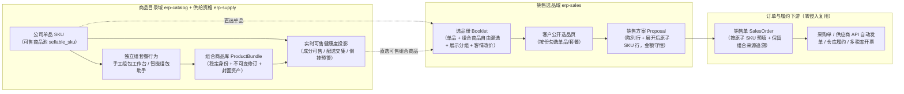
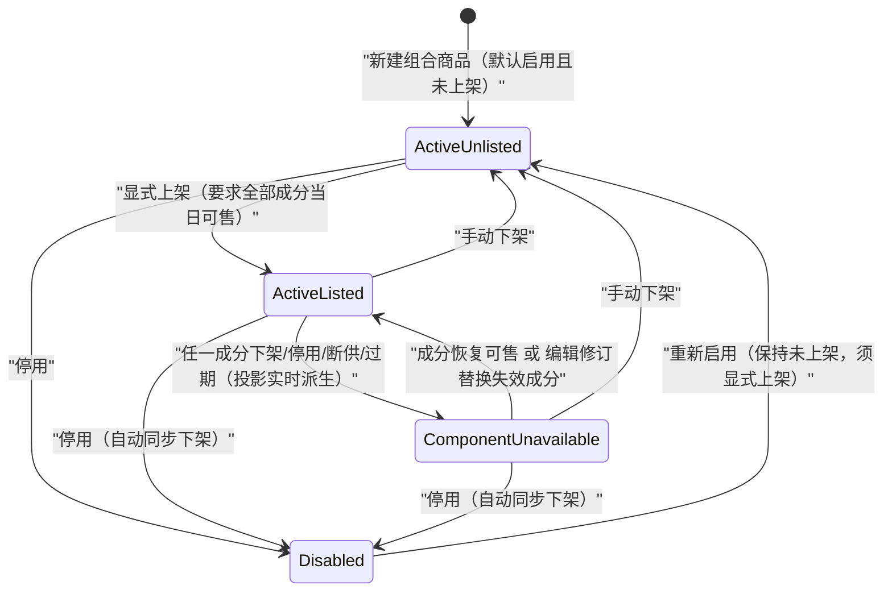
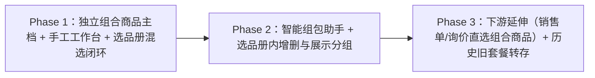

# 组合商品（组套餐）独立重构与选品册解耦实施方案

> 本文档规划将「组套餐」从销售选品册中彻底解耦，重构为**独立可沉淀、可复用的公司级「组合商品（Product Bundle）」能力**，并同步重构选品册使之直接支持单品与组合商品的自由混选。文档覆盖业务规划、体验交互、领域模型、定价分摊不变式、封面生成、前后端技术方案、历史兼容与分阶段实施验收。

---

## 1. 背景与重构目标

### 1.1 旧版「选品册内组套餐」的核心痛点

当前组套餐实现附着于 `erp-sales` 域的选品册（`SalesSelectionBooklet`、`SelectionForm::Package`、`TierRule` 与 `combination.rs`）中，存在以下结构性问题：

| 痛点维度 | 旧版现状 | 业务后果 |
| --- | --- | --- |
| **资产无法沉淀与复用** | 套餐绑定单本选品册、单个客户与单次准备批次，生命周期随选品册结束 | 运营/销售花精力搭出的爆款礼盒组合（如「100元暖心粮油套」「198元中秋全家福」）无法沉淀为公司商品库，给新客户只能整册复制再手工删改 |
| **选品册形态强行二选一** | `SelectionForm` 创建时锁定为 `SINGLE_SKU` 或 `PACKAGE`，创建后不可修改 | 同一本选品册无法同时向客户展示「单品 + 组合套餐」，与企业福利/礼品采购中「单品+套餐混合挑品」的真实场景冲突 |
| **只能黑盒自动凑数，不支持手工精细组包** | 仅支持填「档位目标金额±容差、期望套数、SKU 件数」由后台 DFS 盲搜 | 1）无法手工按需搭套餐；2）每个成分硬编码只能 1 件（不能「2 袋米 + 1 桶油」）；3）自动生成的套餐无业务命名（以 `SKU1 / SKU2` 拼接）、无卖点说明、不能换封面（仅兜底取首成员主图）；4）无法设整套一口价（如 ¥99.00 / ¥198.00） |
| **自动组包过程不可控、容错差** | 一旦触发准备即整档覆盖；不满意只能整档重生成或单删，不能替换某一件商品 | 算出的组合经常出现不合理混搭（如洗发水+酱油）、跨多供应商发货、配送地区不一致，销售既调不了也挑不了 |
| **册内改价与准备链路过重** | 同册内同一 SKU 跨套餐强绑定同一售价；选品册准备队列背负组合搜索、档位报告、重生成等重型逻辑 | 无法针对单套组合做特惠让利；选品册创建/改来源必须走重型后台重算，等待时间长且失败排查难 |

### 1.2 重构目标与核心定位

本次重构确立以下五条核心目标：

1. **组套餐独立为一级业务能力**：将组套餐从 `erp-sales` 选品册中迁移至 `erp-catalog` 商品目录域，成为独立维护、可沉淀、可上下架、可跨客户复用的**组合商品（`ProductBundle`）**。
2. **「手工精细组包」为主、「智能辅助组包」为辅**：
   - 最高频场景提供**所见即所得的手工组套餐工作台**（支持从商品池勾选一键带入、成分数量配比 ≥ 1、自定义名称/卖点/价位标签、按成分算价或整套一口价、3 种封面图模式、实时健康度与风险提示）；
   - 保留并大幅升级「按预算批量凑套餐」能力，改造为**交互式智能组包助手**（支持必含主品、品类槽位、件数区间、同供应商优先、配送区域一致、价格口径选择；先即时试算预览、支持微调/换一批、再由人挑满意的勾选保存入库）。
3. **选品册回归纯粹协作定位，支持单品与组合商品自由混选**：废除选品册创建时的「单品/套餐」二选一形态限制；支持从「公司商品池」「组合商品列表」发起选品，也支持在选品册内直接增删单品/组合商品并按展示分组（如「100元档」「200元档」「精选单品」）编排。
4. **保持既有 ERP 原子履约与财税底线不变**：组合商品是**销售/选品/报价期的虚拟组合商品**，无需单独维护供应商供给和仓库库存；其可售资格、配送覆盖、供应商数量实时派生自成分 SKU；在客户提交销售方案并转销售单时，**受控展开为原子 SKU 明细行**，金额精确守恒，下游采购、供应商 API 自动发单（京东 VOP / 蛋糕叔叔）、多税率开票、分地址履约与成本核算零侵入复用。
5. **平滑兼容存量历史数据**：所有已发布/已提交/已关闭/已作废的历史 `PACKAGE` 选品册、陈列项和销售方案保持完整可读与可转单，不破坏线上数据。

### 1.3 概念边界澄清

| 业务对象 | 本质与归属 | 与组合商品的区别 |
| --- | --- | --- |
| **普通单品（`Product` / `Sku`）** | 公司原子商品，拥有独立供应商供给、库存台账、采购价与进项税率 | 供应商本身打包好的「成品礼盒」（单一供应商货号、单一进项税率）仍建档为普通单品 SKU，不建组合商品 |
| **组合商品（`ProductBundle`）** | `erp-catalog` 下的虚拟组合主档，由 2 个及以上可售原子 SKU 按指定件数搭配而成 | 销售与选品期以「一套组合商品」呈现与定价；不建独立供给和库存，转单/履约期按成分 SKU 展开 |
| **选品册（`SalesSelectionBooklet`）** | `erp-sales` 下面向单个客户的选品协作单据 | 只负责「选入哪些单品/组合商品、设本客户专属售价、分组陈列、分享给客户勾选提交」，不再承担组套餐算法与组合生产 |

---

## 2. 业务架构与核心领域模型

### 2.1 全链路业务架构



### 2.2 组合商品聚合模型设计

对齐 `erp-catalog` 中 `Product / ProductRevision` 与 `Sku / SkuRevision` 的「**稳定主档 + 不可变修订**」双层设计：

1. **稳定主档 `ProductBundle`（集合 `product_bundles`）**：
   - 承载终身不变的身份与治理属性：`id`（`ProductBundleId`）、`bundle_no`（全局唯一编码，如 `CB-20261123-0001`，创建后不可改）、`status`（`Active` / `Disabled`）、`listing_status`（`Listed` / `Unlisted`）、`current_revision_id`（指向当前生效修订）、`maintainer_user_id`（显式维护人）、`business_org_unit_id`（维护人主属业务组织）、`base`（乐观锁 `version`、创建/更新时间、软删除标记）。
   - 遵循本 ERP 既有治理规范：维护人与业务组织创建必填，禁止用 `created_by` 兜底；支持显式责任交接（`handover`）。
2. **不可变修订 `ProductBundleRevision`（集合 `product_bundle_revisions`）**：
   - 每次修改名称、卖点、标签、封面、成分构成、成分件数或定价模式，均追加新修订（`revision_no` 递增）并切换主档 `current_revision_id`，**不覆盖旧修订**，确保历史选品册与销售方案追溯精确无误。
   - 核心字段：
     - **展示资料**：`name`（套餐名称，必填 1~128 字）、`subtitle`（卖点/副标题，可选 ≤ 256 字）、`description`（详细说明，可选 ≤ 1024 字）、`tags`（业务场景标签数组，如 `["中秋", "工会福利"]`，上限 10 个）、`price_band_label`（建议价位档标签，如 `"100元档"`、`"200元档"`，用于列表筛选和选品册快速分组）。
     - **成分配方 `items: Vec<BundleComponentItem>`**（2 ~ 12 个互异 `sku_id`）：
       - `sku_id: SkuId`（稳定 SKU 身份；配方层引用稳定 SKU 身份，不因成分日常改图改文案而整套报废，实时资格由可售投影校验；选入某本选品册时再冻结精确 `sku_revision_id`）
       - `quantity: u32`（单套内含该 SKU 件数，正整数 `1..=999`）
       - `sort_order: u32`（展示与拼图排序，从 1 递增）
       - `allocated_line_amount: Option<Amount>`（仅当 `pricing_mode = FIXED_PRICE` 时写入：该成分在单套内的分摊含税小计，支持系统自动分摊或人工微调，严格满足 $\sum \text{allocated\_line\_amount}_i = \text{fixed\_price\_gross}$）
     - **定价配置**：
       - `pricing_mode: BundlePricingMode`（`SUM_OF_MEMBERS` 按成分参考价实时合计 | `FIXED_PRICE` 整套含税一口价）
       - `fixed_price_gross: Option<Amount>`（仅 `FIXED_PRICE` 模式必填，且满足 $\ge 0.01 \times \text{items.len()}$）
     - **封面配置**：
       - `cover_mode: BundleCoverMode`（`CUSTOM_UPLOAD` 自定义上传 | `AUTO_COLLAGE` 自动拼图 | `MEMBER_MAIN` 指定成分主图）
       - `cover_image_asset_id: Option<FileAssetId>`（`CUSTOM_UPLOAD` 或 `AUTO_COLLAGE` 归档后的受控文件资产 ID）
       - `cover_member_sku_id: Option<SkuId>`（仅 `MEMBER_MAIN` 时指向成分之一）
       - `collage_source_signature: Option<String>`（自动拼图输入指纹，用于幂等防重复合成）
     - **生效窗口与状态**：`status: EnableStatus`、`effective_from: BusinessDate`、`effective_to: Option<BusinessDate>`。
   - **成分签名 `composition_signature`**：将 `(sku_id, quantity)` 按 `sku_id` 升序规范化为 `sku1*2|sku2*1`，用于智能组包去重、工作台「重复搭配提醒」（提示但不强制阻止，因为同一配方可做不同主题包装或价格方案）。

### 2.3 组合商品生命周期与实时可售状态



> [!IMPORTANT]
> **组合商品「上架不等于可售」原则（与单品保持一致）**
> 组合商品在业务日期 `as_of` 具备可售资格（允许进入可售组合池、允许被选品册选入与发布），当且仅当同时满足：
> 1. `ProductBundle` 未删除、`status = Active`、`listing_status = Listed`；
> 2. 当前 `ProductBundleRevision` 启用且处于 `[effective_from, effective_to)` 生效窗口内；
> 3. **全部成分 `sku_id` 在 `as_of` 当日均满足公司商品池 `sellable_sku` 完整资格**（商品与 SKU 启用且已上架、当前修订生效、已维护一件代发价、存在至少一条启用且有效可供的供应商供给）；
> 4. 若 `pricing_mode = FIXED_PRICE`，整套一口价必须大于 0 且成分分摊合法；若 `pricing_mode = SUM_OF_MEMBERS`，所有成分一件代发价均大于 0。

### 2.4 业务约束与防错规则

1. **商品类型约束（严格防错）**：
   - **禁止 `VOUCHER`（卡券类目）进入组合商品**：卡券在本 ERP 中走独立销售单类型（`BusinessType::Voucher`）与商城卡券执行投影，与实物/服务完全隔离。
   - **禁止 `OFFLINE_SERVICE`（线下服务）与实物混组**：首期组合商品默认允许 **`PHYSICAL`（实物）** 组合与 **`VIRTUAL`（虚拟）** 组合；实物与虚拟混组时标记为混合形态并在工作台显式提示（需履约拆分为实物发货 + 电子交付）；`OFFLINE_SERVICE` 首期不纳入组合，避免服务履约工单与快递包裹混淆。
2. **成分规模与数量**：
   - 每个组合商品包含 **2 ~ 12 个互异 SKU**（同一 SKU 通过调整 `quantity` 表达多件，不得出现重复成分行）；
   - 单成分单套数量 `quantity` 为正整数 `1..=999`；单套总件数建议上限 `1000`。
3. **配送覆盖交集**：
   - 当用户按「配送地区（`delivery_region_code`、`delivery_extent`、`include_freight_extra`）」筛选可售组合商品或执行智能组包时，**组合商品仅在其全部实物成分均覆盖该地区时命中**（取交集），从根源避免「客户选完套餐发现里面有一件商品发不到新疆/西藏」的履约事故。
4. **成本与供应商信息隔离**：
   - 组合商品工作台与管理列表仅展示「去重供应商数量（如 `1 家` / `3 家`）」和「供应商业务编号汇总」（受权限控制），**绝不暴露采购成本、进项税率或内部 `supplier_id`**；
   - 客户公开选品页与对外回执**彻底隐藏供应商数量、供应商编号、内部 SKU 编码、组合内部编码及公司三价**。

---

## 3. 业务与功能体验规划（如何做到最方便好用）

本节从**商品运营（建标准套餐库）**和**B2B 销售（快速给客户出方案）**两个核心角色的真实高频路径出发，设计「零多余步骤、所见即所得」的交互体系。

### 3.1 信息架构与三大快捷入口

侧边栏导航（`erp-client/lib/workspace-registry.ts`）：
- **商品目录**分组调整为：
  1. **公司商品池**（`/master-data/sellable-items`）—— 升级为「单品池 / 组合商品」双视图 + 跨视图统一选品篮
  2. **组合商品**（`/master-data/bundles`）—— **新增独立一级工作区**，管理全部组合商品档案、手工组包与智能组包助手
  3. **商品列表**（`/master-data/products`）
  4. 商品分类 / 品牌 / 计量单位 / 卡券类目
- **销售**分组保持 **选品册**（`/sales/selection`），并在选品册列表页**新增「新建选品册」主按钮**（不再强制必须先去商品池才能建册）。

**三条最顺手的业务流路径全部打通**：

| 用户习惯路径 | 操作步骤 | 适用场景 |
| --- | --- | --- |
| **路径 A：先逛商品池，顺手组套餐** | 公司商品池勾选 2~12 个单品 → 点击底部操作栏 **「组成套餐」** → 自动带入「手工组套餐工作台」微调数量/定价/封面 → 保存并上架（可顺手「直接发起选品」） | 销售或选品师逛商品池看到几款绝配商品，想立刻打包成套 |
| **路径 B：按客户预算，批量智能组包** | 组合商品页点击 **「智能组包助手」**（或商品池筛选后点「智能组套餐」）→ 设预算/必含主品/品类槽位 → 现场预览候选、微调、换一批 → 勾选满意的 5 套 **「批量保存入库」**（或「保存并直接发起选品」） | 客户提「预算 150 元/人，给我 8 套不同 3~4 件装方案」 |
| **路径 C：单品+组合混选进选品册** | 方式 1：公司商品池中「单品」Tab 勾选 15 款 + 切「组合商品」Tab 勾选 6 套 → 底部统一选品篮显示「已选 15 单品 + 6 组合」→ 一键「发起选品」；<br/>方式 2：选品册页点击「新建选品册」→ 选客户进草稿 → 在册内自由点击「+ 添加单品」「+ 添加组合商品」「新建展示分组」 | 绝大多数 B2B 客户选品与节日福利方案制作 |

### 3.2 核心功能一：组合商品管理中心（`/master-data/bundles`）

1. **列表视图与筛选**：
   - 支持 **表格视图 / 画廊卡片视图** 双切换（复用公司商品池设计语言，每张卡片直观展示封面图、套餐名称、价位档标签、当前含税价、成分件数摘要如「含 4 款 · 共 5 件」、可售健康状态徽章）。
   - 结构化筛选器：关键字（套餐编码/名称/标签/内含商品名称或编码）、状态（全部/已上架可售/成分异常/未上架/已停用）、价位档标签、业务标签、定价模式、售价区间、配送地区、是否单一供应商、维护人/业务组织（走统一组织数据范围组件）。
2. **健康度与异常预警（运营最省心的设计）**：
   - 顶部提供快捷统计筛选胶囊：**「成分异常需处理 (N)」**、**「价格倒挂预警 (M)」**；
   - **成分异常**：清晰标出具体哪个成分已下架或断供，点击「去修复」直达编辑工作台，支持一键「替换成分」保存新修订后立即恢复可售；
   - **价格倒挂预警**：当 `FIXED_PRICE` 组合的一口价低于当前成分一件代发价合计（或低于集采价合计）时自动标黄/标红提醒，防止成分涨价导致套餐亏本卖。
3. **高频批量与单行操作**：
   - 上架 / 下架（上架前服务端强制复核全部成分当日可售）；
   - **复制为新组合**（1 秒克隆所有成分、件数、定价和标签到新建工作台，换 1 件商品即成新套餐）；
   - 勾选已上架可售的组合商品，一键 **「发起选品」**（直接带入选品册创建弹窗）；
   - 维护人责任交接、停用/重新启用、查看修订历史（Diff 对比成分增删与价格变化）。

### 3.3 核心功能二：所见即所得「手工组套餐工作台」（`/master-data/bundles/new` & `/[bundleId]/edit`）

采用 **左右双栏工作台**（左侧主区操作选品与基础信息，右侧固定悬浮「套餐预览与实时算价看板」），所有计算即时反馈：

1. **顶部/左侧区 A：成分配比编辑器**
   - 点击「从可售商品池添加成分」打开嵌入式搜索抽屉（支持全部商品池筛选条件：关键字、分类、品牌、价格区间、配送地区、商品类型、单一供应商），支持多选加入；
   - 成分清单表格支持：
     - 调整每项的 **单套数量（步进器 `1..999`）**；
     - 拖拽/上下移 **排序**（影响对客展示顺序与拼图顺序）；
     - 单行展示：主图、SKU 名称、规格属性、单位、一件代发价、集采价、市场价、单套小计、供应商数量提示；
     - 一键 **「替换」**（快速换掉某一件商品，尤其适合修复失效成分或做同档位变体）与 **「移除」**。
2. **左侧区 B：定价策略与分摊透明面板**
   - 展示实时汇总基线：**成分一件代发价合计**、**成分集采价合计**（若有缺项标明「部分缺失」）、**成分市场价合计**。
   - **定价模式切换**：
     - **随成分参考价合计（默认）**：自动等于成分一件代发价合计，成分调价时实时联动；
     - **整套一口价**：输入目标整套含税价（并提供快捷按钮：`凑整到元`、`凑尾数 .00 / .90`、`按成分价 95 折`、`按集采价合计`）；下方可展开查看系统自动生成的**各成分分摊金额与折合单价**，并允许运营手工微调单行分摊金额（前端实时校验分摊总和是否等于整套一口价）。
3. **左侧区 C：基础资料与封面包装**
   - **套餐名称**（必填）+ **「智能拟名」**快捷按钮（按核心成分品类/品牌自动生成易读草稿名如「金龙鱼粮油坚果精选 3 件套」，一键填入再微调）；
   - **套餐编码**（默认留空由系统自动生成 `CB-...`，也支持手工指定）；
   - **价位档标签**（快捷下拉预设 `50元档 / 100元档 / 150元档 / 200元档 / 300元档 / 500元档` + 自定义输入）、**业务场景标签**、**套餐卖点/简介**；
   - **封面图选择器（3 选 1）**：
     - **自动拼图生成**：点击「一键生成拼图封面」，调用后端拼图接口按当前成分顺序与主图实时生成高清正方形拼图预览；
     - **上传自定义封面**：拖入/选择设计师制作的礼盒主图（走 `erp-file-assets` 直传）；
     - **选用成分主图**：从已有主图的成分里点选一张作为封面。
4. **右侧悬浮预览看板（实时风险体检 + 客户视角卡片预览）**
   - **客户视角卡片预览**：1:1 预览该组合商品在客户公开选品页上的实际呈现效果；
   - **实时体检清单**：
     - 成分可售性检查（全绿 / 标红失效项）；
     - 供应商集中度提示（如「单一供应商直发」绿色加分标 vs 「涉及 3 家供应商 · 需分包裹履约」中性提示）；
     - 价格合理性提示（一口价相对一件代发价合计的折扣/加价率；若低于集采价合计则标红警告）；
     - 重复搭配检测（若组合库中已存在完全相同的成分与件数配方，温和提示「已有相似组合 `CB-xxx`，点击查看」，避免无意重复建档）。
   - **底部保存动作**：提供 **「保存草稿（未上架）」** 与 **「保存并立即上架」** 两个清晰动作（编辑已有组合时展示变更摘要）。

### 3.4 核心功能三：交互式「智能组包助手」（`/master-data/bundles/smart-compose`）

将旧版藏在选品册后台的「盲搜算法」彻底解放并升级为**交互式智能配货工作台**，分为三步流：

#### 步骤 1：锁定候选商品池
- 支持两种进入方式：从「公司商品池」带入当前筛选条件或已勾选 SKU；或在向导第 1 步直接配置筛选条件（分类、品牌、商品类型、价格区间、**配送地区**、单一供应商等）。
- 实时展示命中候选 SKU 数量（要求 `2..=500`；超出时提示进一步收窄筛选条件）。

#### 步骤 2：配置搭配规则（简洁默认 + 强大进阶）
- **基础规则（必填，3 项）**：
  - **目标预算与容差**：如目标 `150.00` 元，容差 `±10.00` 元（支持一键选「价格口径」：`一件代发价` 或 `集采价`）；
  - **每套 SKU 种数范围**：`min_sku_count..=max_sku_count`（默认 `3..=4`，范围 `2..=8`，打破旧版只能填单一固定件数的死板约束！）；
  - **期望生成候选数**：`1..=20` 套（默认 8 套）。
- **进阶搭配规则（折叠面板，按需开启）**：
  - **必含主品（锚定 SKU，0~3 个）**：例如锁定「五常大米 5kg × 1」，剩余预算与件数由算法自动配齐；
  - **品类搭配槽位（可选结构化规则）**：如「槽位 1：粮油调味（1件）+ 槽位 2：休闲零食（1~2件）+ 槽位 3：居家日用（1件）」，彻底根治跨品类乱搭；
  - **同供应商策略**：`不限` / `同供应商优先（加权排序）` / `强制同一供应商（硬约束）`；
  - **允许同 SKU 多件**：默认关闭（每 SKU 1 件）；开启后可设单 SKU 最大件数（如 `1..=3`）；
  - **定价方式预设**：生成后默认 `随成分合计` 或 `自动凑整为目标预算一口价`（如自动按目标 150.00 元做一口价分摊！）。

#### 步骤 3：即时预览、人工挑品微调与批量入库
- 点击 **「生成候选方案」**，后端执行有界搜索（状态预算与 5 秒限时保护，绝不阻塞主线程），直接返回候选套餐列表（**仅内存试算返回，不写正式表，零垃圾数据！**），并展示透明搜索诊断（如「已搜索完整空间」或「达到搜索预算上限，已返回最优 8 套」）。
- **每张候选卡片提供极顺手的二次加工能力**：
  - 勾选 / 取消勾选（决定要保留哪几套）；
  - **行内微调**：直接改套餐名、改某成分数量、点「换一件」从同价位候选中替换不喜欢的商品、切一口价凑整；
  - **「换一批」**：携带已浏览/已拒绝的 `exclude_signatures`，重新搜出全新不重复组合；
- **一键收口动作**：
  - **「批量保存所选 N 套为组合商品」**（可选：统一打上价位档标签如「150元档」与场景标签如「中秋」、统一生成自动拼图封面、可选「保存后自动上架」）；
  - **「保存并立即发起选品」**：一步到位，批量入库上架后直接打开「发起选品弹窗」把这 N 套组合装进客户的选品册！

### 3.5 核心功能四：选品册重构与混选体验升级

解耦组套餐后，选品册变得极致清爽、灵活且快速：

1. **废除 `SINGLE_SKU` / `PACKAGE` 二选一形态**：
   - 新建选品册不再需要选「形态」，也不再需要填写「档位规则（`TierRule`）」；
   - 一本选品册可以自由包含：**纯单品**、**纯组合商品**，或**单品 + 组合商品混排**。
2. **统一「选品篮」与三处选品入口**：
   - **公司商品池（`/master-data/sellable-items`）**：顶部提供「单品 / 组合商品」视图切换，底层共享同一个跨视图选品篮状态（显示 `已选 X 个单品、Y 个组合商品`），点击「发起选品」一次性打包创建选品册；
   - **组合商品列表（`/master-data/bundles`）**：勾选组合商品直接点「发起选品」；
   - **选品册列表（`/sales/selection`）**：支持直接点击 **「新建选品册」**（选客户 + 设密码创建空草稿或初始选品），进入选品册详情后随时操作。
3. **选品册待发布态自由维护（重大体验跃升！）**：
   - **随时追加陈列项**：待发布/草稿态支持点击 **「+ 添加单品」** / **「+ 添加组合商品」**，直接追加进当前选品册并即时冻结快照，无需再像旧版那样整册推倒重准备！
   - **纯展示分组（`SelectionGroup`）**：销售可在选品册内自定义 0~10 个展示分组（如「100元档礼盒」「200元档礼盒」「人气单品」），支持将任意单品或组合商品归入/拖动到某分组，也支持按组合商品自带的 `price_band_label` **一键自动按价位档分组**！分组纯属对客展示楼层，不再绑定任何生成算法。
   - **直觉化的册内改价**：
     - 单品陈列项：直接行内改客户含税售价；
     - 组合商品陈列项：支持 **「直接改整套客户售价」**（后端自动按比例重算分摊到该陈列项内各成分，保持总额绝对守恒），也支持展开微调 **「该套装内单个成分售价」**（自动重算该套装总价）；默认仅影响当前陈列项（不再强行联动改掉本册其他套装里的同款 SKU 价格！）；
     - 整册 **「统一加价 %」**：对当前册内所有单品与组合商品按当前客户售价统一上浮指定百分比（组合商品按成分逐项计算或按套重分摊，保证守恒）。
4. **极速准备与发布复核**：
   - 由于移除了选品册内的组合搜索，`PrepareKind::RegeneratedTiers` / `RegeneratedAll` 彻底退场；
   - 勾选单品/组合创建或追加项时，只需核验资格与快照图片，小批次（如 ≤ 50 项）可同步/亚秒完成，大批次（筛选来源 ≤ 500 项）沿用既有异步准备队列；
   - 发布前（`publish`）执行严格的 fail-closed 复核：校验每个单品的 `(sku_id, sku_revision_id)` 和每个组合商品的 `(bundle_id, bundle_revision_id)` 及其全部成分 `(sku_id, sku_revision_id)` 当日仍可售；若某组合商品或成分已下架/变更，清晰列出受影响项，支持销售在待发布态一键「同步最新修订」或「删除/替换该项」后再发布。
5. **客户公开选品页（`/s/[token]`）与销售方案 / 转销售单**：
   - **公开选品页**：左侧楼层导航优先按选品册自定义 `SelectionGroup` 展示（无分组时组合商品可按价位档/「精选组合」归楼层、单品按分类归楼层）；组合商品卡片展示套餐封面图、套餐名称、卖点标签、「内含 N 款 · 共 M 件」微标、整套含税价；点击卡片弹出详情抽屉查看完整内含商品清单（成分图、名称、规格、单套件数）。
   - **销售方案（`SalesSelectionProposal`）**：
     - `ProposalDisplayLine` 记录客户选中的每一条单品或组合商品（含 `item_kind: SINGLE_SKU | BUNDLE`、`bundle_id`、`bundle_no`、`display_name`、`group_name`、购买份数 `quantity`、套单价 `unit_price`、行金额 `line_amount`）；
     - `ProposalSkuLine` 展开为原子 SKU 明细行：若来源为组合商品，保存 `bundle_id`、`bundle_name`、`component_quantity`（单套内件数）、`bundle_copies`（购买套数）、`quantity = component_quantity * bundle_copies`（总展开数量）、`unit_price`（折合单价 `UnitPrice`）、`line_amount`（精确行含税金额 `Amount`）。
   - **转销售单（`SelectionOrderBasis`）**：
     - 继续按展开后的 `ProposalSkuLine` 预填实物与服务销售单明细（数量为 `component_quantity * bundle_copies`，不合并不同组合中的同款 SKU 以便核对，且沿用「成交单价由销售确认填写」的既有规则），同时在销售单创建页的来源行摘要中标注「来自组合：`{bundle_name}` × `{bundle_copies}` 份」，实现从客户挑套餐到内部采购履约的全链路透明追溯。

---

## 4. 定价、分摊与金额守恒规则

> [!IMPORTANT]
> 本 ERP 全链路禁止使用浮点数运算金额；所有金额与单价使用 `erp_core::money::{Amount, UnitPrice}`（十进制定点数，分别 2 位 / 4 位小数）与银行家舍入 `round_to_cent`。

### 4.1 组合商品的两种定价模式

设组合商品有 $n$ 个互异成分（$2 \le n \le 12$），第 $i$ 个成分单套数量为 $q_i \in \mathbb{Z}^+$，当前一件代发参考含税单价为 $r_i > 0$（2 位小数），则该成分的基准小计为 $b_i = r_i \times q_i$，基准参考总价为 $B = \sum_{i=1}^n b_i$。

1. **模式一：`SUM_OF_MEMBERS`（随成分合计）**
   - 组合参考含税售价：$P = B = \sum_{i=1}^n (r_i \times q_i)$；
   - 单套内各成分行小计：$s_i = r_i \times q_i$；单价：$u_i = r_i$。
   - **特性**：主档不固化售价，读取可售组合时按成分当日一件代发价实时汇总；被选入选品册时冻结当日 $r_i$ 与 $P$。

2. **模式二：`FIXED_PRICE`（整套一口价）**
   - 组合主档设定明确的目标整套含税价 $P > 0$（2 位小数），强约束 $P \ge 0.01 \times n$（确保每项成分至少可分得 ¥0.01，避免零元行引发财税与开票异常）。
   - **确定性比例分摊与尾差吸收算法（`allocate_bundle_price`）**：
     - 设 $P_{\text{cents}} = P \times 100 \in \mathbb{Z}^+$ 为总分值，各成分权重 $w_i = b_i = r_i \times q_i$（若参考价均缺失则退化为按 $q_i$ 等权），总权重 $W = \sum_{i=1}^n w_i$；
     - 第 $i$ 项精确理想分值：$x_i = P_{\text{cents}} \times w_i / W$；
     - 先取下整并保底 1 分：$c_i = \max(1, \lfloor x_i \rfloor)$，计算剩余尾差 $\Delta = P_{\text{cents}} - \sum_{i=1}^n c_i$；
     - 若 $\Delta > 0$：按小数余数 $(x_i - \lfloor x_i \rfloor)$ 降序（余数相同按 $w_i$ 降序、再按 `sort_order` 升序）依次加 1 分直至 $\Delta = 0$；
     - 若 $\Delta < 0$（极端低价保底触发）：按 $c_i > 1$ 的项权重降序依次减 1 分直至 $\Delta = 0$；
     - 产出每项成分单套分摊含税小计：$s_i = c_i / 100$（`Amount`，2 位小数），以及展示/折合单价 $u_i = \text{round}_4(s_i / q_i)$（`UnitPrice`，4 位小数）。
   - **人工微调支持**：在工作台可手动改写任意成分的 $s_i$（均须 $\ge 0.01$），后端保存前校验 $\sum_{i=1}^n s_i == P$，不相等时拒绝提交。

### 4.2 多份购买时的严格守恒证明

当客户在选品册购买该组合商品 $M \in [1, 100000]$ 份时：
- **组合展示行金额**：$\text{display\_line\_amount} = P \times M$（精确 2 位小数）；
- **第 $i$ 个成分展开行**：
  - 展开数量：$Q_i = q_i \times M$；
  - 展开行含税金额：$\text{sku\_line\_amount}_i = s_i \times M$（精确 2 位小数）；
  - 展开折合单价：$u_i = \text{round}_4(s_i / q_i)$（当 $q_i = 1$ 时 $u_i$ 精确等于 $s_i$，且 $u_i \times Q_i = \text{sku\_line\_amount}_i$；当 $q_i > 1$ 且 $s_i$ 不可被 $q_i$ 整除到分时，行金额始终以 $s_i \times M$ 为权威事实，确保绝对无舍入漂移）。
- **守恒恒等式**：
  $$\sum_{i=1}^n \text{sku\_line\_amount}_i = \sum_{i=1}^n (s_i \times M) = \left(\sum_{i=1}^n s_i\right) \times M = P \times M = \text{display\_line\_amount}$$
  无论成分件数 $q_i$ 与购买份数 $M$ 取何值，**陈列行总额与展开 SKU 行总额恒等，零分厘误差**。

### 4.3 选品册内的改价矩阵

待发布选品册支持四类原子改价操作（均只修改当前选品册批次快照，绝不回写商品或组合主档）：

| 改价命令 | 作用范围 | 计算逻辑 |
| --- | --- | --- |
| `SINGLE_ITEM_PRICE` | 某一条单品陈列项 | 直接更新该项 `sales_visible_price_gross` |
| `BUNDLE_TOTAL_PRICE` | 某一条组合商品陈列项 | 指定新整套含税价 $P'$（$\ge 0.01 \times n$），以当前各成分单套小计 $s_i$ 为权重重新运行 `allocate_bundle_price`，原子更新该陈列项整套价与各成分 $s_i'$ |
| `BUNDLE_MEMBER_PRICE` | 某一条组合陈列项内的某个成分 | 修改该成分单套小计或单价，自动重算该组合陈列项总价 $P' = \sum s_i'$（不影响同册其他组合中的同款 SKU） |
| `BOOKLET_MARKUP` | 整本选品册所有有效陈列项 | 单品按 `round_to_cent(price * (1 + pct/100))` 调整；组合项逐成分按 `round_to_cent(s_i * (1 + pct/100))` 调整并重新汇总为 $P'$，保持守恒 |

### 4.4 参考价漂移与倒挂预警规则

在组合商品读模型中，实时基于各成分当前有效 `SkuRevision` 计算：
- `components_dropship_total`：$\sum (r_{i,\text{dropship}} \times q_i)$；
- `components_bulk_total`：全部成分均有集采价时返回 $\sum (r_{i,\text{bulk}} \times q_i)$，否则 `None`；
- `components_market_total`：全部成分均有市场价时返回 $\sum (r_{i,\text{market}} \times q_i)$，否则 `None`。

当 `pricing_mode = FIXED_PRICE` 时派生 `price_health` 预警状态：
- `BELOW_BULK`（高危红标）：存在 `components_bulk_total` 且 `fixed_price_gross < components_bulk_total`；
- `BELOW_DROPSHIP`（提醒黄标）：`fixed_price_gross < components_dropship_total`；
- `NORMAL`（正常）。

---

## 5. 封面图生成与资产治理

### 5.1 三种封面模式

| 模式 `BundleCoverMode` | 说明 | 产物落点 |
| --- | --- | --- |
| `CUSTOM_UPLOAD` | 运营上传定制礼盒/海报主图（JPG/PNG/WebP） | 复用 `erp-file-assets` 直传与附件登记，保存 `cover_image_asset_id` |
| `AUTO_COLLAGE` | 后端依据当前成分主图（按 `sort_order` 取前 9 张有图成员）合成高清 `800×800` 正方形拼图 | 事务外合成图像并上传至 S3，事务内通过 `FileAssetService` 登记为受控 `FileAsset` 并绑定 `cover_image_asset_id` |
| `MEMBER_MAIN` | 指定某一成分 SKU 的主图作为封面 | 保存 `cover_member_sku_id`，展示时解析该成分当前主图资产 |

### 5.2 自动拼图排版规范

复用仓库 workspace 已有依赖 `image` 与 `zune-jpeg`，以居中裁切（`cover` 填充不变形）+ `12px` 浅白间隔 + 圆角卡片感画布输出：
- **1 张图**：全画布居中铺满；
- **2 张图**：左右 1:1 双栏拼图；
- **3 张图**：左半宽主图 + 右半宽上下 2 格副图（经典礼盒主副布局）；
- **4 张图**：2×2 四宫格；
- **5~6 张图**：上排 2 格 + 下排 3~4 格（或 2×3 六宫格）；
- **7~9 张图**：3×3 九宫格（超过 9 个成分时仅取排位前 9 张主图）。
- 若所有成分均无主图，触发自动拼图时明确返回校验错误提示「成分商品均缺少主图，请先上传自定义封面或补充单品主图」，不生成空白占位图。

### 5.3 事务外执行与安全隔离

- **严格遵守仓库边界**：在 `erp-catalog` 声明窄接口 `BundleCoverCollagePort`（输入成员资产 ID 列表，返回合成后的待登记临时文件信息或已上传对象键），具体 `image` 合成与 S3 写入实现装配在 `apps/erp-server/src/wiring/`，**绝不在 MongoDB 数据库事务内执行对象存储读写与图像编解码**。
- **选品册冻结快照**：组合商品加入选品册时，通过既有 `SelectionImagePort::snapshot_image` 将组合封面图和各成分主图复制到 `sales-selection/{booklet_id}/{batch_id}/...` 隔离前缀，公开选品页仅能通过令牌授权读取本册快照图片，防止原组合删改封面导致已发出的客户选品页破图或越权访问。

---

## 6. 后端技术方案与数据模型

### 6.1 Crate 职责划分与边界（严格对齐 `backend/scripts/crate-layers.json`）

| Crate | 层级 | 本次改造职责 | 边界约束 |
| --- | --- | --- | --- |
| `erp-core` | `foundation` | 新增强类型 ID：`ProductBundleId`、`ProductBundleRevisionId`、`BundleCommandReceiptId`、`SalesSelectionGroupId` | 无业务实体依赖 |
| `erp-permissions` | `foundation` | 新增 `resources::PRODUCT_BUNDLE`、`resources::SELLABLE_BUNDLE` 及权限常量；更新 `catalog.rs` 目录 | 运行 `generate-permissions.py` 同步前端与测试夹具 |
| `erp-catalog` | `domains` | 新增组合商品实体（`ProductBundle`、`ProductBundleRevision`、`BundleCommandReceipt`）、定价分摊纯规则（`bundle_pricing`）、智能组包搜索纯算法（`bundle_search`）、`BundleCoverCollagePort`、`CatalogService` 组合写入步骤、集合常量与索引 `indexes/bundle.rs`、组合商品对象授权 Facts/Access | 仅依赖 `erp-identity`；不直接依赖 `erp-supply`/`erp-sales`/`storage`/`image` |
| `erp-sales` | `domains` | 选品册支持 `SelectionForm::Mixed`（新册统一形态）、`PoolSource` 支持 `bundle_ids` 与 `sku_ids` 混选、新增 `SelectionGroup` 展示分组、`DisplayKind::Bundle`、支持待发布追加陈列项与按陈列项改价、`ProposalDisplayLine/SkuLine` 支持成分数量与组合追溯；下线新册的 `combination.rs` / `tier.rs` / `RegeneratedTiers` / `RegeneratedAll` 调用路径（保留历史只读反序列化兼容） | 仅通过窄 Port `SelectionCatalogPort` 消费组合事实，不依赖 `erp-catalog` |
| `erp-read-models` | `read-models` | 新增 `catalog_center/bundle/` 与 `catalog_supply/repository/sellable_bundle.rs`：组合商品授权列表/详情、实时可售健康度与倒挂预警投影、可售组合查询（含配送交集过滤）、智能组包只读候选试算服务；升级 `sales_center/selection/` 补齐组合参考价对比 | 不依赖编排库 |
| `erp-master-data` | `orchestration` | 新增 `product_bundle/`（`ProductBundleProcess`）：协调组合商品建档、修订编辑、批量保存智能组包结果、上下架、停用、复制、维护人交接、成分可售复验、封面附件登记、命令回执与同事务审计 | 根事务持有者；拼图/S3 副作用置于事务外 |
| `erp-order-to-cash` | `orchestration` | 扩展 `SalesSelectionProcess` 与 `SelectionCatalogPort` 适配器（对接可售组合查询与精确修订复核）；新增待发布追加单品/组合、展示分组编辑用例；升级 `SelectionOrderBasis` 携带组合来源标注 | 沿用原事务与授权重验规范 |
| `erp-server` | `apps` | 挂载 `/admin/product-bundles/*`、`/admin/sellable-bundles` 路由；装配 `BundleCoverCollagePort`（使用 `image` + `S3Storage`）、组合商品授权 Mapping（`wiring/authorization/master.rs`）与索引启动入口 | 路由路径保持字面量供权限扫描 |

### 6.2 MongoDB 集合与索引设计

#### 6.2.1 新增集合（归属 `erp-catalog`，注册于 `CatalogExt` 与 `erp_catalog::indexes::ensure`）

1. **`product_bundles`（组合商品稳定主档）**
   - 核心字段：`id`, `version`, `created_at`, `updated_at`, `deleted_at`, `bundle_no`, `status` (`active`/`disabled`), `listing_status` (`listed`/`unlisted`), `current_revision_id`, `maintainer_user_id`, `business_org_unit_id`, `created_by`, `updated_by`。
   - 必备索引：
     - `uk_product_bundles_id`: `{ "id": 1 }` (unique)
     - `uk_product_bundles_bundle_no`: `{ "bundle_no": 1 }` (unique，全局永久唯一)
     - `idx_product_bundles_listing_status`: `{ "listing_status": 1, "status": 1, "deleted_at": 1 }`
     - `idx_product_bundles_maintainer_org`: `{ "maintainer_user_id": 1, "business_org_unit_id": 1, "created_at": -1, "id": 1 }`
     - `idx_product_bundles_updated_at`: `{ "updated_at": 1 }`

2. **`product_bundle_revisions`（组合商品不可变修订）**
   - 核心字段：`id`, `created_at`, `updated_at`, `deleted_at`, `bundle_id`, `revision_no`, `name`, `subtitle`, `description`, `tags`, `price_band_label`, `composition_signature`, `pricing_mode` (`SUM_OF_MEMBERS`/`FIXED_PRICE`), `fixed_price_gross` (`Decimal128` 可选), `cover_mode` (`CUSTOM_UPLOAD`/`AUTO_COLLAGE`/`MEMBER_MAIN`), `cover_image_asset_id`, `cover_member_sku_id`, `collage_source_signature`, `items: [{ sku_id, quantity, sort_order, allocated_line_amount }]`, `status`, `effective_from`, `effective_to`。
   - 必备索引：
     - `uk_product_bundle_revisions_id`: `{ "id": 1 }` (unique)
     - `uk_product_bundle_revisions_no`: `{ "bundle_id": 1, "revision_no": 1 }` (unique)
     - `idx_product_bundle_revisions_item_sku`: `{ "items.sku_id": 1 }`（反查「某 SKU 下架/改价影响了哪些组合商品」的核心索引！）
     - `idx_product_bundle_revisions_signature`: `{ "composition_signature": 1 }`（快速检测重复配方）
     - `idx_product_bundle_revisions_tags_band`: `{ "price_band_label": 1, "tags": 1 }`

3. **`product_bundle_command_receipts`（独立命令幂等回执）**
   - 用于创建、批量保存智能组包与责任交接的幂等重放，与商品交接回执同构。
   - 必备索引：
     - `uk_product_bundle_receipts_id`: `{ "id": 1 }` (unique)
     - `uk_product_bundle_receipts_scope_key`: `{ "operation": 1, "actor_id": 1, "idempotency_key": 1 }` (unique)

#### 6.2.2 既有集合演进（归属 `erp-sales`，向后兼容缺省反序列化）

1. **`sales_selection_booklets`**：
   - `form`: 新增 `MIXED`（新册默认；旧文档 `SINGLE_SKU` / `PACKAGE` 照常反序列化）；
   - `pool_source`: 新增 `bundle_ids: Option<Vec<ProductBundleId>>`（`#[serde(default)]`）以及 `PoolSourceKind::Manual`（支持 `sku_ids` 与 `bundle_ids` 混选，或初始空草稿自由添加）；
   - `groups: Vec<SelectionDisplayGroup>`（`#[serde(default)]`）：纯展示分组 `{ group_id, name, sort_order }`。
2. **`sales_selection_display_items`**：
   - `group_id: Option<String>`（`#[serde(default)]`）：归属的选品册展示分组；
   - `sort_order: u32`（`#[serde(default)]`）：展示排序；
   - `DisplayKind` 新增变体 `Bundle`：
     ```rust
     Bundle {
         bundle_id: ProductBundleId,
         bundle_revision_id: ProductBundleRevisionId,
         bundle_no: String,
         name: String,
         subtitle: Option<String>,
         price_band_label: Option<String>,
         pricing_mode: String, // "SUM_OF_MEMBERS" | "FIXED_PRICE"
         cover: Option<ImageAssetSnapshot>,
         members: Vec<BundleMemberSnapshot>, // 含 sku: SkuSnapshot + quantity: u32 + sort_order: u32 + allocated_line_amount: Amount
         price: Amount, // 恒等于 sum(members.allocated_line_amount)
     }
     ```
     原有 `DisplayKind::Package` 保留只读反序列化兼容，不再新写入。
3. **`sales_selection_proposal_display_lines` 与 `sales_selection_proposal_sku_lines`**：
   - `ProposalDisplayLine` 增加 `#[serde(default)] item_kind`, `bundle_id`, `bundle_no`, `display_name`, `group_name`；
   - `ProposalSkuLine` 增加 `#[serde(default)] bundle_id`, `bundle_name`, `component_quantity: Option<u32>`, `bundle_copies: Option<u32>`, `effective_unit_price: Option<UnitPrice>`（保留原 `unit_price: Amount` 兼容单品与历史方案；展开金额以 `line_amount: Amount` 守恒为准）。

### 6.3 实时可售健康度查询（`erp-read-models`）

在 `CatalogSupplyRepository` 中新增 `search_bundles` 与 `search_sellable_bundles` 聚合查询：
1. 先按授权范围与主档条件匹配 `product_bundles` 并 `$lookup` 当前 `product_bundle_revisions`；
2. 针对当前页/筛选集内涉及的所有去重成分 `sku_id`，**批量一次调用**既有的 `find_sellable_skus_by_ids`（复用唯一权威的 `sellable_sku_pipeline` 资格判定，杜绝写第二套可售判定逻辑导致口径分裂！）；
3. 内存中为每个组合商品计算：
   - `availability_status`（`SELLABLE` / `COMPONENT_UNAVAILABLE` / `UNLISTED` / `DISABLED`）及精确 `unavailable_sku_ids`；
   - `current_price_gross`（`FIXED_PRICE` 取一口价，`SUM_OF_MEMBERS` 取成分一件代发价乘数量之和）；
   - `components_dropship_total` / `components_bulk_total` / `components_market_total` 与 `price_health` 预警；
   - `supplier_count`（去重供应商总数）与 `supplier_codes`；
   - 若带配送地区查询参数，复用 `erp-read-models/src/catalog_center/delivery_coverage.rs` 批量检查所有实物成分覆盖情况，仅当全部覆盖时命中（交集）并汇总 `delivery_freight_extra`（任一成分需另计运费即为 `true`）。

### 6.4 权限与数据范围设计

在 `erp-permissions` 中新增：

| 权限编码 | 分组 | 说明 | 授权模式 |
| --- | --- | --- | --- |
| `product_bundle:list` | `CATALOG` | 查询组合商品管理列表 | 组织数据范围（按 `maintainer_user_id` / `business_org_unit_id`） |
| `product_bundle:detail` | `CATALOG` | 查看组合商品详情与修订历史 | 对象级数据范围授权 |
| `product_bundle:create` | `CATALOG` | 新建组合商品 / 智能组包批量保存 / 复制 | 候选归属组织授权 |
| `product_bundle:update` | `CATALOG` | 编辑修订 / 上下架 / 停用 / 维护人交接 | 对象级数据范围 + 乐观锁版本校验 |
| `sellable_bundle:list` | `CATALOG` | 查询可售组合商品池（选品与智能组包入口） | 固定操作权限（与 `sellable_sku:list` 同步授予销售/选品角色，无采购成本暴露） |

> 变更权限后必须执行 `backend/scripts/generate-permissions.py` 并通过 `./scripts/check-permissions-drift.sh` 校验前端 `permissions.generated.ts` 及 `permission-routes.json` 零漂移。

### 6.5 HTTP API 契约清单

#### A. 组合商品管理与试算接口（挂载于 `/admin`）

| 方法与路径 | 权限 | 用途 |
| --- | --- | --- |
| `GET /admin/product-bundles` | `product_bundle:list` | 分页查询组合商品管理列表（含健康度、价格倒挂标记、去重供应商数、范围版本 `scope_version`） |
| `POST /admin/product-bundles` | `product_bundle:create` | 创建组合商品（带 `idempotency_key`，可选 `list_immediately: true` 创建并上架） |
| `GET /admin/product-bundles/{id}` | `product_bundle:detail` | 获取组合商品详情（含当前修订、全部成分实时可售与参考价、健康诊断与分摊明细） |
| `PUT /admin/product-bundles/{id}` | `product_bundle:update` | 编辑组合商品并追加新修订（带 `expected_version` 与 `expected_revision_id` 防并发覆盖） |
| `POST /admin/product-bundles/{id}/listing` | `product_bundle:update` | 切换上下架（上架前实时复验全部成分当日可售） |
| `POST /admin/product-bundles/{id}/disable` | `product_bundle:update` | 停用组合商品（自动同步下架） |
| `POST /admin/product-bundles/{id}/reactivate` | `product_bundle:update` | 重新启用历史停用组合商品（保持未上架） |
| `POST /admin/product-bundles/{id}/handover` | `product_bundle:update` | 显式交接维护人与业务组织（带 `idempotency_key`） |
| `GET /admin/product-bundles/{id}/revisions` | `product_bundle:detail` | 查询历史不可变修订列表 |
| `POST /admin/product-bundles/cover-collage/preview` | `product_bundle:create` 或 `update` | 事务外按有序成分资产生成拼图封面并返回临时预览资产引用 |
| `POST /admin/product-bundles/smart-compose/preview` | `sellable_bundle:list` 或 `product_bundle:create` | **智能组包只读试算**（输入池来源、目标金额/容差、件数区间、必含主品、品类槽位、同供应商策略、价格口径、`exclude_signatures`，返回候选方案与搜索报告） |
| `POST /admin/product-bundles/batch-create` | `product_bundle:create` | **智能组包批量保存**（将人工挑选并微调后的 1~20 套候选原子入库为独立 `ProductBundle`，带 `idempotency_key`） |
| `GET /admin/sellable-bundles` | `sellable_bundle:list` | 查询**可售组合商品池**（仅返回已上架且全部成分当日可售的组合，支持关键字、价位档、标签、价格区间、配送地区交集、单一供应商、逗号分隔 `bundle_ids` 精准回查） |

#### B. 选品册混选改造接口（沿用 `/admin/sales-selection-books`）

| 方法与路径 | 变更内容 |
| --- | --- |
| `POST /admin/sales-selection-books` | 放宽为支持 `form = MIXED`（可省略 `form` 默认 `MIXED`）；支持传 `sku_ids` + `bundle_ids`（或筛选快照，甚至允许空列表创建草稿后进册内添加）；新册不再接受 `tiers` |
| `POST /admin/sales-selection-books/{id}/items` | **新增**：草稿/待发布态直接追加单品 SKU 或组合商品（即时核验资格、冻结快照与图片，带 `expected_version` 与 `idempotency_key`） |
| `PUT /admin/sales-selection-books/{id}/groups` | **新增**：草稿/待发布态维护展示分组（新增/重命名/排序/删除分组，及批量移动陈列项所属分组、按价位档自动分组） |
| `POST /admin/sales-selection-books/{id}/display-items/{item_id}/sync-latest` | **新增**：待发布态若某单品或组合商品因主档修订变化导致发布复核提示失效，支持一键同步该项至最新可售修订并刷新快照 |
| `POST /admin/sales-selection-books/{id}/prices` | 扩展 `SelectionPriceChange` 枚举支持 `SINGLE_ITEM`、`BUNDLE_TOTAL`、`BUNDLE_MEMBER`、`MARKUP` |
| `POST /admin/sales-selection-books/{id}/prepare` | 仅保留 `FIRST_PREPARE` 与 `RE_PREPARE`；对新册及所有后续调用拒绝 `REGENERATED_TIERS` 与 `REGENERATED_ALL` |

---

## 7. 前端技术方案与页面拆分

遵循 `erp-client` 既有特性目录规范与 `ListWorkspace` / `DetailWorkspace` 设计系统：

### 7.1 新增与改造目录结构

```text
erp-client/
├── app/(workspace)/master-data/
│   └── bundles/
│       ├── page.tsx                       # 组合商品管理列表页
│       ├── new/page.tsx                   # 手工组套餐工作台（新建 / 带入预选 SKU / 复制源）
│       ├── smart-compose/page.tsx         # 交互式智能组包助手页
│       └── [bundleId]/page.tsx            # 组合商品详情与编辑工作台
├── features/
│   ├── product-bundles/                   # 【新增】组合商品独立前端模块
│   │   ├── api/                           # bundles.ts, sellable-bundles.ts, smart-compose.ts
│   │   ├── hooks/                         # queries.ts, use-bundle-editor.ts, use-smart-compose.ts
│   │   ├── lib/                           # allocation.ts（前端即时分摊预览，与后端大余数法同口径）, validation.ts
│   │   ├── components/
│   │   │   ├── bundle-list-table.tsx      # 表格视图（含健康度/倒挂状态列）
│   │   │   ├── bundle-list-gallery.tsx    # 画廊卡片视图
│   │   │   ├── bundle-editor-workspace.tsx# 左右分栏手工组套餐工作台
│   │   │   ├── bundle-component-picker.tsx# 嵌入式可售单品选择抽屉
│   │   │   ├── bundle-pricing-panel.tsx   # 三价汇总 + 一口价/分摊明细编辑器
│   │   │   ├── bundle-cover-editor.tsx    # 自定义上传 / 自动拼图 / 选成员主图
│   │   │   ├── bundle-health-preview.tsx  # 右侧悬浮客户卡片预览 + 实时风险体检
│   │   │   ├── smart-compose-wizard.tsx   # 3 步交互式智能组包向导
│   │   │   └── smart-candidate-card.tsx   # 候选套餐微调/换品卡片
│   │   └── pages/                         # bundles-list-page.tsx, bundle-detail-page.tsx, smart-compose-page.tsx
│   ├── master-data/
│   │   ├── pages/sellable-items-list-page.tsx  # 升级：新增「单品 / 组合商品」Tab + 跨 Tab 统一选品篮 + 单品勾选栏新增「组成套餐」按钮
│   │   └── hooks/use-unified-selection-cart.ts # 【新增】跨 Tab 选品篮状态管理（skuIds + bundleIds）
│   └── sales-selection/
│       ├── components/
│       │   ├── book-create-dialog.tsx     # 简化：移除选品形态二选一与 TierEditor，支持展示已选单品数 + 组合数
│       │   ├── add-display-items-dialog.tsx # 【新增】选品册内直接添加单品/组合商品弹窗
│       │   ├── display-group-manager.tsx  # 【新增】展示分组管理与一键按价位档分组
│       │   ├── preview-grid.tsx           # 升级：支持单品与组合商品混排、按展示分组切换、组合健康告警与一键同步
│       │   ├── price-edit-dialog.tsx      # 升级：支持组合整套一口价改价 + 成员分摊微调
│       │   └── public-selection-form.tsx  # 升级：统一支持单品+组合混排、按展示分组联动楼层、展示套餐名/卖点/成分件数
│       └── pages/books-list-page.tsx      # 升级：新增「新建选品册」直接入口
```

### 7.2 关键前端交互工程约定

1. **商品池 → 组套餐无缝衔接**：
   - 在公司商品池勾选 `2..=12` 个单品后点击「组成套餐」，将勾选的 `skuIds` 写入 `sessionStorage`（带短 key）并跳转 `/master-data/bundles/new?draftKey=...`，工作台自动批量拉取这些 SKU 的可售详情并填充到成分区，自动计算基准参考价与建议套餐名。
2. **智能组包 → 立即发起选品**：
   - 批量保存所选候选成功后，若用户点击「保存并立即发起选品」，直接用返回的已上架 `bundle_ids` 唤起 `BookCreateDialog`，零页面跳转打断。
3. **前后端分摊口径一致与最终权威**：
   - 前端 `features/product-bundles/lib/allocation.ts` 使用纯定点数（复用 `erp-client/lib/fixed-decimal.ts`）提供实时分摊预览；保存与改价始终以后端返回的权威计算结果为准，所有写命令统一接入 `FormalCommandKeyLedger` 幂等键账本与 `expected_version` 乐观锁。

---

## 8. 历史数据兼容与旧功能退场方案

| 数据/能力分类 | 处理策略 | 具体要求 |
| --- | --- | --- |
| **历史已提交/已发布/已关闭/已作废的 `PACKAGE` 选品册与方案** | **完整只读保留，不可破坏** | 后端保留 `SelectionForm::Package`、`DisplayKind::Package`、`booklet.tiers` 的反序列化与读取映射；历史已提交方案可继续查看详情与预填创建销售单；公开链接在有效期内继续正常查看回执 |
| **历史尚未发布的 `DRAFT` / `PENDING_PUBLISH` 旧 `PACKAGE` 册** | **冻结旧准备能力，温和引导迁移** | 详情页顶部展示醒目提示条：「组套餐已升级为独立【组合商品】功能，历史档位自动套餐册不再支持重生成；请前往组合商品维护后创建新选品册」，保留「查看原陈列」与「作废」动作；禁止调用旧版 `RegeneratedTiers` / `RegeneratedAll` |
| **历史 `PACKAGE` 选品册复制功能** | **显式阻断 + 清晰提示** | 复制旧 `PACKAGE` 册返回明确业务提示（旧 `SINGLE_SKU` 册复制不受影响）；Phase 3 可按需提供「将历史套餐陈列一键转存为独立组合商品」的辅助工具 |
| **旧代码清理边界** | **安全下线不留死路径** | 1）旧 `erp-sales/src/entity/sales_selection/combination.rs` 算法内核经增强重构后迁入 `erp-catalog/src/entity/bundle/search.rs`；2）`erp-sales` 移除 `TierEditor` 新建入口、`RegeneratedTiers/RegeneratedAll` 调度逻辑；3）E2E 测试 `flow-27-selection-sharing.spec.ts` 同步更新覆盖「独立建组合商品 → 混入选品册 → 客户选品提交 → 方案展开转销售单」新主流程，同时保留历史 `PACKAGE` 视图兼容性单测 |

---

## 9. 分阶段实施计划与验收矩阵

### 9.1 分阶段落地节奏



#### Phase 1：核心闭环（独立组合商品 + 手工组包 + 选品册直选组合）
- **后端**：
  - `erp-core` / `erp-permissions` 新增组合商品 ID 与权限并同步生成清单；
  - `erp-catalog` 落地 `ProductBundle`、`ProductBundleRevision`、`BundleCommandReceipt`、`bundle_pricing` 分摊算法、索引与授权 Facts；
  - `erp-read-models` 落地组合商品管理查询与 `sellable_bundle` 实时健康度/配送交集/价格倒挂聚合；
  - `erp-master-data` 落地 `ProductBundleProcess`（建档、修订、上下架、停用、启用、交接、封面上传与自动拼图 `BundleCoverCollagePort`）；
  - `erp-sales` + `erp-order-to-cash` 落地 `SelectionForm::Mixed`、`DisplayKind::Bundle`、混合选品册创建/准备/按项改价/发布复核、方案展开（含 `component_quantity * bundle_copies`）与 `SelectionOrderBasis` 组合来源追溯；下线新册 `SelectionForm::Package` 与 `tiers`。
- **前端**：
  - 新增「组合商品」导航、列表页（表格+卡片+健康度筛选）、手工组套餐工作台（含三价汇总/一口价分摊/3 种封面/实时体检）；
  - 公司商品池新增「单品 / 组合商品」Tab、跨 Tab 统一选品篮与单品勾选「组成套餐」快捷入口；
  - 选品册新建弹窗去除形态二选一，详情预览、改价弹窗、公开选品页与方案页全面适配单品+组合混排。

#### Phase 2：效率升级（智能组包助手 + 选品册自由编排）
- **后端**：
  - `erp-catalog` 落地增强版有界智能组包搜索算法（件数区间、必含主品、品类槽位、同供应商优先/强制、单品多件、价格口径、去重排除）；
  - `erp-read-models` 暴露只读试算接口 `smart-compose/preview`；`erp-master-data` 暴露批量保存接口 `batch-create`；
  - `erp-sales` 落地选品册草稿/待发布态直接 `add_items` 追加单品/组合、`groups` 展示分组管理与单条陈列项 `sync-latest` 一键同步最新修订。
- **前端**：
  - 上线 3 步交互式「智能组包助手」工作台（设条件 → 预览微调换品换一批 → 批量入库/直接发起选品）；
  - 选品册列表新增「新建选品册」直达入口，册详情新增「+ 添加单品 / + 添加组合」「展示分组管理 / 一键按价位档分组」「一键同步最新修订」。

#### Phase 3：生态延伸（按业务节奏推进）
- **销售单与销售询价直选组合商品**：在销售单创建、销售询价录入页面增加「引入组合商品」快捷入口，选择可售组合商品并输入套数后，受控展开为原子 SKU 明细行并附带组合来源标注（复用同一 `sellable_bundle` 与分摊规则，不改变销售单/询价的原子行数据结构）；
- **历史套餐资产抢救工具**：为历史已提交的旧 `PACKAGE` 选品册/方案提供「转存为标准组合商品」按钮，辅助将旧优质方案沉淀进新组合商品库。

### 9.2 关键验收矩阵

| 编号 | 验收场景 | 必须通过的结果 |
| --- | --- | --- |
| **B01** | 手工新建组合商品（含多件成分，如 2 袋米 + 1 桶油）并上架 | 成功生成稳定 `bundle_no` 与修订 `v1`；成分去重且件数正确；上架前校验全部成分可售；支持编辑生成 `v2` 且保留 `v1` 不可变快照 |
| **B02** | 整套一口价分摊与金额守恒（覆盖除不尽场景，如 3 件分摊 ¥100.00、客户买 7 份） | 单套分摊小计之和严格等于 ¥100.00，每项 $\ge ¥0.01$；客户买 7 份时展示行总额与展开 SKU 行总额分毫不差（¥700.00 == ¥700.00） |
| **B03** | 三种封面模式（自定义上传 / 自动拼图 / 选成分主图） | 拼图在事务外合成并归档为受控 `FileAsset`；入册后快照独立隔离，修改原组合封面不影响已发布选品册与公开页图片 |
| **B04** | 成分失效与价格倒挂实时感知 | 下架或断供任一成分 SKU 后，该组合实时标记为 `COMPONENT_UNAVAILABLE`、自动移出可售组合池、禁止新选入册与发布；一口价低于成分一件代发/集采合计时显示对应预警 |
| **B05** | 配送区域交集与商品类型防错 | 按某地区筛选可售组合仅返回全部实物成分均可送达的组合；尝试加入卡券（`VOUCHER`）或线下服务（`OFFLINE_SERVICE`）被后端明确拒绝 |
| **B06** | 交互式智能组包助手 | 设预算 ± 容差、件数区间、必含主品、品类槽位与同供应商偏好后即时返回合法候选（不写业务库）；支持单品替换、微调改名、换一批去重、勾选批量入库 |
| **B07** | 单品 + 组合商品自由混入选品册 | 从公司商品池跨 Tab 选 3 单品 + 2 组合一键建册；待发布态支持追加项、删项、设展示分组、独立修改单套组合一口价（不误改同册其他含同 SKU 项）与整册加价 |
| **B08** | 客户公开选品、提交方案与转销售单 | 公开页严守信息脱敏（无内部 SKU/组合码、无供应商与成本）；提交生成唯一方案且总额守恒；转销售单按 `component_quantity * bundle_copies` 精确展开原子 SKU 行并保留来源组合标注，成交单价仍留空由销售确认 |
| **B09** | 权限隔离、并发乐观锁与幂等性 | 无 `product_bundle:update` 或越出数据范围不可改他人组合；旧 `version` 提交返回并发冲突；重复 `idempotency_key` 同载荷重放不重复创建，同键异载荷拒绝 |
| **B10** | 历史旧 `PACKAGE` 选品册与方案兼容性 | 存量旧 `PACKAGE` 选品册详情、公开回执、历史方案详情与方案转销售单均正常可读可用；旧 `PACKAGE` 草稿明确阻断重生成并展示迁移引导 |

### 9.3 工程质量门禁

每阶段代码落地须满足仓库统一验证要求：
- 后端（`backend/`）：`cargo fmt --all -- --check`、`./scripts/check-permissions-drift.sh`、`cargo check --workspace --locked`、`cargo clippy --workspace --all-targets --all-features --locked -- -D warnings`、`env -u ERP_TEST_MONGO_URI cargo test --workspace --lib --locked`、`./scripts/check-domain-boundaries.sh --cutover`；
- 前端（`erp-client/`）：TypeScript 类型检查、ESLint 与构建验证，并更新 `e2e/tests/flow-27-selection-sharing.spec.ts` 覆盖完整新链路。
