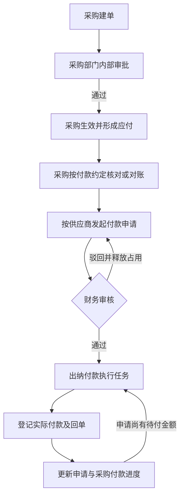

# 采购付款申请执行合同

版本：1.0
日期：2026-10-10
状态：需求基线已确定；代码、审批配置、存量切换和业务验收待实施。

## 1. 适用范围

1. 本合同约束第一期普通采购的应付、付款申请、财务审核和出纳付款。采购单可覆盖实物商品、虚拟商品、线下服务及同供应商物流费用。
2. 供应商按现结或自然周期结算；周期包括月、季、年。采购负责按实际业务开展对账，在需要付款时发起申请。对账频率与付款周期分别处理：季结、年结供应商可以每月对账，到约定付款周期再申请付款。
3. 本次不建设普通采购自动对账、自动生成结算单或逐采购单自动尾款节点。采购可上传线下对账材料；系统不得因期末到达、存在余额或预付款已满足而自动授权付款。
4. 付款申请、审核和实际付款记录在 ERP 内闭环。企业微信用于沟通，不作为并行审批权威；企微审批同步不在本次范围。
5. 第二期 API 供应商结算继续执行《第二期方案》第 12.2 节。普通采购付款申请不得再次生成采购单已有的应付，也不得以 API 结算单代替普通采购对账材料。
6. 本合同与[第一期业务基线](erp-phase-1.md)第 7.4、9.2 节共同约束业务；审批授权按[审批授权与执行合同](approval-workflow-contract.md)执行。本合同的需求状态不得用作已实现、已部署或已验收证明。

## 2. 责任与流程

| 环节 | 责任人 | 必须形成的结果 |
| --- | --- | --- |
| 采购建单与内部审批 | 采购经办人、采购部门审批人 | 确认供应商、采购内容、数量、成本、付款条件、主体和履约安排 |
| 应付形成 | 系统 | 采购生效时按采购单形成应付，财务供应商往来可按权限查询 |
| 对账与付款申请 | 采购经办人 | 核对付款依据，选择未付清采购单并填写逐单申请金额、希望付款日和说明 |
| 付款申请审核 | 财务审批人 | 核对业务来源、金额、主体、收款账户、已付及占用，批准或驳回本次申请 |
| 付款执行 | 指定出纳 | 在批准额度内实际付款，登记回单和逐单分配 |

1. 采购单按采购部门内部已发布审批定义流转，财务不再作为普通采购单的固定审批节点。采购申请人不得审批自己的采购单；没有合格审批人时须阻断提交，不得自动通过或回退给财务。
2. 采购审批通过只使采购单生效并形成应付，不授予付款执行资格、不直接派发出纳付款任务。
3. 现结或预付款可在采购生效后直接申请，不要求先收货或等待月末。周期结算由采购完成相应对账后申请。付款条件与履约门槛继续有效，批准申请本身不代表预付款已付足。
4. 财务审核与出纳执行分别授权。付款申请人不得审批自己的申请；财务批准不等于资金已支付。
5. 付款申请全部审批节点通过后，系统才建立指定到人的付款执行任务。实际付款单不再启动一套重复审批；付款申请审批与实际付款单必须使用不同业务身份。



## 3. 单据与应付的区别

| 对象 | 业务含义 | 金额更新时点 |
| --- | --- | --- |
| 采购单 | 已批准的采购内容及商务条件 | 采购生效或正式采购变更 |
| 采购应付 | 按采购来源记录应付总额、有效已付、剩余应付及收票核销事实 | 采购生效、正式调整和实际付款核销 |
| 付款申请 | 本次请求支付的采购范围、逐单金额及批准结果 | 申请提交、审核、关闭及付款进度更新 |
| 供应商付款单 | 向供应商实际付款的事实、回单及核销分配 | 实际付款登记及按对应业务流程实施的纠正 |

1. 应付继续沿用采购最终审批通过时按含税总额形成的 ERP 业务台账口径；不以付款申请为创建时点，不重复建账。
2. 财务在“供应商往来”查看全部获准范围内的应付，包括未申请付款的余额。存在应付不表示已收货、对账完成、到期或获准付款。
3. 申请提交及批准均不减少应付余额，不增加已付金额。实际付款与核销完成后才更新有效已付和剩余应付。
4. 对账发现采购金额变化时，须通过采购变更、退货或对应调整流程修正正式依据。不得通过修改申请金额覆盖采购总额或应付事实。

## 4. 供应商、我方主体与收款账户

1. 一份申请限定同一供应商、同一我方付款主体和同一供应商收款账户，可包含多张采购单及其关联的多张销售单。
2. 我方付款主体必须继承采购来源销售单的我方结算主体。主体须来自采购所引用的正式销售版本，并随采购提交、生效、应付和付款申请保留可追溯身份及名称快照；不得采用客户主体、供应商主体、内部部门或申请人默认公司替代。
3. 采购选择供应商及采购单后，系统自动带出主体并校验一致性，不提供脱离来源依据的任意主体改选。一次选择跨主体采购单时须提示按主体分组并分别提交，不得形成跨主体申请。
4. 销售后续变更不得静默改写既有采购、应付或已提交申请的主体。相关采购须完成正式变更及一致性检查后才能重新申请；已付款历史保留原主体。
5. 历史采购缺少主体时，必须证明原正式销售版本及其结算主体，按受控修复流程补齐。不能证明或来源主体冲突时阻断申请，不能以当前销售资料、合同默认主体或默认公司猜测。
6. 供应商当前默认账户只作为录入候选；申请提交必须冻结实际选定的有效账户身份、版本、户名和开户行等审核依据。批准后不得随默认账户切换自动更换收款账户。
7. 财务审核及付款提交必须重验主体、账户归属、账户有效性和版本。账户版本变化或更换须停止执行，关闭原申请未付部分并按新账户重新申请、审核；保留已付部分及原审核记录。
8. 本次不支持跨公司代付。实际付款必须使用申请所载我方主体；不得通过改账户、手工备注或合并付款绕过主体约束。

## 5. 申请内容与来源

| 层级 | 必须记录的内容 |
| --- | --- |
| 表头 | 申请单号、供应商、我方付款主体、收款账户及版本、采购申请人、业务归属、申请总额、希望付款日、申请说明、附件、提交版本 |
| 采购明细 | 采购单及生效版本、对应应付身份、本次申请金额、提交时采购总额、有效已付、剩余应付、其他申请占用、付款条件 |
| 销售来源 | 每张采购单真实关联的销售单及正式版本、客户、我方结算主体、完整销售预览与允许材料引用 |
| 流转与执行 | 冻结审批绑定、节点决定、执行任务责任、实际付款分配、回单、未付关闭原因及金额 |

1. 仅允许选择当前用户具备申请资格、已生效且有可申请余额的采购单；逐单校验来源和数据范围，不以能查看供应商代替采购申请资格。
2. 本次申请金额必须逐采购单填写，均大于零；申请总额由服务端精确汇总。可以申请部分余额，不能只填供应商总额而不分配到采购单。
3. 同一申请内同一采购应付只允许一条金额明细。销售单由采购关系自动关联并去重预览，不作为另一层付款金额分配对象，不手工添加无关销售单。
4. 希望付款日与申请说明必填；对账单及其他业务依据可作为附件上传。现结、预付款、周期结算和尾款沿同一申请入口处理。
5. 原采购计划付款日仅作资金安排参考，不能代替申请、审核或证明尾款到期。只有先款比例的采购单不得自动推断尾款日期或预填全部尾款；采购须核对后明确填写本次申请金额及日期。

## 6. 金额、占用与生命周期

按每笔采购应付分别计算：

```text
剩余应付 = 当前有效应付总额 - 当前有效付款核销金额
进行中申请占用 = 审批中申请金额 + 已批准但尚未支付且未关闭的申请金额
可新增申请金额 = 剩余应付 - 进行中申请占用
```

1. 草稿不占用额度。提交时原子校验每笔来源余额并建立占用；审批中、批准待付和部分付款状态均保留相应未付占用。
2. 驳回、合法撤回释放本次全部未付占用并取消原开放审批任务；重新提交必须重新校验余额、冻结新提交和建立占用，不沿用原通过结果。付款申请驳回不得自动重启为仍占额度的新审批轮次。
3. 批准不重复建立占用。付款后在同一事务内减少剩余应付及对应申请未付占用，禁止已付金额仍被计入申请占用。
4. 已批准申请的采购范围、主体、账户、逐单金额、希望付款日及审核依据不得直接修改。需要调整时关闭未付部分后重新提交申请；原批准和已付款历史不变。
5. 关闭未付部分仅允许经授权的原申请人或财务处理人执行，须记录原因、逐单释放金额及当前版本，并同步终止相应执行资格；不得删除申请或付款。关闭与付款必须并发互斥。
6. 申请全部支付时显示“已付清”；仍有批准未付金额时显示“待付款”或“部分付款”；未付部分关闭后显示“已关闭”并保留已付和关闭金额，不得伪装为已付清。采购单状态仍按整单有效核销计算。
7. 申请提交、撤回、驳回、关闭与实际付款须使用同一来源额度并发保护。不同申请同时提交也不得超占；数据库事务及版本校验是最终约束，前端禁用仅提供提示。
8. 采购变更、退货或其他调整导致主体、来源版本、账户或可付余额不再满足批准依据时，必须阻断相关申请付款，处理未付占用后重新申请；不得静默缩减、扩额或转移批准金额。负余额必须显示异常并阻断新增申请。
9. 付款冲正保留原付款和申请关系。原申请尚未关闭时，只能在原批准逐单额度内恢复对应未付金额，并重新校验当前来源、账户和任务资格；已关闭申请不得自动恢复授权，新增可申请余额须由采购重新申请。

示例：采购总额 10 万元、有效已付 3 万元，可申请 7 万元。提交 7 万元申请后可新增申请为 0；批准后先付 4 万元，采购剩余应付为 3 万元、该申请未付占用为 3 万元，可新增申请仍为 0。关闭这 3 万元后才释放为可重新申请余额。

## 7. 审核材料、权限与工作台

1. 财务工作台展示申请总额、希望付款日、申请人、供应商、我方主体、脱敏收款账户、申请说明及对账附件，并直接展开逐采购单金额、付款条件、提交时依据及当前履约和付款进度。
2. 审核面必须提供本次全部关联采购单、销售单的完整只读预览，清楚区分采购成本与销售成交金额。同一销售单的同一正式版本只提供一个预览入口；不同采购引用不同销售版本时须分别标注版本并保留对应预览，采购付款分配仍逐单展示。
3. 提交时冻结精确采购生效版本、来源销售版本及允许附件。审核展示必须区分提交时快照与当前余额、履约进度；后续变更不得覆盖原审核材料，历史缺失不得补读当前草稿或最新合同。
4. 当前合法审批人及付款任务责任人通过专用任务上下文读取必要资料，不要求额外授予普通销售、采购、合同或附件目录的全局权限。任务材料接口须逐项证明申请与来源版本、附件的关系，禁止通过一个关联单据展开其他无关业务。
5. 普通申请列表、详情、统计和导出沿真实业务来源及动作资格授权。多采购来源必须全部具备整单访问资格，或使用明确标注的裁剪视图；不得因部分来源可见而泄露整单资金与附件。部门归属与我方法人主体分别保存和解释。
6. 完整银行账号仅由具备敏感信息揭示权限且具有当前任务资格者主动查看，须记录审计。文件下载复验当前任务或历史读取资格、来源关系和文件治理状态。
7. 工作台区分财务“待审核付款申请”和出纳“待付款申请”；按希望付款日显示今日应处理、后续安排与超期项目。超期不自动批准、不自动付款。采购应能查看本人申请的审核、已付和剩余待付进度。

## 8. 实际付款与回单

1. 出纳只能对已批准、有未付额度且自己具有当前执行资格的申请登记付款。每次逐单支付不得超过该申请该采购行的未付批准金额，并须同时满足当前应付余额约束；禁止在申请内将批准额度从一张采购单转给另一张。
2. 一份申请可以分多次支付，一次支付可以核销该申请内多张采购单。供应商、我方付款主体及收款账户必须与申请一致，实际金额必须与银行回单一致。
3. 多份申请确需合并打款时，必须逐份已批准、任务责任人一致，且供应商、我方付款主体及供应商收款账户均相同，并逐申请逐采购单分配；本合同不要求首批提供跨申请合并入口。禁止继续合并未获申请授权的旧采购应付任务。
4. 实际付款单、逐申请逐采购单核销、申请未付占用扣减、任务进度、回单关联和命令结果须在同一事务提交。外部文件 I/O 放在事务外。
5. 事务提交后详情读取失败不得撤销付款或删除已关联回单。未知提交结果必须沿原幂等键查证；成功后的下一笔分次付款使用新命令身份，禁止重复核销或误复用上一笔结果。
6. 付款申请未付完时保留执行任务；付清或关闭未付部分后完成或终止对应任务。不得以整张采购单是否结清作为单份申请任务的完成条件。
7. 采购详情“票款”页和采购履约任务继续展示本采购单有效付款及回单；合并付款只显示本采购单净分配金额，附件读取沿真实来源授权，不暴露其他采购单分配。冲正后同步更新有效展示资格。

## 9. 实施与存量切换

1. 财务领域负责付款申请实体、状态、逐单批准额度与占用；采购领域负责采购内部审批及正式主体事实；跨域写入由 `erp-processes` 组织事务，工作台和关联材料由 `erp-read-models` 组合读取。不得新增业务领域间直接依赖。
2. 销售正式版本到采购、应付、申请、付款单的我方主体链路须同批补齐。权限生成物、审批类型注册、任务来源、岗位模板、演示数据和前端入口须同时对齐；接口路径和持久化结构须在实现阶段明确，不得把本合同当作接口已存在的证明。
3. 先实现申请及占用、主体与来源校验，再完成采购内部审批、出纳付款准入、工作台与演示流程适配，验收后同批切换；禁止先开放新的付款按钮而保留旧直付接口。
4. 采购内部审批必须配置合格且与申请人分离的采购审批人；财务审核配置到付款申请。既有正在运行的采购审批实例保留冻结定义和历史决定，不伪造或删除财务历史节点；切换后的新提交使用新的采购内部审批定义。
5. 旧采购应付直付任务必须在切换时停止新执行，不得自动转换为已批准付款申请。历史实际付款和应付余额保留；尚未支付余额由采购补齐主体、核对后发起新申请。
6. 存量主体补齐、旧任务停用和新入口启用必须有逐单清单及核验记录。不能证明原主体的单据保留查询并阻断新申请，不伪造主体、不自动授予付款。
7. 切换时须停止旧付款写入并查证在途未知结果，先核对有效付款与余额，再停用旧任务；禁止新旧入口同时写入同一余额。迁移和新流程通过验收前不得宣称上线完成。

## 10. 验收要求

所有项目初始状态为待验证；文档更新不核销代码、数据库、浏览器或部署验收。

| 编号 | 场景 | 必须结果 |
| --- | --- | --- |
| PPR-01 | 采购部门内部审批通过 | 形成采购与应付；财务往来可查；不产生直接付款资格或出纳执行任务 |
| PPR-02 | 同供应商、同主体、同账户的多采购多销售申请 | 逐采购金额正确，全部来源可预览，销售去重展示且不重复计金额 |
| PPR-03 | 跨供应商、跨我方主体或跨收款账户 | 拒绝合并；客户端改参数不能绕过；跨主体选择提示拆分 |
| PPR-04 | 历史缺主体或销售后续改主体 | 不猜测、不静默重写；不能证明正式来源时阻断申请 |
| PPR-05 | 并发申请同一余额 | 原子占用，最多允许余额范围内的提交成功；草稿不占额 |
| PPR-06 | 驳回、撤回、重提 | 释放旧占用、取消旧任务；重提新冻结且重新占用，旧决定无效 |
| PPR-07 | 10 万采购已付 3 万，再申请 7 万，先付 4 万 | 采购余额与申请未付均为 3 万；可新增申请为 0；原任务继续可执行 |
| PPR-08 | 未申请、审批中、驳回、关闭后请求付款 | 服务端拒绝；旧直付接口和旧任务不能绕过 |
| PPR-09 | 部分付款后关闭余款，并发关闭与付款 | 已付历史保留，只释放未付金额；只有合法版本成功，不超付 |
| PPR-10 | 财务与出纳只具有任务材料资格 | 可读本申请全部冻结采购、销售及允许材料；不能读取无关单据或附件 |
| PPR-11 | 收款账户变更、批准明细被篡改、采购减额 | 阻断付款，保留原依据并要求处理未付部分；不得静默换账户或挪额度 |
| PPR-12 | 付款响应丢失、详情读取失败、重复提交 | 原键恢复同一付款；不重复扣额度、核销或删除已关联回单 |
| PPR-13 | 现结、预付款、月结、季结、年结 | 统一申请入口；先款申请无需先收货；月度对账不强制月度付款；审批通过不解除实际先款门槛 |
| PPR-14 | 冲正与采购变更 | 净付款及申请额度一致；关闭申请不自动恢复授权；增额须重新申请 |
| PPR-15 | 存量切换 | 历史付款不变，旧任务失去执行资格，新申请主体有据；在途付款先查证，新旧入口无并发写入 |
