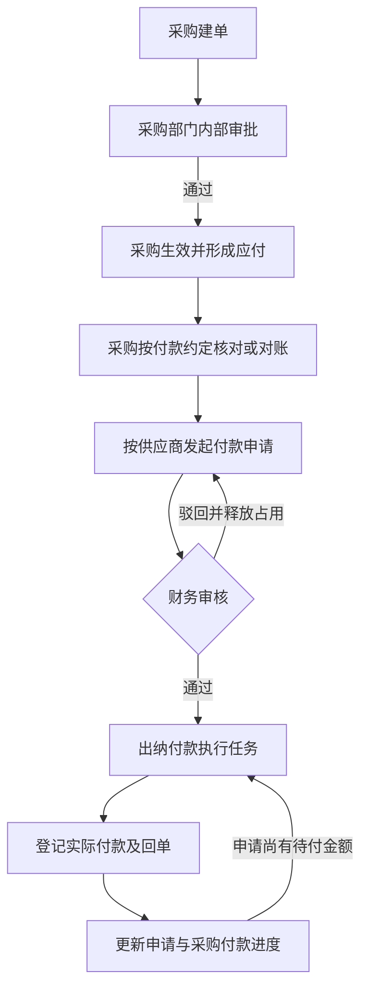

# 采购付款申请执行合同

版本：1.0
日期：2026-10-10
状态：本地实现与验证完成；未部署。验证记录与证据边界见第 10 节。

## 1. 适用范围

1. 本合同约束第一期普通采购的应付、付款申请、财务审核和出纳付款。采购单可覆盖实物商品、虚拟商品、线下服务及同供应商物流费用。
2. 供应商按现结或自然周期结算；周期包括月、季、年。采购负责按实际业务开展对账，在需要付款时发起申请。对账频率与付款周期分别处理：季结、年结供应商可以每月对账，到约定付款周期再申请付款。
3. 本次不建设普通采购自动对账、自动生成结算单或逐采购单自动尾款节点。采购可上传线下对账材料；系统不得因期末到达、存在余额或预付款已满足而自动授权付款。
4. 付款申请、审核和实际付款记录在 ERP 内闭环。企业微信用于沟通，不作为并行审批权威；企微审批同步不在本次范围。
5. 第二期 API 供应商结算继续执行《第二期方案》第 12.2 节。普通采购付款申请不得再次生成采购单已有的应付，也不得以 API 结算单代替普通采购对账材料。
6. 本合同与[第一期业务基线](erp-phase-1.md)第 7.4、9.2 节共同约束业务；审批授权按[审批授权与执行合同](approval-workflow-contract.md)执行。本合同的需求状态不得用作已实现、已部署或已验收证明。

## 2. 责任与流程

| 环节 | 责任人 | 必须形成的结果 |
| --- | --- | --- |
| 采购建单与内部审批 | 采购经办人、采购部门审批人 | 确认供应商、采购内容、数量、成本、付款条件、主体和履约安排 |
| 应付形成 | 系统 | 采购生效时按采购单形成应付，财务供应商往来可按权限查询 |
| 对账与付款申请 | 采购经办人 | 核对付款依据，选择未付清采购单并填写逐单申请金额、希望付款日和说明 |
| 付款申请审核 | 财务审批人 | 核对业务来源、金额、主体、收款账户、已付及占用，批准或驳回本次申请 |
| 付款执行 | 指定出纳 | 在批准额度内实际付款，登记回单和逐单分配 |

1. 采购单按采购部门内部已发布审批定义流转，财务不再作为普通采购单的固定审批节点。采购申请人不得审批自己的采购单；没有合格审批人时须阻断提交，不得自动通过或回退给财务。
2. 采购审批通过只使采购单生效并形成应付，不授予付款执行资格、不直接派发出纳付款任务。
3. 现结或预付款可在采购生效后直接申请，不要求先收货或等待月末。周期结算由采购完成相应对账后申请。付款条件与履约门槛继续有效，批准申请本身不代表预付款已付足。
4. 财务审核与出纳执行分别授权。付款申请人不得审批自己的申请；财务批准不等于资金已支付。
5. 付款申请全部审批节点通过后，系统才建立指定到人的付款执行任务。实际付款单不再启动一套重复审批；付款申请审批与实际付款单必须使用不同业务身份。



## 3. 单据与应付的区别

| 对象 | 业务含义 | 金额更新时点 |
| --- | --- | --- |
| 采购单 | 已批准的采购内容及商务条件 | 采购生效或正式采购变更 |
| 采购应付 | 按采购来源记录应付总额、有效已付、剩余应付及收票核销事实 | 采购生效、正式调整和实际付款核销 |
| 付款申请 | 本次请求支付的采购范围、逐单金额及批准结果 | 申请提交、审核、关闭及付款进度更新 |
| 供应商付款单 | 向供应商实际付款的事实、回单及核销分配 | 实际付款登记及按对应业务流程实施的纠正 |

1. 应付继续沿用采购最终审批通过时按含税总额形成的 ERP 业务台账口径；不以付款申请为创建时点，不重复建账。
2. 财务在“供应商往来”查看全部获准范围内的应付，包括未申请付款的余额。存在应付不表示已收货、对账完成、到期或获准付款。
3. 申请提交及批准均不减少应付余额，不增加已付金额。实际付款与核销完成后才更新有效已付和剩余应付。
4. 对账发现采购金额变化时，须通过采购变更、退货或对应调整流程修正正式依据。不得通过修改申请金额覆盖采购总额或应付事实。

## 4. 供应商、我方主体与收款账户

1. 一份申请限定同一供应商、同一我方付款主体和同一供应商收款账户，可包含多张采购单及其关联的多张销售单。我方付款主体按身份归组；同一主体更名前后的采购可合并申请，各来源保留自身冻结名称，申请表头采用首笔所选采购的冻结名称。不得要求全部历史名称相同，也不得以当前主体名称覆盖历史依据。
2. 我方付款主体必须继承采购来源销售单的我方结算主体。主体须来自采购所引用的正式销售版本，并随采购提交、生效、应付和付款申请保留可追溯身份及名称快照；不得采用客户主体、供应商主体、内部部门或申请人默认公司替代。
3. 采购选择供应商及采购单后，系统自动带出主体并校验一致性，不提供脱离来源依据的任意主体改选。一次选择跨主体采购单时须提示按主体分组并分别提交，不得形成跨主体申请。
4. 销售后续变更不得静默改写既有采购、应付或已提交申请的主体。相关采购须完成正式变更及一致性检查后才能重新申请；已付款历史保留原主体。
5. 采购或正式销售版本缺少主体身份时阻断申请，不能以当前销售资料、合同默认主体或默认公司猜测。本次开发切换不提供旧数据修复或兼容读取；开发数据须按当前种子和单据流程重建。
6. 供应商当前默认账户只作为录入候选；申请提交必须冻结实际选定的有效账户身份、版本、户名和开户行等审核依据。批准后不得随默认账户切换自动更换收款账户。
7. 财务审核及付款提交必须重验主体、账户归属、账户有效性和版本。账户版本变化或更换须停止执行，关闭原申请未付部分并按新账户重新申请、审核；保留已付部分及原审核记录。
8. 本次不支持跨公司代付。实际付款必须使用申请所载我方主体；不得通过改账户、手工备注或合并付款绕过主体约束。
9. 采购正式变更引用当前销售行时，须同时校验稳定行身份和商品 SKU 身份。销售行更换商品后，不得仅刷新来源版本或主体，使原商品采购取得新的付款资格；来源不一致时须阻断，按正式业务流程纠正后再申请。

## 5. 申请内容与来源

| 层级 | 必须记录的内容 |
| --- | --- |
| 表头 | 申请单号、供应商、我方付款主体、收款账户及版本、采购申请人、业务归属、申请总额、希望付款日、申请说明、附件、提交版本 |
| 采购明细 | 采购单及生效版本、对应应付身份、本次申请金额、提交时采购总额、有效已付、剩余应付、其他申请占用、付款条件 |
| 销售来源 | 每张采购单真实关联的销售单及正式版本、客户、我方结算主体、完整销售预览与允许材料引用 |
| 流转与执行 | 冻结审批绑定、节点决定、执行任务责任、实际付款分配、回单、未付关闭原因及金额 |

1. 仅允许选择当前用户具备申请资格、已生效且有可申请余额的采购单；逐单校验来源和数据范围，不以能查看供应商代替采购申请资格。
2. 本次申请金额必须逐采购单填写，均大于零；申请总额由服务端精确汇总。可以申请部分余额，不能只填供应商总额而不分配到采购单。
3. 同一申请内同一采购应付只允许一条金额明细。销售单由采购关系自动关联并去重预览，不作为另一层付款金额分配对象，不手工添加无关销售单。
4. 希望付款日与申请说明必填；对账单及其他业务依据可作为附件上传。现结、预付款、周期结算和尾款沿同一申请入口处理。
5. 原采购计划付款日仅作资金安排参考，不能代替申请、审核或证明尾款到期。只有先款比例的采购单不得自动推断尾款日期或预填全部尾款；采购须核对后明确填写本次申请金额及日期。
6. 申请自身上传的附件身份与采购、销售来源材料分别保存。草稿编辑须保留申请自身附件，仅将本次新增上传并入申请附件；不得将展示材料中的来源附件反写为申请人上传附件。来源材料继续沿真实关系展示及授权读取。

### 5.1 批量选单与草稿保存

1. 从付款申请列表新建时，须先选择采购单，再填写申请；从采购单详情进入时，仅预选该采购单。不得自动包含同供应商的其他采购单。
2. 选单允许跨供应商、跨我方付款主体。系统按供应商身份及付款主体身份分组，名称差异不改变身份归组；供应商和付款主体只读，不能手工改选。
3. 每组独立填写逐单金额、有效收款账户、希望付款日、申请说明及自有附件。同组多张采购单可以拆成独立申请后选择不同账户；同一采购应付不得在同一批次重复出现。
4. 返回选单须保留仍被选择采购单的金额及各组付款安排。取消勾选的采购单不得进入本次保存载荷或合计。修改已有草稿只修改原申请，不得借编辑入口创建跨供应商或跨主体的额外申请。
5. 一次批量保存接受 1 至 50 份草稿。服务端须在同一事务逐份校验来源、账户、主体、申请资格及当前可申请余额，保存全部草稿、审计和成功回执；任一项失败时整批回滚。草稿不占用应付余额，不启动审批或实际付款。
6. 批次操作号与完整规范化载荷绑定；相同操作号、相同载荷只返回原草稿，相同操作号、不同载荷必须拒绝。客户端在结果未知时保留原操作号、原表单和已上传附件身份，禁止修改后换号重建；须查询本次保存结果。
7. 保存成功须逐份展示申请单号、付款关系和金额，提供打开申请的入口。每份申请继续独立提交审核、占用余额及执行付款。
8. 新选采购单首次进入填写步骤时，须按采购生效版本的付款条款预填逐单申请金额。先款条件使用“预付款缺口减其他申请占用”与可申请余额的较小正数；缺口已扣除有效已付，不得重复扣减。现结、货到及周期结算条件使用当前可申请余额，预填金额不得用于推断付款日期或证明已经到期。条款未知、门槛缺失、条件不一致或预付款已满足时金额留空，不得自动填满尾款。预填后允许修改；返回选单、拆分申请及重新勾选不得覆盖已修改或主动清空的金额，编辑已有草稿须保留原申请金额。

9. 新建申请组的希望付款日默认使用业务时区（Asia/Shanghai）的当天，允许申请人修改或清空后重选。返回选单须保留已有组的日期，编辑草稿须保留原日期。默认值仅表达申请人的付款安排，不作为合同到期、尾款到期或实际付款日期的判断依据。

## 6. 金额、占用与生命周期

按每笔采购应付分别计算：

```text
剩余应付 = 当前有效应付总额 - 当前有效付款核销金额
进行中申请占用 = 审批中申请金额 + 已批准但尚未支付且未关闭的申请金额
可新增申请金额 = 剩余应付 - 进行中申请占用
```

1. 草稿不占用额度。提交时原子校验每笔来源余额并建立占用；审批中、批准待付和部分付款状态均保留相应未付占用。
2. 驳回、合法撤回释放本次全部未付占用并取消原开放审批任务；重新提交必须重新校验余额、冻结新提交和建立占用，不沿用原通过结果。付款申请驳回不得自动重启为仍占额度的新审批轮次。
3. 批准不重复建立占用。付款后在同一事务内减少剩余应付及对应申请未付占用，禁止已付金额仍被计入申请占用。
4. 已批准申请的采购范围、主体、账户、逐单金额、希望付款日及审核依据不得直接修改。需要调整时关闭未付部分后重新提交申请；原批准和已付款历史不变。
5. 关闭申请仅允许经授权的原申请人或财务处理人执行，须记录原因、逐单释放金额及当前版本，并同步终止相应执行资格；不得删除申请或付款。已付清申请可沿同一关闭命令显式终止原付款授权，未付释放金额为零，原付款和已完成任务保持不变。关闭不要求账户或来源仍满足继续付款资格。关闭与付款必须并发互斥。
6. 申请全部支付时显示“已付清”；仍有批准未付金额时显示“待付款”或“部分付款”；未付部分关闭后显示“已关闭”并保留已付和关闭金额，不得伪装为已付清。采购单状态仍按整单有效核销计算。
7. 申请提交、撤回、驳回、关闭与实际付款须使用同一来源额度并发保护。不同申请同时提交也不得超占；数据库事务及版本校验是最终约束，前端禁用仅提供提示。
8. 采购变更、退货或其他调整导致主体、来源版本、账户或可付余额不再满足批准依据时，必须阻断相关申请付款，处理未付占用后重新申请；不得静默缩减、扩额或转移批准金额。负余额必须显示异常并阻断新增申请。
9. 付款冲正保留原付款和申请关系。原申请尚未关闭时，只能在原批准逐单额度内恢复对应未付金额，并重新校验当前来源、账户和任务资格；已有开放付款任务须按当前合法负责人复验并保持其责任，不得因单次改派与默认责任不同而拒绝冲正。需要新建后继任务时才解析当前默认责任。已关闭申请不得自动恢复授权，新增可申请余额须由采购重新申请。已付清申请的账户或来源依据失效时，须先按第 5 条终止原授权，再完成仅账务冲正；不得通过冲正恢复失效授权。

示例：采购总额 10 万元、有效已付 3 万元，可申请 7 万元。提交 7 万元申请后可新增申请为 0；批准后先付 4 万元，采购剩余应付为 3 万元、该申请未付占用为 3 万元，可新增申请仍为 0。关闭这 3 万元后才释放为可重新申请余额。

## 7. 审核材料、权限与工作台

1. 财务工作台展示申请总额、希望付款日、申请人、供应商、我方主体、脱敏收款账户、申请说明及对账附件，并直接展开逐采购单金额、付款条件、提交时依据及当前履约和付款进度。
2. 审核面必须提供本次全部关联采购单、销售单的完整只读预览，清楚区分采购成本与销售成交金额。同一销售单的同一正式版本只提供一个预览入口；不同采购引用不同销售版本时须分别标注版本并保留对应预览，采购付款分配仍逐单展示。
3. 提交时冻结精确采购生效版本、来源销售版本及允许附件。审核展示必须区分提交时快照与当前余额、履约进度；后续变更不得覆盖原审核材料，历史缺失不得补读当前草稿或最新合同。
4. 当前合法审批人及付款任务责任人通过专用任务上下文读取必要资料，不要求额外授予普通销售、采购、合同或附件目录的全局权限。任务材料接口须逐项证明申请与来源版本、附件的关系，禁止通过一个关联单据展开其他无关业务。
5. 普通申请列表、详情、统计和导出沿真实业务来源及动作资格授权。多采购来源必须全部具备整单访问资格，或使用明确标注的裁剪视图；不得因部分来源可见而泄露整单资金与附件。部门归属与我方法人主体分别保存和解释。
6. 完整银行账号仅由具备敏感信息揭示权限且具有当前任务资格者主动查看，须记录审计。文件下载复验当前任务或历史读取资格、来源关系和文件治理状态。
7. 工作台区分财务“待审核付款申请”和出纳“待付款申请”；按希望付款日显示今日应处理、后续安排与超期项目。超期不自动批准、不自动付款。采购应能查看本人申请的审核、已付和剩余待付进度。
8. 销售正式版本变更后，销售详情仍须可读，并明确标记仍引用旧正式版本的采购数量及单数；这些历史分配不得冒充当前版本的有效采购覆盖。原采购、应付及申请的冻结来源不改写，相关采购完成正式变更前须阻断继续创建采购。旧依据申请不得继续付款；相关采购更新后须重新申请、审核，已批准未付部分先按第 6 节关闭。

## 8. 实际付款与回单

1. 出纳只能对已批准、有未付额度且自己具有当前执行资格的申请登记付款。每次逐单支付不得超过该申请该采购行的未付批准金额，并须同时满足当前应付余额约束；禁止在申请内将批准额度从一张采购单转给另一张。
2. 一份申请可以分多次支付，一次支付可以核销该申请内多张采购单。供应商、我方付款主体及收款账户必须与申请一致，实际金额必须与银行回单一致。首批每笔新付款只接受本命令真实上传的回单，不接受客户端提供的已有正式文件身份；原命令成功结果的幂等查证不得要求重新上传，不得创建新付款或替换原回单。
3. 多份申请确需合并打款时，必须逐份已批准、任务责任人一致，且供应商、我方付款主体及供应商收款账户均相同，并逐申请逐采购单分配；本合同不要求首批提供跨申请合并入口。禁止继续合并未获申请授权的旧采购应付任务。
4. 实际付款单、逐申请逐采购单核销、申请未付占用扣减、任务进度、回单关联和命令结果须在同一事务提交。外部文件 I/O 放在事务外。
5. 事务提交后详情读取失败不得撤销付款或删除已关联回单。未知提交结果必须沿原幂等键查证；成功后的下一笔分次付款使用新命令身份，禁止重复核销或误复用上一笔结果。无文件查证只保证恢复已存在且载荷一致的成功回执；未命中时的缺回单拒绝不得解释为先前未知命令确定未提交。正常客户端的未知结果恢复继续发送原完整命令与文件。
6. 付款申请未付完时保留执行任务；付清或关闭未付部分后完成或终止对应任务。不得以整张采购单是否结清作为单份申请任务的完成条件。
7. 采购详情“票款”页和采购履约任务继续展示本采购单有效付款及回单；合并付款只显示本采购单净分配金额，附件读取沿真实来源授权，不暴露其他采购单分配。冲正后同步更新有效展示资格。

## 9. 实施与开发切换

1. 财务领域负责付款申请实体、状态、逐单批准额度与占用；采购领域负责采购内部审批及正式主体事实；跨域写入由 `erp-processes` 组织事务，工作台和关联材料由 `erp-read-models` 组合读取。不得新增业务领域间直接依赖。
2. 销售正式版本到采购、应付、申请、付款单的我方主体链路须同批补齐。权限生成物、审批类型注册、任务来源、岗位模板、演示数据和前端入口须同时对齐；接口路径和持久化结构须在实现阶段明确，不得把本合同当作接口已存在的证明。
3. 先实现申请及占用、主体与来源校验，再完成采购内部审批、出纳付款准入、工作台与演示流程适配，验收后同批切换；禁止先开放新的付款按钮而保留旧直付接口。
4. 采购内部审批必须配置合格且与申请人分离的采购审批人；财务审核配置到付款申请。演示采购申请人为 `caigou`，采购审批人为 `caigoushenpi`，付款申请审核人为 `caiwu`，付款执行人为 `fukuan`。
5. 本次项目处于开发阶段，不提供旧持久化结构、旧审批实例或旧付款任务的数据迁移和兼容运行。开发业务数据按隔离 E2E 或开发准备入口重建，禁止将旧采购审批结果或旧应付任务转换为付款申请批准结果。
6. 旧供应商付款提交入口和旧应付执行任务必须拒绝新付款；新付款统一按已批准申请执行，禁止新旧入口并行写入同一余额。
7. 付款响应丢失或提交结果未知仍须查证原命令结果；不兼容旧数据不免除资金幂等、版本、事务及审核材料约束。本地验证通过不得宣称已经部署。

## 10. 验收要求

按本节要求执行验收。本地结果须登记运行身份、构建与证据层级；不得以文档更新替代部署验收，或将未执行的场景登记为浏览器通过。

| 编号 | 场景 | 必须结果 |
| --- | --- | --- |
| PPR-01 | 采购部门内部审批通过 | 形成采购与应付；财务往来可查；不产生直接付款资格或出纳执行任务 |
| PPR-02 | 同供应商、同主体、同账户的多采购多销售申请 | 逐采购金额正确，全部来源可预览，销售去重展示且不重复计金额 |
| PPR-03 | 跨供应商、跨我方主体或跨收款账户 | 拒绝合并；客户端改参数不能绕过；跨主体选择提示拆分 |
| PPR-04 | 来源缺主体或销售后续改主体 | 不猜测、不静默重写；不能证明正式来源时阻断申请；不提供旧数据修复 |
| PPR-05 | 并发申请同一余额 | 原子占用，最多允许余额范围内的提交成功；草稿不占额 |
| PPR-06 | 驳回、撤回、重提 | 释放旧占用、取消旧任务；重提新冻结且重新占用，旧决定无效 |
| PPR-07 | 10 万采购已付 3 万，再申请 7 万，先付 4 万 | 采购余额与申请未付均为 3 万；可新增申请为 0；原任务继续可执行 |
| PPR-08 | 未申请、审批中、驳回、关闭后请求付款 | 服务端拒绝；旧直付接口和旧任务不能绕过 |
| PPR-09 | 部分付款后关闭余款，并发关闭与付款 | 已付历史保留，只释放未付金额；只有合法版本成功，不超付 |
| PPR-10 | 财务与出纳只具有任务材料资格 | 可读本申请全部冻结采购、销售及允许材料；不能读取无关单据或附件 |
| PPR-11 | 收款账户变更、批准明细被篡改、采购减额 | 阻断付款，保留原依据并要求处理未付部分；不得静默换账户或挪额度 |
| PPR-12 | 付款响应丢失、详情读取失败、重复提交 | 原键恢复同一付款；不重复扣额度、核销或删除已关联回单 |
| PPR-13 | 现结、预付款、月结、季结、年结 | 统一申请入口；先款申请无需先收货；月度对账不强制月度付款；审批通过不解除实际先款门槛 |
| PPR-14 | 冲正与采购变更 | 净付款及申请额度一致；关闭申请不自动恢复授权；增额须重新申请 |
| PPR-15 | 开发切换 | 按当前流程重建数据，旧直付入口和任务拒绝执行；新申请主体有据，未知结果按原命令查证 |
| PPR-16 | 出纳引用无权访问的已有回单 | 拒绝新付款，不扣额度、不形成材料读取资格；本命令上传及原命令结果恢复仍有效 |
| PPR-17 | 已付清后账户或来源变更，再终止授权并冲正 | 关闭金额初始为零，保留原付款；冲正后不恢复原占用或任务，余额可重新申请 |
| PPR-18 | 付款任务合法改派后部分付款冲正 | 复验现任任务负责人，恢复原逐单占用并保留任务责任；失去资格时拒绝恢复 |
| PPR-19 | 同一主体更名前后的采购合并申请 | 可提交、批准及执行；各来源保留自身历史名称，不误报来源变化 |
| PPR-20 | 取消提交确认后编辑草稿再提交 | 保留申请自身附件且不混入来源材料；首次实际提交使用最新版本；未知结果仍沿原命令身份查证 |
| PPR-21 | 同会话付款后返回已缓存的先款履约任务 | 付款成功后刷新履约门槛，无需手动刷新即可继续合法履约 |

### 10.1 本地验证登记

验证日期：2026-10-10。全量运行身份：`20261010t154656_c8173e29d605`。前端生产构建：`kUUlB7yo3utxtfVb_z9sB`。以下证据保存在本地、已忽略的 `logs/` 目录；不构成远程 CI、部署或生产验收证明。

| 验证范围 | 执行结果 | 本地证据 |
| --- | --- | --- |
| 全量隔离 E2E | `E2E_ISOLATE=1 E2E_WORKERS=6 bash scripts/run-flow.sh all`：6 个隔离分片，38 个 spec 各执行一次、55 个测试全部通过；0 失败、0 跳过、0 flaky；618.644 秒 | [运行摘要](../logs/e2e/20261010t154656_c8173e29d605/summary.json)、[覆盖核验](../logs/ppr-review-fix-20261010t072556/full-e2e-verification.json) |
| 回归场景 | flow-33 至 flow-36 验证既有回单引用拒绝及原结果恢复、付清授权终止、改派冲正及撤权拒绝、同主体历史名称归组、草稿编辑与自有附件保留、未知结果恢复、同会话履约缓存刷新 | [验证汇总](../logs/ppr-review-fix-20261010t072556/validation.json) |
| 后端格式、编译与构建 | `cargo fmt --all -- --check`、工作区 locked check、web-api locked build、工作区 all-targets/all-features 严格 clippy 均通过 | [门禁汇总](../logs/ppr-review-fix-20261010t072556/validation.json) |
| 后端库单元测试 | `env -u ERP_TEST_MONGO_URI cargo test --workspace --lib --locked`：34 个库目标，5,377 通过、0 失败、63 忽略；未执行集成测试或依赖真实 MongoDB 的忽略测试 | [库测试日志](../logs/ppr-review-fix-20261010t072556/backend-unit.log) |
| 架构边界与生成物 | BPM 边界及领域最终切换检查通过；权限生成物重新构建可复现，使用临时索引校验，真实索引内容未修改 | [边界门禁](../logs/ppr-review-fix-20261010t072556/validation.json)、[生成物一致性](../logs/ppr-review-fix-20261010t072556/permissions.json) |
| 前端与 E2E 类型 | 前端 lint、format check、严格 TypeScript、生产 build 通过；最终 E2E 严格 TypeScript 通过 | [门禁汇总](../logs/ppr-review-fix-20261010t072556/validation.json)、[生产构建日志](../logs/ppr-review-fix-20261010t072556/frontend-build-final.log) |
| 源码体积 | 修复前后均有 192 项存量超限，无新增或加重；全量体积门禁未通过 | [体积对比](../logs/ppr-review-fix-20261010t072556/rust-size-comparison.json) |
| 运行资源清理 | 定向及全量共 9 次运行的 14 个临时数据库、9 个原生 Mongo、分片 API、临时配置、数据目录与端口均已清理；本次前端 3100 已停止，原开发 3000、10001 服务保留 | [隔离资源核验](../logs/ppr-review-fix-20261010t072556/e2e-cleanup.json)、[本次服务清理](../logs/ppr-review-fix-20261010t072556/owned-services-cleanup.json) |

1. 浏览器与隔离数据库证据包含：内部采购审批仅形成应付、跨供应商与主体分组拒绝、并发占用、撤回及驳回释放、重新冻结、受限任务完整材料、部分付款、原键恢复、账户停用及换版、采购减额、销售正式版本变化、开放与关闭申请冲正、关闭与付款竞争，以及 PPR-16 至 PPR-21 的回归场景。已付清后依据失效的真实浏览器场景采用账户停用及换版；不得将其登记为已付清后销售来源变更的独立浏览器注入。
2. 同销售同正式版本去重、原始 10 万／3 万／7 万／4 万金额示例、主体缺失或错配、商品 SKU 来源证明及来源变化后的新采购阻断，另由库测试验证。不得将这些库测试登记为相同参数的真实浏览器注入。
3. 付款提交后读取失败与未知结果查证失败采用 Process 库故障注入；真实 E2E 验证提交成功后客户端丢失响应及原命令恢复。未执行真实 MongoDB 或 S3 故障注入；web-api 二进制中的补偿单测不计入库测试结果。
4. 未单独进行正式销售换主体、直接篡改数据库中批准申请、旧审批决定重放或采购增额的浏览器注入；不得仅凭验收编号将这些子场景登记为已完成真实 E2E。
5. 清理须按运行身份独立核验。文件上传使用隔离 S3 前缀，上述清理记录不声明已删除这些 S3 对象。开发源库只读复制；开发业务数据重建及常驻 API 切换须按第 9 节执行，不以隔离 E2E 代替。

## 11. 接口与持久化执行约束

管理端前缀为 `/admin`。所有接口须通过 JWT、对应动作权限及服务端来源或任务资格校验。

| 方法与路径 | 执行结果 | 动作权限 |
| --- | --- | --- |
| `GET /purchase-payment-requests` | 全部采购来源获准的分页整单申请 | `purchase_payment_request:list` |
| `GET /purchase-payment-requests/candidates` | 可申请采购、继承主体与脱敏账户候选 | `purchase_payment_request:create` |
| `GET /purchase-payment-requests/{id}` | 冻结依据与当前余额分别展示的整单详情 | `purchase_payment_request:detail` |
| `GET /purchase-payment-requests/{id}/submissions/{version}` | 沿全部历史来源授权读取该轮不可变提交依据 | `purchase_payment_request:detail` |
| `POST /purchase-payment-requests/batch` | 原子创建多份独立草稿并恢复原批次结果 | `purchase_payment_request:create` |
| `POST /purchase-payment-requests` | 保存不占用额度的申请草稿 | `purchase_payment_request:create` |
| `PUT /purchase-payment-requests/{id}` | 按当前版本修改本人可编辑草稿 | `purchase_payment_request:update` |
| `POST /purchase-payment-requests/{id}/submit` | 冻结来源、原子占用并启动财务审核 | `purchase_payment_request:submit` |
| `POST /purchase-payment-requests/{id}/withdraw` | 撤回审批中申请、释放占用和取消开放审批任务 | `purchase_payment_request:withdraw` |
| `POST /purchase-payment-requests/{id}/close` | 关闭批准未付部分或终止已付清申请的原授权；只释放实际未付占用 | `purchase_payment_request:close` |
| `POST /purchase-payment-requests/{id}/payments/commit` | multipart 原子登记实际付款与回单 | `purchase_payment_request:pay` |
| `POST /purchase-payment-requests/{id}/reveal-account` | 主动揭示当前任务冻结账户并记审计 | `party_bank_account:reveal` |
| `GET /work-items/{id}/purchase-payment-request` | 当前合法审批人或出纳的完整申请材料上下文 | `work_item:detail` |
| `GET /purchase-payment-requests/{id}/materials/{file_asset_id}/preview` | 读取冻结允许的同版本图片或 PDF | `purchase_payment_request:detail` |
| `GET /purchase-payment-requests/{id}/materials/{file_asset_id}/download` | 下载冻结允许的同版本文件 | `purchase_payment_request:detail` |

1. 草稿表单为 `data`：`supplier_id`、`payee_bank_account_id`、`lines[{payable_account_id, amount}]`、`desired_payment_date`、`reason`、`attachment_ids`。主体由正式采购来源继承；客户端不得填写或改选主体。
批量创建入参为 `{ idempotency_key, requests: [data] }`，`data` 与单份草稿一致；返回按入参顺序排列的申请数组。上传须先完成，再将每组自有附件身份放入对应 `data.attachment_ids`。

2. 修改草稿须带 `expected_version`。提交须带当前版本与 `idempotency_key`；撤回、关闭还须填写 `reason`。提交、撤回、关闭与付款的未知结果只能沿原命令身份恢复。
3. 实际付款命令须带 `payment_request_id`、`expected_request_version`、当前任务及账户版本，并与路径申请身份一致；分配对象只能为该申请已批准采购行。
4. 申请保存在 `purchase_payment_requests`，每轮不可变提交保存在 `purchase_payment_request_snapshots`，以申请身份和提交版本、审批实例建立唯一约束。每笔应付的 `payment_request_reserved_total` 为共享占用约束；实际付款保留申请身份、我方付款主体及逐申请采购分配。新集合索引由财务领域定义，web-api 与 CLI 组合根统一登记。
5. 审批类型为 `PurchasePaymentRequest`，任务来源为 `purchase_payment_request`。实际付款继续使用 `SupplierPayment` 事实身份并采用无重复审批登记。旧 `POST /supplier-payments/commit` 与旧应付合并付款任务必须拒绝执行。
6. 文件读取须核对申请、任务、允许清单、文件版本及内容指纹，存储读取前后重验资格和治理状态；响应采用私有禁止缓存设置。任务参数不得为其他申请的材料授予读取资格。
7. 历史材料须通过 `submission_version` 明确选择提交轮次，不得同时使用 `work_item_id`。历史读取使用该轮冻结来源与审批实例的材料清单，不得以当前提交替代。
8. 供应商商务资料的 `reconciliation_cycle` 独立保存对账频率；付款条件继续由 `settlement_mode` 和 `payment_terms` 表达。管理端、门户申请与审核差异均须分别展示两者。切换月结、季结或年结不得覆盖已经选择的对账频率，接口不得要求两种周期相等。
9. 实际付款持久化结构必须显式包含申请身份、我方付款主体身份及名称；草稿可明确保存为空，过账与冲正必须验证完整身份、唯一的正数逐采购分配及分配合计。缺字段的旧付款不得通过默认值补成获准付款，也不得跳过原申请关系校验。
10. 首次申请草稿在提交前不要求已有审批业务登记，可以展示当前已发布路线；提交后必须使用该申请登记的精确审批实例、提交版本及冻结定义。不得按创建时间推测当前实例，也不得用未登记草稿的读取规则放宽已提交申请。
