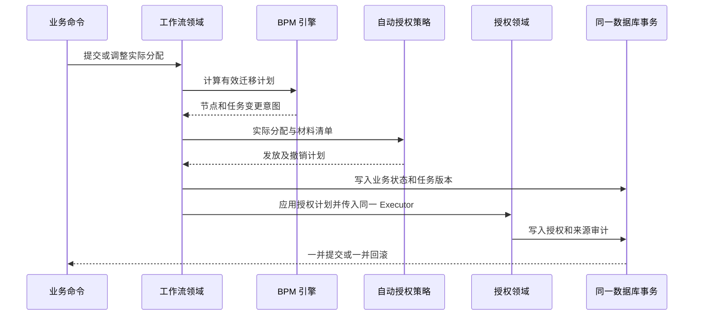

# 统一资源授权设计合同

版本：1.0　日期：2026-11-05　状态：待实施设计

本合同规定 ERP 功能权限、数据授权、自动授权和 BPM 的边界，以及各业务流程的接入要求。适用于管理端、工作台、公开业务页、文件服务、后台任务和集成入口。

本合同适用于当前无多租户模型的 ERP，不引入多租户隔离或多公司准入体系。“公司范围”表示所登记资源类型及动作的全公司数据范围，由授权选择器表达。

基线为提交 `6b253a5f2` 的领域与编排代码，补充核对当日主工作区正在建设的交付地址安排流程。本文规定的统一授权模型尚未实现；“当前”仅表示源码已确认的类型或业务入口，不代表线上验收。交付地址安排单独标为在建，不计入基线能力。本文不修改线上授权和业务数据。

## 1. 强制规则

1. 所有资源访问必须同时满足有效身份、功能权限、资源动作授权和强制边界。不存在“部门范围不满足，但任务关系允许”的备用放行路径。
2. 功能权限按主体全部有效角色求并集；一次操作所需的多项功能权限允许由不同角色共同提供，不要求同一角色完整授予。部门、公司、本人负责、指定资源等有效数据授权也按并集生效，不设置人员或部门范围的统一上限。
3. 任务、单据、文件、审批提交版本和受限业务材料均为资源。任务关系只负责产生、调整、撤销授权，不直接参与访问放行。
4. 功能权限决定能否使用某项能力；数据授权决定能对哪些资源使用该能力。两者分别取证，不要求来自同一角色或同一授权来源。业务事件不得自动添加角色、功能权限或组织成员身份。
5. BPM 决定流程与节点如何推进；工作流领域维护实际分配；授权领域维护由分配产生的授权。领域状态、金额、版本、职责分离约束继续独立校验。
6. 自动授权必须能够解释“因何事件、哪个责任版本、向谁、对哪个资源、允许什么、何时终止”。禁止只有用户和资源、没有来源的自动授权记录。
7. 关联资源不得递归传播授权。销售单可读不等于客户全部资料、采购成本、供应商资金、全部附件或其他销售单可读。
8. 每个新增业务事件、资源类型、任务类型必须登记本合同要求的授权策略和撤销规则。未登记的事件不得自动发放权限。

### 1.1 统一判定

```text
Allow(subject, entry, resource, action) =
    ActiveIdentity(subject)
    AND HasAllCapabilities(subject, RequiredCapabilities(entry))
    AND ExistsEffectiveGrant(subject, resource, action)
    AND HardBoundaryAllows(subject, resource, action)

CommandSucceeds = Allow AND DomainPreconditions AND ExpectedVersionMatches
WorkflowCommandSucceeds = CommandSucceeds AND WorkflowTransitionValid
```

`entry` 为服务端登记的业务入口或操作，不接受调用方自行指定权限要求。每个入口必须登记所需功能权限集合及目标资源动作；复合操作必须逐项检查全部目标资源动作。不同入口可以要求不同功能权限，同时检查相同的资源动作授权。

`HasAllCapabilities` 将主体全部有效角色提供的功能权限合并，再检查是否覆盖当前操作所需的全部权限。禁止要求某一个角色独自覆盖全部权限。例如，角色甲提供采购单创建权限、角色乙提供采购单提交权限时，主体满足“创建并提交”的功能资格；对应资源授权及业务前置条件仍须满足。角色停用、解绑或权限撤销仅移除该来源，其他有效角色提供的权限继续生效。

`ExistsEffectiveGrant` 对全部有效来源的“资源 + 动作”授权求并集。本人责任、部门范围、公司范围、任务分配和人工共享均可独立贡献授权；任一来源覆盖目标资源及动作即满足数据授权，不要求目标同时位于本人或部门范围内。复合操作需要多个资源动作时，各项可以由不同来源分别满足。

每一条资源授权必须同时覆盖主体、资源选择器、动作、有效期和该条授权的约束；该条约束只限定本来源，不限制其他来源。不得使用甲授权的资源范围与乙授权的动作生成未授予的组合。例如，A 单读取权与 B 单修改权叠加后，仍不产生 A 单修改权。

公司范围授权覆盖所登记资源类型及动作的全公司数据；部门范围授权覆盖明确指定的部门，并按登记规则决定是否包含下级部门。账号停用等强制禁用条件优先于全部正向授权，资源级授权不得绕过。人员范围和部门范围均为正向授权来源，不作为其他有效资源授权的统一上限；禁止在授权并集之后再与人员或部门范围求交集。

本版本不引入可任意叠加的负向 ACL；撤销某一来源仅删除该来源的贡献。账号停用、资源封禁等硬性禁用优先于全部正向授权。撤销公司范围授权仅移除该来源，其他有效授权继续独立判定。

### 1.2 两类页面的查询合同

| 页面 | 查询条件 |
| --- | --- |
| 销售单、采购单等管理列表 | 对应列表功能权限 ∩ 对该资源及 `read` 动作的有效授权 ∩ 用户筛选条件 |
| 销售单、采购单等完整详情 | 对应详情功能权限 ∩ 对该资源及 `read` 动作的有效授权 |
| 待办列表 | 工作台列表功能权限 ∩ 对任务资源 `read` 的有效授权 ∩ 业务筛选条件（待处理、分配给我、类型等） |
| 待办详情中的业务材料 | 材料读取功能权限 ∩ 对明确材料资源 `read` 的有效授权 |
| 审批或执行提交 | 对应动作功能权限 ∩ 对指定任务或执行资源的动作授权 ∩ 流程及业务前置条件 |

“分配给我”是任务列表筛选，不是第三种授权通道。监督人员只有显式的任务查看授权才可看他人的任务；查看权限不产生执行权限。界面不得通过“查得到任务”推断“所有关联单据均可完整读取”。

管理列表和工作台必须共享同一授权引擎。拥有销售单完整读取授权且具备销售单列表功能权限的人，可在销售管理列表看到该单；打开完整详情还必须具备销售单详情功能权限。列表权限与详情权限不得互相替代。只有审批材料授权的人，只能读取材料及其安全摘要，不得自动获得完整销售单权限。

## 2. 架构与职责


图源：[Graphviz DOT](assets/resource-authorization-architecture.dot)。授权发放与授权判定分开；图中的业务关系只进入授权策略，不直接进入放行表达式。



| 模块 | 必须承担的职责 | 禁止承担的职责 |
| --- | --- | --- |
| `erp-identity` 授权模块 | 主体资格、功能权限、资源授权存储、有效性判定、查询约束、来源撤销和解释 | 解析销售金额、计算审批下一节点、直接访问其他领域集合 |
| 各业务领域 | 资源身份、所有权与版本事实、材料视图、业务状态不变式 | 在详情接口增加任务关系放行分支 |
| `erp-workflow` | 流程实例、任务分配、分配代次、节点运行状态、职责分离事实 | 以任务关系替代授权判定 |
| `platform/bpm` | 根据输入资格与状态计算迁移计划 | 依赖 ERP 权限、MongoDB、HTTP 或发放资源 ACL |
| 业务编排库 | 在一个事务内组合业务变更、任务变更、授权计划和审计 | 直接写入其他领域拥有的授权集合 |
| `erp-read-models` | 组合授权约束与业务查询，输出受限投影 | 将“查不到”直接解释成业务关联错误 |
| 应用接线层 | 实现窄 Port 连接、资源注册及权限目录接线 | 成为业务授权策略集中堆放处 |
| 文件、导出、后台执行入口 | 使用同一授权合同；校验实际输出资源及动作 | 只校验菜单或任务可见性 |

授权存储由 `erp-identity` 拥有；消费方通过窄 Port 传入类型化事实和计划，跨域编排复用 `&mut dyn Executor`。共享基础库只放协议和值对象，不放跨领域授权业务查询。不得为本设计新增领域循环依赖。

## 3. 资源、动作与功能权限

### 3.1 资源身份

资源键必须至少包含 `resourceType + resourceId`。固定提交、审批材料、历史回执必须进一步包含不可变 `version`；行级材料必须包含确定的行集合或稳定子资源标识。

| 资源族 | 资源示例 | 动作示例 |
| --- | --- | --- |
| 业务对象 | 销售单、采购单、客户、合同、应收、应付 | `read`、`update`、`submit`、`cancel`、`handover` |
| 集合或业务容器 | 销售单集合、指定单据下的交付集合 | `create`、`import` |
| 冻结提交与材料 | 销售提交版本、开票材料、采购需求行材料 | `read`、`export` |
| 工作任务 | 某次节点审批任务、付款执行任务 | `read`、`approve`、`reject`、`execute`、`reassign` |
| 资金或履约命令对象 | 付款申请、收款登记、入库单、对账单 | `pay`、`post`、`register_invoice`、`receive`、`dispatch`、`confirm` |
| 文件及导出产物 | 合同附件、发票附件、某次导出结果 | `read_metadata`、`preview`、`download`、`replace`、`delete` |
| 外部受限资源 | 个人选品会话、供应商提交批次 | `read`、`save`、`submit` |
| 运维与治理资源 | 导入批次、异常核查单、授权策略、审计记录 | `read`、`resolve`、`retry`、`manage` |

动作名称为目标模型语义，不表示当前代码已经具有同名权限码。实施时必须逐入口登记“所需功能权限集合 + 目标资源动作”，保留现有列表、详情及业务操作权限的独立配置语义。功能权限码与资源动作不要求一对一：多个入口可以检查同一资源动作，一个入口也可以要求多项功能权限和多个资源动作。权限目录继续通过现有生成链同步前端；不得根据字符串前缀推断权限，也不得因引入资源授权重复建立一套功能权限配置。

| 业务入口 | 所需功能权限 | 目标资源动作 |
| --- | --- | --- |
| 销售单列表 | `sales_order:list` | 列表中每张销售单的 `read` |
| 销售单完整详情 | `sales_order:detail` | 指定销售单的 `read` |
| 审批材料读取 | `approval_instance:read` | 指定审批材料的 `read`，不授予完整销售单读取权 |
| 审批附件下载 | `approval_instance:read` | 指定附件的 `download`，不以材料 `read` 替代 |
| 审批通过或驳回 | `approval_instance:decide` | 当前实际分配任务对应的 `approve` 或 `reject` |

上表沿用现有功能权限码，资源动作按本合同接入。同一功能权限码可以支持多个入口，但各入口必须分别校验实际访问的资源及动作。功能权限满足而资源授权缺失时拒绝；资源授权满足而入口功能权限缺失时也拒绝。

创建新资源之前不存在对象 ACL，必须检查目标集合或容器上的 `create` 授权；创建后在同一事务发放该对象的责任授权。更新对象必须按更新动作检查，不能用创建权限替代。

### 3.2 完整对象与业务材料

材料是具备稳定身份和固定输出合同的资源，不是任意 SQL/Mongo 字段过滤表达式。材料中只允许以下登记字段；新增敏感字段必须更新资源合同和验证。

| 材料配置 | 必需内容 | 默认不包含 |
| --- | --- | --- |
| 销售审批材料 | 冻结提交的客户摘要、商品、数量、销售金额、条款、登记附件 | 其他销售单、客户完整历史、无关采购成本 |
| 采购处理材料 | 当前分配需求行、规格、数量、交期、必要履约信息 | 无关销售行、全部客户联系人、完整销售利润 |
| 开票材料 | 已核实关联的申请、应收、待开金额、开票抬头、销售单标识及开票明细 | 全部客户应收、完整销售修改权、所有收付款记录 |
| 付款材料 | 付款申请、应付与已付款摘要、收款方必要信息、指定凭证 | 无关银行流水、其他供应商资金、凭据密钥 |
| 履约材料 | 任务对应行、数量、地址与联系人、有效履约约定 | 无关收件人、销售利润、资金账户 |
| 退货与冲销材料 | 原始事实、拟退数量金额、关联凭证、剩余额度 | 原对象所有后续业务的执行权限 |
| 异常核查材料 | 请求身份、业务摘要、脱敏回执、可核对证据 | 连接器密钥、完整身份令牌、无关原始报文 |

材料可以由授权服务认可的受限投影读取，并保持来源关联校验；不得先返回全对象再在前端隐藏字段。文件下载必须单独授权，材料可读不隐含附件可下载。

每种任务必须登记必需资源清单和可选资源清单。必要附件新增、材料替换或业务关联变化时，必须在变更事务内按仍有效的分配重算授权差异；不得运行时沿父对象关系无限继承权限。冻结审批材料的附件集合必须固定，新增附件须通过合法换版或补充材料流程进入。

### 3.3 受控动作

`approve/reject` 必须授权在明确的节点执行任务上，授权来源只能是该节点实际分配。部门或公司通用范围不得授予跨任务审批能力。人工 ACL 编辑器不得直接新增这类权限；临时增加审批人、代办、改派必须经工作流命令产生新分配和授权。

付款、发票登记、异常重试等责任驱动动作应绑定指定执行任务或受控业务资源，由登记的责任策略发放。业务系统若同时支持非任务直接办理，必须登记独立的直接办理能力与范围策略，不能借用任意历史任务授权。

普通管理人员拥有授权管理功能，不等于拥有全部业务数据。授权管理本身需要管理范围、可授动作上限和审计；不得授予自己并不具备委派权的业务能力。

内建超级管理员 `root` 保留现行全公司数据范围，由系统维护的 A01 授权策略显式表达并接入统一授权引擎。该策略仅适用于有效账号绑定的、已启用且未删除的内建系统 `root` 角色，不得按角色名称识别；普通自定义角色即使名称为“超级管理员”，或具有授权管理功能，也不得取得该策略。功能权限仍按有效角色合并计算，`root` 范围不替代入口功能权限检查。

`root` 的公司范围覆盖已登记的普通业务数据范围，不产生审批或其他责任驱动任务的执行资格。审批仍须由实际分配产生任务动作授权；付款等执行仍须满足登记的任务或直接办理政策。账号停用、资源封禁、业务状态、版本及职责分离约束继续适用。`root` 角色停用、删除或解绑后，该系统来源立即失效，其他有效来源独立判定。

## 4. 授权数据合同

### 4.1 主要记录

| 记录 | 必需字段与约束 |
| --- | --- |
| 资源目录 `ResourceType` | 类型、身份格式、部门归属字段（适用时）、动作集合、材料输出合同、允许的选择器、允许的授权来源 |
| 入口登记 `EntryPolicy` | 稳定入口标识、所需功能权限集合、目标资源动作及解析规则；前后端复用同一登记语义 |
| 授权策略 `GrantPolicy` | 策略 ID 与版本、触发事件、资格要求、接收人解析规则、资源材料清单、动作、保留规则、撤销事件 |
| 授权记录 `ResourceGrant` | 主体、资源选择器、动作、来源、策略版本、有效起止、状态、约束、授权代次 |
| 来源 `GrantSource` | 来源类型、业务对象 ID、业务版本、流程实例/节点执行 ID（如适用）、任务 ID、分配代次、事件幂等键 |
| 来源批次 `GrantBatch` | 一次业务分配生成的授权集合、预期数量、内容摘要、状态、授权版本；用于整体生效及一致性核验 |
| 授权审计 `GrantAudit` | 发放/撤销/调整前后事实、操作者、来源事件、原因、请求 ID；不得含密钥与敏感原文 |

主体允许内部账号、带有效成员资格的角色或用户组、受限外部会话、服务身份。角色主体适合公司/部门长期政策；实际审批与执行任务必须解析到确定的分配主体，不能把某岗位全员自动变成任务处理人。

选择器允许：单资源、固定版本、固定子资源集合、全公司某类型资源、指定部门内某类型资源、登记的本人负责规则。选择器必须结构化、可索引、可解释；禁止用户提供可执行查询或脚本。

### 4.2 授权来源与有效期

| 来源 | 生效与终止 |
| --- | --- |
| 公司/部门岗位政策 | 有效岗位资格与范围配置共同生效；岗位停用、成员移出、范围收回后立即失效 |
| 内建超级管理员政策 | 有效账号绑定有效内建系统 `root` 角色时生效；账号或角色失效、角色解绑时立即失效；不授予任务执行资格 |
| 业务责任 | 已持久化负责人或协作责任生效；移交、解除责任、资源终止时按策略收回 |
| 流程分配 | 对应节点执行分配生效；处理完成、取消、替换、改派时撤销该代次 |
| 执行任务分配 | 实际执行责任生效；责任变更、任务关闭或材料版本替换时调整 |
| 历史留阅 | 明确参与事实转化为固定版本只读授权；不含执行动作，不跟随未来内容 |
| 人工共享 | 授权人具有委派权且范围明确；到期或撤销终止；受控动作除外 |
| 外部会话 | 身份校验、指定会话与资源版本绑定后生效；会话过期、撤销或凭证代次更新终止 |
| 服务作业 | 服务身份资格与指定作业资源清单共同生效；作业结束、取消或资格失效终止 |

历史留阅默认仅保留本人实际处理的任务回执和当次已见的冻结材料；不保留付款、审批、编辑动作。未实际处理的候选人默认不因曾被列入候选而获得历史材料。是否长期留阅及到期时间必须由类型策略显式配置，不得把审计保留期等同于个人读取期限。

同一用户通过部门授权和任务授权同时获得销售单读取权时，两条来源独立存在。撤销任务授权后，部门授权仍可生效；原任务执行权仍必须消失。

## 5. 自动授权执行与一致性

1. 业务命令完成身份、功能权限、目标资源授权和业务校验后，确定最终负责人、实际分配与材料资源清单。
2. 策略生成精确授权差异；按来源和分配代次发放、撤销，不按“用户 + 单据”批量删除。
3. 业务事实、任务状态、授权批次与审计在同一事务提交；任一步失败必须全部回滚。不得先让待办可见，再异步补齐必需材料权限。
4. 发放幂等键必须包含策略、来源、执行版本、分配代次、接收人、资源及动作集合摘要。重复事件不得延长已撤销来源，也不得重复增加权限。
5. 改派必须同时关闭旧代次并创建新代次。老处理人的并发提交必须通过任务/来源版本的条件写入产生冲突，不能仅在事务开始时读一次授权后无条件写业务结果。
6. 公司范围、成员资格等共享策略变更必须增加授权版本。敏感写命令必须与相关资格版本形成提交时可检测的冲突或采用等效串行化机制；仅依赖缓存失效通知不能保证撤销后不执行。
7. 多人或签任一人完成时，工作流一次关闭同节点剩余执行资格，并撤销其动作授权。会签、加签、委托只在对应流程能力实现后接入，不因本合同描述而视为已有能力。
8. 对业务读取，授权版本必须与读取快照一致或在输出前重验。敏感下载和导出发布必须再次验证；撤销后不得继续生成新可用下载链接。
9. 外部 HTTP、对象存储和通知在事务外执行；需要一致驱动的事件使用 outbox。外部结果未知时不得通过重新授权自动重放付款或供应商下单。
10. 对账修复只恢复仍有效来源的缺失授权；已完成、已取消或旧代次不得被回放恢复。缺少可证实来源时进入修复队列，不默认扩大公司权限。

签名下载链接属于短期访问凭证。要求即时撤销的敏感文件必须经可重验的下载网关；直接对象存储链接只能提供明确的短期有效窗口，并在资源合同中声明该限制。

## 6. 自动授权业务清单

本节是实施必须覆盖的政策清单。每行的“接收人”均需具备有效身份，并满足功能资格及对应策略的接收人资格要求。职责配置必须解析为具体有效人员；无人符合时返回可诊断的配置错误或建立无执行授权的治理异常，禁止自动扩大到全员。

表内动作均为资源动作；“材料”包含第 3.2 节受限视图，不代表原始对象全量权限。“结束”仅撤销本行来源；其他来源继续独立判定。所有行均适用第 5 节原子性要求。

### 6.1 长期范围、主数据与责任

| 策略 | 触发事件 | 接收人 | 自动授权资源及动作 | 变更与终止 |
| --- | --- | --- | --- | --- |
| A01 | 公司/部门范围配置生效、共享政策登记、角色创建或权限调整、角色绑定或解绑、账号或角色状态变化 | 配置明确的人员、满足共享政策资格的人员、有效内建系统 `root` 成员 | 指定类型和动作的公司/部门选择器；包含岗位共享和内建 `root` 公司范围；不含任务执行资格 | 按有效角色权限并集、成员资格及政策范围同步重算；失效仅移除对应来源，不得保留旧部门写权 |
| A02 | 客户创建、销售负责人/协作人增加或移交 | 持久化的客户负责人和明确协作人 | 该客户 `read`；主负责人按岗位取得 `update`，协作人按登记责任取有限动作 | 移交撤销旧责任；不授权该客户全部销售单、合同或资金 |
| A03 | 合同创建、归档、责任移交 | 合同登记负责人、明确经办人 | 该合同及必要客户摘要 `read`，草稿责任人 `update/submit`；指定附件按 A43 | 归档撤销草稿编辑；移交更新责任；OCR 操作者不自动获得永久合同权限 |
| A04 | 供应商创建、责任人交接 | 指定供应商责任人 | 该供应商资料 `read/update`；不含银行资金执行、连接器凭据 | 移交撤销旧责任；公司共享读取来自 A01 |
| A05 | 商品、供给创建或责任交接 | 商品/供给登记责任人 | 该商品或供给 `read/update`，明确的供应商摘要 | 交接撤销旧责任；不沿商品关联开放全部订单 |
| A06 | 仓库及办理责任配置、人员变更 | 指定仓库管理/办理人员 | 仓库主数据和登记库存视图；按配置授予维护动作 | 实际入出库/调整执行由对应任务或业务政策发放，不由仓库名称推断 |

当前公司共享的采购、供应商、商品、供给、供应商履约与结算等读取语义，应迁移成明确的 A01 选择器，不得因引入对象授权而意外收缩为“仅创建人可见”。创建人、业务负责人、提交人必须分别记录；不得默认三者相同。

A01 岗位共享必须按资源及动作登记资格规则，沿用现有共享政策；维护动作、敏感信息及任务执行要求分别登记，不得由共享读取权推导。满足共享资格的人员自动获得对应范围，无需另行配置个人部门范围或手工逐单授权。

角色创建或权限调整、角色绑定或解绑、账号及角色启停必须同步更新相关共享授权的有效性及授权版本。新角色采用相同功能权限配置时必须获得相同的共享政策效果；角色名称不参与资格判断。资格依据全部有效角色的功能权限并集计算，撤销一个角色或一项权限时，其他有效角色仍能满足同一资格的，共享授权继续生效；全部来源均不再满足时，对应共享授权立即失效。其他独立资源授权仍按统一判定处理。

存量回填和后续配置变更必须使用同一 A01 规则，并满足第 5 节的一致性要求。不得只回填历史账号而遗漏新账号、新角色或后续权限变更；不得出现功能资格已生效但必需共享授权尚未生效，或资格已撤销而旧共享授权仍可使用的窗口。

### 6.2 销售、询价、选品与变更

| 策略 | 触发事件 | 接收人 | 自动授权资源及动作 | 变更与终止 |
| --- | --- | --- | --- | --- |
| A07 | 销售单或卡券销售单保存草稿 | 明确销售负责人、登记协作人、被明确授予草稿经办责任的创建人 | 本单 `read`；负责人/草稿经办人按职责取得 `update/submit`，协作人默认只读 | 责任移交或草稿终止调整；不向未来审批链发放权限 |
| A08 | 销售询价创建、采购处理分配 | 询价销售负责人、被分配的采购处理人 | 负责人读取询价；处理人读取任务和当前需求行材料，执行询报价处理；必要供给摘要 | 按需求版本、行责任与分配代次调整；完成后只留实际处理回执 |
| A09 | 选品册创建、发布、内部责任调整 | 选品册业务负责人及明确编辑人员 | 指定册与内部方案 `read/update/publish`，关联销售摘要 | 册关闭、移交、版本替换收回对应编辑和发布权 |
| A10 | 个人选品密码及提货码验证成功 | 指定参与人的受限会话 | 该人的会话、公开册投影和个人方案 `read/save/submit`；仅本人地址 | 撤销、过期、密码/访问凭证代次变化立即失效；不得共享其他参与人数据 |
| A11 | 销售单提交、创建并提交、重提 | 当前实际激活的审批处理人；退回时的实际返工人 | 按 A47 发放审批任务与冻结提交材料；返工按 A48 | 每次提交生成新版本；草稿绑定审批定义本身不发授权 |
| A12 | 销售审批通过并生成采购需求 | 被采购责任规则实际分配的处理人 | 采购建单任务 `read/execute`、分配需求行材料 `read`、限定需求容器 `create` | 改派、需求撤回/消耗或版本替换调整；不授权整单销售编辑 |
| A13 | 销售变更草稿、提交及生效 | 变更责任人、当前审批处理人；受影响任务的新实际责任人 | 变更草稿、冻结差异及必要原版本；审批按 A47；生效后按新任务差异重发材料 | 原版本材料不得漂移；旧任务授权按影响范围撤销，不批量关闭无关资金任务 |
| A14 | 销售责任移交、协作人调整 | 新销售负责人/协作人及明确转移的执行责任人 | 本单责任授权及允许转移的客户验收任务授权 | 撤销旧责任；审批节点不得随销售负责人隐式改派；历史留阅单独发放 |
| A15 | 销售单取消、关闭、归档 | 符合留阅策略的原责任人和实际参与人 | 固定版本及回执 `read` | 撤销已终止责任的写权；未完成开票、收退款、售后任务按各自来源继续有效 |

### 6.3 采购、供给与供应商协作

| 策略 | 触发事件 | 接收人 | 自动授权资源及动作 | 变更与终止 |
| --- | --- | --- | --- | --- |
| A16 | 采购单创建、提交、采购变更 | 明确采购经办人、当前审批处理人 | 该采购单草稿与指定需求材料；经办 `update/submit`，审批按 A47 | 提交版本变更撤销旧执行；公司读取仍由 A01；不沿采购单授予销售利润 |
| A17 | 采购来源需更新、更新任务生成 | 指定采购来源处理人 | 来源更新任务及受影响行、可选供给材料 `read`；来源确认动作 | 来源确认、取消、改派或新版本替代时撤销 |
| A18 | 采购付款安排任务生成 | 指定采购付款安排责任人 | 本采购单的付款安排任务、付款条件和应付摘要；`arrange_payment` 及限定申请创建 | 不获得实际出款权；安排完成/取消/改派撤销 |
| A19 | 供应商履约订单创建、执行责任交接 | 实际供给执行责任人 | 指定供应商订单和必要请求快照 `read`，登记的提交/核查动作 | 移交或执行状态变化调整；不包含连接器密钥读取 |
| A20 | 供应商门户提交、审核任务分配 | 外部供应商会话；内部实际审核人 | 外部仅本供应商本批次材料 `read/save/submit`；内部审核任务与提交版本 `read/review` | 会话撤销、批次结束、审核改派收回；不得授予公司全部商品修改权 |
| A21 | 目录同步、商品采纳、供给发布 | 配置的服务身份；实际负责的目录处理人 | 指定同步作业和连接器范围；人工只读处理批次及待采纳条目，并获登记采纳动作 | 作业结束或责任变化撤销；新建商品/供给再按 A05 生成责任授权 |
| A22 | 供应商结算单准备、提交复核、过账 | 编制责任人、实际复核人、登记过账服务或人员 | 结算单、选定行及来源摘要 `read`；各自 `prepare/review/post` | 退回换版、复核结束、作废/过账后撤销相应动作；禁止授权全部来源单据 |

### 6.4 履约、库存与验收

| 策略 | 触发事件 | 接收人 | 自动授权资源及动作 | 变更与终止 |
| --- | --- | --- | --- | --- |
| A23 | 采购入库任务创建/改派 | 仓库办理规则确定的实际人员 | 入库任务、入库单及本次采购行材料 `read/receive`；必要附件 | 本次入库完成、取消、改派时撤销；不授予该仓库所有采购金额读取 |
| A24 | 实物交付任务创建/改派 | 仓库发货或直发责任规则确定的实际人员 | 交付任务及本次行、收件地址、物流资料 `read/dispatch` | 发货结束、撤销或改派调整；交付记录留阅按固定版本 |
| A25 | 电子交付任务创建/改派 | 指定电子履约人员 | 电子交付任务与对应行材料 `read/execute`，指定交付文件 | 凭证按敏感资源管理；任务结束撤销执行，禁止读取其他人的电子凭证 |
| A26 | 服务履约任务创建/改派 | 指定服务办理人员 | 服务任务、对应约定、证明材料 `read/execute` | 完成、取消或改派时撤销；不授予实物仓储动作 |
| A27 | 客户验收登记任务生成 | 当前实际分配的验收登记人员 | 验收任务、待验收交付行与证据 `read/confirm` | 验收完成、责任移交或取消时撤销；独立于审批节点分配 |
| A28 | 库存调整创建、提交、批准过账 | 调整责任人、当前审批处理人、受限过账服务 | 调整草稿、相关库存快照与审批材料；审批按 A47；批准后执行登记过账命令 | 不向审批人自动开放任意库存修改；取消/完成撤销执行 |
| A29 | 交付地址安排维护、冻结并绑定交付（在建） | 销售安排责任人；实际交付处理人 | 前者本单地址安排维护；后者仅本次冻结行对应的必要地址读取及登记交付动作 | 地址变更不得改写已冻结历史授权；脱敏预览和明文读取分开；复制地址不产生新主体授权 |

### 6.5 财务、开票与资金

| 策略 | 触发事件 | 接收人 | 自动授权资源及动作 | 变更与终止 |
| --- | --- | --- | --- | --- |
| A30 | 应收/应付建立、账项责任确定 | 业务负责人取得登记的业务财务摘要；明确财务责任人取得相应账项处理材料 | 指定账项或受限摘要 `read`；不自动产生付款/开票动作 | 按账项责任调整；全账读取来自单独财务范围；关闭账项不删除审计 |
| A31 | 客户收款登记创建、提交、批准 | 实际收款登记责任人、当前审批人、批准后过账服务 | 本次收款草稿与核销目标材料；草稿 `update/submit`，审批按 A47，服务限本次 `post` | 审批完成不把后台过账能力授予审批人；撤回、拒绝、冲销按版本调整 |
| A32 | 销售开票申请创建、提交、批准及任务分配 | 申请责任人、当前审批人、财务责任规则解析出的实际开票人 | 申请与开票材料、任务 `read`；指定待开范围 `register_invoice`；指定附件动作 | 实际开票人无需扩大部门范围即可读取必要材料；完结、撤销、改派或余额变更调整 |
| A33 | 采购付款申请创建、审批、出款任务分配 | 申请/安排责任人、当前审批人、实际出纳 | 本次申请和付款材料 `read`；实际出纳取得本次 `pay`，申请人只获申请操作 | 完成、取消、改派撤销出款资格；重试沿原幂等身份，不生成第二次支付授权 |
| A34 | 发票登记、分配、红票处理 | 实际分配的发票办理人 | 指定发票及可分配的申请/账项材料；`register_invoice/allocate/red_invoice` 按实际任务分别授予 | 不允许凭发票可读修改全部账项；余额和红冲资格仍由财务领域校验 |
| A35 | 额外费用、成本归集创建或分配 | 明确成本/费用经办责任人及登记财务处理人 | 指定费用、归集对象必要材料及相应登记动作 | 归集完成/责任变化调整；销售读取不自动包含完整采购成本 |
| A36 | 供应商预存、充值、信用资金保障及对账处理 | 配置财务责任人；指定资金保障服务身份 | 指定资金账户处理材料、本次充值/保障/核对记录及登记动作 | 资金账户长期管理与单次作业授权分开；自动保障不继承发起人的全公司财务权限 |

### 6.6 退货、退款与冲销

| 策略 | 触发事件 | 接收人 | 自动授权资源及动作 | 变更与终止 |
| --- | --- | --- | --- | --- |
| A37 | 销售退货案例、直退及退货结算建立 | 实际售后责任人、明确仓储/财务责任人 | 指定退货案例与原交付行、金额证据；各自登记/收货/结算动作 | 原销售负责人不自动取得全部售后执行；关闭/移交按子责任撤销 |
| A38 | 采购退货建立、退款或红票待办生成 | 实际退货经办人；规则确定的退款出纳和红票办理人 | 退货单、原采购相关行和退货余额材料；退款/红票任务分别授权 | 退货结束不提前关闭仍有余额的退款/红票任务；两类任务独立撤销 |
| A39 | 客户退款或供应商退款创建、提交 | 实际退款登记责任人、当前审批人、批准后过账服务 | 本次退款及原收付款/退货材料；审批按 A47，服务仅本次 `post` | 不授予修改原资金事实；撤回、拒绝、完成后撤销相应动作 |
| A40 | 收款冲销或付款冲销创建、提交 | 实际纠错责任人、当前审批人、批准后过账服务 | 本次冲销与被冲销事实、必要分配材料；审批按 A47 | 冲销成功只改变业务事实，不扩散原对象所有权限；固定保留当次证据 |

### 6.7 导入、文件、集成与系统协作

| 策略 | 触发事件 | 接收人 | 自动授权资源及动作 | 变更与终止 |
| --- | --- | --- | --- | --- |
| A41 | 商品/供应商/合同/询价/历史数据导入创建、业务确认分配 | 导入责任人、按业务范围确定的确认人、受限导入服务 | 指定批次、来源缓存受限视图和本次确认材料；`read/confirm/apply` 按职责分离 | SALES、PROCUREMENT、OPERATIONS、WAREHOUSE、FINANCE 范围分别解析；不因批次含数据就向操作者授权全部目标资源 |
| A42 | 集成结果未知、业务异常、对账差异、凭据修复任务生成 | 实际异常责任人；需要专门凭据能力的配置人员 | 指定异常任务、脱敏请求回执与受影响业务材料；登记 `resolve/retry` | 解决、改派、请求版本替换收回；未知结果必须先核对，不能凭重试授权重复外部写入 |
| A43 | 文件上传暂存、绑定单据、附件替换/解绑 | 上传者获得暂存批次权限；绑定后按材料政策确定的业务主体 | 具体文件的元数据、预览或下载动作分别登记；更新/删除另行授权 | 绑定时转为业务来源，上传者不永久保留；解绑/替换撤销对应来源；多处绑定独立维护 |
| A44 | 导出、识别或其他后台作业创建 | 发起人；作业服务身份 | 指定作业与固定资源清单；导出需 `export`，结果文件按 A43 | 执行、发布、下载时重验资格；源权限收回后不得靠旧导出任务持续输出新数据 |
| A45 | 通知生成、抄送、消息推送 | 明确收件人 | 本人通知资源 `read`，仅可包含已授权安全摘要 | 收到通知、被抄送不自动获得目标业务资源权限；跳转目标重新判定 |
| A46 | 回调接收、消息消费、定时补偿 | 已认证且范围明确的服务身份 | 指定连接器、事件或作业对应的资源及动作 | 验签只确认身份；仍须匹配授权范围和事件关联；不得以系统账号跳过业务状态校验 |
| A47 | 审批节点激活、合法改派/委托/加签 | 当前节点实际且合格的处理人 | 精确审批任务 `read/approve/reject`、该次冻结审批材料 `read`、允许的附件动作 | 节点完成、撤回、取消、改派、流程重启撤销旧代次；新实例不得复用旧执行权 |
| A48 | 审批退回并建立返工责任 | 当前实际返工人 | 返工任务 `read/execute`、被允许修改的工作副本 `read/update/submit`、退回说明 | 重提、取消、改派终止；不得修改已提交历史版本 |
| A49 | 授权、审计、组织、流程定义、支持配置治理 | 显式配置的治理人员 | 明确治理资源及管理动作；个别排障资源需独立范围授权 | 治理岗位不自动获得业务审批、付款、客户全量数据；支持页面可见不构成授权 |

### 6.8 不产生自动授权的事件

以下事件不得单独产生目标业务资源授权：打开页面、点击链接、收到通知、搜索命中、复制单据、知道资源 ID、建立外键关联、创建审批定义、绑定未来审批链、缓存命中、导入文件内出现某人的名字、日志中出现业务单号。

复制单据只按新对象的创建和责任政策发放权限；不得复制旧对象 ACL。客户或供应商责任移交不得隐式移交所有历史单据。业务对象归属变更需明确列出同步移交对象，分别应用各对象策略。

## 7. 全量类型覆盖索引

### 7.1 当前 22 类单据

本表按 `DocumentType::ALL` 与 `policy_of` 核对：13 类要求审批流程，9 类不要求审批流程。“无流程审批”不等于无功能权限、无数据授权或无业务状态检查。

| 单据类型 | 当前审批政策 | 自动授权政策 |
| --- | --- | --- |
| `SalesOrder` | 必须审批 | A07、A11–A15、A47–A48 |
| `VoucherSalesOrder` | 必须审批 | A07、A11–A15、A47–A48 |
| `SalesChangeOrder` | 必须审批 | A13、A47–A48 |
| `PurchaseOrder` | 必须审批 | A12、A16–A18、A47–A48 |
| `PurchaseChangeOrder` | 必须审批 | A16–A18、A47–A48 |
| `StockAdjustment` | 必须审批 | A28、A47–A48 |
| `CustomerReceipt` | 必须审批 | A31、A47–A48 |
| `SalesInvoiceRequest` | 必须审批 | A32、A47–A48 |
| `PurchasePaymentRequest` | 必须审批 | A33、A47–A48 |
| `SupplierPayment` | 无流程审批 | A33、A36 |
| `CustomerRefund` | 必须审批 | A39、A47–A48 |
| `SupplierRefund` | 必须审批 | A39、A47–A48 |
| `ReceiptReversal` | 必须审批 | A40、A47–A48 |
| `PaymentReversal` | 必须审批 | A40、A47–A48 |
| `PurchaseReceipt` | 无流程审批 | A23 |
| `Delivery` | 无流程审批 | A24、A29 |
| `ElectronicDelivery` | 无流程审批 | A25 |
| `ServiceFulfillment` | 无流程审批 | A26 |
| `CustomerAcceptance` | 无流程审批 | A27 |
| `Invoice` | 无流程审批 | A32、A34、A38 |
| `SalesReturnCase` | 无流程审批 | A37 |
| `PurchaseReturnOrder` | 无流程审批 | A38 |

### 7.2 当前 26 类任务枚举

任务枚举存在不等于有当前生产创建入口。表中“无当前创建入口”表示本次源码盘点未发现编排生产者；迁移必须检查存量实例，不能凭枚举自动恢复执行资格。

| 任务类型 | 接入及资源范围 | 政策 |
| --- | --- | --- |
| `SalesInquiryProcessing` | 询价任务、分配需求行、报价处理材料 | A08 |
| `ProcurementOrderCreation` | 建单任务、销售需求材料、限定创建容器 | A12 |
| `PurchaseSourceUpdate` | 来源更新任务与受影响采购行 | A17 |
| `PurchasePaymentArrangement` | 付款安排任务及付款条件 | A18 |
| `PurchaseReturnRefund` | 退货退款任务、原采购及退款余额材料 | A38 |
| `PurchaseReturnInvoice` | 退货红票任务、发票与待红冲余额材料 | A38 |
| `FulfillmentOperation` | 入库、实物、电子、服务四种具体资源分别登记 | A23–A26 |
| `CustomerAcceptanceRegistration` | 验收任务及指定交付证据 | A27 |
| `SupplierPaymentExecution` | 出款任务、指定付款申请与付款材料 | A33 |
| `SalesInvoiceExecution` | 开票任务、申请/应收关联的开票材料 | A32 |
| `PurchaseOrderReview` | 无当前创建入口；新采购审批使用统一审批任务 | A16、A47；存量逐项核实 |
| `SalesChangeImpactReview` | 无当前创建入口；不得推导为独立授权来源 | A13、A47；存量逐项核实 |
| `SalesChangeFinanceReview` | 无当前创建入口；不得推导为独立授权来源 | A13、A47；存量逐项核实 |
| `CardFundsReview` | 已停用历史类型；禁止发放新执行授权 | 只允许经核实的历史留阅 |
| `CardFundsDeltaReview` | 已停用历史类型；禁止发放新执行授权 | 只允许经核实的历史留阅 |
| `OwnershipMigrationSalesConfirmation` | 当前分配隔离策略为拒绝；不得自动激活 | A14 仅描述合法责任移交，不启用此类型 |
| `OwnershipMigrationFinanceConfirmation` | 当前分配隔离策略为拒绝；不得自动激活 | 存量治理，不自动发执行权 |
| `InventoryAdjustmentReview` | 无当前创建入口；库存审批使用统一审批任务 | A28、A47；存量逐项核实 |
| `FinanceCorrectionReview` | 当前分配隔离策略为拒绝；不得自动激活 | A40 不启用此历史类型 |
| `SupplierSettlementReview` | 指定结算单与固定来源行材料 | A22 |
| `SupplierPortalReview` | 指定供应商提交批次审核材料 | A20 |
| `ImportBusinessConfirmation` | 指定导入批次和业务确认范围 | A41 |
| `IntegrationResultUnknown` | 指定未知结果核查任务和脱敏请求回执 | A42 |
| `BusinessException` | 指定供给/集成/履约异常材料；按业务对象细分 | A42 |
| `DocumentApproval` | 节点执行任务与冻结提交材料 | A47 |
| `ApprovalRework` | 返工任务、可编辑工作副本 | A48 |

### 7.3 领域与基础设施覆盖

| 当前领域 | 覆盖政策 |
| --- | --- |
| `erp-party` | A02–A04；交易主体关联本身不扩散权限 |
| `erp-customer` | A02、A14 |
| `erp-supplier` | A04、A20 |
| `erp-catalog` | A05、A21 |
| `erp-warehouse` | A06、A23–A24、A28 |
| `erp-sales` | A07–A15 |
| `erp-procurement` | A12、A16–A18、A38 |
| `erp-fulfillment` | A23–A29 |
| `erp-inventory` | A06、A23–A24、A28、A37–A38 |
| `erp-finance` | A18、A22、A30–A40 |
| `erp-returns` | A37–A40 |
| `erp-contract` | A03、A41、A43–A44 |
| `erp-supply` | A19–A22、A36、A42、A46 |
| `erp-integration` | A21、A42、A46 |
| `erp-import` | A41、A44 |
| `erp-identity` | A01、A49及全部授权存储与判定 |
| `erp-workflow` | A47–A48及各任务分配事件 |
| `erp-notification` | A45 |
| `erp-audit` | A49；审计记录保存不产生业务读取权 |
| `erp-support` | A43–A44、A49；资源登记按实际功能接入 |

文件平台、后台 worker、公开会话通过 A10、A20、A43–A46 接入。演示数据生成不得成为生产自动授权规则来源。

## 8. 销售单完整执行示例

以下采用虚构角色和单据，不表示对某个线上账号增加权限。

1. 销售甲创建销售单 S1 草稿并指定自己为负责人。检查销售创建功能和销售单集合 `create` 授权；同事务授予甲 S1 的责任动作。协作乙只获得登记的协作动作。审批链尚未激活，不发审批授权。
2. 甲提交版本 V1，当前节点分配给审批丙。丙获得任务 T1 的 `read/approve/reject`、S1/V1 审批材料 `read` 及明确附件动作。丙的部门范围即使不包含甲，也能凭资源授权完成该节点。
3. 若策略明确允许丙读完整 S1，可另发 S1 `read`，且须具有销售单读取功能权限；否则只展示审批材料。不得为方便详情页直接把丙的部门范围扩大。
4. T1 改派给丁，T1 旧分配代次失效；丁的新授权与任务改派原子提交。丙凭旧页面提交必须失败，即使丙通过部门范围仍能读取 S1。
5. 审批通过后给采购戊分配部分需求行 L1、L2。戊取得建单任务、对应采购材料及限定容器建单权，不获得 S1 全部销售利润和其他需求行。
6. 财务开票申请批准，实际开票责任人为己。己获得开票任务、申请、关联应收及销售开票材料；关联关系必须由后端核实。读取材料不再依赖销售负责人相同或额外扩大部门范围。
7. 开票完成后撤销己的该任务执行授权，按策略保留固定回执。若仍有另一笔有效开票任务，只撤销完成任务的来源。关闭 S1 不提前撤销仍有效的售后或资金任务。
8. 己同时有部门内销售单读取授权时，查询结果为该部门范围与 S1 对应资源授权的并集；材料授权只增加材料可见性，不自动将 S1 完整对象加入销售管理列表。

## 9. 查询、文件与前端合同

### 9.1 列表与详情

授权引擎必须提供同语义的单资源判定和查询约束生成。按资源类型、动作、主体、资源选择器和有效授权版本生成可索引谓词；公司/部门范围与单资源授权在数据库分页之前合并、去重。

查询和对象判定均不得追加旧人员范围上限或部门交集过滤。部门外资源只要具有覆盖本次动作的有效授权，就必须纳入授权结果；前端不得因单个角色缺少完整权限，或资源位于本人、部门范围之外而隐藏已获授权的操作。

禁止先分页再逐行过滤，禁止将全部可读 ID 无上限拉入内存，禁止先按销售负责人过滤后再尝试补任务。数量、汇总、导出、分页游标与详情必须使用一致约束；游标应绑定查询条件及授权版本，版本变化时重新计算。

资源授权索引至少覆盖主体与资源动作检索、来源撤销、单资源授权反查、到期清理及幂等键。数据库索引顺序和大范围授权查询计划必须通过实际数据分布评估；本合同不以模型推导代替性能验收。TTL 仅负责清理，判定必须主动检查到期时间。

### 9.2 错误语义

必须区分：身份或功能资格不足、资源授权不足、对象不存在、授权材料缺失、真实关联不一致、业务状态已变更。对外可按防枚举策略统一部分状态码，但内部原因码与审计必须保持区别。

前端不得将所有 404 转成空对象后显示“销售应收不匹配”。任务材料接口应返回后端核验的关联和授权结果；任务可见但材料缺少授权时，返回可修复的授权配置错误及追踪 ID，不引导用户修改真实业务关联。

### 9.3 前端与下载

前端能力描述用于展示按钮，不能替代服务端判定。材料预览、纸质预览、附件下载、导出结果、移动端和直接 API 必须执行同一资源动作合同。

被授权任务需要的材料必须由任务政策显式声明，不要求用户先打开通用销售列表。材料所需读取功能可以映射到登记的任务材料读取能力；不得暗中授予完整销售管理功能。

## 10. 存量迁移与发布

### 10.1 实施顺序

| 阶段 | 必须交付 | 完成标准 |
| --- | --- | --- |
| P1 资源注册 | 资源、动作、入口功能权限及资源动作登记、材料合同、A01–A49策略注册 | 22类单据、26类任务、20个领域均有登记；列表和详情权限独立；岗位共享及内建 `root` 政策明确；停用类型不产生执行策略 |
| P2 授权基础 | 功能权限合并、授权记录、来源批次、查询约束、解释、索引及审计 | 跨角色功能权限合并生效；数据授权按来源求并集且无人员范围上限；同一资源动作的详情与列表判定一致；来源独立撤销 |
| P3 分配原子接入 | 工作流及执行任务创建、改派、关闭与授权同事务 | 旧代次执行拒绝、回放幂等、失败回滚；不存在异步必需授权窗口 |
| P4 业务接入 | 按第6节接入所有生产者；文件及作业同步接入 | 各策略正向、拒绝、改派、撤销和历史场景完成验证 |
| P5 存量回填 | 影子计算、差异报告、可追踪回填与对账修复 | 每条执行授权均有有效来源；未知历史任务隔离处理 |
| P6 切换 | 以资源及其全部消费者为单元切换 | 列表、详情、工作台、预览、导出、后台命令同时使用新合同 |
| P7 清理 | 删除同角色完整授权限制、人员范围上限、旧任务特判和重复授权实现 | 全部消费者使用跨角色功能权限并集和多来源数据授权并集；不存在功能权限加任务关系的备用放行；旧字段仅按迁移合同归档 |

### 10.2 回填要求

1. 现有部门/公司/本人负责范围转成明确的正向授权策略；保留操作所需的功能权限项，移除“同一角色必须提供全部权限”的要求。有效角色的权限必须合并计算，角色编辑、账号权限展示、前端操作判定和服务端校验必须使用一致语义。
2. 现有有效负责人、协作责任、任务实际分配转成带来源和版本的授权；不得把历史参与人表直接解释成可变写权限。
3. 现有审批实例按实际运行节点回填；已结束节点只能按历史留阅策略生成固定版本读权。
4. 每个有效任务必须同时核对任务授权与全部必需材料授权。缺失关联与缺失授权分开记录，不用补 ACL 掩盖真实坏数据。
5. 来源不明确、退休类型、拒绝分配类型进入人工治理清单；保留受控诊断入口，不让异常无声消失，也不自动恢复执行。
6. 回填前后记录来源版本与差异；批量处理必须可续跑、可幂等，不得覆盖同期真实分配变更。
7. 影子判定只报告差异。正式切换后不得用旧逻辑与新逻辑求并集放行。
8. 回退必须整体恢复同一资源的兼容读写路径和授权生产者；保留新审计。无法证明旧实现安全时，关闭受影响写入口并修复，不重新启用已知任务绕过。
9. 旧人员范围的全局上限及部门交集限制必须退出运行判定，不得迁移成新的全局约束或隐式拒绝规则。旧范围中明确允许的资源与动作应保留为正向授权；旧交集条件如用于确定该来源的实际范围，仅参与该来源的转换，不约束其他有效来源。
10. 因跨角色权限合并或取消人员范围上限而新增的可执行操作、可见资源，必须在授权差异报告中标明对应的有效权限和授权来源。此类变化属于本合同规定的行为调整；不得为消除差异重新加入旧限制，也不得生成缺少有效来源的资源动作授权。
11. 按入口核对现有功能权限码，保留列表、详情、材料、下载及业务操作的配置语义；新增资源动作不得隐式新增、合并或替换账号已有的功能权限。入口登记与前端生成目录必须同步交付。
12. 将现有岗位共享范围及内建 `root` 范围回填为可解释的 A01 系统政策授权。切换前必须完成角色及权限变更的同步接入，并验证新建账号、绑定新角色、撤销及恢复资格的行为；禁止依赖一次性历史回填维持共享能力。

## 11. 验收条件

以下是实施验收要求，不表示本次文档交付已执行这些测试。

| 场景 | 必须结果 |
| --- | --- |
| 有功能权限但无任何数据授权 | 列表不返回，详情和命令拒绝 |
| 有资源授权但缺功能资格 | 读取/执行均拒绝，业务事件不得自动补角色 |
| 有销售单 `read` 和列表权限，但无详情权限 | 可在列表看到该单，完整详情拒绝；不得以列表权限替代详情权限 |
| 有销售单 `read` 和详情权限，但无列表权限 | 指定单据详情可读，管理列表拒绝；不得要求为详情额外授予列表权限 |
| 审批材料与附件共用功能权限码 | 分别校验材料 `read` 与附件 `download`；仅有材料授权不得下载附件 |
| 共享岗位的存量账号及新建账号 | 满足相同功能资格时取得相同共享范围，无需补配个人部门范围 |
| 共享岗位角色新增、绑定、权限调整、解绑或停用 | 共享授权与资格同步生效或失效；其他有效角色仍满足资格时继续生效 |
| 有效内建系统 `root` | 获得已登记普通业务的全公司范围；任务执行仍校验实际分配或登记的直接办理政策 |
| 普通授权管理员或同名自定义角色 | 不因管理权限或角色名称取得 `root` 公司范围 |
| `root` 角色停用、删除或解绑 | 系统公司范围来源立即失效；其他有效来源独立判定 |
| 角色甲提供创建、角色乙提供提交 | 合并满足“创建并提交”的功能资格；资源授权及业务前置条件满足时允许执行 |
| 功能权限与资源授权来自不同来源 | 分别满足即可使用，不要求同角色或同来源 |
| 撤销一个角色，但另一有效角色仍提供所需权限 | 功能资格继续有效；全部有效角色均不再提供某项必需权限时拒绝 |
| 同时有部门与资源读取授权 | 精确并集、重复去重；撤销一个来源不影响另一个 |
| 部门范围之外存在有效单资源或任务材料授权 | 对应资源及动作可用；列表、详情和执行均不得追加人员或部门上限 |
| 旧人员范围含上限条件 | 切换后仅保留转换后的正向授权，不再限制其他有效来源 |
| 复合操作所需资源动作由不同来源分别提供 | 每一项均有有效授权时通过，不要求由单条授权完整覆盖复合操作 |
| 一条授权含资源A读取，另一条含资源B修改 | 不得推出可修改A |
| 仅有任务材料读取授权 | 可完成材料读取；不可完整读取销售单、成本或其他附件 |
| 草稿仅绑定未来审批链 | 未来审批人无自动数据权；当前节点激活后才产生对应授权 |
| 改派、取消与处理并发 | 只能一个合法状态迁移成功；旧代次不得提交业务结果 |
| 或签节点被一人完成 | 其他人的节点动作同时失效；历史留阅按实际处理事实 |
| 流程重启、重提、新提交版本 | 旧实例授权不能作用于新实例；历史材料内容固定 |
| 原业务负责人移交 | 责任授权按清单移交；不隐式改派审批；无跨资源级联删除 |
| 多来源文件绑定与解绑 | 撤销一个绑定不误删另一个来源；下载独立校验 |
| 导出期间收回权限 | 不再发布包含无权资源的新结果；下载满足重验合同 |
| 账号停用、资源封禁 | 所有范围与资源授权均不能绕过；缓存和敏感写一致 |
| 公司范围授权撤销 | 仅撤销该来源；其他有效部门或单资源授权继续独立判定 |
| 单据关闭但仍有开票或退款任务 | 有效任务材料可读；已结束销售修改权不可用 |
| 任务存在但材料授权缺失 | 返回授权配置原因；不得误报销售/应收关联不匹配 |
| 关联确实错误 | 明确返回业务关联错误；不通过扩大授权修复 |
| 发放失败、事务失败、重复事件 | 业务和授权一起回滚；重放不恢复已撤销代次 |
| 历史停用任务、未知类型 | 不生成可执行授权；进入可审计治理路径 |
| 分页、汇总、导出与详情 | 使用同一授权语义；总数正确，无页后过滤与无限ID展开 |
| 外部个人会话与供应商会话 | 只能访问自身资源；猜测ID、链接复用、凭证轮换不能越界 |
| 回调与后台任务 | 服务身份和资源范围明确；验签不能替代业务授权与状态校验 |
| 现有职责分离政策 | 当前单据政策允许/禁止提交人审批的差异保持；不能统一改成任意人自审 |

发布前必须提供：策略覆盖报告、授权差异与迁移报告、并发撤销验证、查询性能证据、任务材料与文件验证、可执行回退步骤。静态检查与单元测试不能替代数据库并发和线上授权结果的证据；具体验证须遵守仓库测试约束并另行取得所需环境授权。

## 12. 源码依据与维护入口

以下文件用于确认当前类型、职责和生产入口，不表示它们已经实现本文目标模型。

| 依据 | 确认内容 |
| --- | --- |
| [crate目录](../backend/crates/README.md) | 当前领域及跨域编排边界 |
| [业务单据注册](../backend/crates/domains/erp-workflow/src/entity/document_registry/business_document.rs) | 22类单据 |
| [审批政策](../backend/crates/domains/erp-workflow/src/service/approval/policy.rs) | 13类必需审批、9类无流程审批、版本及职责分离 |
| [任务类型](../backend/crates/domains/erp-workflow/src/entity/work_item/entity/types.rs) | 26类任务、退役类型及分配隔离政策 |
| [当前授权政策](../backend/crates/domains/erp-identity/src/entity/access_control/authorization_policy.rs) | Business、Shared、SourceInherited、Task等现有路径 |
| [现有个人授权](../backend/crates/domains/erp-identity/src/entity/access_control/personal_grant.rs) | 现有个人组织范围结构；不能直接替代对象授权 |
| [销售创建](../backend/crates/orchestration/erp-order-to-cash/src/order_to_cash/command/create/persist.rs) | 草稿与创建并提交的区别 |
| [销售移交](../backend/crates/orchestration/erp-order-to-cash/src/order_to_cash/handover.rs) | 责任移交与审批分配区别 |
| [询价任务](../backend/crates/orchestration/erp-order-to-cash/src/sales_inquiry/tasks.rs) | 询价任务版本及实际处理责任 |
| [个人选品入口](../backend/crates/orchestration/erp-order-to-cash/src/sales_selection/public_access.rs) | 密码、个人会话、受限公开访问 |
| [采购任务同步](../backend/crates/orchestration/erp-procure-to-pay/src/procure_to_pay/procurement_task_sync.rs) | 采购任务创建及同步 |
| [采购退货财务任务](../backend/crates/orchestration/erp-procure-to-pay/src/procure_to_pay/return_finance.rs) | 退款与红票责任分别解析 |
| [履约任务](../backend/crates/orchestration/erp-fulfillment-execution/src/fulfillment_execution/task/creation.rs) | 履约实际办理责任 |
| [结算复核](../backend/crates/orchestration/erp-supply-settlement/src/supply_settlement/review.rs) | 明确复核人与结算任务 |
| [主数据编排](../backend/crates/orchestration/erp-master-data/README.md) | 客户、供应商、商品、合同及交接 |
| [财务编排](../backend/crates/orchestration/erp-finance-posting/README.md) | 应收应付、申请、发票与资金事实 |
| [逆向流程](../backend/crates/orchestration/erp-reverse-flow/README.md) | 退货、退款、冲销 |
| [供应商目录编排](../backend/crates/orchestration/erp-supplier-catalog/README.md) | 目录、门户和异常责任 |
| [供应商订单编排](../backend/crates/orchestration/erp-supplier-orders/README.md) | 外部执行、回调、凭据和资金保障 |
| [导入编排](../backend/crates/orchestration/erp-data-import/README.md) | 导入、来源缓存、任务确认 |
| [文件资产编排](../backend/crates/orchestration/erp-file-assets/README.md) | 文件绑定与原业务事务 |
| [审批运行编排](../backend/crates/orchestration/erp-approval-runtime/README.md) | 审批启动、恢复与材料 |
| [BPM边界](../backend/crates/platform/bpm/README.md) | 纯引擎、资格输入及迁移计划 |

维护本合同时必须同步更新自动授权清单、类型覆盖表、材料输出合同和验收场景。不得只新增一个任务枚举或路由权限而省略授权来源和撤销规则。
