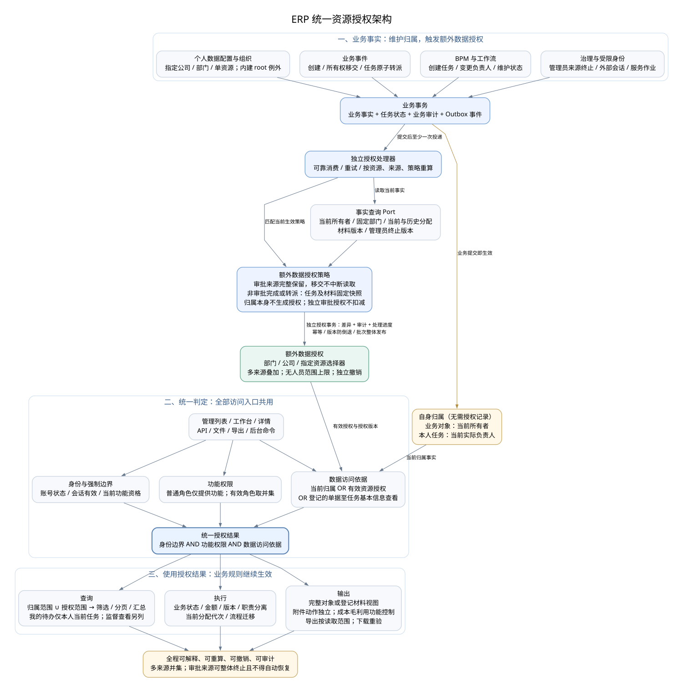
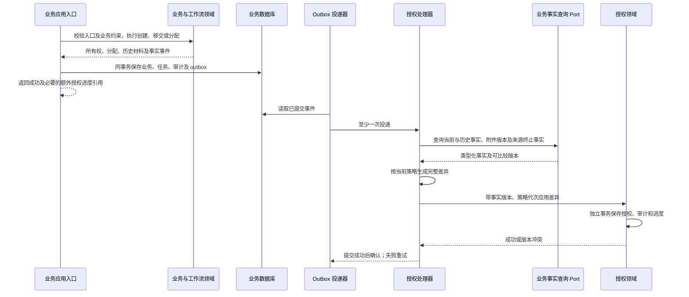

# 统一资源授权设计合同

版本：2.0　日期：2026-11-06　状态：待实施设计

本合同规定 ERP 功能权限、数据授权、所有权、自动授权和 BPM 的边界，适用于管理端、工作台、公开业务页、文件服务、后台任务和集成入口。实施与验收必须遵守本合同及[资源授权 Q&A 执行清单](resource-authorization-qa.md)。Q&A 保留全部 98 项确认、原回答及最终执行规则；已被后续确认替代的回答不得用于实施。数据范围仅适用于单据类和客户资源类，具体分类执行第 3.6 节；其他资源不得因接入统一授权模块而新增通用人员范围配置；指定附件的管理员授权按第 3.7 节作为上下文授权执行，不开放附件公司/部门范围配置。

本合同适用于当前无多租户模型的 ERP，不引入多租户隔离或多公司准入体系。“公司范围”表示所登记资源类型及动作的全公司数据范围。

源码类型与生产入口的盘点基线为提交 `6b253a5f2`，补充核对当日主工作区正在建设的交付地址安排流程。本文规定的是待实施目标；“当前”仅指已盘点的源码类型与入口，不代表目标行为已实现或已通过线上验收。交付地址安排标为在建，不计入基线能力。本次修订不修改业务代码、线上权限或业务数据。

## 1. 强制规则

1. 需要数据范围的单据及客户按**当前所有者**提供自身归属访问依据；创建人仅作为历史事实，不能在移交后继续提供访问依据。供应商、商品等公共资料不按负责人限制可见性。当前任务按实际分配提供办理资格。自身归属不生成授权记录，不等待授权处理器；独立审批来源须保留完整授权，不因所有权已覆盖读取而省略。
2. 所有访问必须满足有效身份及入口所需功能权限；单据类、客户资源类另检查数据访问依据，其他资源不检查独立人员数据范围。任务、附件、通知及外部会话执行第 3.6 节登记的上下文约束。业务状态、金额、版本和职责分离继续独立校验。
3. 全部有效角色的功能权限取并集。普通角色只配置功能权限，内部人员的数据授权直接配置到个人；内建 `root` 的系统范围是唯一已登记的角色资格特例。
4. 当前所有权、个人公司/部门范围、管理员指定资源授权及业务自动授权取并集。部门范围不是其他来源的上限；不设置覆盖其他来源的个人禁止规则，不提供资源封禁功能。
5. 业务事件不得添加角色、功能权限或组织成员身份。任务可以分配给缺少功能权限的人，办理时必须具有所需功能权限；职责分离等业务约束不得因此放宽。
6. 业务、文件资产与工作流领域维护所有者、所属部门、附件绑定、任务分配及执行资格；授权领域维护额外数据授权。所有权移交必须按第 1.4 节同步转派相关任务，授权处理器不得修改任务负责人。
7. 归属、授权及已登记的任务查看关系均由统一访问机制执行；业务接口不得自行增加“审批人可读单据”等放行分支。
8. 关联资源不得任意递归传播访问权。销售责任对应的客户完整读取、单据对应的任务基本信息等例外必须按本合同显式登记；客户可读不等于其全部销售单可读。
9. 每个资源、动作、入口、自动授权来源必须登记范围、事实依据及生命周期。自动授权必须能够解释来源、接收人、版本、动作、保留及终止原因。
10. 额外数据授权采用事件驱动的最终一致性。业务事实与 outbox 同事务保存；独立授权处理器按当前及有效历史事实重算。重试不得重放业务命令，不得恢复管理员已终止的来源。

### 1.1 统一判定

```text
DataAccess(subject, resource, action) =
    OwnResourceAllows(subject, resource, action)
    OR ExistsEffectiveGrant(subject, resource, action)

Allow(subject, entry, resource, action) =
    ActiveIdentity(subject)
    AND HasAllCapabilities(subject, RequiredCapabilities(entry))
    AND ResourceAccess(subject, entry, resource, action)
    AND CurrentIdentityAndSourceConstraintsAllow(subject, resource, action)

ResourceAccess(subject, entry, resource, action) =
    IF RequiresDataScope(resource)
    THEN DataAccess(subject, resource, RequiredDataAction(entry, action))
    ELSE RegisteredContextAllows(subject, entry, resource, action)

CommandSucceeds = Allow AND DomainPreconditions AND ExpectedVersionMatches
AssignedTaskCommandSucceeds = CommandSucceeds AND CurrentAssignmentAllows AND WorkflowTransitionValid

TaskReadContext(subject, task) =
    CurrentAssignmentAllows(subject, task)
    OR RegisteredTaskViewAllows(subject, task, read)
    OR ExistsEffectiveContextGrant(subject, task, read)
```

`entry`、所需功能权限和数据动作由服务端登记，不接受调用方指定。复合操作逐项检查目标资源，功能权限和各资源的数据访问依据可分别来自不同有效来源。不得将 A 单的读取范围与 B 单的编辑动作拼接成 A 单编辑权。

`RequiresDataScope` 由第 3.6 节资源分类确定，不能由请求参数控制。公共资料的 `RegisteredContextAllows` 不增加人员、部门或负责人限制；任务分配、受限材料、附件、本人通知及外部会话按登记的上下文执行。需要读取关联单据或客户时分别检查该目标；公共资料可见不能放行其关联单据。未知资源或未登记入口拒绝，不得默认当作公共资料。

`HasAllCapabilities` 合并所有有效角色后检查全部必需权限，不要求一个角色独自提供完整权限。角色甲提供创建、角色乙提供提交时，可满足“创建并提交”的功能资格。角色停用、解绑或撤权仅移除该角色贡献；其他有效角色仍可提供功能权限。

`OwnResourceAllows` 读取服务端持久化事实，不接受调用方传入所有者或负责人作为放行凭据：

| 资源 | 自身归属依据 | 动作边界 |
| --- | --- | --- |
| 客户、销售单、采购单等普通业务对象 | 当前账号为当前所有者 | 提供已登记的读取、编辑、提交及移交等普通动作的数据依据；功能权限和业务状态仍须满足，不产生他人任务办理资格 |
| 审批、采购处理、开票等当前任务 | 当前账号为实际负责人或有效分配成员 | 提供本任务查看和当前办理依据；状态、分配代次、职责分离及功能权限独立检查 |
| 本人通知、上传暂存批次、本人发起的作业 | 登记的接收人、上传者或发起人 | 仅覆盖该资源自身的登记动作，不扩展到通知目标、绑定后的业务附件或作业源数据 |
| 普通业务附件 | 当前附件所有者，初始为实际上传者 | 绑定后保留附件所有权，提供预览、下载依据；不凭源单据所有权读取他人附件，移交及共用规则按第 3.7 节 |
| 冻结材料、外部会话及服务资源 | 按资源类型登记 | 无明确归属规则时必须有有效授权；系统写入者不因后台写入取得业务所有权 |

`ExistsEffectiveContextGrant` 复用有效授权来源、动作、期限及版本选择器判定，不另建授权内核。任务读取的 `RegisteredContextAllows` 执行 `TaskReadContext`；任务办理仍只按当前实际分配判定，历史快照只返回其固定版本。

`RegisteredTaskViewAllows` 只对已登记单据关联任务的基本信息、进度和处理记录提供 `read` 依据，前提是主体对相应单据具有 `read` 数据依据。该规则必须由统一机制及查询约束共同实现，禁止扩展到任务办理、材料、附件或其他关联单据。已完成任务记录与非审批材料快照按 A50 留阅，不凭旧分配恢复当前任务归属。

`RequiredDataAction` 必须显式登记。普通编辑检查 `update`；单据导出检查该单据 `read`；任务转派检查该任务 `read`，同时要求独立转派功能权限。不得按权限码前缀推断替代关系。管理员授予 `update` 时必须包含同一选择器的 `read`；该动作包含关系不补齐任何功能权限。

不需要数据范围的公共资料仅登记功能动作，不伪造公司范围或为每个人生成 `read/update` 授权。材料、附件和任务的动作表示上下文访问要求，不开放通用公司/部门范围；指定附件管理员授权执行第 3.7 节。

`ExistsEffectiveGrant` 对有效来源的“主体 + 资源选择器 + 动作 + 有效期 + 本来源约束”求并集。每条来源约束只限制本来源。撤销一个来源不影响其他来源；账号停用、会话失效及功能权限失效按当前事实直接拒绝，不等待异步清理。

### 1.2 页面与查询合同

| 入口 | 必须条件与输出边界 |
| --- | --- |
| 单据管理列表 | 列表功能权限 ∩ 全部有效单据读取范围 ∩ 用户筛选；所有权、个人范围、审批及管理员指定授权均纳入，重复去重 |
| 单据完整详情 | 对应单据详情功能权限 ∩ 该单据 `read`；从审批待办进入也不得省略详情功能权限 |
| 我的待办 | 工作台列表功能权限 ∩ 当前实际分配给本人的未完成待处理任务；不混入仅可查看的他人任务 |
| 单据内任务信息、任务监督入口 | 对应入口功能权限 ∩ 本人任务、单据派生任务查看或独立任务查看授权；只返回基本信息、进度和处理记录 |
| 独立受限材料 | 材料查看功能权限 ∩ 指定材料 `read`；无需源单据详情功能权限，不得返回完整源单据 |
| 审批及执行 | 对应办理功能权限 ∩ 当前实际分配 ∩ 状态、代次、职责分离；涉及额外资源时逐项检查 |
| 任务转派 | 转派功能权限 ∩ 任务 `read` ∩ 可转派状态及接收人业务资格；不另要求任务转派数据授权，不要求操作者是当前办理人 |
| 单据导出 | 导出功能权限 ∩ 单据 `read`；敏感字段另检查功能权限，不要求 `export` 数据授权 |

列表权限和详情权限保持独立。完整单据可读不要求先进入列表；只有受限材料授权不能使完整单据进入管理列表。单据详情内的任务查看不授予任务材料及附件权限。

### 1.3 创建、部门与个人范围

1. 本节所有权与固定部门规则适用于需要数据范围的单据及客户资源。人工新建不提供代他人创建能力，创建人和初始所有者必须为实际创建账号，创建时不得另选所有者。系统自动生成执行第 1.5 节的责任人归属，后台导入执行本节第 3 条；不得把这两类入口解释为人工代建。创建人、当前所有者、提交人和协作责任分别记录。公共资料可保留创建人及维护责任等业务事实，不得据此新增数据范围或强制建立授权所有权。
2. 人工新建业务对象所属部门取创建时本人部门，持久化后不可修改，不提供修改入口。人员调动及所有权移交均不改变所属部门。
3. 后台批量导入创建的客户或单据归导入发起人所有，所属部门取发起导入时的部门。发起身份及部门必须在导入请求中持久化，后台程序不得按执行时部门重新归属，也不得将导入文件中某人的姓名当作所有者。
4. 新建客户有对应新建功能权限即可，不要求已有客户范围或部门 `create` 授权。新对象创建成功后所有者立即按归属访问。其他依赖已有业务容器的创建操作仍须按入口合同检查该容器；不得要求尚不存在的新对象已有授权。
5. 创建销售单前必须已有目标客户的查看资格，不能通过创建销售单反向获取原本无权访问的客户。销售单责任可产生 A07/A14 的客户完整读取来源，但不能绕过创建前检查。
6. 公司及部门范围仅向第 3.6 节需要数据范围的资源开放，必须直接配置到个人并明确资源类型、动作和有效期。功能权限不自动生成这些资源的数据范围，普通角色不能承载数据授权；部门读取范围加编辑功能权限不能代替部门编辑范围。公共资料按对应功能访问，不需要额外配置个人公司范围。
7. 部门范围包含指定部门及全部下级部门，层级按当前组织架构计算。单据所属部门 ID 不变，但部门改变上级后，既有单据随当前层级纳入新上级范围。组织版本变化必须触发范围更新及缓存失效。
8. 个人范围绑定明确的部门，不随该人员调动自动替换。人员从一部调到二部后，原一部授权保持，管理员需另行调整；此规则与单据所属部门冻结分别执行。
9. 普通角色只提供功能权限；内建 `root` 的系统政策按第 3.3 节执行，不将此特例推广到自定义角色或用户组。
10. 需要所有权授权的单据与客户统一使用 `owner_id` 保存当前所有者账号 ID，使用 `business_org_unit_id` 保存固定所属部门，使用 `ownership_version` 记录单调所有权版本。可信事实接口使用相同语义。存量所有者字段须核实、迁移并退出重复权威字段；创建人、独立业务负责人、历史归属和任务办理人不得混作所有者。公共资料不因字段规范新增所有权授权。

### 1.4 所有权移交与任务转派

1. 移交必须具备独立移交功能权限。当前所有者凭所有权提供移交数据依据；其他人员须有目标单据的移交数据授权。编辑能力不能替代移交能力。
2. 接收人可以是全公司任意正常在职且账号有效的员工，不受移交人的部门数据范围限制。缺少对应单据或任务功能权限不阻止接收，系统不得自动补功能权限。
3. 单据所有权移交必须在同一业务事务中，将该单下原所有者名下的全部未完成任务转派给接收人，包括审批、开票、付款及交付等登记任务。其他人的任务及已完成任务保持不变。任务关联清单由业务事实明确，禁止沿任意外键无限扩展。
4. 移交前必须核对所有待转派任务的状态、版本、接收人资格和职责分离。任一任务发生职责分离冲突时，整次移交失败，所有者与任务分配均不改变；不得只移交单据或静默跳过冲突任务。缺少功能权限不是这种业务冲突。
5. 业务提交后旧所有者立即失去当前所有权及旧任务办理依据，新所有者与新任务负责人立即按归属生效。创建人历史记录不改写，也不提供残留访问权；额外责任授权按第 5 节异步调整。
6. 原所有者如仍有个人部门范围、管理员指定资源授权或审批留阅等独立来源，继续按该来源访问，甚至编辑；不设置“移交后禁止原所有者访问”的否定规则。
7. 客户移交只改变客户资料所有权，不移交历史销售单、合同或资金对象。各关联对象保持原所有权，需要时分别移交。
8. 销售单新所有者自动取得该单关联客户的完整 `read`，不获得客户编辑权，也不改变客户所有权。该销售责任结束时撤销此来源；其他销售责任、客户所有权或个人授权独立保留。
9. 已完成任务保持实际处理人及历史留阅。非审批任务转派时保留原处理人当时的任务和材料快照；审批转派保留原审批人的完整单据及持续附件读取来源，分别按 A50、A47 执行。
10. 任务转派命令按任务查看权和转派功能权限执行；不能以查看权直接办理。允许停用仍有未完成任务的账号，停用立即阻止访问和办理，任务保留原分配，由有权人员后续转派。
11. 单据移交须在同一业务事务中移交本单绑定且当前归原单据所有者所有的附件；其他人的附件不移交。附件共用、版本与独立授权执行第 3.7 节。
12. 移交与相关任务创建、附件绑定及附件移交必须采用任务/绑定集合版本或等效并发控制。移交读取集合后新增的相关任务或绑定，不得逃过整体条件校验；冲突操作须重读当前归属与集合后重试，不能留下基于过期归属新建的旧负责人任务。只检查已读取任务的版本不足以证明集合完整。

### 1.5 系统自动生成对象的归属

系统生成入口必须登记责任解析、归属时点、固定部门、缺失处理及触发业务边界；后台执行身份不取得所有权。责任人配置须在生成事务内核实，所有者与部门以该次成功生成时的有效责任事实保存，不取上游单据所有者或部门替代。来源业务、触发人及后台执行者分别留审计，不能伪造成责任人亲自创建。

| 自动生成对象 | 初始所有者 | 固定所属部门 | 缺少责任人时必须结果 |
| --- | --- | --- | --- |
| 应收账项 | 明确配置的应收财务责任人 | 生成时该责任人的部门 | 阻止本次触发生成的业务操作；当审批通过需同时生成应收时，审批通过与应收生成整体成功或失败，不保存成功后待补生成 |
| 应付账项 | 明确配置的应付财务责任人 | 生成时该责任人的部门 | 阻止本次触发生成的业务操作；当入库确认需同时生成应付时，入库确认与应付生成整体成功或失败，不保存成功后待补生成 |
| 供应商履约订单 | 明确指定的执行责任人 | 生成时该责任人的部门 | 阻止本次下单，不生成待补责任人的订单或自动续跑请求，不向供应商发送请求；已完成的采购审批保持不变 |

1. 配置完成后由调用方重新发起失败的业务操作，仍执行原命令幂等及版本规则；不得用授权处理器重放业务命令。
2. 应收、应付的实际生成触发点由所属业务入口登记；上表不新增审批或入库触发点，也不改写既有财务确认时点。
3. 供应商外部下单继续使用事务外调用及可靠事件机制；责任人前置检查不得在已发出外部请求后补做，不能声称本地事务可回滚外部下单。
4. 所有权后续移交不改变固定部门。其他系统自动生成资源必须逐类型登记归属，未登记不得默认套用财务责任人、执行责任人或源单所有者。

## 2. 架构与职责



图源：[Graphviz DOT](assets/resource-authorization-architecture.dot)。当前所有权、当前分配、有效授权及已登记任务查看关系共同参与统一判定。历史分配与来源终止事实必须持久化，不能仅依据当前待办重算权限。



| 模块 | 必须承担的职责 | 禁止承担的职责 |
| --- | --- | --- |
| `erp-identity` 授权模块 | 身份、功能权限并集、统一归属/授权/任务查看判定、查询约束、授权来源与终止、审计及解释 | 解析业务金额、决定审批迁移、直接读取其他领域集合 |
| 各业务领域 | 当前所有者、创建人、固定所属部门、关联、版本、材料及业务状态；类型化事件与事实查询 Port | 写入授权记录、在接口中另加审批或任务关系放行分支 |
| `erp-workflow` | 当前与历史任务分配、节点状态、代次、职责分离、已办理事实与任务快照 | 用任务归属直接放行关联单据、写入额外授权、等待授权处理器才提交合法分配 |
| `platform/bpm` | 根据资格与状态计算流程迁移计划 | 依赖 ERP 权限、数据库或资源 ACL |
| 业务编排库 | 原子组合所有权移交、相关任务转派、业务变更、审计、快照事实与 outbox | 提交部分移交结果、计算或写入授权集合、仅用内存消息保证后续处理 |
| 授权处理器与策略模块 | 通过窄 Port 读取当前及历史事实，计算来源完整差异，执行重算和对账 | 改派任务、重放业务命令、将管理员终止误判为待修复缺失 |
| Outbox 与调度器 | 可靠投递、消费确认、退避、隔离、进度与告警 | 将投递完成当成授权就绪、丢弃失败任务 |
| `erp-read-models` | 将统一数据约束与业务查询组合为受限投影 | 页后过滤、将无权或授权处理中解释成业务关联错误 |
| 应用接线层 | 窄 Port、事件及资源目录接线 | 集中堆放跨领域业务授权策略 |
| 文件、导出、后台入口 | 校验实际输出、当前访问依据和敏感字段功能权限 | 只检查菜单、作业可见性或使用长期直链绕过撤权 |

授权存储由 `erp-identity` 拥有。业务事务与授权事务分别复用各自的 `&mut dyn Executor`，不得跨异步任务共享事务。处理器可同进程或独立运行，必须依赖持久化事件恢复，不依赖请求生命周期。策略按资源组织，通过窄 Port 消费事实；共享基础库仅放事件协议和值对象，不引入领域循环依赖。

### 2.1 统一授权调用合同

1. **`erp-identity` 授权模块是访问权限的唯一判定实现。** 有效身份、功能权限并集、当前归属、有效授权、登记的任务查看关系、敏感字段资格及查询访问约束均由该模块统一计算。业务 Service、Process、ReadModel、Handler、文件与后台入口不得自行组合角色、部门、所有者、审批人等条件产生授权结论，也不得在统一结果之外追加放行分支。
2. 业务入口必须调用统一授权接口取得本次访问结果，再执行业务操作。接口按单资源访问、复合访问、集合查询、输出字段及解释用途提供；不要求所有用途合并成一个方法。接口输入、输出、错误及版本约束按[实施规划第 2 节](resource-authorization-implementation-plan.md#2-统一接口交付合同)落实。
3. 编排库和 ReadModel 可在现有依赖规则允许的范围内调用授权服务；其他业务领域通过本域窄授权 Port 调用，组合根将 Port 接到同一 `erp-identity` 实现。不得为统一调用新增业务领域间的直接依赖；Port 适配器只转换协议与错误，不复制判定规则。
4. 资源所有者、固定部门、关联及当前任务分配由所属领域提供可信、带版本的事实。受限单据与客户的归属事实统一为 `owner_id`、`business_org_unit_id`、`ownership_version` 及稳定资源身份。授权模块经窄事实 Port 读取，业务请求不得自行提交所有者、角色清单或“已授权”布尔值作为放行凭据。统一字段不授权该模块直接访问其他领域集合，事实 Port 不得反向调用同一资源的授权入口形成递归。
5. 统一模块判断当前任务归属是否提供访问或办理依据；`erp-workflow` 继续维护分配，并在业务提交时对当前分配代次、状态和职责分离执行条件校验。业务金额、版本、不变式及流程迁移由所属领域执行。授权通过不替代这些业务条件。
6. 集合查询必须使用统一模块按第 3.6 节分类返回的访问约束，业务仓储或 ReadModel 仅将其转换为数据库查询并与业务筛选组合。公共资料返回无需人员范围过滤的明确结果，不伪造个人公司授权。分页、计数、汇总与导出必须使用同一范围；不得在查询适配器中重新解释授权来源、补范围或扩大关联资源访问。MongoDB 存储、查询协议及执行计划按[实施规划第 5 节](resource-authorization-implementation-plan.md#5-p2授权存储治理与查询)落实。
7. HTTP 认证与 `with_permission` 保留协议接入及路由权限登记职责，并复用统一身份与功能判定能力；路由预检不能替代用例内资源授权。后台、公开会话及直接调用用例必须接入相同合同。影响写入的授权重验复用业务事务的 `Executor`，读取与实际输出遵守第 5.4 节版本一致性要求；不得将一次通过结果作为长期访问凭据。

## 3. 资源、动作与功能权限

### 3.1 身份及入口登记

资源键至少包含 `resourceType + resourceId`。同一单据各版本共用稳定单据身份，版本记录必须关联该身份；单据授权与固定版本授权的边界按第 3.4 节执行。冻结提交、历史任务、材料快照及历史附件必须包含不可变版本；行级材料包含确定行集合或稳定子资源标识。

| 资源族 | 示例 | 数据动作与边界 |
| --- | --- | --- |
| 普通业务对象 | 客户、销售单、采购单、合同、账项 | `read/update/submit/cancel/handover`；`update` 包含同范围 `read` |
| 集合与容器 | 指定采购需求容器、交付集合 | 按入口登记 `create/import`；普通新建客户无额外容器授权要求 |
| 冻结材料与历史快照 | 提交版本、开票材料、历史任务材料 | `read`；导出以导出功能权限加该资源 `read` 判定 |
| 当前任务 | 审批、开票、付款、交付任务 | `read`；`approve/reject/execute` 按实际分配；转派以转派功能权限加 `read` 判定 |
| 业务命令对象 | 付款申请、发票、入库、对账 | `pay/post/register_invoice/receive/dispatch/confirm` 等，独立于任务办理资格 |
| 文件与导出产物 | 合同附件、发票附件、导出文件 | `read_metadata/preview/download/replace/delete`；单据读取不隐含附件权限 |
| 外部与服务资源 | 个人选品会话、供应商批次、服务作业 | 指定资源与版本的登记动作，不推广到内部个人公司范围 |
| 治理资源 | 授权配置、来源终止、审计与异常 | `read/manage/resolve/retry`；治理功能不自动提供业务数据范围 |

上表区分访问动作，不表示每类资源都需要人员数据范围。是否配置范围以第 3.6 节为唯一分类依据；治理、任务、文件等只保留对应功能与登记的上下文约束。

资源动作不是现有功能权限码，也不要求重命名现有功能权限。功能目录沿用现有配置和生成链，禁止另建功能权限体系。每个入口必须显式登记全部功能权限及适用的资源动作；公共资料明确登记不要求数据范围，不补造数据动作。完整详情在管理端、待办、直接 API、纸质预览等入口使用相同的详情资格要求，不因入口改名放宽。

| 业务入口 | 功能要求 | 数据要求 |
| --- | --- | --- |
| 销售单列表 | `sales_order:list` | 可读销售单范围 |
| 销售单完整详情 | `sales_order:detail` | 指定销售单 `read` |
| 采购审批中的完整采购单 | 已登记的采购单详情功能权限 | 指定采购单 `read`，不能只以审批材料功能代替 |
| 冻结审批材料 | `approval_instance:read` | 指定冻结材料 `read`；不替代完整单据入口 |
| 审批附件下载 | 已登记的附件读取功能；可沿用 `approval_instance:read` | 指定附件 `download` |
| 审批通过/驳回 | `approval_instance:decide` | 当前实际任务归属、状态、代次及职责分离 |
| 开票受限材料 | 登记的开票材料查看功能 | 指定材料 `read`；无需销售单详情功能 |
| 单据导出 | 对应导出功能权限 | 实际导出单据 `read`，不另要求 `export` 数据授权 |
| 供应商、商品、供给、仓库等公共资料 | 对应列表、详情、维护或导出功能权限 | 不要求人员、部门、负责人或指定对象的数据范围；涉及关联客户、单据时分别检查目标 |

### 3.2 完整单据、受限材料与敏感信息

所有审批类型均须授予被审批完整单据 `read`，冻结审批材料作为独立证据并存，不能用快照替代完整单据读取。审批人在任何入口读取完整单据都须具备该单据详情功能权限。非审批任务按任务需要提供受限材料，不统一授予完整关联单据。

材料必须具有稳定身份及固定输出合同，禁止由客户端任意指定字段。新增敏感字段必须更新合同与验证，不能先返回全对象再在前端隐藏。

| 材料 | 允许输出 | 不得因此扩展 |
| --- | --- | --- |
| 冻结销售审批证据 | 本次提交的客户摘要、商品、数量、金额、条款及登记附件 | 其他销售单、客户完整历史；不替代本单当前内容的独立读取 |
| 采购处理材料 | 分配需求行、规格、数量、交期、必要履约信息 | 无关销售行、全部客户联系人、完整销售利润 |
| 开票材料 | 已核实的申请、应收、待开金额、抬头、销售标识及开票明细 | 全客户应收、完整销售修改权、无关收付款 |
| 付款材料 | 本次申请、应付与已付摘要、必要收款方、指定凭证 | 无关流水、其他供应商资金、连接器密钥 |
| 履约材料 | 本次行、数量、地址、联系人和履约约定 | 无关收件人、销售利润、资金账户 |
| 退货与冲销材料 | 原始事实、拟退数量金额、关联凭证、剩余额度 | 原对象后续全部业务操作 |
| 异常核查材料 | 请求身份、业务摘要、脱敏回执及核对证据 | 密钥、完整令牌、无关原始报文 |

销售单采购成本、毛利须具备独立的敏感信息功能权限，数据范围沿用本单 `read`，不另建成本/毛利数据范围。完整销售单读取仍须隐藏未获功能资格的敏感字段；此规则不授予完整关联采购单读取。详情、材料、纸质预览、统计和导出须使用同一字段资格规则。

单据查看权不包含附件预览或下载。审批分配按 A47 显式授予必要附件权限，其他附件不因关联自动开放；审批附件范围内后续新增或替换的附件必须持续自动授权，不得冻结为仅最初附件集合。冻结审批证据及非审批历史材料的附件版本必须固定，不能随当前附件替换而漂移。新增、替换、解绑均须持久化版本及事件，重算所有仍有效的当前和长期来源，而非只查当前待办。

### 3.3 管理、任务及内建 root

审批和执行仅由当前分配提供办理依据，个人公司/部门授权、管理员指定资源授权、单据派生任务查看及历史留阅均不能代替实际分配。临时加签、代办、转派必须经过业务命令。缺少办理功能权限可保留任务分配，但须明确展示缺少资格，禁止自动授予功能权限。

系统不提供业务人员之间的共享及委派功能，附件所有者也不能直接共享。管理员对其他个人配置单据/客户范围或指定附件上下文授权，必须同时具有对应管理功能及当前有效的资源访问与操作资格，并记录原因、范围、动作和有效期。

1. 可授资源范围不得超过管理员当前可访问范围，可授动作不得超过其当前具备的对应数据动作和功能资格。只有读取资格不能授予编辑；公司/部门选择器须证明整个选择器及动作受当前权限覆盖，不能凭当前碰巧拥有若干单据扩大成未获准的范围规则。
2. 禁止管理员给自己新增或扩大数据授权，包括通过配置修改、批量配置及导入变相自授。内建 `root` 的系统来源由系统政策提供，不作为管理员自授入口。
3. 撤销或终止来源也须有对应治理功能及当前资源、动作资格。整体来源终止须核实该来源所含目标与动作，不能以只有单据查看权终止自己无权访问的附件来源；无资格时拒绝，不拆分已经登记为整体终止的来源。
4. 授予时持久化操作者及其资格依据、事实版本和授权内容，并对并发权限变更执行条件校验。授权人的权限后来到期、被收回、移交或调岗，不自动终止此前合法授出的来源；重算不得依赖授权人当前权限重新决定既有授权有效性。
5. 新授权的有效期可以超过授权人自身权限有效期。授予时核实当前资格，接收人的来源按自身期限、撤销及终止事实独立生效，不取双方到期时间的较小值。
6. 管理员指定授权独立于资源所有权移交；到期或被有权管理员撤销时终止。普通角色和普通业务所有者不取得授权配置能力。

本合同的“治理范围”由操作者当前有效的目标资源访问范围及对应操作资格确定，包含已登记的指定附件及历史来源治理；不另建可超越自身资格的治理范围配置。治理功能不自动提供业务访问权，不对组织、配置记录或公共资料另设人员数据范围。

内建 `root` 按 A01 系统政策获得第 3.6 节已登记单据及客户的全公司数据范围。公共资料不需要 `root` 或个人公司授权，有对应功能即可按公共资料合同访问。必须按内建角色稳定身份识别，不按角色名称识别；普通管理员及同名自定义角色不获得单据及客户的全公司范围。该政策仍对每个有效内部账号提供可解释的个人来源，不将数据授权开放为通用角色配置。

内建 `root` 另具有普通业务附件的系统访问依据，覆盖 `preview/download`，具备对应功能后可查看，并在授权管理功能及上述上限内授予其他人。此特例不开放普通角色的附件范围配置，不扩展为导出文件、服务凭据或历史材料的无条件访问；导出内容继续按第 9.4 节重验。

`root` 仍须满足功能权限、实际任务分配、状态、版本及职责分离。账号停用或内建角色停用、删除、解绑时，该系统来源立即失效；其他有效来源分别判定。不提供资源封禁或任意个人拒绝 ACL。

### 3.4 单据新版本与历史版本访问

1. 同一单据从 V1 更新至 V2 或后续版本，仍属于同一授权对象。已有且有效的单据授权继续按原动作及范围适用，不因版本递增失效，不要求逐版本重新授权；当前所有者继续按当前归属访问。复制或另建产生的独立单据不属于原单据版本，不继承原单据授权。
2. 当前有效的单据 `read` 同时覆盖该单据当前版本及全部历史版本，不以获权时间划分可读版本。此规则统一适用于当前所有权、覆盖该单据的个人公司/部门范围、管理员指定单据授权及审批等完整单据读取来源。
3. 后续获得所有权或单据读取授权的人员，可以查看获权前的全部历史版本。例如，单据已更新至 V3 时移交给李四，或管理员对李四的单据读取授权生效后，李四可查看 V1、V2、V3；以后产生的新版本继续按当前有效依据访问。
4. 明确限定版本的授权只覆盖指定版本或快照。只有冻结审批材料、非审批任务历史材料或其他固定快照授权时，不因此获得完整单据、其他历史版本或后续版本的读取权；已有快照内容不得随新版本变化。
5. 当前及历史版本访问均按访问时的有效身份、对应入口功能权限和当前数据依据判定。历史版本不按当时的所有者或授权记录恢复访问资格；来源到期、撤销或终止后，不得凭曾经获权继续读取。其他有效来源仍独立生效。
6. 单据版本读取不包含附件预览、下载资格；各版本引用的附件仍须分别校验对应附件及版本权限。成本、毛利等敏感字段按当前功能资格过滤，不因历史版本可读而开放。冻结材料及任务快照仍按其独立资源合同执行。
7. 单据版本递增不产生任务办理资格，也不恢复已终止授权来源。重提或流程重启时，新的办理资格依当前正式分配及业务状态判定；历史版本读取不提供改写历史内容或绕过业务版本校验的依据。

### 3.5 驳回后重新提交审批

1. 驳回后重新提交沿用原业务单据 ID 和单号，不新建替代单据；生成新的冻结提交版本、审批实例及相应审批任务。旧提交内容、审批实例、任务和处理记录必须保留，不覆盖为本次结果。
2. 驳回时保留已完成审批任务及意见，关闭该审批实例中尚未结束的审批任务。重新提交不得重新激活旧任务；新任务按当前正式分配提供办理资格，旧审批通过结果不得直接作为本次任务的办理结果。
3. 重新提交成功时关闭前次驳回处理待办；新的提交、审批实例及任务和旧驳回处理待办的关闭必须在同一业务事务中保存。提交失败不得留下部分成功状态；同一次提交请求的幂等重试不得增加提交次数或重复创建审批任务。
4. 业务单据、提交记录、审批实例和节点执行必须分别标识并可靠关联。每次提交保存单据内稳定递增的提交序号及对应冻结版本；页面的“第几次提交”取该提交序号，不使用审批实例内部轮次、数据库修改次数或列表下标代替。
5. 历史审批只提供按现行权限允许的查看能力，不能恢复旧任务办理资格。旧审批人的有效 A47 来源按第 4.3 节继续保留；当次提交内容、独立材料及附件分别按第 3.4 节和各资源合同读取，不把当前内容充当历史审批材料。

### 3.6 数据范围适用表

**只有单据类、客户资源类需要人员数据范围。其他资源不提供通用个人范围配置；第 3.7 节指定附件授权是已登记上下文例外，不开放附件公司/部门范围。** 本表中的“需要”表示列表、详情、统计、导出及操作均执行登记的数据依据；新建时仍按第 1.3 节检查，不要求尚不存在的对象已有授权。“不需要”不取消功能权限、敏感字段资格、业务状态及必要的上下文约束。

#### 3.6.1 需要数据范围：客户及业务单据

| 数据或资源 | 需要数据范围 | 范围与实施边界 |
| --- | --- | --- |
| 客户档案 `customer` | 是 | 当前所有权、个人范围、管理员指定授权及登记自动来源共同决定 |
| 客户联系人、客户专属地址、开票资料、跟进记录等客户子资源 | 是，按所属客户 | 沿所属客户确定范围；功能和敏感字段分别检查，不配置重复子资源部门范围 |
| 销售单 `SalesOrder` | 是 | 按单据控制，客户可读不能代替本单可读 |
| 卡券销售单 `VoucherSalesOrder` | 是 | 按单据控制，电子凭证另受材料及敏感字段约束 |
| 销售变更单 `SalesChangeOrder` | 是 | 独立单据身份，关联原单按登记要求分别检查 |
| 采购单 `PurchaseOrder` | 是 | 采购属于单据；供应商资料可见不意味着采购单可见 |
| 采购变更单 `PurchaseChangeOrder` | 是 | 按变更单及必要原单范围控制 |
| 采购入库单 `PurchaseReceipt` | 是 | 按入库单控制；仓库目录可见不授予本单访问 |
| 实物交付单 `Delivery` | 是 | 按交付单控制，地址和联系人作为受限业务内容 |
| 电子交付单 `ElectronicDelivery` | 是 | 按交付单控制，交付文件单独检查 |
| 服务履约单 `ServiceFulfillment` | 是 | 按履约单控制 |
| 客户验收单 `CustomerAcceptance` | 是 | 按验收单控制 |
| 库存调整单 `StockAdjustment` | 是 | 按调整单控制；库存目录或余额访问不提供调整资格 |
| 客户收款单 `CustomerReceipt` | 是 | 按收款单控制，核销目标分别检查 |
| 销售开票申请 `SalesInvoiceRequest` | 是 | 按申请控制，执行材料可按任务受限提供 |
| 采购付款申请 `PurchasePaymentRequest` | 是 | 按申请控制，实际出款仍检查任务资格 |
| 供应商付款单 `SupplierPayment` | 是 | 按付款单控制，不随供应商资料公开 |
| 发票 `Invoice` | 是 | 按发票控制，关联申请、账项与附件分别检查 |
| 销售退货案例/单 `SalesReturnCase` | 是 | 按退货业务对象控制 |
| 采购退货单 `PurchaseReturnOrder` | 是 | 按退货单控制 |
| 客户退款单 `CustomerRefund` | 是 | 按退款单控制 |
| 供应商退款单 `SupplierRefund` | 是 | 按退款单控制 |
| 收款冲销单 `ReceiptReversal` | 是 | 按冲销单控制，原事实不因关联而开放 |
| 付款冲销单 `PaymentReversal` | 是 | 按冲销单控制，原事实不因关联而开放 |
| 合同、销售询价单、客户选品册及方案 | 是 | 属于客户交易业务对象；方案按登记的选品册来源控制，不因未列入审批枚举而排除 |
| 供应商履约订单、供应商结算单、业务对账及差异处理单 | 是 | 属于交易单据；供应商目录、供给资料与这些单据分别判定 |
| 应收应付账项、费用/成本归集记录 | 是 | 属于交易账项及业务凭证，按本对象或登记来源单据确定范围，不开放无权单据汇总 |
| 充值、资金保障及资金调整等交易凭证 | 是 | 交易记录按单据控制；资金账户配置不作为同一资源混用 |
| 单据明细、需求行、地址安排、提交版本与历史版本 | 是，按所属单据 | 使用稳定单据身份及登记的行/版本限制，不独立配置重复部门范围 |
| 客户、单据的报表与统计 | 是，按源数据 | 按当前可见客户或单据聚合，不因是报表而绕过范围 |

“单据”按业务交易事实识别，不以是否有审批流程、名称是否含“单”、是否属于销售部门判断。第 7.1 节全部 22 类单据均在上表；采购、库存及财务单据继续纳入。

#### 3.6.2 不需要数据范围：公共资料与系统配置

| 数据或资源 | 需要数据范围 | 保留的访问条件 |
| --- | --- | --- |
| 供应商档案、供应商联系人及一般资质资料 `supplier` | 否 | 对应查看/维护功能；不按采购人员、部门、创建人或负责人限制可见性 |
| 商品/SPU/SKU、规格、分类、品牌、单位 `product` | 否 | 对应功能；公共商品资料不包含客户交易、成交记录及销售毛利 |
| 供应商供给、公共报价、供应商商品目录 `supplier_offering` | 否 | 对应功能及字段资格；针对客户的询价、报价方案按上表业务对象控制 |
| 仓库、库位及公共仓储目录 `warehouse` | 否 | 对应目录/维护功能；仓库本身不作为个人数据授权范围 |
| 库存余额、公共库存可用量 | 否 | 对应库存功能及敏感字段资格；不因此返回受限单据明细 |
| 库存流水、预占关系中的源单据引用 | 否，不独立配置 | 库存操作事实按功能读取；客户身份、单据内容及跳转按来源权限过滤或重验 |
| 交易主体、结算主体基础目录 | 否 | 对应目录/维护功能；同一主体关联的客户档案仍按客户范围，不能借通用目录输出客户专属资料 |
| 银行、收付款账户及资金账户配置 | 否 | 对应配置与敏感功能；资金交易单据、明细和汇总按上表控制，密钥不通过普通读取输出 |
| 组织、部门、人员候选目录 | 否 | 对应目录功能和业务候选资格；不按个人部门数据范围缩小候选，选择人员不产生其业务权限 |
| 账号、角色、权限目录及授权配置 | 否 | 对应管理功能、可授上限及系统不变式；配置目标中的单据/客户范围仍须核实，不对配置记录另设人员范围 |
| 审批定义、流程模板、字典、编号及系统参数 | 否 | 对应配置功能及版本/发布规则；审批实例和材料按下表执行 |
| 连接器、集成配置、公共同步目录及运行状态 | 否 | 对应功能、凭据及服务身份规则；日志中的客户/单据内容不得绕过源范围 |
| 审计、运维日志、异常处理入口及支持配置 | 否 | 对应治理功能、敏感字段与脱敏规则；异常所引用的单据材料仍按来源控制 |

内部人员具有供应商或商品查看功能时，可查看对应公共资料，不需要再给其配置全公司数据范围。创建人及维护负责人仅用于审计或业务责任，不构成可见范围。外部供应商账号不适用内部公共资料可见规则。

#### 3.6.3 不独立配置数据范围：任务与受限内容载体

| 数据或资源 | 需要独立人员数据范围 | 必须保留的上下文约束 |
| --- | --- | --- |
| 审批实例、工作项及各类执行任务 | 否 | 按当前分配办理；查看按本人任务、单据派生查看或登记来源；不能让全部有功能的人办理他人任务 |
| 审批证据、任务材料、历史任务及材料快照 | 否 | 只开放已登记的对象、行、版本和接收人；可保留指定材料授权，但不配置材料全公司/部门范围 |
| 附件、上传暂存及导出产物 | 否 | 普通业务附件保留独立所有权，绑定不清除；指定附件管理员授权、内建 `root` 及 A43/A47 按第 3.7 节执行，不开放公司/部门配置；公共资料附件按其功能及文件策略；导出按实际内容重验 |
| 本人通知、消息、个人作业及导入批次 | 否 | 按接收人、发起人或登记管理功能访问；通知与作业可见不代表源客户、单据可见 |
| 个人选品会话、供应商门户与外部提交批次 | 否 | 绑定本人/供应商/批次及凭证代次，不适用内部公共资料访问规则 |
| 回调、服务身份、后台命令与重试任务 | 否 | 校验服务身份及本次资源清单，执行涉及的客户/单据仍检查目标范围与业务约束 |

上述上下文约束仍由统一授权机制执行。不得以“不需要独立数据范围”为由取消本人隔离、任务分配、附件检查或外部身份边界；也不得把这些约束重新包装为通用个人公司/部门范围。

#### 3.6.4 登记、配置与迁移要求

1. 资源目录必须显式记录 `requires_data_scope` 及上下文约束类型，按本表建立名单。未登记拒绝；禁止按资源名称、权限码前缀或调用方参数自动推断。
2. 通用人员范围配置页面与 API 仅接受第 3.6.1 节的范围对象；指定附件授权使用第 3.7 节独立登记的上下文入口。不接受给供应商、商品、仓库等公共资料配置个人公司、部门、单对象授权，不能以默认给全员发放公司授权模拟“不需要范围”。
3. A04–A06 中公共资料额外授权退出目标策略；公共资料创建、维护、责任交接不产生授权事件。涉及受限客户、单据、任务材料及外部身份的事件按各自合同保留。
4. 现有个人/部门/仓库/治理范围对不需要范围资源的过滤必须随该资源整体切换退出；保留历史审计，不迁移为新的限制。单据、客户的范围及任务执行资格不能随之删除。
5. 公共资料接口若混有客户、单据、资金交易或受限附件，必须分离投影或逐项检查来源；不能借公共资料详情、报表、日志或导出扩大受限内容。
6. 本表调整时同步更新入口登记、自动来源、配置 API、Q&A、迁移及验收。全量接入统一模块不等于全部资源启用数据范围。

### 3.7 普通业务附件所有权与授权

1. 普通业务附件具有独立稳定身份及唯一当前所有者，实际上传者为初始所有者。绑定到单据后保留附件所有权，上传历史与当前所有者分别保存；所有者在满足功能权限时取得该附件预览、下载依据，不等待额外授权处理器。
2. 单据所有者不能凭单据归属查看他人附件。非附件所有者须具有管理员指定附件授权、已登记业务自动来源或内建 `root` 系统依据；附件所有者无直接共享入口，管理员授权与撤权执行第 3.3 节。
3. 单据移交时，仅将本单绑定且当前属于原单据所有者的附件同步移交给接收人。其他所有者的附件保持原状，新单据所有者不因此取得其访问权。附件移交立即改变所有者依据，独立授权继续按各自生命周期有效。
4. 多张单据可以引用同一个附件；不得为实现单据隔离擅自复制为多个授权对象。附件随其中一张单移交后，其他引用处仍指向同一附件及其新所有者。原所有者对另一张单的所有权不恢复附件访问权，所有引用入口及缓存须使用同一附件归属版本。
5. 文件资产领域保存 `owner_id`、`ownership_version`、上传者历史、内容版本及绑定关系。附件不增加部门/公司范围，不要求按单据字段生成附件部门。移交更新所有者及版本，不修改文件内容，不改写冻结证据中的固定内容版本。
6. 指定附件授权必须记录接收人、附件身份、明确动作、版本选择器、来源及有效期；不得以授予源单据 `read` 替代。配置不扩展成通用附件公司/部门范围。预览、下载之外的替换、删除等动作须按入口另行登记，不能从所有权或 `root` 读取特例推导。
7. 绑定、解绑、替换、附件移交和来源变化须触发相关查询与缓存失效及必要来源重算；审批与历史快照来源独立保留或终止，不按附件移交批量删除。冻结材料和 A50 的附件内容版本仍固定。
8. 导出产物继续检查实际资源与字段资格；不得因产物上传者、文件所有者或普通附件 `root` 依据绕过导出失权检查。

## 4. 授权数据合同

### 4.1 主要记录

| 记录 | 必需字段与约束 |
| --- | --- |
| 业务归属事实 | 当前所有者账号 `owner_id`、固定所属部门 `business_org_unit_id`、单调所有权版本 `ownership_version`；历史创建人、提交人、导入发起人和发起时部门独立保存；事实由所属业务领域维护 |
| 附件归属事实 | 稳定附件身份、当前 `owner_id`、`ownership_version`、实际上传者、内容版本和跨单据绑定；归属变更由文件资产拥有领域维护，不按绑定复制所有者 |
| 管理员配置事实 | 授权人、接收人、目标选择器与动作、期限、原因、授予时资格与版本证据；授权生效后授权人的失权不构成接收人来源终止 |
| 资源目录 `ResourceType` | 身份、`requires_data_scope`、上下文约束、动作与敏感字段合同；需要范围的资源另登记归属、固定部门、选择器及来源；任务查看派生关系必须显式登记 |
| 入口 `EntryPolicy` | 稳定入口标识、全部功能权限、目标资源及其范围分类；公共资料无数据动作要求，受限单据导出及任务转派按登记 `read` 检查；上下文限制不得省略 |
| 策略 `GrantPolicy` | 稳定 ID、内容版本、单调启用代次、事件与事实依赖、接收人、资源动作、保留/终止规则、收敛时限 |
| 授权 `ResourceGrant` | 主体、选择器、动作、来源、策略版本、起止、状态、约束及授权代次；普通内部主体必须为个人账号 |
| 来源 `GrantSource` | 稳定来源键、业务对象、流程/节点执行/任务、接收人、事实版本和分配代次；稳定键与状态版本分离 |
| 来源终止 `GrantSourceTermination` | 被终止稳定来源键、管理员、原因、时间、单调终止版本；与终止事件和审计同事务保存，禁止重算或旧事件恢复 |
| 历史分配事实 | 实际激活节点、正式分配人员、分配历史、办理决定、任务结束/转派事实及版本；不能只保留当前负责人 |
| 审批提交关联 | 稳定单据身份、单据内提交序号、冻结提交版本、审批实例及相应节点执行和任务关联；重提保留旧关联，提交序号与实例内部轮次分开 |
| 历史任务材料 | 原人员、固定任务/材料版本、确定附件版本、冻结时点及清单；业务领域保存可重建的不可变事实 |
| 批次 `GrantBatch` | 来源完整额外授权集合、事实版本组合、策略代次、摘要、预期数量、状态及授权版本；不含本人当前任务权限 |
| 审计 `GrantAudit` | 前后差异、操作者、来源、事件/任务、事实及策略版本、原因、请求 ID；不含密钥或敏感原文 |
| 事件 `OutboxEvent` | ID、协议版本、稳定来源定位、事实版本、时间、因果标识及投递状态；与事实同事务保存 |
| 授权任务 `GrantJob` | 事件/重算请求、来源范围、目标版本、状态、尝试次数、原因、追踪及分项进度 |
| 进度 `GrantCheckpoint` | 稳定策略/来源键、已应用版本组合、策略代次、批次及摘要；与授权差异和成功记录同事务提交 |

内部数据授权直接到个人，不以普通角色或用户组为授权主体。受限外部会话、服务身份分别按各自协议登记，不作为内部员工数据范围的替代。选择器支持单资源、固定版本、固定子资源集合、个人全公司类型范围、个人指定部门及其当前下级范围、登记业务责任范围；必须结构化、可索引、可解释，不接受可执行查询或脚本。

通用个人全公司/部门/指定对象范围配置仅限第 3.6.1 节资源。任务材料、附件及外部身份可以保存指定内容和版本的上下文授权；指定附件允许管理员按第 3.7 节配置，不开放通用公司/部门范围；公共资料不进入授权集合。

### 4.2 来源与生命周期

| 来源 | 生效、保留及终止 |
| --- | --- |
| 管理员对个人的公司/部门/指定资源及附件授权 | 授予时检查自身范围、动作及禁止自授；批次就绪后按自身期限生效，期限可超过授权人权限期限；授权人失权、移交或调动不自动撤销；自身到期或有权管理员撤销终止 |
| 内建 `root` 系统来源 | 单据/客户范围批次就绪且当前内建角色资格有效时生效；普通业务附件按当前内建资格及登记上下文提供依据，不逐附件发放 ACL；资格失效立即拒绝 |
| 业务责任补充 | 覆盖所有权以外的协作、经办和关联数据；责任结束撤销该来源，不删除其他责任来源 |
| 销售责任对应客户读取 | 当前销售责任提供关联客户完整 `read`；责任移交/解除后撤销本来源，客户所有权不变 |
| 审批正式分配 | 节点激活并实际分配即建立 A47 长期来源；通过、驳回、退回、转派、撤回、取消、或签结束、重启均不自动撤销 |
| 非审批当前任务材料 | 当前任务需要的受限数据及登记业务动作；完成、转派或取消清理当前来源，并按 A50 保留固定任务及材料快照 |
| 历史任务记录与非审批材料 | 所有已完成任务保留实际处理人的固定任务信息和处理记录；非审批任务转派或取消时，原负责人保留转派或取消时的固定任务信息及已有处理记录，不以任务已完成或本人已办理为前提；非审批完成者、被转派的原负责人及取消时负责人同时保留当时材料和已获准附件的固定版本；无当前办理或源单据后续内容读取资格 |
| 外部会话 | 校验身份、资源及凭证代次，批次就绪后生效；过期、撤销、凭证轮换直接失效 |
| 服务作业 | 服务身份与明确资源清单有效且批次就绪；作业结束、取消或资格失效终止，执行与输出重验 |

### 4.3 审批长期来源与管理员终止

1. A47 的长期读取依据为**已激活节点上的正式分配事实**，不要求本人作出审批决定。未来审批链配置不产生来源。或签未办理人、尚未处理即撤回或取消的审批人均保留来源。
2. 所有审批类型的完整单据 `read` 按单据 ID 生效，覆盖当前版本、全部历史版本及后续更新，不受正式分配时间限制；冻结证据使用固定版本。该来源还提供审批政策登记的附件预览、下载，后续新增和替换触发持续更新。即使审批人同时是当前所有者，也必须保留该审批来源的完整授权；所有权移交不得中断已有审批查看权，不得等待异步重算补回。
3. 同一审批任务对不同人员分别保存可解释来源；转派到新人员不得以覆盖旧负责人记录的方式丢失原人员留阅。重算必须同时枚举当前分配、有效历史正式分配和已有来源。
4. 来源键必须包含稳定审批执行定位及接收人，不得因附件、材料或当前分配版本变化改成新来源以绕过终止。状态版本与来源身份分离；新流程执行可按新的正式分配产生独立来源，不得伪造新来源恢复旧来源。
5. 管理员可在治理范围内整体终止指定审批来源。该来源的单据读取、材料及附件权限一并收回，不支持拆分终止为只收回附件下载；其他来源不受影响。A50 独立保留的已完成任务处理记录不是单据或审批材料读取依据，既不得随本来源误删，也不得借它恢复被终止的材料、附件访问。这不是个人禁止 ACL。
6. 终止事实必须先持久化并可靠触发重算；允许按第 5.4 节延迟撤权，界面显示处理进度。授权就绪前管理员操作成功表示终止请求已保存，不表示清理已完成。
7. 重试、对账、策略切换及历史回填均须读取终止版本，将该来源的应有集合计算为空；禁止将管理员终止作为授权缺失修复。该来源不得自动恢复。

### 4.4 非审批历史留阅终止

非审批任务完成、转派或取消时，A50 分别向实际完成者、被转派的原负责人或取消时负责人提供该时点固定任务信息、已有处理记录、材料及已获准附件版本；尚未办理即取消也必须保留。取消须在业务事务保存可恢复快照事实，不读取后续源内容补造历史，不授予当时未获准的附件。

有第 3.3 节治理资格的管理员可以整体终止指定非审批 A50 历史留阅来源。终止收回本来源对任务快照、记录、材料及附件的访问，保留快照实体及审计，不删除历史事实，不影响其他来源。终止事实、版本、异步进度及防恢复要求与第 4.3 节一致；重算、回填、任务后续变更不得恢复已终止来源。终止 A47 不自动终止独立 A50，终止 A50 也不终止其他审批来源。

## 5. 自动授权执行与一致性

### 5.1 业务提交与可靠投递

本节涉及授权事件的要求仅作用于受限单据/客户、授权来源及已登记上下文事实。公共资料维护仍遵守本身的事务与审计要求，但不为资料可见性新增授权 outbox 或等待授权收敛。

1. 业务入口检查身份、全部功能权限、所需数据动作和业务前置条件；所有权移交额外检查整组任务的职责分离及版本。缺少接收人功能权限不得被误作分配失败。
2. 业务事实、单据与附件所有权及任务分配变更、历史分配、可核实的快照版本、业务审计及 outbox 必须同事务提交；任一步失败全部回滚。外部 HTTP、对象存储及通知在事务外执行。
3. 业务成功以业务事务提交为准，不等待授权处理，不因授权失败回滚业务。新所有者和当前任务归属立即生效；涉及额外数据时返回受控进度引用。
4. Outbox 至少一次投递，持久化重试与恢复。投递成功与消费完成分别记录；授权事务提交或确认已有不低于目标版本的成功结果后才确认消费。一条事件影响多个策略/来源时，保存分项进度，全部完成才确认整条事件。
5. 事件携带来源定位和事实版本，不把旧事件中的负责人或授权清单直接当成最终结果。组织层级、责任、附件、历史分配、管理员终止及 `root` 资格等依赖变化均须触发对应重算。
6. 重试与重算不得重放付款、下单、审批、业务创建或通知发送。后台导入的实际业务命令保持原请求幂等身份，授权重试不重建导入对象。

### 5.2 重算与授权事务

1. 经窄 Port 读取当前所有者、固定部门、当前组织层级、当前与历史分配、材料及附件版本、管理员终止、账号/系统角色资格，选取当前策略。历史材料读取明确版本；审批长期单据读取不能缩减为快照。
2. 不为当前所有权及当前任务归属单独生成授权记录。管理员范围授权等独立来源不得因此删除；A47 必须按正式分配事实保存完整审批授权，即使本人同时是所有者，也不得扣除所有权已覆盖的读取动作。所有权移交后，已有且有效的审批来源持续提供访问依据，不等待异步重算补回；重算不得绕过已有终止记录。
3. 按稳定策略 ID 与来源键计算该来源完整应有集合。身份与状态版本分离；同一来源创建、移交、关闭均定位同一重算范围。历史审批保留与非审批快照是独立应有来源，不能与当前办理动作一起清空。
4. 仅调整本来源差异，不按“用户 + 单据”批量删除，不覆盖个人范围或其他任务来源。空集合可撤销本来源全部旧授权；管理员终止必须收敛为空。
5. 查询失败、暂不可用或无法判断的缺失不得解释为空集合，必须重试或隔离。删除与终止须有可核实版本；证据保留覆盖允许的重放期，期外事件进入治理，禁止无版本恢复。
6. 一个来源的授权批次、必需材料、撤销差异、审计、消费成功记录及进度必须在同一授权事务提交，不能部分发布。失败仅回滚授权事务，不影响已提交业务，不包含本人当前任务权限。
7. 通过进度条件更新检测并发冲突，事实版本组合和策略启用代次均不得倒退。事实依赖包含来源终止版本及必要的所有权、组织、附件修订；不得仅按事件到达时间判断新旧。冲突后重读事实和进度计算。
8. 策略切换与授权提交必须产生可检测冲突或等效串行化。回退使用新的启用代次引用旧策略内容，不降低已应用版本。业务事实在计算期间再次变化可暂时滞后，由后续事件收敛；较旧结果不得覆盖已应用新结果。
9. 相同来源、版本、策略代次及摘要重复处理必须幂等，不重复授权、不延长有效期、不重复发放审计。有效期由业务事实或政策基准推导，不以重跑时刻重新起算。
10. 对账及显式重算必须检查实际集合，不能仅凭 checkpoint 跳过；同版本缺失或多余记录可修复并记录修复审计，管理员已终止来源仍只能修复为空。

### 5.3 重试、重算与对账

| 操作 | 必须行为 |
| --- | --- |
| 事件重试 | 保留身份及尝试记录，重读当前与有效历史事实；不恢复旧任务办理资格或已终止来源 |
| 按资源/来源重算 | 覆盖当前来源、历史留阅来源、已终止及已持久化来源，既补漏发也清理多余 |
| 按策略批量重算 | 分页遍历业务事实与已有授权来源并集，支持暂停、续跑、幂等及逐项失败恢复 |
| 发布、停用、回退 | 保存新的启用代次及可靠重算事件；停用仍需清理已有来源，不把配置保存当作全部生效 |
| 定期对账 | 核对版本、应有摘要、来源终止及实际集合，修复漏发、漏撤和停滞，不擅自扩大范围 |

治理入口须检查功能权限及可管理范围，记录操作者、原因、请求 ID。全部重算共用事实读取、策略计算及差异应用逻辑。退避、失败隔离、告警、恢复入口与处理时限必须逐策略登记；监控待处理数量、最老滞后时间、失败原因、批量进度及差异。超时不得标记就绪或放宽权限。

### 5.4 最终一致性期间的访问

1. **新增额外授权允许等待。** 本人对象、本人任务按当前归属立即可访问，仍检查功能权限；关联数据无其他依据时显示授权进度并阻止依赖操作。已有独立依据时正常办理，不等待新批次，不把整个任务隐藏。
2. **进度区分待处理、处理中、重试中、失败隔离、已收敛。** 必须携带来源、事实版本及策略代次；旧批次不能代表新分配就绪。“已收敛”可以是空集合，不保证请求人获得权限。
3. **进度入口受控。** 创建请求关联凭据、当前本人任务归属或治理资格可读取对应状态及追踪 ID，不泄露业务内容。不得因授权未完成重复创建或误报业务保存失败。
4. **普通撤权允许延迟。** 业务责任结束、公司/部门范围调整、管理员单资源撤销及审批来源整体终止，在清理前旧授权可能继续有效。界面明确显示进度；提交授权差异后更新授权版本，旧缓存不得继续放行。
5. **身份与功能失效直接生效。** 账号停用、功能权限失效、会话过期/撤销/凭证代次变化及内建 `root` 资格失效不得等待授权进程。其他有效角色仍提供所需功能时继续有效。
6. **所有权与任务办理资格同步变化。** 移交、转派、完成、取消和或签结束立即改变当前归属及办理资格；旧关联数据权限或长期审批读取不能继续办理。业务提交须对分配代次、状态和职责分离形成可检测的条件冲突，不能只在事务开始检查一次。
7. **敏感业务操作登记即时约束。** 金额、业务版本、服务或会话资格等须按业务合同校验；授权异步撤销不能代替这些规则。审批历史读取、非审批历史快照仍受当前身份与功能权限限制。
8. **历史材料必须可恢复。** 非审批完成、转派或取消保留该时点的任务/材料固定版本；异步发布可以等待，但须凭业务事务已保存的不可变事实重建，不能读取后来变化的源对象冒充当时快照。历史材料发布与旧实时来源清理均按进度追踪。
9. **读取及输出使用一致版本。** 判定与输出使用一致的所有权、组织、授权快照或在输出前重验；敏感字段功能权限变化也须失效缓存。导出发布、下载重新检查实际所含单据及字段资格，撤权已生效不得继续下载旧文件。

导出产物必须使用可重验的下载入口，不得用尚未过期的对象存储直链绕过已生效撤权。其他允许短期签名链接的文件资源必须声明有效窗口；要求即时控制的下载使用可重验网关，不能仅依赖链接到期。

## 6. 自动授权业务清单

本节规定必须核对的 A01–A50 政策编号，其中 A04–A06 的公共资料授权停止生成，编号保留用于迁移追踪；其余政策不得越过第 3.6 节分类向公共资料发放人员数据范围。需授权的内部接收人必须是确定的个人；任务分配可以缺少办理功能权限，但不能违反身份有效性、职责分离等业务约束。缺少功能权限时保留任务并明确提示，办理时拒绝；不得自动补角色。无法解析具体人员时按入口登记返回配置错误或进入未分配治理，禁止扩大到全员；第 1.5 节三类自动生成对象必须阻止触发操作，不适用未分配或待补生成分支。

每项策略按业务事实及本来源规则确定应有资源及动作。当前所有权及当前任务归属本身不另生成授权记录；独立来源不得因其他来源已覆盖访问而省略。A47 必须保留完整审批授权，不扣除当前所有权已覆盖的部分；所有权变化不得中断已有审批查看权。历史审批依据及管理员终止记录必须保留，重算不得恢复已终止来源。

下表所有任务均以当前分配提供办理依据，不重复授予本人任务动作。A47 统一提供所有审批单据及附件的长期读取；完成、转派、取消或重启不得清理该来源。A50 保留所有已完成任务的实际处理记录，并为非审批任务完成、转派或取消提供固定任务及材料快照；当前任务业务动作仍按本行清理。已建立的历史快照不因后续取消被改写。所有来源独立撤销，归属及其他来源继续有效。

### 6.1 个人范围、主数据与责任

| 策略 | 触发事实 | 接收人 | 额外资源及动作 | 生命周期 |
| --- | --- | --- | --- | --- |
| A01 | 管理员个人范围/指定资源配置、组织层级变化、内建 `root` 资格变化 | 明确个人；有效内建 `root` 账号 | 仅第 3.6.1 节单据及客户类型的个人公司/部门/单资源选择器；`root` 系统公司范围 | 普通角色功能不生成这些范围；公共资料不生成授权；范围调整异步收敛，`root` 资格失效立即拒绝 |
| A02 | 客户创建、协作责任登记、所有权移交 | 有明确客户协作责任且超出归属的个人 | 协作读取或登记业务动作；所有者本客户动作按归属 | 移交当前所有者，原创建人不保留归属；不移交或授权全部历史销售单、合同、资金 |
| A03 | 合同创建、归档、责任移交 | 超出所有权的明确经办人 | 合同 `read`，草稿经办 `update/submit`，必要客户摘要；附件按 A43 | 归档由状态禁止草稿编辑并清理补充写权；移交调整责任；OCR 操作者无永久合同权 |
| A04 | 供应商资料创建、维护及责任交接 | 不生成数据授权接收人 | 公共资料按对应功能访问；停止生成供应商资料 `read/update` 人员来源 | 旧资料范围过滤退出；采购、付款等关联单据仍独立控制，不含连接器凭据 |
| A05 | 商品、供给创建及维护 | 不生成数据授权接收人 | 公共商品、供给及供应商摘要按对应功能访问，不生成资料 ACL | 旧资料范围过滤退出；客户询价、交易订单及销售毛利不随之开放 |
| A06 | 仓库目录、公共库存资料维护 | 不生成公共资料数据授权 | 仓库主数据及公共库存视图按功能访问；不配置个人仓库资料范围 | 入出库、调整单仍需单据范围；实际办理依任务分配，相关来源分别按 A23–A28 |

A01 不提供普通角色数据范围或业务人员共享。新增账号或绑定普通角色不自动获得全公司采购单、销售单、客户等受限数据范围；需超出归属访问时按个人来源配置或登记自动来源取得。供应商资料、商品、供给、仓库等公共资料具有对应功能即可访问，不配置个人公司范围，不依赖 A01。管理员的治理功能不自动产生受限单据或客户范围；内建 `root` 按第 3.3 节执行。

A01 的个人配置、范围撤销、组织层级变化和内建资格变化必须可靠触发重算。普通角色变化直接影响功能判定；不能借重算新增未配置的个人范围。公司、部门读取均不隐含编辑；`update` 授权必须包含同选择器 `read`。部门层级按当前树计算，个人所选部门不会随人员调动替换。

### 6.2 销售、询价、选品与变更

| 策略 | 触发事实 | 接收人 | 额外资源及动作 | 生命周期 |
| --- | --- | --- | --- | --- |
| A07 | 销售/卡券销售创建、协作登记、关联客户变化 | 当前所有者所需关联数据；明确协作或经办人 | 所有者对关联客户完整 `read`；非所有者经办 `read/update/submit`、协作默认 `read` | 创建前须已有客户查看资格；本单归属不重复授权；责任结束清理对应来源；不向未来审批链授权 |
| A08 | 询价创建、采购处理分配 | 明确询价经办人、实际采购处理人 | 所需询价、分配需求行、供给摘要及报价处理动作 | 需求版本、行责任、分配代次变更重算；完成/转派/取消按 A50 留阅 |
| A09 | 选品册创建、发布、责任调整 | 明确编辑人员及所需关联数据的所有者 | 册与内部方案 `read/update/publish`，关联销售摘要 | 关闭、移交、版本替换清理编辑及发布来源，不保留创建人特权 |
| A10 | 个人选品密码或提货码校验成功 | 指定参与人的受限会话 | 本人会话、公开册投影、个人方案 `read/save/submit`，仅本人地址 | 过期、撤销、凭证代次变化立即失效，不开放其他参与人 |
| A11 | 销售提交、重提、节点激活 | 当前正式分配审批人、实际返工人 | 所有审批均按 A47 授予完整单据、冻结证据及附件；返工按 A48 | 提交生成新证据版本；未来节点不授权；旧正式分配来源长期保留 |
| A12 | 销售审批通过并生成采购需求 | 实际分配的采购处理人 | 指定需求行材料 `read`、限定需求容器 `create` | 改派、需求撤回/消耗、版本变化清理当前范围，完成/转派/取消按 A50 留阅，不授完整销售编辑 |
| A13 | 销售变更草稿、提交、生效 | 明确变更经办人、正式分配审批人、受影响任务负责人 | 超出归属的变更草稿、冻结差异、必要原版本；审批完整变更单按 A47 | 冻结证据不漂移；只调整受影响任务来源，不关闭无关资金任务，不撤销历史审批读取 |
| A14 | 销售所有权移交、协作调整 | 新所有者、明确协作人、新任务负责人 | 新所有者关联客户完整 `read`；协作及转派任务所需额外材料 | 同事务转派本单下原所有者未完成任务，职责分离冲突整体失败；旧销售责任客户读取撤销，独立来源保留 |
| A15 | 销售取消、关闭、归档 | 有有效历史依据的参与人 | 固定任务材料/回执按 A50，审批长期来源按 A47 | 状态禁止已结束的写操作，清理终止的额外写权；未完开票、收退款、售后来源继续有效 |

### 6.3 采购、供给与供应商协作

| 策略 | 触发事实 | 接收人 | 额外资源及动作 | 生命周期 |
| --- | --- | --- | --- | --- |
| A16 | 采购创建、提交、变更 | 超出归属的经办人、正式分配审批人、需需求材料的所有者 | 经办 `read/update/submit`、指定需求材料；审批完整采购单及附件按 A47 | 公司读取来自个人 A01；审批转派保留旧审批读取，不授完整销售利润；所有权移交按第 1.4 节 |
| A17 | 采购来源更新任务生成 | 指定处理人 | 受影响采购行材料 `read` 及来源确认动作；公共供给按功能读取，不发资料授权 | 完成、取消、转派、版本替代清理当前动作；完成/转派/取消按 A50 |
| A18 | 采购付款安排任务生成 | 指定安排责任人 | 本单付款条件、应付摘要、`arrange_payment` 和限定申请创建 | 不获得实际出款资格；完成/取消/转派清理当前补充动作，历史按 A50 |
| A19 | 供应商履约订单创建、执行交接 | 指定执行责任人；超出所有权的明确协作人 | 所有权及固定部门按第 1.5 节；额外请求快照 `read` 与登记提交/核查动作按来源提供 | 缺执行责任人阻止本次下单，已通过采购审批不回退；交接调整归属及补充来源，历史按 A50，不含密钥 |
| A20 | 供应商门户提交、审核任务分配 | 指定外部会话、内部审核人 | 外部仅本供应商本批次 `read/save/submit`；内部本次提交材料 `read` | 会话即时失效；审核转派/完成按 A50；不授公司全部商品修改 |
| A21 | 目录同步、采纳、供给发布 | 受限服务身份、当前处理人 | 服务限指定连接器、作业和批次；内部公共目录与供给按功能访问，不生成资料个人范围 | 作业及任务资格结束即失效；保留操作者审计，不为公共资料新增授权所有权 |
| A22 | 结算准备、复核、过账 | 编制人、实际复核人、过账服务或人员 | 结算单、选定行、来源摘要 `read` 及 `prepare/review/post` | 退回换版、作废、复核/过账后清理相应当前动作；历史按 A50，不授全部来源单据 |

### 6.4 履约、库存与验收

| 策略 | 触发事实 | 接收人 | 额外资源及动作 | 生命周期 |
| --- | --- | --- | --- | --- |
| A23 | 入库任务创建/转派 | 实际仓库办理人 | 本次入库单 `read/receive`、采购行材料及必要附件 | 完成/取消/转派清理当前来源，完成/转派/取消按 A50；不授仓库全部采购金额 |
| A24 | 实物交付任务创建/转派 | 实际仓库发货或直发人 | 本次交付行、收件地址、物流资料、交付单 `read/dispatch` | 完成/取消/转派清理当前来源，任务及交付证据固定留阅按 A50 |
| A25 | 电子交付任务创建/转派 | 指定电子履约人 | 对应交付行、指定文件、登记的交付对象动作 | 任务结束禁止再次办理；历史材料按 A50 且敏感功能仍检查，不授其他人电子凭证 |
| A26 | 服务履约任务创建/转派 | 指定服务办理人 | 本次服务约定、证明及登记记录动作 | 完成/取消/转派清理当前来源，历史按 A50，不授实物仓储动作 |
| A27 | 客户验收登记任务生成/转派 | 实际验收登记人 | 待验收交付行与证据 `read`、验收记录 `confirm` | 完成/取消清理当前动作，历史按 A50；所有权移交涉及原所有者任务时按第 1.4 节转派 |
| A28 | 库存调整创建、提交、批准 | 调整经办人、正式分配审批人、受限过账服务 | 草稿、必要库存快照；完整调整单及审批证据按 A47；服务限本次过账 | 审批不授任意库存修改；清理结束的执行来源，保留 A47 |
| A29 | 地址安排维护、冻结绑定交付（在建） | 销售安排人、实际交付人 | 前者本单地址安排维护，后者本次冻结行必要地址及交付动作 | 冻结历史不改写；脱敏预览与明文资格分别登记；复制地址不产生新主体授权 |

### 6.5 财务、开票与资金

| 策略 | 触发事实 | 接收人 | 额外资源及动作 | 生命周期 |
| --- | --- | --- | --- | --- |
| A30 | 应收/应付建立、账项责任确定 | 明确配置的应收/应付财务责任人；其他登记参与人 | 账项所有权及固定部门按第 1.5 节；其他人仅获登记摘要或材料 `read` | 缺责任人阻止触发生成的本次业务操作；不自动产生付款/开票动作，其他全账读取须独立来源，关闭不删除审计 |
| A31 | 收款登记创建、提交、批准 | 登记经办人、正式分配审批人、过账服务 | 草稿、核销目标材料、`update/submit`；审批按 A47，服务限本次 `post` | 不把后台过账资格授给审批人；按版本清理当前业务动作，审批来源保留 |
| A32 | 开票申请、审批及执行分配 | 申请经办人、正式分配审批人、实际开票人 | 完整被审批申请按 A47；执行所需申请/应收/销售开票材料、指定 `register_invoice` 及附件 | 受限材料无需销售详情功能；执行完成/转派/取消按 A50，余额变化重算；审批来源长期保留 |
| A33 | 付款申请、审批、出款分配 | 申请/安排人、正式分配审批人、实际出纳 | 审批完整申请按 A47；出款所需材料及本次付款资源 `pay` | 实际分配与状态限制出款；完成/取消/转派清理当前执行动作，历史按 A50，重试沿原幂等身份 |
| A34 | 发票登记、分配、红票处理 | 实际发票办理人 | 指定发票、申请/账项材料及 `register_invoice/allocate/red_invoice` | 不凭发票可读修改全部账项；仍检查分配、余额与红冲资格，历史按 A50 |
| A35 | 费用、成本归集创建或分配 | 明确经办人、财务处理人 | 指定费用/归集对象材料及登记动作 | 完成/责任变化清理当前来源；销售成本/毛利显示按第 3.2 节，不因此开放完整采购数据 |
| A36 | 供应商预存、充值、资金保障、对账 | 业务经办人、指定服务身份 | 本次充值/保障/核对交易凭证及受限材料、动作；账户配置按功能，不授账户个人范围 | 交易单据与账户配置分别判定，服务限本次清单，不继承发起人全公司交易范围 |

### 6.6 退货、退款与冲销

| 策略 | 触发事实 | 接收人 | 额外资源及动作 | 生命周期 |
| --- | --- | --- | --- | --- |
| A37 | 销售退货案例、直退、结算建立 | 实际售后、仓储、财务责任人 | 本案例、原交付行、金额证据及各自登记/收货/结算动作 | 不自动给原销售人全部售后执行；关闭/移交清理子责任，历史按 A50 |
| A38 | 采购退货、退款或红票待办生成 | 退货经办人、实际退款出纳、红票人 | 本退货单、原采购行、余额及红票材料 | 退款与红票独立来源；有剩余余额的任务不能提前结束，完成/转派/取消按 A50 |
| A39 | 客户/供应商退款创建、提交 | 登记人、正式分配审批人、过账服务 | 本次退款、原收付款/退货材料；完整审批单按 A47，服务限本次 `post` | 不授修改原资金事实；清理结束的业务动作，保留审批来源 |
| A40 | 收款/付款冲销创建、提交 | 纠错人、正式分配审批人、过账服务 | 本次冲销、被冲销事实、分配材料；完整审批单按 A47 | 不扩散原对象全部权限，固定当次证据，审批长期来源保留 |

### 6.7 导入、文件、集成与治理

| 策略 | 触发事实 | 接收人 | 额外资源及动作 | 生命周期 |
| --- | --- | --- | --- | --- |
| A41 | 导入创建、业务确认分配 | 发起人、按业务资格确定的确认人、受限导入服务 | 指定批次、来源缓存、确认材料及 `read/confirm/apply` | 导入单据/客户按范围及发起时归属；导入公共资料按功能不造范围；不能借批次访问绕过受限目标；任务历史按 A50 |
| A42 | 集成未知结果、异常、差异、凭据修复 | 实际异常人、具有凭据能力的配置人 | 脱敏请求回执、业务材料及指定 `resolve/retry` | 解决/转派/换版清理当前来源，历史按 A50；未知结果先核对，不能重复外部写入 |
| A43 | 上传、绑定、新增、替换、解绑及附件移交 | 当前附件所有者；管理员指定个人；登记业务政策接收人；有效内建 `root` | 普通附件所有权在绑定后保留；所有者及 `root` 按登记取得预览/下载依据，指定附件授权按第 3.7 节；更新删除另登记 | 移交只改变原所有者名下附件，跨单共用唯一归属；他人附件不随单据放行；A47 持续更新审批附件，A50 保留固定版本并允许整体终止 |
| A44 | 导出、识别及后台作业创建 | 发起人、受限服务身份 | 本人作业按归属；源数据须当前 `read` 及导出/识别功能，服务仅本次资源清单，结果文件按 A43 | 不要求 `export` 数据授权；执行、发布、下载重验数据和敏感字段；失权后禁止旧产物继续下载 |
| A45 | 通知、抄送、消息生成 | 明确接收人 | 本人通知按归属读取，只含允许的安全摘要 | 通知和抄送不产生目标单据权限，跳转重验 |
| A46 | 回调、消息消费、定时补偿 | 已认证且范围明确的服务身份 | 指定连接器、事件、作业对应资源及动作 | 验签不能替代授权范围、关联、状态校验，不使用系统账号绕过 |
| A47 | 节点激活正式分配、附件变化、管理员来源终止 | 每位曾被正式分配的审批人 | 所有类型被审批完整单据 `read`、固定审批证据、审批政策附件 `preview/download`，后续新增/替换持续更新 | 正式分配即长期保留，不要求本人处理；转派/撤回/取消/重启/或签结束不撤销；管理员整体终止后清空且不得自动恢复 |
| A48 | 退回并建立返工责任 | 当前实际返工人 | 超出所有权的工作副本 `read/update/submit`、退回说明 | 重提/取消/转派清理当前返工动作，不能修改历史提交；非审批任务留阅按 A50，独立 A47 不受影响 |
| A49 | 授权、审计、组织、流程及支持配置治理 | 具有对应治理功能且当前资源与操作资格足够的人员 | 配置、撤销及来源终止按自身范围和动作上限；禁止自授；指定附件及 A50 终止按第 3.3/3.7/4.4 节 | 授出期限可超过自身期限；授权人后续失权不级联撤销；治理功能不默认取得业务数据或任务办理资格，终止事实与审计可靠保存 |
| A50 | 所有任务完成；非审批任务转派或取消；管理员终止历史来源 | 实际完成者；非审批被转派的原负责人或取消时负责人，包括尚未办理者 | 固定任务信息及已有处理记录；非审批另保留当时材料与已获准附件版本，不开放后续更新或当前办理 | 管理员可整体终止本非审批历史留阅来源，保留快照实体与审计且重算不得恢复；其他来源独立有效；审批材料/附件归 A47，不能借任务记录绕过终止 |

### 6.8 不产生权限的关系与事件

打开页面、点击链接、收到通知、搜索命中、知道 ID、普通外键关联、缓存命中、创建审批定义、绑定未来审批链、日志或导入文件中出现某人姓名，均不得单独产生业务数据权。

复制产生的新单据或客户按实际创建人作为初始所有者，不复制原对象 ACL，不支持借复制代他人创建。公共资料复制只按功能及业务校验，不生成权限所有权。客户移交或供应商维护责任交接均不级联移交历史单据。销售责任的客户读取、单据派生任务基本信息及审批附件更新仅按已登记规则执行，不推广为任意关系继承。

## 7. 全量类型覆盖索引

### 7.1 当前 22 类单据

本表按 `DocumentType::ALL` 与 `policy_of` 核对：13 类要求审批流程，9 类不要求审批流程。“无流程审批”不等于无需功能权限、数据访问依据或业务状态检查。

| 单据类型 | 当前审批政策 | 自动授权政策 |
| --- | --- | --- |
| `SalesOrder` | 必须审批 | A07、A11–A15、A47–A48 |
| `VoucherSalesOrder` | 必须审批 | A07、A11–A15、A47–A48 |
| `SalesChangeOrder` | 必须审批 | A13、A47–A48 |
| `PurchaseOrder` | 必须审批 | A12、A16–A18、A47–A48 |
| `PurchaseChangeOrder` | 必须审批 | A16–A18、A47–A48 |
| `StockAdjustment` | 必须审批 | A28、A47–A48 |
| `CustomerReceipt` | 必须审批 | A31、A47–A48 |
| `SalesInvoiceRequest` | 必须审批 | A32、A47–A48 |
| `PurchasePaymentRequest` | 必须审批 | A33、A47–A48 |
| `SupplierPayment` | 无流程审批 | A33、A36 |
| `CustomerRefund` | 必须审批 | A39、A47–A48 |
| `SupplierRefund` | 必须审批 | A39、A47–A48 |
| `ReceiptReversal` | 必须审批 | A40、A47–A48 |
| `PaymentReversal` | 必须审批 | A40、A47–A48 |
| `PurchaseReceipt` | 无流程审批 | A23 |
| `Delivery` | 无流程审批 | A24、A29 |
| `ElectronicDelivery` | 无流程审批 | A25 |
| `ServiceFulfillment` | 无流程审批 | A26 |
| `CustomerAcceptance` | 无流程审批 | A27 |
| `Invoice` | 无流程审批 | A32、A34、A38 |
| `SalesReturnCase` | 无流程审批 | A37 |
| `PurchaseReturnOrder` | 无流程审批 | A38 |

### 7.2 当前 26 类任务枚举

本表任务名称用于定位业务事实及所需关联数据，不表示需要向负责人发放任务权限。任务枚举存在不等于有当前生产创建入口。表中“无当前创建入口”表示本次源码盘点未发现编排生产者；迁移必须检查存量实例，不能凭枚举自动恢复执行资格。

| 任务类型 | 接入及资源范围 | 政策 |
| --- | --- | --- |
| `SalesInquiryProcessing` | 询价任务、分配需求行、报价处理材料 | A08 |
| `ProcurementOrderCreation` | 建单任务、销售需求材料、限定创建容器 | A12 |
| `PurchaseSourceUpdate` | 来源更新任务与受影响采购行 | A17 |
| `PurchasePaymentArrangement` | 付款安排任务及付款条件 | A18 |
| `PurchaseReturnRefund` | 退货退款任务、原采购及退款余额材料 | A38 |
| `PurchaseReturnInvoice` | 退货红票任务、发票与待红冲余额材料 | A38 |
| `FulfillmentOperation` | 入库、实物、电子、服务四种具体资源分别登记 | A23–A26 |
| `CustomerAcceptanceRegistration` | 验收任务及指定交付证据 | A27 |
| `SupplierPaymentExecution` | 出款任务、指定付款申请与付款材料 | A33 |
| `SalesInvoiceExecution` | 开票任务、申请/应收关联的开票材料 | A32 |
| `PurchaseOrderReview` | 无当前创建入口；新采购审批使用统一审批任务 | A16、A47；存量逐项核实 |
| `SalesChangeImpactReview` | 无当前创建入口；不得推导为独立授权来源 | A13、A47；存量逐项核实 |
| `SalesChangeFinanceReview` | 无当前创建入口；不得推导为独立授权来源 | A13、A47；存量逐项核实 |
| `CardFundsReview` | 已停用历史类型；禁止恢复办理资格 | 只允许经核实的历史留阅 |
| `CardFundsDeltaReview` | 已停用历史类型；禁止恢复办理资格 | 只允许经核实的历史留阅 |
| `OwnershipMigrationSalesConfirmation` | 当前分配隔离策略为拒绝；不得自动激活 | A14 仅描述合法责任移交，不启用此类型 |
| `OwnershipMigrationFinanceConfirmation` | 当前分配隔离策略为拒绝；不得自动激活 | 存量治理，不自动恢复办理资格 |
| `InventoryAdjustmentReview` | 无当前创建入口；库存审批使用统一审批任务 | A28、A47；存量逐项核实 |
| `FinanceCorrectionReview` | 当前分配隔离策略为拒绝；不得自动激活 | A40 不启用此历史类型 |
| `SupplierSettlementReview` | 指定结算单与固定来源行材料 | A22 |
| `SupplierPortalReview` | 指定供应商提交批次审核材料 | A20 |
| `ImportBusinessConfirmation` | 指定导入批次和业务确认范围 | A41 |
| `IntegrationResultUnknown` | 指定未知结果核查任务和脱敏请求回执 | A42 |
| `BusinessException` | 指定供给/集成/履约异常材料；按业务对象细分 | A42 |
| `DocumentApproval` | 当前节点任务、完整被审批单据、冻结证据及持续审批附件 | A47 |
| `ApprovalRework` | 返工任务、可编辑工作副本 | A48 |

所有已完成任务的实际处理记录，以及非审批任务完成、转派或取消时的固定任务信息、已有处理记录、材料和已获准附件留阅另适用 A50；通过单据读取依据查看任务基本信息适用第 1.1 节统一关系规则。上述盘点状态保持原基线，不以本次目标合同将停用任务重新激活。

### 7.3 领域与基础设施覆盖

| 当前领域 | 覆盖政策 |
| --- | --- |
| `erp-party` | 主体基础目录无人员范围；客户专属资料按 A02，关联本身不扩散权限 |
| `erp-customer` | A02、A14 |
| `erp-supplier` | A04 不生成资料授权；A20 仅保留外部与任务上下文 |
| `erp-catalog` | A05 不生成资料授权；A21 仅保留作业与服务约束 |
| `erp-warehouse` | A06 不生成公共资料范围；业务单据和任务按 A23–A24、A28 |
| `erp-sales` | A07–A15 |
| `erp-procurement` | A12、A16–A18、A38 |
| `erp-fulfillment` | A23–A29 |
| `erp-inventory` | A06、A23–A24、A28、A37–A38 |
| `erp-finance` | A18、A22、A30–A40 |
| `erp-returns` | A37–A40 |
| `erp-contract` | A03、A41、A43–A44 |
| `erp-supply` | A19–A22、A36、A42、A46 |
| `erp-integration` | A21、A42、A46 |
| `erp-import` | A41、A44 |
| `erp-identity` | A01、A49及全部授权存储与判定 |
| `erp-workflow` | A47–A48、A50及当前/历史分配、任务快照事实 |
| `erp-notification` | A45 |
| `erp-audit` | A49；审计记录保存不产生业务读取权 |
| `erp-support` | A43–A44、A49；资源登记按实际功能接入 |

文件平台、后台 worker、公开会话通过 A10、A20、A43–A46 接入。演示数据生成不得成为生产自动授权规则来源。

## 8. 业务执行与授权示例

以下使用虚构人员和单据，所有访问均须满足当前身份、入口功能权限及业务约束。

### 8.1 审批正式分配、转派及来源终止

1. 甲创建采购单 P1，保存创建人甲、当前所有者甲、甲创建时的所属部门。甲无需本对象授权即可按功能和状态读取、编辑、提交。
2. 当前审批节点激活并将 T1 正式分配给乙，保存历史分配及 outbox。乙直接取得本人任务归属；缺少审批功能权限也允许分配，但办理时拒绝。
3. A47 为乙建立稳定的审批来源，授予 P1 当前完整内容 `read`、冻结证据及审批必要附件预览/下载。乙打开 P1 必须有采购详情功能权限，不能用审批材料功能代替。
4. 授权尚未就绪且无独立数据依据时，乙可在具备工作台功能时看到 T1，关联内容显示处理进度；有个人部门读取等独立来源时正常读取，无需等待。
5. T1 从乙转派给丙后，乙立即不能办理，丙按当前分配办理；乙的审批来源保留，丙获得新的正式分配来源。完成、驳回、退回、撤回、取消、或签被别人完成均不自动清除已建立的审批来源。
6. P1 之后发生业务变更，乙和丙在来源有效且功能资格满足时可查看新内容；审批政策内新增/替换附件继续触发授权，原审批证据仍固定原版本。
7. 管理员整体终止乙的该审批来源，保存终止版本及事件，界面显示撤权进度。收敛后本来源的单据、材料、附件权限一并移除；旧事件、策略重算及附件新增均不能恢复它。
8. 若乙另有个人部门读取或指定单据授权，可继续据此查看，但不能因此办理 T1；来源终止不能实现对乙的全局禁止。

### 8.2 销售移交、客户与部门

1. 一部甲创建 S1，只能选择已有查看资格的客户 C1。S1 初始所有者为甲、所属部门固定一部；销售责任额外形成 C1 完整读取来源，不授客户编辑权。
2. S1 的审批人获得完整 S1 读取；采购处理人仅获分配需求行材料；开票人仅获开票所需材料。完整详情、材料、成本/毛利各按入口及功能资格输出。
3. 甲把 S1 移交给二部乙。业务命令先检查移交资格、接收人以及本单下所有分配给甲的未完成任务。任一职责分离冲突则整次失败；仅缺功能权限不阻止。
4. 同一事务将所有者改为乙，并将上述任务转给乙，其他人的任务不变。S1 所属部门仍为一部，创建人仍记甲；甲不再凭创建记录访问，乙按当前所有权立即访问。
5. 旧销售责任的 C1 读取来源异步撤销，乙的 C1 完整读取异步生效。客户所有权不变，其他销售单不移交，其他销售责任或个人授权继续独立生效。
6. 若甲有一部销售单编辑范围及编辑功能，仍能编辑允许状态的 S1。若甲曾正式获分配 S1 审批且来源已生效、未被终止，该来源的完整授权不因甲曾是所有者而省略，移交前后持续提供读取依据，即使授权处理器暂停也不得中断；移交不设置否定规则。
7. 乙后来调部门，不改变 S1 所属部门，也不自动调整乙个人已配置的数据范围。一部部门本身调整上级时，则按当前组织树计算包含一部的上级范围。

### 8.3 非审批历史、监督及导出

1. 开票人丙有材料查看功能和指定开票材料授权，无销售详情功能时仍可读取受限材料，不能打开完整销售单。
2. 丙完成开票任务，或尚未办理就被转派时，保留该时点的固定任务信息、已有处理记录、材料及已获准附件的固定版本；不能遗漏未完成即转派的任务信息，不能继续办理，也不能借历史来源读取后续任务、材料或附件更新。
3. 主管丁有 S1 查看依据，可在对应功能入口看到其任务信息、进度和处理记录；不会取得任务材料或附件。丁具备转派功能时可按任务 `read` 发起合法转派，但不能直接审批或开票。
4. 丁的“我的待办”不混入这些监督任务。只有本人当前分配的待处理任务进入我的待办，历史任务另行查阅。
5. 丁有导出功能即可导出当前可读单据，不另配 `export` 数据授权；成本、毛利须另有敏感功能权限。导出发布、下载重验所含单据及字段，撤权已生效时旧文件不可下载，需按当前范围重新生成。

## 9. 查询、文件与前端合同

### 9.1 列表、详情及统计

统一机制须同时提供单资源判定与可索引查询约束。按当前所有者、当前任务分配、个人范围、指定资源授权和已登记任务查看关系，在数据库分页前合并、去重。禁止先分页后过滤、无限展开全部 ID，或先按负责人过滤后再补审批来源。

公司、部门授权保存为范围规则，不展开为“人员 × 全部覆盖单据”；指定单据及审批授权按独立来源保存。单据查询使用统一归属字段、有效范围和有效对象授权存在性条件。来源多次命中不能展开为重复业务行；多分支查询须先按稳定资源身份去重或证明互斥，才能分页、计数与求和。固定版本、受限材料授权不得混入完整单据读取。

上述范围合并适用于受限客户、单据及登记上下文查询。第 3.6.2 节公共资料列表不附加人员、部门、创建人或负责人过滤，身份及功能满足后按业务筛选查询；不存在“缺少个人公司授权”的错误。公共资料内引用的客户、单据和交易统计须另按源范围处理。

所有完整单据读取来源都进入相应管理列表，仍检查列表功能权限；完整详情独立检查详情功能权限。“我的待办”在访问判定之后另加本人当前分配及待处理状态筛选，不因拥有他人任务查看权而扩展待办。

单据历史版本列表及版本详情须关联稳定单据身份，按当前单据读取依据统一约束，不按授权起始时间过滤历史版本，不按版本产生时的所有者放行。固定快照入口只能返回获准版本，不能借版本切换读取完整单据或其他版本。所有入口均继续检查对应功能、附件动作及敏感字段资格。

单据历次审批查询须按稳定单据身份汇总各次提交及其审批实例，不得只查询当前实例后声明已返回全部审批历史。记录须携带提交序号、冻结版本及实例关联，支持分页加载更早提交；不得按相同节点名称或实例内部轮次合并不同提交的记录。审批基本信息和处理记录按已登记任务查看关系判定，当次提交内容、材料及附件分别校验。

数量、汇总、分页、导出使用同一数据范围。客户可读不产生关联销售单读取；客户详情的订单数量、累计销售额只统计本人的可见销售单，并标注“本人可见范围”。有客户详情功能但没有销售单列表功能时，是否可调用统计入口由显式入口登记决定，统计不得输出无数据依据的销售事实。

列表、精确计数、精确金额与导出必须复用同一授权和业务筛选定义；页游标不限制全量统计。一次一致性结果须使用同一数据快照及授权上下文，不能仅以相同过滤表达式证明读取时点一致。金额先按业务口径归约到一单一行，不能累加各来源金额或在多行关联后重复累计。单资源与集合的数据依据须等价，各入口功能及输出字段资格继续分别检查。

部门谓词使用单据固定部门 ID 与当前组织层级，个人选择的部门不随人员调动变化。游标与缓存绑定筛选、所有权/分配版本、组织版本、授权版本及必要功能资格；变更后失效或重算。关联任务查询只生成基本信息约束，不向材料查询传递无登记的父对象权限。

查询上下文还须绑定业务快照、排序及下一有效期边界；授权开始或到期即使没有版本更新也须重新判定。额外授权版本不能替代归属、组织或业务变更版本；不得枚举全部命中单据 ID/版本计算列表指纹。组织关系查询投影按版本完整发布，快照、上下文失效或输出前重验失败时不得继续使用旧结果放行。

索引必须覆盖当前所有者、固定部门、当前任务分配及历史来源定位；授权索引覆盖主体/资源动作、来源清理、管理员终止、单资源反查、期限及幂等键。索引顺序与大范围查询必须以实际数据验证。TTL 仅清理，判定主动检查期限。

MongoDB 基准管道、完整公司范围简化、业务集合驱动、对象授权驱动及混合去重计划执行[实施规划第 5.2–5.7 节](resource-authorization-implementation-plan.md#52-统一所有权与-mongodb-存储)。计划选择不能改变权限语义；精确统计与导出分别登记性能预算，未达标不得改用近似值或静默收窄范围。未经数据库与容量验收，不得声明百万到千万级查询达标。

### 9.2 错误语义

必须区分身份或功能不足、无数据依据、额外授权待处理/重试/隔离、对象不存在、必需材料缺少授权、真实业务关联错误、状态变化及职责分离冲突。对外可采用防枚举状态码，内部原因码、审计和追踪必须可区分。

不得把所有 404 变为空对象后提示“销售应收不匹配”。授权处理中返回受控进度；来源声明就绪但必需授权缺失时返回可修复配置错误及追踪 ID，不引导用户修改真实业务关联。任务缺办理功能权限须明确说明，不能伪装成任务不存在；所有权移交遇职责分离冲突须报告冲突任务且整体失败。

### 9.3 前端与输出

前端能力描述仅控制展示，不能替代服务端校验。完整详情、纸质预览、移动端、直接 API、下载及后台作业遵守同一合同。完整单据在待办中读取仍需对应详情功能；受限材料按独立入口检查，不能为方便任务访问暗中授予完整管理功能。

保存成功后所有者立即进入本人对象，任务负责人在具备工作台功能时立即看到本人任务。缺少额外数据时仅对应区域显示等待、刷新和失败追踪；有独立依据时可继续，不重复提交业务。

管理员终止来源及范围撤销成功表示请求可靠保存，须显示待处理与已收敛的区别。账号停用立即拒绝新访问与办理，不以存在待办阻止停用；有权人员通过监督入口完成后续转派。

#### 9.3.1 同一单据的历次审批展示

1. 同一单据页面集中展示全部历次审批，以“第 N 次提交”区分，不要求用户离开单据页面前往独立历史列表才能查阅旧审批。默认展开当前一次，历史审批默认折叠；历史较多时提供加载更早记录入口。
2. 当前审批展示提交次数、当前状态、本次提交内容、当前审批人及审批进度。例如“第 2 次提交 · 审批中”。审批实例内部从第 1 轮开始，不得使第二次提交显示为第一次提交。
3. 历史审批折叠标题展示提交次数及当次结果，例如“第 1 次提交 · 已驳回”。展开后展示当次提交内容、审批节点、处理人、审批意见、驳回原因及时间；内容必须定位当次冻结版本，不能替换为单据最新版本。
4. 历史审批区域只读，不显示可继续批准、驳回或执行旧任务的办理按钮。驳回后的修改、重新提交入口属于当前驳回处理或单据业务操作，不能重新开启历史审批任务。
5. “我的待办”只显示当前实际分配给本人且需要处理的任务。旧审批任务保持完成或关闭状态，重新提交后旧驳回处理待办退出待办列表；新审批任务仅向当前实际分配人显示。
6. 汇总展示不扩大权限。当次单据版本、审批材料、附件及敏感字段分别遵守现行访问规则；缺少材料或附件资格时只限制对应区域，不能把有权查看的审批记录一并隐藏。权限判定不得因记录折叠而省略。

### 9.4 附件、敏感字段与导出

1. 单据 `read` 不包含附件 `preview/download`。附件动作独立检查；A47 是显式、持续更新的审批附件来源，不是通用父对象继承。
2. 任务派生查看只覆盖信息、进度和记录，不包括材料、附件。历史快照的附件引用及内容版本必须固定，不得链接到会随替换变化的当前文件。
3. 成本、毛利以独立功能权限控制，沿用单据 `read` 数据范围；完整详情、统计、预览和导出统一处理，后台结果不能泄露被前端隐藏的字段。
4. 导出检查导出功能及每个实际输出资源 `read`，服务身份仅限本次清单，作业发起不扩大权限。输出清单须保存实际包含的资源、版本及敏感字段资格要求，支持发布和下载重验。
5. 发布或下载时任一所含资源已失去查看依据，或敏感字段资格已失效，必须阻止原文件发布/下载，允许用户按当前范围重新生成。文件已经生成不是继续访问的依据。
6. 导出产物通过可重验下载入口访问；不得发布可绕过当前判定的长期直链。普通撤权仍允许处理延迟，但一旦生效，旧授权快照、缓存或签名链接不能继续输出原文件。

## 10. 存量迁移与发布

### 10.1 实施顺序

实施必须执行[统一资源授权实施规划](resource-authorization-implementation-plan.md)。先交付 `erp-identity` 基建与统一调用合同，再接入授权处理器和业务。各阶段分别记录代码交付、规则验证、环境验收与切换状态；基础能力完成不代表业务已经切换。

| 阶段 | 必须交付 | 完成标准 |
| --- | --- | --- |
| P1 身份域基建与接口 | 资源、入口、动作与事实协议；统一调用接口；功能并集及数据判定内核；全量覆盖台账 | 核心规则经真实生产内核的库单测验证；未知登记拒绝；无业务领域直接依赖身份域 |
| P2 授权存储与查询 | 个人正向来源、终止事实、治理用例、授权版本、查询约束、索引及输出字段资格 | 单资源与集合规则一致；来源独立；无角色数据授权及人员上限；治理与查询可通过统一接口调用 |
| P3 异步授权基础 | outbox、消费、授权事务、版本组合、进度、重试、重算对账 | 可靠性机制及故障用例交付，运行验收证据单独记录；不得恢复终止来源或重放业务命令 |
| P4 首条业务闭环 | 客户与销售单、审批、一个非审批任务、移交、材料、附件及导出贯通 | 验证可信事实到统一授权再到输出的完整链路；任务原子转派、审批留阅与非审批快照符合合同 |
| P5 全量业务接入 | 按资源批次接入剩余领域、全部任务、公共/后台入口、配置入口及前端 | 22 类单据、26 类任务、20 个领域与 A01–A50 全量核对；全部 Q&A 有实现和验收归属；停用类型不恢复 |
| P6 影子、回填与验收 | 归属与历史来源核实、迁移与回退工具、差异报告、环境验收证据 | 不猜测归属、不恢复终止来源；差异有依据，数据收敛，真实并发、恢复、性能及输出验收完成 |
| P7 切换与旧路径清理 | 同一资源全部消费者整体切换，删除旧判定与重复授权路径，更新运行文档 | 本合同成为唯一运行判定；不做新旧结果并集；回退可执行；无遗留绕过或错误职责分离变更 |

### 10.2 回填与回退要求

1. 分别核实创建人、当前所有者、创建时所属部门及当前任务分配。不得以创建人覆盖已移交所有者，不得以当前人员部门重写历史单据部门；缺证据的对象进入治理清单，不猜测回填。
2. 核实导入发起人及发起时部门。普通用户代他人创建入口必须退出目标路径；系统生成的服务事实按资源目录登记，不将系统写入账号当作业务所有者。
3. 原个人部门/公司/单资源授权迁移为个人正向来源，保留明确资源与动作；旧全局人员上限、部门交集不得继续限制其他来源。旧条件如用于确定本来源范围，仅用于该来源转换。
4. 单据及客户的旧岗位共享或角色数据范围不能直接变成新的自动政策。需要保留的业务范围须形成明确的个人授权配置，逐项记录依据与差异。公共资料按第 3.6 节退出数据范围控制，不回填全员公司授权，也不继续使用旧个人/部门过滤；功能访问保留。内建 `root` 单独核实稳定系统身份。
5. 所有权提供的本对象普通动作及当前任务办理不生成重复 ACL。协作、经办、销售责任关联客户及任务额外材料按明确来源回填；不得把历史参与表直接转换成可变写权限。
6. 审批按已激活节点的全部正式分配历史回填，包含未办理、转派、撤回、取消和或签未处理者。保留完整单据和持续审批附件来源；审批人同时是当前所有者时仍回填完整审批授权，不扣除重叠读取动作；不将全部人清成冻结证据，也不恢复旧办理资格。
7. 同时回填管理员终止事实及版本，后续任何重算均须尊重终止。缺少正式分配或终止证据时进入可审计治理，不用当前待办覆盖历史记录。
8. 非审批任务按完成、转派或取消时证据回填任务和材料快照；不可用当前可变对象伪造历史内容。未知类型、停用类型及分配隔离类型不自动激活。
9. 原移交路径必须改为单据、应移交附件所有权与相关未完成任务的整体条件提交，覆盖职责分离冲突、并发处理、缺功能权限接收和已停用原负责人。创建人历史及完成任务实际处理人保持。
10. 核对功能权限目录，保留列表、详情、材料、附件及业务动作独立配置；删除普通 `export` 数据授权要求及任务转派专用数据授权要求，改用本合同登记的 `read`。旧业务编辑授权补足同范围读取，不能扩大至其他选择器。
11. 按资源、来源或策略批量回填必须复用正式处理器，遍历业务来源与已有授权来源并集，包含应撤记录、历史留阅与终止。记录事实版本、策略代次和差异，支持续跑及逐项失败；同期事件持续处理至收敛。
12. 影子判定仅报告差异；正式切换不得用旧逻辑与新逻辑并集放行。新增及收缩访问都须列明依据，不能为消除差异恢复受限客户/单据的创建人特权、岗位共享或部门上限。公共资料去除旧范围过滤属于本合同明确的目标变化，不能误记为越权后补回限制。
13. 回退必须整体恢复同一资源的读写路径、生产者及事实兼容性，保留新审计、历史分配和管理员终止记录。不能安全重现目标权限时关闭受影响写入口并修复，不重新开启已知绕过。
14. 附件回填须核实实际上传者、既有移交和跨单绑定，统一稳定附件身份及当前所有者；不得按当前单据所有者覆盖第三人附件或为共用附件创建多个权限身份。缺证据进入治理清单。
15. 应收、应付、供应商履约订单逐入口核实责任解析、生成时部门及失败边界；不得用当前责任人部门猜测历史部门。管理员配置迁移保留授出时证据，不因授权人当前失权批量撤销历史合法来源。

## 11. 验收条件

本节与[Q&A 执行清单](resource-authorization-qa.md)共同构成验收合同。下列预期除即时约束外均以授权收敛后为准；处理窗口按第 5.4 节。表中“允许”始终以当前身份、对应功能及业务状态满足为前提。本次文档修订不表示已经执行这些业务测试。

### 11.1 业务行为

| 场景 | 必须结果 |
| --- | --- |
| 受限单据/客户仅有功能权限，无归属或数据授权 | 列表不返回，详情和命令拒绝；不因普通角色生成共享范围 |
| 有供应商/商品查看功能，无任何个人数据范围 | 可列出和查看公共资料，不按部门、创建人或负责人缩小；无查看功能仍拒绝 |
| 有公共资料维护功能，无个人编辑范围 | 可按业务状态维护公共资料；查看功能不能代替维护功能，敏感字段仍独立检查 |
| 为供应商、商品、仓库配置个人公司/部门/单对象范围 | 配置 API 拒绝且页面不提供；不能以全员公司授权代替无范围模式 |
| 可查看供应商、商品、仓库，但关联采购/付款/交付/调整单无权 | 公共资料正常显示，受限单据内容、客户专属信息及交易统计不泄露，跳转拒绝 |
| 公共库存、主体目录、审计或日志包含客户/单据内容 | 公共字段按功能输出，受限内容按目标范围过滤或单独获取，不借投影绕过 |
| 不需要独立数据范围的任务、附件、通知或外部会话 | 仍执行分配、指定材料/附件、本人或外部绑定约束，不开放给所有有功能的人 |
| 切换公共资料授权时存在旧部门/仓库资料范围 | 旧范围不再过滤公共资料，不迁移为 ACL；相关单据范围和实际任务资格保持 |
| 创建客户，无任何客户数据授权 | 新建功能满足即可创建，初始所有者为本人、部门为创建时部门，无重复本对象授权 |
| 创建时试图指定他人为所有者或另选部门 | 不支持该能力；服务器不能信任调用方归属字段 |
| 后台导入期间发起人调部门 | 新数据仍归发起人、部门取发起时记录，后台写入者不取得所有权 |
| 所有权移交 | 原所有者不再凭创建记录读取或编辑，新所有者按归属访问；固定所属部门不变 |
| 原所有者仍有独立部门编辑或管理员授权 | 仍按该来源操作，移交不能设置个人禁止规则 |
| 原所有者同时有已生效且未终止的审批来源，移交时授权处理器暂停 | 移交前已保留完整审批授权，移交后持续可读，不出现等待重算补回的访问中断；身份及功能资格仍须满足 |
| 移交与任务 | 本单下原所有者的全部未完成任务一起转派，其他人和已完成任务不变 |
| 接收人跨部门且缺少功能权限 | 可接收，功能不足时不能办理，不自动补权限 |
| 任一转派任务违反职责分离 | 整次移交失败，所有者与所有任务分配均不变 |
| 客户移交 | 只移交客户资料，历史销售单及其他关联对象保持原归属 |
| 销售单移交及再次移交 | 新所有者获客户完整读取而非编辑，旧销售责任来源清理，其他客户来源独立保留 |
| 新建销售单选择无权客户 | 拒绝，不能以创建建立客户反向越权 |
| 人员调部门 | 历史单据部门不变；个人明确配置的部门范围不变 |
| 单据所属部门修改请求 | 不提供入口，不得通过移交、导入更新或维护操作变更 |
| 部门范围与组织调整 | 包含所有当前下级部门；部门换上级后既有单据按当前树纳入新上级范围 |
| 部门读取范围加编辑功能 | 无 `update` 数据依据仍拒绝编辑；合法 `update` 授权含同范围 `read` |
| 甲角色提供创建、乙角色提供提交 | 功能合并满足创建并提交；撤掉一个仍有其他来源的功能时不误拒绝 |
| 有部门外任务或单资源授权 | 并集提供访问，不追加本人/部门上限，不跨授权拼接资源动作 |
| 普通角色、同名超级管理员及治理管理员 | 不自动获得公司范围，不支持配置普通角色数据授权 |
| 有效内建 `root` | 已登记受限单据及客户全公司范围，仍检查功能、实际任务分配及职责分离；公共资料不依赖此来源 |
| 内建 `root` 资格失效 | 系统来源立即失效；其他个人来源独立判断 |
| 所有者尝试共享 | 不提供共享功能；管理员可按治理范围向指定个人授权，移交不撤销该独立来源 |
| 撤销一个允许来源 | 仅移除该来源，不能遮蔽其他允许来源；无个人拒绝 ACL，无资源封禁入口 |
| 正式分配审批，尚缺功能权限 | 分配成功、来源按政策建立，实际查看/办理仍拒绝缺失功能的入口 |
| 未来审批链仅配置人员 | 无自动数据权，节点实际激活正式分配才建立来源 |
| 所有审批类型 | 获完整被审批单据读取；冻结材料并存，不替代当前完整单据；详情功能不可省略 |
| 通过、驳回、退回修改 | 均保留审批单据及附件来源，不能重复办理 |
| 审批未处理即转派/撤回/取消 | 原正式分配者保留长期来源，只失去当前办理依据 |
| 或签由一人完成 | 同节点所有正式分配者保留来源，其他人的办理资格立即结束 |
| 流程重启/重提 | 旧正式分配读取仍保留，新办理依新分配，旧冻结证据不冒充新版本 |
| 驳回后重新提交审批 | 原单据 ID 和单号不变，生成新提交版本、审批实例及任务；旧审批及意见保留，旧任务不重新激活，提交成功后关闭前次驳回处理待办 |
| 第一次提交驳回，第二次提交审批中 | 同一单据页面默认展开“第 2 次提交 · 审批中”，折叠展示“第 1 次提交 · 已驳回”；历史展开后返回第一次冻结内容、审批意见、驳回原因及时间，不返回第二次内容替代 |
| 新实例内部轮次为 1，或多次提交使用相同审批节点 | 页面仍按单据提交序号区分，不将第二次提交标为第一次，不合并或遗漏前次实例记录；历史区域只读，旧任务不出现在我的待办 |
| 同一单据从 V1 更新至 V2，原单据授权仍有效 | 原授权继续按原动作及范围适用，无需另授 V2；原有单据读取依据覆盖 V1、V2，版本变化不产生任务办理资格 |
| 单据已有 V1、V2、V3，之后移交或授予单据读取 | 新所有者或新获权人在依据生效后可读全部三个版本及后续版本，不按获权时间截断历史；附件及敏感字段分别检查 |
| 仅有 V1 固定快照授权 | 仅可读获准的 V1 快照，不能切换至完整单据、其他历史版本或 V2；原快照内容保持不变 |
| 曾有单据读取但全部访问依据已失效 | 当前及历史版本均不得继续读取，不凭历史所有者身份或曾经获权放行；版本递增不得恢复终止来源 |
| 审批后单据变更、附件新增/替换 | 读取当前单据，审批附件范围持续更新，冻结证据保留原版本，其他附件不因单据 `read` 自动开放 |
| 管理员终止某审批来源 | 单据、材料、附件整体异步收回，显示进度；其他来源有效；重算不得恢复 |
| 审批来源终止但本人已完成任务记录仍有 A50 来源 | 固定处理记录可查，不能据此读取已失权的单据、材料或附件 |
| 终止后新增附件、重放旧事件或回填 | 本来源仍为空，不因来源版本变化重建；新独立来源必须有真实新事实 |
| 单据读取及附件 | 普通单据 `read` 不能代替 `preview/download`，即使入口共用功能码仍分别检查 |
| 非审批任务材料 | 只按业务所需范围开放；有材料功能及材料授权、无源单据详情功能时可读受限材料 |
| 非审批任务完成或未处理即转派 | 原人员保留该时点固定任务信息、已有处理记录、材料及已获准附件的固定版本；尚未办理且任务未完成也不得遗漏任务信息，不凭此来源读取后续任务、材料及附件更新或继续办理 |
| 单据查看者观察相关任务 | 可看基本信息、进度、处理记录，不附带材料和附件 |
| 任务查看者具有转派功能 | 可执行符合业务规则的转派，不另要求转派数据授权；无办理资格不能直接执行任务 |
| 我的待办 | 只显示本人当前待处理任务，有权监督的他人任务不混入 |
| 客户可读但部分销售单不可读 | 不返回无权单据；数量、累计销售额仅统计本人可见范围并标注 |
| 单据可读但无成本/毛利功能 | 页面、材料、统计、导出均不输出敏感字段；取得功能后沿本单读取范围开放 |
| 有导出功能及单据读取，无 `export` 数据授权 | 可导出允许字段；不要求另配导出数据范围 |
| 导出后失去部分单据或敏感字段资格 | 撤权生效后旧文件禁止发布/下载，需按当前范围重新生成，不允许旧直链绕过 |
| 单据完整读取来源不同 | 均进入管理列表；列表和详情功能分别检查，只有材料授权不进入完整单据列表 |
| 账号有未完成任务时停用 | 允许停用并立即拒绝访问/办理，任务不自动转派，之后由有权人员处理 |
| 授权待处理或处理器停机 | 本人当前归属仍可用，缺少额外数据的区域显示进度；已有独立依据可继续 |
| 单据关闭仍有开票/退款任务 | 状态禁止已结束写操作，不提前清理仍有效任务材料来源 |
| 管理员只有一部读取资格，尝试授予二部或一部编辑 | 拒绝越范围、越动作授权；配置与批量入口一致 |
| 管理员给自己新增或扩大授权 | 拒绝，包括修改已有配置及批量导入 |
| 授权人 11 月底失权，曾合法授予他人至 12 月底 | 接收人来源持续至自身期限；不按授权人后续失权撤销，不截断授出期限 |
| 管理员有终止功能但无目标附件或动作资格 | 拒绝整体终止该来源，不只凭单据读取清除附件来源 |
| 应收、应付生成 | 所有者为已配置财务责任人，固定部门取生成时责任人部门，不取来源单据部门 |
| 缺应收/应付责任人 | 本次触发业务操作整体失败；配置后重试，不创建待补责任人的账项 |
| 供应商履约订单生成及缺责任人 | 归指定执行责任人及其生成时部门；缺人阻止本次下单、不发外部请求，既有采购审批保持 |
| 上传普通附件后绑定单据 | 上传者仍为附件所有者，凭所有权及功能预览/下载，不等待额外授权 |
| 单据移交，附件分别归原所有者和第三人 | 同步移交前者，后者不变；新单据所有者不凭单据归属查看后者 |
| S1、S2 共用附件，附件随 S1 移交 | 仍为同一附件，S2 也显示当前新所有者；原所有者不能凭 S2 所有权继续访问 |
| 普通附件所有者尝试直接共享 | 拒绝；由有相应资格的管理员或登记业务流程授权 |
| 内建 root 与普通管理员访问普通业务附件 | root 的系统依据配合功能允许预览/下载及合规授予；普通管理员不得借管理功能放行；导出重验不豁免 |
| 非审批任务尚未办理即取消 | 保留取消时任务、已有记录、材料及已获准附件的固定快照；无后续读取或办理资格 |
| 管理员终止非审批 A50 后重试、回填或其他来源存在 | 该来源收敛为空且不恢复，快照与审计保存，其他独立来源继续有效 |

### 11.2 可靠性、并发与查询

| 场景 | 必须结果 |
| --- | --- |
| 业务或 outbox 写入失败 | 业务、移交任务、历史事实、事件一起回滚，无部分成功 |
| 业务提交后投递前退出 | 重启继续投递，不丢失来源及材料变更事件 |
| 授权计算或事务失败 | 仅授权事务回滚，业务保持成功，进度可查和重试 |
| 授权提交后确认前退出 | 重复消费幂等，不重复授权、不延长期限、不重复发放审计 |
| 多策略或多来源事件 | 分项进度持久化，全部完成才确认整条事件 |
| 旧创建、移交、分配事件迟到 | 按当前及有效历史事实重算，不恢复旧所有权或办理资格，不删除应保留审批来源 |
| 终止、附件更新与重算并发 | 来源终止版本参与冲突判断，旧计算不得覆盖新终止结果，允许的撤权延迟可观测 |
| 移交与新增相关任务、附件绑定或共享附件移交并发 | 集合变化可检测，冲突后重读重试；不得遗漏新增任务、基于旧归属分配或部分移交附件；所有引用缓存失效 |
| 授权治理提交与操作者资格撤销并发 | 授予或终止资格在提交时有效；合法授出后不把授权人后续变化当作接收人撤权依据 |
| 任务改派/取消/或签完成与办理并发 | 仅合法状态迁移成功，旧分配代次不能提交业务结果 |
| 策略切换与旧计算并发 | 旧启用代次不能提交，回退使用新代次，重新读取当前策略 |
| 事实查询失败或来源删除 | 失败不按空集撤权；删除凭可核实终止版本处理，未知缺失进入治理 |
| 同版本实际授权被破坏 | 对账核对实际集合并修复，终止来源只能修复为空，记录修复审计 |
| 批量重算及存量回填 | 包含应授、应撤、历史和终止来源，支持续跑，不重放业务命令 |
| 策略停用 | 新启用代次驱动清理全部已有来源，不遗留无人处理授权 |
| 重算期间业务变化 | 后续事件推动收敛，已应用新版本不能被旧结果覆盖 |
| 超时、重复失败、漏发漏撤 | 告警、隔离、人工恢复、对账可用，不静默丢弃或扩大范围 |
| 批次必需资源发布 | 来源差异与必需材料整体提交，不以部分成功声明就绪，不阻断已有独立访问依据 |
| 归属、组织、授权或功能变化 | 查询缓存和游标失效，判定与实际输出版本一致 |
| 分页、计数、汇总、导出 | 同一范围，数据库分页前约束，无页后过滤和无上限 ID 展开 |
| 所有权字段迁移 | 单据/客户统一 `owner_id` 语义及可信事实，旧字段无双重权威，公共资料和任务办理规则不被误套 |
| 所有权、部门、多个管理员及审批来源重叠 | 同一稳定单据仅一行，计数与金额只累计一次；撤销单个来源不影响其他有效来源 |
| 授权开始或到期但版本未变化 | 按有效期边界重新判定，旧缓存及游标不能继续放行 |
| 多次查询、不同计划及同次列表/统计 | 同一快照和约束下结果等价；页游标不截断全量统计，未知约束和失效快照受控失败 |
| 大规模查询及当前页外的归属变化 | 不枚举全部结果构造权限版本；按登记机制失效，查询计划、精确统计与收敛时限具备容量证据 |
| 非审批快照在源内容更新后发布 | 使用已保存的固定事实，不能把新内容当成旧材料；版本附件不漂移 |
| 历史停用任务或未知类型 | 不恢复办理资格，不凭未知关系生成授权，保留治理追踪 |
| 外部个人及供应商会话 | 仅指定资源，猜 ID、链接复用、凭证轮换不能越界 |
| 回调与服务作业 | 身份、范围、关联及状态均校验，验签不替代授权 |
| 任务材料缺授权与真实关联错误 | 分别返回授权进度/配置错误与业务关联错误，不能扩大范围掩盖坏数据 |
| 既有职责分离差异 | 各单据允许/禁止提交人自审的政策保持，统一授权不能统一放开自审 |

发布前必须提供策略覆盖、Q&A 对照、授权差异与迁移报告、事务/崩溃/重复/乱序证据、管理员终止防恢复、历史快照、批量重算/对账、收敛时限与告警、并发移交与职责分离、查询性能、文件/导出重验及可执行回退步骤。静态检查和单元测试不能替代数据库并发及实际运行证据；环境验证遵守仓库测试约束与已有授权。

## 12. 源码依据与维护入口

以下文件用于确认当前类型、职责和生产入口，不表示它们已经实现本文目标模型。

| 依据 | 确认内容 |
| --- | --- |
| [crate目录](../backend/crates/README.md) | 当前领域及跨域编排边界 |
| [业务单据注册](../backend/crates/domains/erp-workflow/src/entity/document_registry/business_document.rs) | 22类单据 |
| [审批政策](../backend/crates/domains/erp-workflow/src/service/approval/policy.rs) | 13类必需审批、9类无流程审批、版本及职责分离 |
| [任务类型](../backend/crates/domains/erp-workflow/src/entity/work_item/entity/types.rs) | 26类任务、退役类型及分配隔离政策 |
| [当前授权政策](../backend/crates/domains/erp-identity/src/entity/access_control/authorization_policy.rs) | Business、Shared、SourceInherited、Task等现有路径 |
| [现有个人授权](../backend/crates/domains/erp-identity/src/entity/access_control/personal_grant.rs) | 现有个人组织范围结构；不能直接替代对象授权 |
| [销售创建](../backend/crates/orchestration/erp-order-to-cash/src/order_to_cash/command/create/persist.rs) | 草稿与创建并提交的区别 |
| [销售移交](../backend/crates/orchestration/erp-order-to-cash/src/order_to_cash/handover.rs) | 责任移交与审批分配区别 |
| [询价任务](../backend/crates/orchestration/erp-order-to-cash/src/sales_inquiry/tasks.rs) | 询价任务版本及实际处理责任 |
| [个人选品入口](../backend/crates/orchestration/erp-order-to-cash/src/sales_selection/public_access.rs) | 密码、个人会话、受限公开访问 |
| [采购任务同步](../backend/crates/orchestration/erp-procure-to-pay/src/procure_to_pay/procurement_task_sync.rs) | 采购任务创建及同步 |
| [采购退货财务任务](../backend/crates/orchestration/erp-procure-to-pay/src/procure_to_pay/return_finance.rs) | 退款与红票责任分别解析 |
| [履约任务](../backend/crates/orchestration/erp-fulfillment-execution/src/fulfillment_execution/task/creation.rs) | 履约实际办理责任 |
| [结算复核](../backend/crates/orchestration/erp-supply-settlement/src/supply_settlement/review.rs) | 明确复核人与结算任务 |
| [主数据编排](../backend/crates/orchestration/erp-master-data/README.md) | 客户、供应商、商品、合同及交接 |
| [财务编排](../backend/crates/orchestration/erp-finance-posting/README.md) | 应收应付、申请、发票与资金事实 |
| [逆向流程](../backend/crates/orchestration/erp-reverse-flow/README.md) | 退货、退款、冲销 |
| [供应商目录编排](../backend/crates/orchestration/erp-supplier-catalog/README.md) | 目录、门户和异常责任 |
| [供应商订单编排](../backend/crates/orchestration/erp-supplier-orders/README.md) | 外部执行、回调、凭据和资金保障 |
| [导入编排](../backend/crates/orchestration/erp-data-import/README.md) | 导入、来源缓存、任务确认 |
| [文件资产编排](../backend/crates/orchestration/erp-file-assets/README.md) | 文件绑定与原业务事务 |
| [审批运行编排](../backend/crates/orchestration/erp-approval-runtime/README.md) | 审批启动、恢复与材料 |
| [BPM边界](../backend/crates/platform/bpm/README.md) | 纯引擎、资格输入及迁移计划 |

维护本合同时必须同步更新第 3.6 节数据范围适用表、当前所有权与固定部门规则、自动生成责任归属、附件唯一所有权与共用绑定、管理员治理上限及授出时证据、自动授权清单、当前及历史事实查询合同、来源终止与版本规则、类型覆盖表、材料及敏感字段合同、Q&A 对照和验收场景。不得只新增任务枚举或路由权限而省略分类、来源、留阅和撤销规则。
