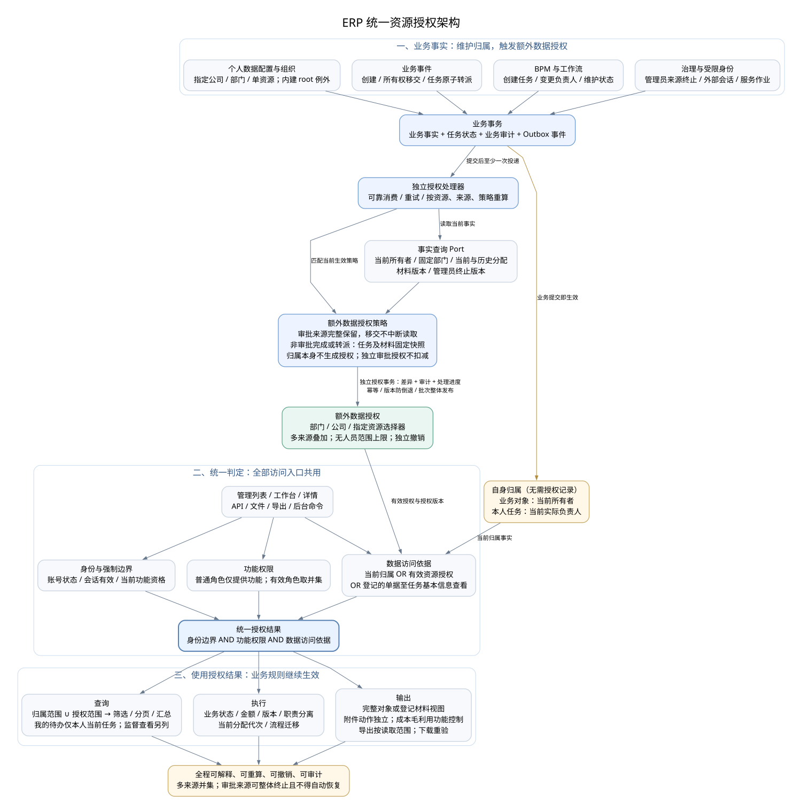

# 行级资源授权规则细则

版本：2.5　日期：2026-11-09　状态：目标规则，未表示实现或验收完成

本细则是[行级资源授权设计](resource-authorization-design.md)的组成部分，供实现和逐条验收使用。主文规定目标、判定方式和业务接入要求；本细则规定资源分类、特殊场景和技术约束。两者须保持一致，规则变更同步更新对应条款和验收索引。主文第 1.3 节为实施边界：集中执行所有访问检查，保留既有业务合同；本细则不得要求新增独立材料业务对象、统一非审批快照、移交联动转派或责任人配置阻断流程。

当前工作区未提供 `resource-authorization-implementation-plan.md`；后续实施规划须遵守本合同，不以未提供的阶段文档作为已实现或已验收依据。

本细则保留原设计第 1–8 节的条款编号，供 Q&A 和实施规划定位。首次审核从主文开始，实施时按下表查阅。

| 实施内容 | 对应细则 |
| --- | --- |
| 访问判定、创建归属、部门范围和移交 | [第 1 节](#1-访问判定与业务事实) |
| 模块职责、统一调用和自动授权策略 | [第 2 节](#2-架构与职责) |
| 资源分类、动作、敏感字段、管理员和附件 | [第 3 节](#3-资源动作与功能权限) |
| 授权记录、审批留阅和历史来源终止 | [第 4 节](#4-授权数据合同) |
| 事件、事务、重算、撤权时点和策略发布 | [第 5 节](#5-自动授权执行与一致性) |
| 各业务的自动授权规则 A01–A50 | [第 6 节](#6-自动授权策略登记) |
| 查询、统计、错误、文件和导出 | [第 7 节](#7-查询与输出合同) |
| 验收与维护 | [第 8 节](#8-验收与维护) |

## 1. 访问判定与业务事实

1. `erp-identity` 是访问权限的唯一判定实现；各入口不得另加审批人、负责人或角色放行分支。
2. 业务领域维护可信归属、分配和历史事实，授权领域维护额外数据来源。业务事件不得添加角色、功能权限或组织身份；授权处理器不得改派任务或重放业务命令。
3. 当前所有权与有效授权取并集；部门范围不构成其他来源的上限，不提供个人禁止 ACL 或资源封禁。关系传播仅限显式登记规则，普通外键关联不产生权限。
4. 当前所有权与任务归属不生成额外 ACL；独立来源不因其他依据已覆盖访问而省略。额外授权按第 5 节异步收敛。

### 1.1 统一判定

```text
DataAccess(subject, resource, action) =
    OwnResourceAllows(subject, resource, action)
    OR ExistsEffectiveGrant(subject, resource, action)

Allow(subject, entry, resource, action) =
    ActiveIdentity(subject)
    AND HasAllCapabilities(subject, RequiredCapabilities(entry))
    AND ResourceAccess(subject, entry, resource, action)
    AND CurrentIdentityAndSourceConstraintsAllow(subject, resource, action)

ResourceAccess(subject, entry, resource, action) =
    IF RequiresDataScope(resource)
    THEN DataAccess(subject, resource, RequiredDataAction(entry, action))
    ELSE RegisteredContextAllows(subject, entry, resource, action)

CommandSucceeds = Allow AND DomainPreconditions AND ExpectedVersionMatches
AssignedTaskCommandSucceeds = CommandSucceeds AND CurrentAssignmentAllows AND WorkflowTransitionValid

TaskReadContext(subject, task) =
    CurrentAssignmentAllows(subject, task)
    OR RegisteredTaskViewAllows(subject, task, read)
    OR RegisteredTaskHistoryAllows(subject, task, read)
    OR ExistsEffectiveContextGrant(subject, task, read)
```

`entry`、所需功能权限和数据动作由服务端登记，不接受调用方指定。复合操作逐项检查目标资源，功能权限和各资源的数据访问依据可分别来自不同有效来源。不得将 A 单的读取范围与 B 单的编辑动作拼接成 A 单编辑权。

`RequiresDataScope` 由第 3.6 节资源分类确定，不能由请求参数控制。公共资料的 `RegisteredContextAllows` 不增加人员、部门或负责人限制；任务分配、审批及任务资料、附件、本人通知及外部会话按既有访问条件登记并统一执行。需要读取关联单据或客户时分别检查该目标；公共资料可见不能放行其关联单据。未知资源或未登记入口拒绝，不得默认当作公共资料。

`HasAllCapabilities` 对全部有效角色的功能权限取并集后检查必需权限，不要求同一角色提供全部权限；停用、解绑或撤权仅移除该角色贡献。普通角色不承载数据授权，内建 `root` 特例执行第 3.3 节。

`OwnResourceAllows` 读取服务端持久化事实，不接受调用方传入所有者或负责人作为放行凭据：

| 资源 | 自身归属依据 | 动作边界 |
| --- | --- | --- |
| 客户、销售单、采购单等普通业务对象 | 当前账号为当前所有者 | 提供已登记的读取、编辑、提交及移交等普通动作的数据依据；功能权限和业务状态仍须满足，不产生他人任务办理资格 |
| 审批、采购处理、开票等当前任务 | 当前账号为实际负责人或有效分配成员 | 提供本任务查看和当前办理依据；状态、分配代次、职责分离及功能权限独立检查 |
| 本人通知、上传暂存批次、本人发起的作业 | 登记的接收人、上传者或发起人 | 仅覆盖该资源自身的登记动作，不扩展到通知目标、绑定后的业务附件或作业源数据 |
| 审批资料、外部会话及服务资源 | 按既有实例、任务、会话或服务事实登记 | 由统一模块检查对应上下文；不强制产生额外授权记录，系统写入者不因后台写入取得业务所有权 |

`ExistsEffectiveContextGrant` 仅处理已登记且确有额外授权需要的来源，复用授权内核。既有实例、任务或会话事实足以判定时，直接执行统一上下文规则，不要求先生成授权记录。任务读取的 `RegisteredContextAllows` 执行 `TaskReadContext`；任务办理仍只按当前实际分配判定，已有历史快照只返回其固定版本。`RegisteredTaskHistoryAllows` 执行第 4.4 节登记的既有历史访问条件，不新增留阅机制。

`RegisteredTaskViewAllows` 只对已登记单据关联任务的基本信息、进度和处理记录提供 `read` 依据，前提是主体对相应单据具有 `read` 数据依据。该规则必须由统一机制及查询约束共同实现，禁止扩展到任务办理、其他办理资料入口或其他关联单据；附件只按第 3.7 节真实绑定的资源继承读取资格。已有任务历史按 A50 的适用边界检查，不凭旧分配恢复当前任务归属。

`RequiredDataAction` 必须显式登记。普通编辑检查 `update`；单据导出检查该单据 `read`；任务转派检查该任务 `read`，同时要求独立转派功能权限。不得按权限码前缀推断替代关系。管理员授予 `update` 时必须包含同一选择器的 `read`；该动作包含关系不补齐任何功能权限。

`ExistsEffectiveGrant` 对有效来源的“主体 + 资源选择器 + 动作 + 有效期 + 本来源约束”求并集。每条来源约束只限制本来源。撤销一个来源不影响其他来源；账号停用、会话失效及功能权限失效按当前事实直接拒绝，不等待异步清理。

### 1.2 页面与查询合同

| 入口 | 必须条件与输出边界 |
| --- | --- |
| 单据管理列表 | 列表功能权限 ∩ 全部有效单据读取范围 ∩ 用户筛选；所有权、个人范围、审批及管理员指定授权均纳入，重复去重 |
| 单据完整详情 | 对应单据详情功能权限 ∩ 该单据 `read`；从审批待办进入也不得省略详情功能权限 |
| 我的待办 | 工作台列表功能权限 ∩ 当前实际分配给本人的未完成待处理任务；不混入仅可查看的他人任务 |
| 单据内任务信息、任务监督入口 | 对应入口功能权限 ∩ 本人任务、单据派生任务查看或独立任务查看授权；只返回基本信息、进度和处理记录 |
| 审批及任务办理资料 | 既有入口功能权限 ∩ 集中登记的实例、任务或源对象访问条件；保持既有内容及版本边界，不新增独立材料权限 |
| 审批及执行 | 对应办理功能权限 ∩ 当前实际分配 ∩ 状态、代次、职责分离；涉及额外资源时逐项检查 |
| 任务转派 | 转派功能权限 ∩ 任务 `read` ∩ 可转派状态及接收人业务资格；不另要求任务转派数据授权，不要求操作者是当前办理人 |
| 单据导出 | 导出功能权限 ∩ 单据 `read`；敏感字段另检查功能权限，不要求 `export` 数据授权 |

列表权限和详情权限保持独立。完整单据可读不要求先进入列表；通过办理资料入口不能使完整源单据进入管理列表。单据详情内的任务查看不自动放行其他资料入口；资料所含附件随该入口的合法读取依据判断，直接绑定单据的附件随单据读取资格判断。

### 1.3 创建、部门与个人范围

1. 本节所有权与固定部门规则适用于需要数据范围的单据及客户资源。人工新建不提供代他人创建能力，创建人和初始所有者必须为实际创建账号，创建时不得另选所有者。系统自动生成执行第 1.5 节的责任人归属，后台导入执行本节第 3 条；不得把这两类入口解释为人工代建。创建人、当前所有者、提交人和协作责任分别记录。公共资料可保留创建人及维护责任等业务事实，不得据此新增数据范围或强制建立授权所有权。
2. 人工新建业务对象所属部门取创建时本人部门，持久化后不可修改，不提供修改入口。人员调动及所有权移交均不改变所属部门。
3. 后台批量导入创建的客户或单据归导入发起人所有，所属部门取发起导入时的部门。发起身份及部门必须在导入请求中持久化，后台程序不得按执行时部门重新归属，也不得将导入文件中某人的姓名当作所有者。
4. 新建客户有对应新建功能权限即可，不要求已有客户范围或部门 `create` 授权。新对象创建成功后所有者立即按归属访问。其他依赖已有业务容器的创建操作仍须按入口合同检查该容器；不得要求尚不存在的新对象已有授权。
5. 创建销售单前必须已有目标客户的查看资格，不能通过创建销售单反向获取原本无权访问的客户。销售单责任可产生 A07/A14 的客户完整读取来源，但不能绕过创建前检查。
6. 公司及部门范围仅向第 3.6 节需要数据范围的资源开放，必须直接配置到个人并明确资源类型、动作和有效期。功能权限不自动生成这些资源的数据范围，普通角色不能承载数据授权；部门读取范围加编辑功能权限不能代替部门编辑范围。公共资料按对应功能访问，不需要额外配置个人公司范围。
7. 部门范围包含指定部门及全部下级部门，层级按当前组织架构计算。单据所属部门 ID 不变，但部门改变上级后，既有单据随当前层级纳入新上级范围。组织版本变化必须触发范围更新及缓存失效。
8. 个人范围绑定明确的部门，不随该人员调动自动替换。人员从一部调到二部后，原一部授权保持，管理员需另行调整；此规则与单据所属部门冻结分别执行。
9. 可信事实接口统一表达 `owner_id`、`business_org_unit_id`、`ownership_version` 的语义。各业务实体可映射已有权威字段，不要求为统一接口重命名数据库字段或新增重复实体。缺少必要事实时，须先登记补充字段及存量迁移方案；创建人、独立业务负责人和任务办理人不得未经核实直接当作所有者。公共资料不因事实规范新增所有权授权。

### 1.4 所有权移交与任务转派

1. 移交必须具备独立移交功能权限。当前所有者凭所有权提供移交数据依据；其他人员须有目标单据的移交数据授权。编辑能力不能替代移交能力。
2. 统一授权模块检查移交或转派访问资格，业务命令继续执行已有接收人资格、任务分配、职责分离、状态与并发条件。不得通过授予单据访问权直接改派任务或补齐功能权限。
3. 单据所有权移交与任务转派分别消费其实际业务事实。本次不要求移交时将原所有者名下全部未完成任务一起转派，也不新增整组任务冲突导致整次移交失败的规则。
4. 已有业务合同规定联动转派时，继续按该合同执行任务集合、接收人及事务校验；不得以授权改造删除原有联动或扩大联动范围。未发生转派的任务按原分配检查，不能推定新所有者已成为办理人。
5. 业务提交后按实际变更立即更新当前所有权及任务办理依据；创建历史不改写。原所有者仍有个人范围、管理员指定授权或审批来源时，继续按独立来源访问。
6. 客户移交不级联移交历史销售单、合同或资金对象。销售单新所有者按 A07/A14 取得关联客户读取来源，不取得客户编辑权；责任结束只撤销对应来源。
7. 任务转派须有转派功能及任务查看资格，并满足已有业务条件。已完成任务的实际处理人不改写；历史访问按第 4.3–4.4 节检查。
8. 单据移交不移交附件所有权，也不生成附件授权；真实绑定保持，附件按所属资源读取资格访问。授权重验与业务提交须防止使用过期所有权或分配事实。

### 1.5 系统自动生成对象的归属

系统生成对象必须逐类型登记可信归属映射，统一授权消费该映射。不得仅因执行程序写入而授予后台账号所有权，也不得未经核实统一改为财务责任人、执行责任人或源单所有者。

| 对象 | 接入要求 | 保持的业务边界 |
| --- | --- | --- |
| 应收、应付账项 | 核实现有账项归属、责任及来源关系，登记所有者和部门范围事实的映射、版本及存量迁移 | 保持既有确认时点、生成流程和财务责任配置，不新增“缺授权责任人即阻止审批或入库”条件 |
| 供应商履约订单 | 核实现有执行责任及订单归属，登记可信映射 | 保持既有下单准入、责任要求及外部调用流程，不因统一授权新增责任配置门槛 |
| 其他系统生成对象 | 按主文清单及该对象既有合同单独登记 | 不自动套用其他类型的归属或失败规则 |

1. 已有业务规则要求责任人时，保留该前置条件；本合同不取消已有校验，也不增加新的责任人配置功能。
2. 无法可靠确定必要归属时，须在该入口切换前补齐映射和迁移方案。不得静默放行、授予全公司范围、虚构所有者，或上线后通过阻断原流程补救未完成的迁移。
3. 来源业务、实际触发人和后台执行身份分别留审计；部门事实按第 1.3 节固定，无法从历史证据还原时不得猜测。
4. 授权处理器不得重放审批、入库、下单等业务命令；外部调用与原业务事务、幂等和恢复规则保持。

## 2. 架构与职责



图源：[Graphviz DOT](assets/resource-authorization-architecture.dot)。当前所有权、当前分配、有效授权及已登记任务查看关系共同参与统一判定。历史分配与来源终止事实必须持久化，不能仅依据当前待办重算权限。

| 模块 | 必须承担的职责 | 禁止承担的职责 |
| --- | --- | --- |
| `erp-identity` 授权模块 | 身份、功能权限并集、统一归属/授权/任务查看判定、查询约束、授权来源与终止、审计及解释 | 解析业务金额、决定审批迁移、直接读取其他领域集合 |
| 各业务领域 | 当前所有者、创建人、固定所属部门、关联、版本、材料及业务状态；类型化事件与事实查询 Port | 写入授权记录、在接口中另加审批或任务关系放行分支 |
| `erp-workflow` | 当前与历史任务分配、节点状态、代次、职责分离、已办理事实与已有业务合同要求的历史记录 | 用任务归属直接放行关联单据、写入额外授权、等待授权处理器才提交合法分配 |
| `platform/bpm` | 根据资格与状态计算流程迁移计划 | 依赖 ERP 权限、数据库或资源 ACL |
| 业务命令编排库 | 执行既有业务事务，保存实际归属/分配变更、审计及必要 outbox | 擅自新增联动转派或历史归档、计算或写入授权集合、仅用内存消息保证后续处理 |
| `erp-resource-grants` 授权编排库 | 通过窄 Port 读取当前及历史事实，以 Rust 策略计算来源完整应有集合，调用身份域应用差异，执行重算和对账 | 直接访问授权私有集合、改派任务、重放业务命令、将管理员终止误判为待修复缺失 |
| Outbox 与调度器 | 可靠投递、消费确认、退避、隔离、进度与告警 | 将投递完成当成授权就绪、丢弃失败任务 |
| `erp-read-models` | 将统一数据约束与业务查询组合为受限投影 | 页后过滤、将无权或授权处理中解释成业务关联错误 |
| 应用接线层 | 窄 Port、事件及资源目录接线 | 集中堆放跨领域业务授权策略 |
| 文件、导出、后台入口 | 校验实际输出、当前访问依据和敏感字段功能权限 | 只检查菜单、作业可见性或使用长期直链绕过撤权 |

授权存储由 `erp-identity` 拥有。业务事务与授权事务分别复用各自的 `&mut dyn Executor`，不得跨异步任务共享事务。处理器可同进程或独立运行，必须依赖持久化事件恢复，不依赖请求生命周期。策略按资源组织，通过窄 Port 消费事实；共享基础库仅放事件协议和值对象，不引入领域循环依赖。

### 2.1 统一授权调用合同

1. 业务入口必须调用统一授权接口取得本次访问结果，再执行业务操作。接口按单资源访问、复合访问、集合查询、输出字段及解释用途提供；不要求所有用途合并成一个方法。接口须携带入口、目标、动作及可信事实版本，返回访问结果、查询约束或拒绝原因；输入输出不得允许调用方自选放行依据。
2. 编排库和 ReadModel 可在现有依赖规则允许的范围内调用授权服务；其他业务领域通过本域窄授权 Port 调用，组合根将 Port 接到同一 `erp-identity` 实现。不得为统一调用新增业务领域间的直接依赖；Port 适配器只转换协议与错误，不复制判定规则。
3. 资源所有者、固定部门、关联及当前任务分配由所属领域提供可信、带版本的事实。受限单据与客户的归属事实接口统一表达 `owner_id`、`business_org_unit_id`、`ownership_version` 及稳定资源身份，存储字段按第 1.3 节映射。授权模块经窄事实 Port 读取，业务请求不得自行提交所有者、角色清单或“已授权”布尔值作为放行凭据。统一事实协议不授权该模块直接访问其他领域集合，事实 Port 不得反向调用同一资源的授权入口形成递归。
4. 统一模块判断当前任务归属是否提供访问或办理依据；`erp-workflow` 继续维护分配，并在业务提交时对当前分配代次、状态和职责分离执行条件校验。业务金额、版本、不变式及流程迁移由所属领域执行。授权通过不替代这些业务条件。
5. 集合查询必须使用统一模块按第 3.6 节分类返回的访问约束，业务仓储或 ReadModel 仅将其转换为数据库查询并与业务筛选组合。公共资料返回无需人员范围过滤的明确结果，不伪造个人公司授权。分页、计数、汇总与导出必须使用同一范围；不得在查询适配器中重新解释授权来源、补范围或扩大关联资源访问。存储与查询计划须满足第 7.1 节，并在接入批次记录验证证据。
6. HTTP 认证与 `with_permission` 保留协议接入及路由权限登记职责，并复用统一身份与功能判定能力；路由预检不能替代用例内资源授权。后台、公开会话及直接调用用例必须接入相同合同。影响写入的授权重验复用业务事务的 `Executor`，读取与实际输出遵守第 5.4 节版本一致性要求；不得将一次通过结果作为长期访问凭据。

7. 任务、审批资料、文件、本人隔离及外部会话必须使用同一检查入口和规则执行机制。不同资源的规则集中按类型维护；业务方法仅传入目标并提供可信事实，不自行实现身份、负责人或关联关系放行分支。仅集中调用外壳而仍由各业务方法决定放行，不满足本合同。

### 2.2 自动授权策略边界

1. `erp-resource-grants` 以类型化 Rust 策略计算接收人、资源动作及来源生命周期；策略纯计算，不执行 I/O，不写入授权私有集合。第一版不引入脚本、表达式语言或通用规则编辑器。
2. `GrantPolicy` 仅保存登记、不可变内容版本、依赖及运行状态；可执行实现由代码显式登记，未知策略或不支持版本受控失败。
3. 财务责任人等参数由所属业务领域通过带版本的窄 Port 提供。参数类型、允许值和生效条件逐策略登记，不得改变资源动作边界、来源键或生命周期；配置变化触发重算。
4. 事实 Port 由事实拥有方或允许的 ReadModel 实现，不直接读取其他领域私有集合，不反向调用资源授权详情形成递归。各业务领域及 `erp-identity` 不依赖本编排库。
5. A01–A50 为业务追踪编号，可共用算法但须分别登记实现与事实依赖。A47 的材料按单据类型显式登记；附件根据真实绑定继承所属资源读取资格，不生成独立附件授权。

目录、workspace、依赖门禁和 worker 接线遵守仓库架构规范，按接入批次记录代码归属及验证证据。

### 2.3 自动授权策略输入与输出

一次来源处理必须执行“读取可信事实 → 纯策略计算完整应有集合 → 身份域原子应用差异”。业务事件只提供来源定位与版本线索，不作为最终接收人或授权清单。

| 合同 | 必须包含的内容与约束 |
| --- | --- |
| 事实输入 | 稳定策略 ID 与来源键；当前策略内容版本和启用代次；当前及必要历史事实、终止事实、业务参数与完整事实版本组合；显式时间基准 |
| 策略输出 | 本来源完整应有授权集合，每项包含确定接收人、结构化资源选择器、动作、有效期及解释依据；附来源键、输入版本和策略代次。空集合必须携带可核实的清理原因 |
| 失败输出 | 区分查询暂不可用、事实不完整、配置错误及版本不支持；保留原因与追踪信息，由处理流程按登记规则重试或隔离，禁止转为空集合或部分成功 |
| 差异应用 | 身份域校验资源动作、来源终止和版本条件，将应有集合与本来源实际集合比较；原子保存授权差异、批次、审计及成功进度，不影响其他来源 |

1. 相同事实、策略版本及时间基准必须产生相同的规范化集合与摘要。策略不得自行读取时钟、数据库、网络或随机值；有效期从业务事实或登记政策基准推导，禁止按重试时刻延长。
2. 事实读取成功且证据证明本来源应清空时，才可输出空集合。查询失败、缺失但无法证明删除、未知资源类型或无法解析人员均不得伪装为清空成功。
3. 已终止来源的应有集合必须为空；身份域提交时仍校验终止版本，阻止计算期间发生终止后旧结果恢复授权。策略停用的清理执行第 5.5 节。
4. 当前所有权及当前任务归属不生成额外授权；独立审批来源不得扣减所有权已覆盖的部分。策略输出不授予功能权限，也不替代业务办理条件。
5. 事实读取和纯计算不得长时间占用授权写事务。独立授权用例控制事务入口，下层差异应用只接收同一 `Executor`；不得跨任务共享事务。版本冲突须重新读取事实并计算，其他一致性要求执行第 5.2 节。

## 3. 资源、动作与功能权限

### 3.1 身份及入口登记

资源键至少包含 `resourceType + resourceId`。同一单据各版本共用稳定单据身份，版本记录必须关联该身份；单据授权与固定版本授权的边界按第 3.4 节执行。已有冻结提交、快照及历史附件按其业务合同携带不可变版本；限定行的资料使用已有行集合或稳定标识。入口登记可直接绑定现有单据、任务、实例或会话，不要求新增材料实体或材料 ID。

| 资源族 | 示例 | 数据动作与边界 |
| --- | --- | --- |
| 普通业务对象 | 客户、销售单、采购单、合同、账项 | `read/update/submit/cancel/handover`；`update` 包含同范围 `read` |
| 集合与容器 | 指定采购需求容器、交付集合 | 按入口登记 `create/import`；普通新建客户无额外容器授权要求 |
| 已有审批资料及历史视图 | 提交版本、审批核对资料、已有任务记录 | 既有入口功能与集中登记的上下文检查；已有固定版本限制保持，不新增独立材料授权 |
| 当前任务 | 审批、开票、付款、交付任务 | `read`；`approve/reject/execute` 按实际分配；转派以转派功能权限加 `read` 判定 |
| 业务命令对象 | 付款申请、发票、入库、对账 | `pay/post/register_invoice/receive/dispatch/confirm` 等，独立于任务办理资格 |
| 文件与导出产物 | 合同附件、发票附件、导出文件 | 普通附件的元信息、预览及下载继承所属资源读取资格；替换、删除检查维护权限；导出产物按实际内容重验 |
| 外部与服务资源 | 个人选品会话、供应商批次、服务作业 | 指定资源与版本的登记动作，不推广到内部个人公司范围 |
| 治理资源 | 授权配置、来源终止、审计与异常 | `read/manage/resolve/retry`；治理功能不自动提供业务数据范围 |

上表区分访问动作，不表示每类资源都需要人员数据范围。是否配置范围以[主文第 1.1 节封闭清单](resource-authorization-design.md#11-需要行级控制的数据清单)为唯一依据，第 3.6 节补充执行规则；治理、任务、文件等只保留对应功能与登记的上下文约束。

资源动作不是现有功能权限码，也不要求重命名现有功能权限。功能目录沿用现有配置和生成链，禁止另建功能权限体系。每个入口必须显式登记全部功能权限及适用的资源动作；公共资料明确登记不要求数据范围，不补造数据动作。完整详情在管理端、待办、直接 API、纸质预览等入口使用相同的详情资格要求，不因入口改名放宽。

| 业务入口 | 功能要求 | 数据要求 |
| --- | --- | --- |
| 销售单列表 | `sales_order:list` | 可读销售单范围 |
| 销售单完整详情 | `sales_order:detail` | 指定销售单 `read` |
| 采购审批中的完整采购单 | 已登记的采购单详情功能权限 | 指定采购单 `read`，不能只以审批材料功能代替 |
| 冻结审批资料 | 既有 `approval_instance:read` | 统一检查该实例的资料访问资格及版本，不替代完整单据入口 |
| 审批附件下载 | 复用所属单据或审批材料的读取功能，不另要求附件功能 | 所属资源可读且绑定关系、内容版本有效 |
| 审批通过/驳回 | `approval_instance:decide` | 当前实际任务归属、状态、代次及职责分离 |
| 开票审批核对资料及任务资料 | 对应现有入口的功能权限 | 统一检查既有实例、任务或源对象条件；不新增“开票材料查看”功能或材料授权记录 |
| 单据导出 | 对应导出功能权限 | 实际导出单据 `read`，不另要求 `export` 数据授权 |
| 供应商、商品、供给、仓库等公共资料 | 对应列表、详情、维护或导出功能权限 | 不要求人员、部门、负责人或指定对象的数据范围；涉及关联客户、单据时分别检查目标 |

### 3.2 完整单据、办理资料与敏感信息

1. “材料”或“办理资料”指现有业务入口返回的审批证据、任务数据、摘要、行及附件，不定义新的业务资源类型、持久化实体或通用材料配置。
2. 逐入口登记现有功能权限、目标单据/任务/实例、允许读取的内容及版本条件，交由统一模块判定。既有上下文足以判断时，不额外生成材料授权；不得为统一检查强制新增功能权限或重做返回结构。
3. 审批完整单据读取执行第 4.3 节。非审批任务不因分配自动获得所有关联单据读取权；既有资料入口保留原输出范围和访问依据，已有完整单据入口按该单据规则检查。不得未经逐入口核对统一裁剪为新“材料视图”，也不得直接返回全对象后仅在前端隐藏。
4. 付款任务资料继续使用当前任务、申请、提交版本及允许文件关系；开票审批核对资料继续使用审批实例及来源关系；外部选品资料继续使用会话及绑定资源。这些规则须集中执行，不保留业务方法中的独立放行实现。
5. 销售成本、毛利按已有敏感功能权限控制，范围沿用本单 `read`，不另建敏感数据范围。详情、资料、统计和导出使用同一字段资格；不得据此读取完整关联采购单。
6. 资料包含的附件按第 3.7 节真实绑定及合法读取依据检查。已有冻结版本不得随源对象更新；未实现历史快照的任务不因本次接入被要求新增归档机制。

### 3.3 管理、任务及内建 root

任务分配准入沿用已有业务规则；允许分配给缺少办理功能权限者的入口，实际办理仍须按第 1.2 节拒绝并提示缺失资格，不自动补权。临时加签、代办、转派必须经过业务命令，不以数据授权替代分配。

系统不提供业务人员之间的共享及委派功能，也不提供独立附件共享或授权入口。管理员对其他个人配置单据/客户范围，必须同时具有对应管理功能及当前有效的资源访问与操作资格，并记录原因、范围、动作和有效期。

1. 可授资源范围不得超过管理员当前可访问范围，可授动作不得超过其当前具备的对应数据动作和功能资格。只有读取资格不能授予编辑；公司/部门选择器须证明整个选择器及动作受当前权限覆盖，不能凭当前碰巧拥有若干单据扩大成未获准的范围规则。
2. 禁止管理员给自己新增或扩大数据授权，包括通过配置修改、批量配置及导入变相自授。内建 `root` 的系统来源由系统政策提供，不作为管理员自授入口。
3. 撤销或终止来源也须有对应治理功能及当前资源、动作资格。整体来源终止须核实该来源所含单据、材料目标与动作，附件随所属资源资格变化，不另检查附件治理资格；无资格时拒绝，不拆分已经登记为整体终止的来源。
4. 授予时持久化操作者及其资格依据、事实版本和授权内容，并对并发权限变更执行条件校验。授权人的权限后来到期、被收回、移交或调岗，不自动终止此前合法授出的来源；重算不得依赖授权人当前权限重新决定既有授权有效性。
5. 新授权的有效期可以超过授权人自身权限有效期。授予时核实当前资格，接收人的来源按自身期限、撤销及终止事实独立生效，不取双方到期时间的较小值。
6. 管理员指定授权独立于资源所有权移交；到期或被有权管理员撤销时终止。普通角色和普通业务所有者不取得授权配置能力。

本合同的“治理范围”由操作者当前有效的目标资源访问范围及对应操作资格确定，包含已登记的单据、材料及历史来源治理；不另建可超越自身资格的治理范围配置。治理功能不自动提供业务访问权，不对组织、配置记录或公共资料另设人员数据范围。

内建 `root` 按 A01 系统政策获得第 3.6 节已登记单据及客户的全公司数据范围。公共资料不需要 `root` 或个人公司授权，有对应功能即可按公共资料合同访问。必须按内建角色稳定身份识别，不按角色名称识别；普通管理员及同名自定义角色不获得单据及客户的全公司范围。该政策仍对每个有效内部账号提供可解释的个人来源，不将数据授权开放为通用角色配置。

内建 `root` 与其他账号一样，按所属资源读取资格访问附件，不提供独立附件系统授权，也不单独授予他人附件权限。导出内容继续按第 7.4 节重验。

`root` 仍须满足功能权限、实际任务分配、状态、版本及职责分离。账号停用或内建角色停用、删除、解绑时，该系统来源立即失效；其他有效来源分别判定。不提供资源封禁或任意个人拒绝 ACL。

### 3.4 单据新版本与历史版本访问

1. 同一稳定单据身份的授权按原动作及范围覆盖后续版本，不逐版本重新授权；复制或另建的新对象不继承原对象授权。
2. 当前有效的单据 `read` 覆盖全部历史、当前及后续版本，不以获权时间截断。访问时检查当前身份、功能及数据依据，不恢复历史所有者或已失效来源的资格。
3. 固定版本或快照授权只覆盖获准版本，不提供完整单据或其他版本读取；快照内容不可随源对象变化。
4. 各版本引用的附件按第 3.7 节检查所属资源读取资格、绑定及内容版本；敏感字段按第 3.2 节独立校验。版本递增不产生任务办理资格、不恢复终止来源，也不允许改写历史内容或绕过业务版本校验。

### 3.5 审批提交与授权衔接

提交、重提、旧任务关闭、提交序号及历史展示由[单据审批提交与历史展示合同](approval-submission-contract.md)独立规定，不作为本次授权改造新增的页面或流程交付要求。授权模块消费业务提交后保存的稳定单据身份、冻结版本、审批实例及正式分配事实。

新任务的办理依据取当前正式分配；旧任务不得凭历史查看来源恢复办理。审批来源按第 4.3 节保留或终止，版本读取执行第 3.4 节；重提不把当前内容替换为旧审批证据。

### 3.6 数据范围适用表

**行级控制仅适用于[主文第 1.1 节封闭清单](resource-authorization-design.md#11-需要行级控制的数据清单)明确列出的数据，未列出的不需要。本节不得以“单据类”“交易凭证”或相似业务性质扩展范围。其他资源不提供通用个人范围配置；普通附件按第 3.7 节继承所属资源读取资格，不单独配置附件授权。** 本表中的“需要”表示列表、详情、统计、导出及操作均执行登记的数据依据；新建时仍按第 1.3 节检查，不要求尚不存在的对象已有授权。“不需要”不取消功能权限、敏感字段资格、业务状态及必要的上下文约束。

#### 3.6.1 需要数据范围：客户及业务单据

| 数据或资源 | 需要数据范围 | 范围与实施边界 |
| --- | --- | --- |
| 客户档案 `customer` | 是 | 当前所有权、个人范围、管理员指定授权及登记自动来源共同决定 |
| 客户联系人、客户专属地址、客户开票资料、客户跟进记录 | 是，按所属客户 | 沿所属客户确定范围；功能和敏感字段分别检查，不配置重复子资源部门范围 |
| 销售单 `SalesOrder` | 是 | 按单据控制，客户可读不能代替本单可读 |
| 卡券销售单 `VoucherSalesOrder` | 是 | 按单据控制，电子凭证另受材料及敏感字段约束 |
| 销售变更单 `SalesChangeOrder` | 是 | 独立单据身份，关联原单按登记要求分别检查 |
| 采购单 `PurchaseOrder` | 是 | 采购属于单据；供应商资料可见不意味着采购单可见 |
| 采购变更单 `PurchaseChangeOrder` | 是 | 按变更单及必要原单范围控制 |
| 采购入库单 `PurchaseReceipt` | 是 | 按入库单控制；仓库目录可见不授予本单访问 |
| 实物交付单 `Delivery` | 是 | 按交付单控制，地址和联系人作为受限业务内容 |
| 电子交付单 `ElectronicDelivery` | 是 | 按交付单控制，交付文件单独检查 |
| 服务履约单 `ServiceFulfillment` | 是 | 按履约单控制 |
| 客户验收单 `CustomerAcceptance` | 是 | 按验收单控制 |
| 库存调整单 `StockAdjustment` | 是 | 按调整单控制；库存目录或余额访问不提供调整资格 |
| 客户收款单 `CustomerReceipt` | 是 | 按收款单控制，核销目标分别检查 |
| 销售开票申请 `SalesInvoiceRequest` | 是 | 按申请控制，执行材料可按任务受限提供 |
| 采购付款申请 `PurchasePaymentRequest` | 是 | 按申请控制，实际出款仍检查任务资格 |
| 供应商付款单 `SupplierPayment` | 是 | 按付款单控制，不随供应商资料公开 |
| 发票 `Invoice` | 是 | 按发票控制，关联申请、账项分别检查；发票附件继承发票读取资格 |
| 销售退货案例/单 `SalesReturnCase` | 是 | 按退货业务对象控制 |
| 采购退货单 `PurchaseReturnOrder` | 是 | 按退货单控制 |
| 客户退款单 `CustomerRefund` | 是 | 按退款单控制 |
| 供应商退款单 `SupplierRefund` | 是 | 按退款单控制 |
| 收款冲销单 `ReceiptReversal` | 是 | 按冲销单控制，原事实不因关联而开放 |
| 付款冲销单 `PaymentReversal` | 是 | 按冲销单控制，原事实不因关联而开放 |
| 合同、销售询价单、客户选品册、选品方案 | 是 | 属于客户交易业务对象；方案按登记的选品册来源控制，不因未列入审批枚举而排除 |
| 供应商履约订单、供应商结算单、业务对账单、差异处理单 | 是 | 属于交易单据；供应商目录、供给资料与这些单据分别判定 |
| 应收账项、应付账项、费用归集记录、成本归集记录 | 是 | 属于交易账项及业务凭证，按本对象或登记来源单据确定范围，不开放无权单据汇总 |
| 充值凭证、资金保障凭证、资金调整凭证 | 是 | 交易记录按单据控制；资金账户配置不作为同一资源混用 |
| 单据明细、需求行、地址安排、提交版本与历史版本 | 是，按所属单据 | 使用稳定单据身份及登记的行/版本限制，不独立配置重复部门范围 |
| 客户、单据的报表与统计 | 是，按源数据 | 按当前可见客户或单据聚合，不因是报表而绕过范围 |

上表逐项对应主文封闭清单。新增客户子资源、单据、交易凭证或附属数据必须先修改主文清单，再同步本表及验收索引；不能仅凭名称、审批流程或业务性质自动纳入。

#### 3.6.2 不需要数据范围：公共资料与系统配置

内部人员访问这些资料和配置只检查对应功能权限，不增加行级授权。下表中的版本、发布及系统不变式属于具体操作的执行校验；授权配置的可授上限属于授予操作的限制，不限制配置记录本身的可见范围。关联的受限数据分别检查。

| 数据或资源 | 需要数据范围 | 功能权限与具体操作要求 |
| --- | --- | --- |
| 供应商档案、供应商联系人及一般资质资料 `supplier` | 否 | 对应查看/维护功能；不按采购人员、部门、创建人或负责人限制可见性 |
| 商品/SPU/SKU、规格、分类、品牌、单位 `product` | 否 | 对应功能；公共商品资料不包含客户交易、成交记录及销售毛利 |
| 供应商供给、公共报价、供应商商品目录 `supplier_offering` | 否 | 对应功能及字段资格；针对客户的询价、报价方案按上表业务对象控制 |
| 仓库、库位及公共仓储目录 `warehouse` | 否 | 对应目录/维护功能；仓库本身不作为个人数据授权范围 |
| 库存余额、公共库存可用量 | 否 | 对应库存功能及敏感字段资格；不因此返回受限单据明细 |
| 库存流水、预占关系中的源单据引用 | 否，不独立配置 | 库存操作事实按功能读取；客户身份、单据内容及跳转按来源权限过滤或重验 |
| 交易主体、结算主体基础目录 | 否 | 对应目录/维护功能；同一主体关联的客户档案仍按客户范围，不能借通用目录输出客户专属资料 |
| 银行、收付款账户及资金账户配置 | 否 | 对应配置与敏感功能；资金交易单据、明细和汇总按上表控制，密钥不通过普通读取输出 |
| 组织、部门、人员候选目录 | 否 | 对应目录功能和业务候选资格；不按个人部门数据范围缩小候选，选择人员不产生其业务权限 |
| 账号、角色、权限目录及授权配置 | 否 | 对应管理功能、可授上限及系统不变式；配置目标中的单据/客户范围仍须核实，不对配置记录另设人员范围 |
| 审批定义、流程模板、字典、编号及系统参数 | 否 | 对应配置功能及版本/发布规则；审批实例和材料按下表执行 |
| 连接器、集成配置、公共同步目录及运行状态 | 否 | 对应功能、凭据及服务身份规则；日志中的客户/单据内容不得绕过源范围 |
| 审计、运维日志、异常处理入口及支持配置 | 否 | 对应治理功能、敏感字段与脱敏规则；异常所引用的单据材料仍按来源控制 |

内部人员具有供应商或商品查看功能时，可查看对应公共资料，不需要再给其配置全公司数据范围。创建人及维护负责人仅用于审计或业务责任，不构成可见范围。外部供应商账号不适用内部公共资料可见规则。

#### 3.6.3 不独立配置数据范围：任务及既有访问上下文

| 数据或资源 | 需要独立人员数据范围 | 必须保留的上下文约束 |
| --- | --- | --- |
| 审批实例、工作项及各类执行任务 | 否 | 按当前分配办理；查看按本人任务、单据派生查看或登记来源；不能让全部有功能的人办理他人任务 |
| 审批资料、任务办理资料及已有历史视图 | 否 | 集中检查既有对象、行、版本和访问者条件，不强制新增材料实体、材料授权或历史快照 |
| 附件、上传暂存及导出产物 | 否 | 普通业务附件继承所属资源读取资格；未绑定暂存按上传批次访问；公共资料附件随资料读取功能访问；导出按实际内容重验 |
| 本人通知、消息、个人作业及导入批次 | 否 | 按接收人、发起人或登记管理功能访问；通知与作业可见不代表源客户、单据可见 |
| 个人选品会话、供应商门户与外部提交批次 | 否 | 绑定本人/供应商/批次及凭证代次，不适用内部公共资料访问规则 |
| 回调、服务身份、后台命令与重试任务 | 否 | 校验服务身份及本次资源清单，执行涉及的客户/单据仍检查目标范围与业务约束 |

上述上下文约束必须由统一授权机制执行，业务方法不得重复实现放行规则。统一检查不等于强制把每项上下文物化为额外授权记录。不得以“不需要独立数据范围”为由取消本人隔离、任务分配、附件检查或外部身份边界；也不得把这些约束重新包装为通用个人公司/部门范围。

#### 3.6.4 登记、配置与迁移要求

1. 资源目录必须显式记录 `requires_data_scope` 及上下文约束类型。`requires_data_scope` 仅对主文第 1.1 节列出的数据设为真，未列出的设为假；禁止按资源名称、权限码前缀或调用方参数自动推断。资源和入口仍须登记功能及必要的上下文约束，未登记拒绝；不在行级控制清单中本身不是拒绝理由。
2. 通用人员范围配置页面与 API 仅接受第 3.6.1 节的范围对象；附件不提供独立授权入口。不接受给供应商、商品、仓库等公共资料配置个人公司、部门、单对象授权，不能以默认给全员发放公司授权模拟“不需要范围”。
3. A04–A06 中公共资料额外授权退出目标策略；公共资料创建、维护、责任交接不产生授权事件。涉及受限客户、单据、任务材料及外部身份的事件按各自合同保留。
4. 现有个人/部门/仓库/治理范围对不需要范围资源的过滤必须随该资源整体切换退出；保留历史审计，不迁移为新的限制。单据、客户的范围及任务执行资格不能随之删除。
5. 公共资料接口若混有客户、单据、资金交易或受限附件，必须分离投影或逐项检查来源；不能借公共资料详情、报表、日志或导出扩大受限内容。
6. 本表调整时同步更新入口登记、自动来源、配置 API、Q&A、迁移及验收。全量接入统一模块不等于全部资源启用数据范围。

### 3.7 普通业务附件访问

1. 普通业务附件继承所属资源的读取资格。当前身份有效且能够读取所属资源，即可读取附件元信息、预览和下载；不另要求附件功能权限、附件所有权或独立附件授权。例如，能够读取销售单 S001，即可下载绑定在 S001 上的合同文件，无论由谁上传。
2. 文件入口必须通过可信绑定事实核实资源身份、附件身份及内容版本，并调用所属资源的统一读取判定。调用方传入资源 ID、附件 ID 或持有下载地址均不能代替校验。独立合同单据仅与销售单关联时，仍检查合同自身权限；普通关联不等于附件绑定。
3. 单据移交、人员范围调整、来源新增或撤销后，附件随当前所属资源读取资格变化，不单独执行附件授权、撤权或所有权移交。原上传人如已无任何有效读取依据，不能凭上传历史继续读取已绑定附件。
4. 同一附件可以绑定多项资源。通过任一当前可读且有效绑定的资源可读取该附件，但不能据此读取其他绑定资源、它们的内容或绑定清单。一项资源移交或失权，不影响其他有效绑定提供的读取依据。
5. 文件资产领域保存上传人、附件身份、内容版本及绑定关系和版本。上传人用于业务和审计，不作为已绑定附件的独立访问依据；授权不依赖附件 `owner_id` 或 `ownership_version`。未绑定暂存文件按上传批次资格访问，绑定后改按所属资源判断。
6. 附件绑定、解绑和替换必须通过有相应维护资格的业务命令执行，并使相关缓存失效。绑定文件须来自有权使用的上传批次或当前可读的资源，不能通过绑定任意文件 ID 获得访问权。解绑后不能再通过该绑定下载；历史快照已保存的固定绑定独立保留。下载使用当前绑定及权限，签名链接或网关要求执行第 7.4 节。
7. 可读某项办理资料或已有历史快照，只能读取该入口允许且真实绑定的附件及内容版本，不扩展到完整源单据的其他附件。已有冻结资料或快照的附件版本保持固定；拥有完整单据读取资格的人可访问该单据当前及历史版本实际绑定的附件。
8. 读取资格只包含附件元信息、预览和下载。新增、替换、解绑及删除附件继续检查所属资源的维护功能、数据动作和业务条件；不从读取资格推导修改能力。公共资料附件随资料读取功能访问，不新增人员范围。
9. 导出产物不适用普通附件继承规则，继续按第 7.4 节检查实际资源与字段资格；不得将导出文件绑定到可读单据来绕过重验。

## 4. 授权数据合同

### 4.1 主要记录

| 记录 | 必需字段与约束 |
| --- | --- |
| 业务归属事实 | 所属领域保存第 1.3–1.5 节的归属、历史身份、固定部门及版本，通过可信事实 Port 提供 |
| 附件绑定事实 | 文件资产领域保存第 3.7 节的上传历史、内容版本及可信绑定事实；不保存独立附件授权 |
| 管理员配置事实 | 授权人、接收人、目标选择器与动作、期限、原因、授予时资格与版本证据；授权生效后授权人的失权不构成接收人来源终止 |
| 资源目录 `ResourceType` | 身份、`requires_data_scope`、上下文约束、动作与敏感字段合同；需要范围的资源另登记归属、固定部门、选择器及来源；任务查看派生关系必须显式登记 |
| 入口 `EntryPolicy` | 稳定入口标识、全部功能权限、目标资源及其范围分类；公共资料无数据动作要求，受限单据导出及任务转派按登记 `read` 检查；上下文限制不得省略 |
| 策略 `GrantPolicy` | 稳定 ID、不可变内容版本及实现标识、单调启用代次、启停状态、事件与事实依赖、接收人/资源动作/生命周期的登记说明、收敛时限；不保存可执行逻辑，登记内容须与 Rust 实现一致 |
| 授权 `ResourceGrant` | 主体、选择器、动作、来源、策略版本、起止、状态、约束及授权代次；普通内部主体必须为个人账号 |
| 来源 `GrantSource` | 稳定来源键、业务对象、流程/节点执行/任务、接收人、事实版本和分配代次；稳定键与状态版本分离 |
| 来源终止 `GrantSourceTermination` | 被终止稳定来源键、管理员、原因、时间、单调终止版本；与终止事件和审计同事务保存，禁止重算或旧事件恢复 |
| 历史分配事实 | 实际激活节点、正式分配人员、分配历史、办理决定、任务结束/转派事实及版本；不能只保留当前负责人 |
| 审批提交关联 | 业务与工作流提供[审批提交合同](approval-submission-contract.md)登记的单据、提交版本、实例及节点任务关联 |
| 已有任务历史事实 | 按既有业务合同提供处理人、记录及版本；存在快照时提供固定内容和绑定；不要求所有任务新增快照存储 |
| 批次 `GrantBatch` | 来源完整额外授权集合、事实版本组合、策略代次、摘要、预期数量、状态及授权版本；不含本人当前任务权限 |
| 审计 `GrantAudit` | 前后差异、操作者、来源、事件/任务、事实及策略版本、原因、请求 ID；不含密钥或敏感原文 |
| 事件 `OutboxEvent` | ID、协议版本、稳定来源定位、事实版本、时间、因果标识及投递状态；与事实同事务保存 |
| 授权任务 `GrantJob` | 事件/重算请求、来源范围、目标版本、状态、尝试次数、原因、追踪及分项进度 |
| 进度 `GrantCheckpoint` | 稳定策略/来源键、已应用版本组合、策略代次、批次及摘要；与授权差异和成功记录同事务提交 |

内部数据授权直接到个人，不以普通角色或用户组为授权主体。受限外部会话、服务身份分别按各自协议登记，不作为内部员工数据范围的替代。选择器支持单资源、固定版本、固定子资源集合、个人全公司类型范围、个人指定部门及其当前下级范围、登记业务责任范围；必须结构化、可索引、可解释，不接受可执行查询或脚本。

### 4.2 来源与生命周期

| 来源 | 生效、保留及终止 |
| --- | --- |
| 管理员对个人的公司/部门/指定资源授权 | 授予时检查自身范围、动作及禁止自授；批次就绪后按自身期限生效，期限可超过授权人权限期限；授权人失权、移交或调动不自动撤销；自身到期或有权管理员撤销终止 |
| 内建 `root` 系统来源 | 单据/客户范围批次就绪且当前内建角色资格有效时生效；普通业务附件继承所属资源读取资格，不另发放附件 ACL；资格失效立即拒绝 |
| 业务责任补充 | 覆盖所有权以外的协作、经办和关联数据；责任结束撤销该来源，不删除其他责任来源 |
| 销售责任对应客户读取 | 当前销售责任提供关联客户完整 `read`；责任移交/解除后撤销本来源，客户所有权不变 |
| 审批正式分配 | A47，生效、持续读取和整体终止执行第 4.3 节 |
| 非审批任务资料上下文 | 直接检查既有任务、实例及来源条件；仅明确需要额外单据访问时生成独立来源，历史按第 4.4 节处理 |
| 已有任务历史访问 | A50，按既有历史内容、访问者和期限统一检查，不自动产生新的留阅来源 |
| 外部会话 | 统一校验既有身份、绑定资源、有效期及凭证代次；不新增等待授权批次的条件；过期、撤销、凭证轮换直接失效 |
| 服务作业 | 统一校验既有服务身份与本次资源清单；仅额外数据授权依赖对应批次；作业结束、取消或资格失效终止，执行与输出重验 |

### 4.3 审批长期来源与管理员终止

1. A47 的长期读取依据为**已激活节点上的正式分配事实**，不要求本人作出审批决定。未来审批链配置不产生来源。通过、驳回、退回、转派、撤回、取消、或签结束及流程重启均不自动撤销；未办理的正式分配人同样保留来源。
2. 所有审批类型的完整单据 `read` 按单据 ID 生效，覆盖当前版本、全部历史版本及后续更新，不受正式分配时间限制；冻结证据使用固定版本。该单据读取资格同时允许预览、下载其实际绑定的附件，新增和替换不需要重发附件授权；冻结证据仍只读取固定版本。即使审批人同时是当前所有者，也必须保留该审批来源的完整授权；所有权移交不得中断已有审批查看权，不得等待异步重算补回。
3. 同一审批任务对不同人员分别保存可解释来源；转派到新人员不得以覆盖旧负责人记录的方式丢失原人员留阅。重算必须同时枚举当前分配、有效历史正式分配和已有来源。
4. 来源键必须包含稳定审批执行定位及接收人，不得因附件、材料或当前分配版本变化改成新来源以绕过终止。状态版本与来源身份分离；新流程执行可按新的正式分配产生独立来源，不得伪造新来源恢复旧来源。
5. 管理员可在治理范围内整体终止指定审批来源。收回该来源的单据及材料读取资格，附件随之失去该读取依据，不单独撤销附件动作；其他有效来源或绑定不受影响。A50 涉及的已有任务处理记录不是单据或审批材料读取依据，既不得随本来源误删，也不得借它恢复被终止的材料、附件访问。这不是个人禁止 ACL。
6. 终止事实必须先持久化并可靠触发重算；允许按第 5.4 节延迟撤权，界面显示处理进度。授权就绪前管理员操作成功表示终止请求已保存，不表示清理已完成。
7. 重试、对账、策略切换及历史回填均须读取终止版本，将该来源的应有集合计算为空；禁止将管理员终止作为授权缺失修复。该来源不得自动恢复。

### 4.4 任务历史留阅与终止

1. A50 只登记已有任务历史访问规则。历史记录保存范围、访问者、保留期限及可读内容沿用所属业务合同，访问判定迁移至统一模块。
2. 任务完成、转派或取消不自动触发本合同新增的快照保存或长期留阅。没有相应业务能力时，不补造历史数据，不将历史归档作为接入前置工作。
3. 已有固定快照必须按其固定任务、资料及附件版本读取，不得用后来变化的源对象替代。历史读取不能恢复当前任务办理资格，也不自动授予完整关联单据访问权。
4. 已有历史访问依赖独立授权来源时，按该来源登记终止边界并执行防恢复；直接依赖既有历史上下文时，统一执行该上下文，不强制新增 A50 授权记录。授权终止不删除业务历史或审计，也不影响其他有效来源。
5. 审批单据长期读取按 A47 独立执行，已有任务记录不能绕过审批来源终止。新增非审批历史快照及留阅机制须另立业务变更。

## 5. 自动授权执行与一致性

### 5.1 业务提交与可靠投递

本节涉及授权事件的要求仅作用于受限单据/客户、授权来源及已登记上下文事实。公共资料维护仍遵守本身的事务与审计要求，但不为资料可见性新增授权 outbox 或等待授权收敛。

1. 业务入口调用统一模块检查身份、功能、数据及上下文资格，再执行业务前置条件。移交是否联动任务及相关条件执行第 1.4 节，不新增整组任务检查。
2. 影响额外授权的业务事实、必要历史依据、审计及 outbox 须原子保存。任务、附件及已有快照按原业务事务保存；不得因此扩展为单据与所有任务的整体移交或新增快照事务。外部 HTTP、对象存储及通知在事务外执行。
3. 业务成功以业务事务提交为准，不等待授权处理，不因授权失败回滚业务。新所有者和当前任务归属立即生效；涉及额外数据时返回受控进度引用。
4. Outbox 至少一次投递，持久化重试与恢复。投递成功与消费完成分别记录；授权事务提交或确认已有不低于目标版本的成功结果后才确认消费。一条事件影响多个策略/来源时，保存分项进度，全部完成才确认整条事件。
5. 事件携带来源定位和事实版本，不把旧事件中的负责人或授权清单直接当成最终结果。组织层级、责任、历史分配、管理员终止及 `root` 资格等授权依赖变化须触发对应重算。附件绑定和版本变化触发访问缓存失效，不为继承读取新增附件授权重算。
6. 重试与重算不得重放付款、下单、审批、业务创建或通知发送。后台导入的实际业务命令保持原请求幂等身份，授权重试不重建导入对象。

### 5.2 重算与授权事务

1. 经窄 Port 读取当前所有者、固定部门、当前组织层级、当前与历史分配、材料及附件版本、管理员终止、账号/系统角色资格，选取当前策略。历史材料读取明确版本；审批长期单据读取不能缩减为快照。
2. 按第 1 节与第 4 节计算独立来源，不把当前归属物化为 ACL，不因访问重叠扣减 A47；同时读取历史正式分配与终止版本。
3. 按稳定策略 ID 与来源键计算该来源完整应有集合。身份与状态版本分离；同一来源创建、移交、关闭均定位同一重算范围。历史审批来源与确已登记的任务历史来源分别计算，不能与当前办理动作一起清空。
4. 仅调整本来源差异，不按“用户 + 单据”批量删除，不覆盖个人范围或其他任务来源。空集合可撤销本来源全部旧授权；管理员终止必须收敛为空。
5. 查询失败、暂不可用或无法判断的缺失不得解释为空集合，必须重试或隔离。删除与终止须有可核实版本；证据保留覆盖允许的重放期，期外事件进入治理，禁止无版本恢复。
6. 一个来源的授权批次、撤销差异、审计、消费成功记录及进度必须在同一授权事务提交，不能部分发布。失败仅回滚授权事务，不影响已提交业务，不包含本人当前任务权限；业务资料和快照仍由所属业务保存，不由授权事务新建。
7. 通过进度条件更新检测并发冲突，事实版本组合和策略启用代次均不得倒退。事实依赖包含来源终止版本及必要的所有权、组织、附件修订；不得仅按事件到达时间判断新旧。冲突后重读事实和进度计算。
8. 策略切换与授权提交必须产生可检测冲突或等效串行化。回退使用新的启用代次引用旧策略内容，不降低已应用版本。业务事实在计算期间再次变化可暂时滞后，由后续事件收敛；较旧结果不得覆盖已应用新结果。
9. 相同来源、版本、策略代次及摘要重复处理必须幂等，不重复授权、不延长有效期、不重复发放审计。有效期由业务事实或政策基准推导，不以重跑时刻重新起算。
10. 对账及显式重算必须检查实际集合，不能仅凭 checkpoint 跳过；同版本缺失或多余记录可修复并记录修复审计，管理员已终止来源仍只能修复为空。

### 5.3 重试、重算与对账

| 操作 | 必须行为 |
| --- | --- |
| 事件重试 | 保留身份及尝试记录，重读当前与有效历史事实；不恢复旧任务办理资格或已终止来源 |
| 按资源/来源重算 | 覆盖当前来源、历史留阅来源、已终止及已持久化来源，既补漏发也清理多余 |
| 按策略批量重算 | 分页遍历业务事实与已有授权来源并集，支持暂停、续跑、幂等及逐项失败恢复 |
| 发布、停用、回退 | 保存新的启用代次及可靠重算事件；停用仍需清理已有来源，不把配置保存当作全部生效 |
| 定期对账 | 核对版本、应有摘要、来源终止及实际集合，修复漏发、漏撤和停滞，不擅自扩大范围 |

治理入口须检查功能权限及可管理范围，记录操作者、原因、请求 ID。全部重算共用事实读取、策略计算及差异应用逻辑。退避、失败隔离、告警、恢复入口与处理时限必须逐策略登记；监控待处理数量、最老滞后时间、失败原因、批量进度及差异。超时不得标记就绪或放宽权限。

### 5.4 最终一致性期间的访问

1. **新增额外授权允许等待。** 本人对象、本人任务按当前归属立即可访问，仍检查功能权限；关联数据无其他依据时显示授权进度并阻止依赖操作。已有独立依据时正常办理，不等待新批次，不把整个任务隐藏。
2. **进度区分待处理、处理中、重试中、失败隔离、已收敛。** 必须携带来源、事实版本及策略代次；旧批次不能代表新分配就绪。“已收敛”可以是空集合，不保证请求人获得权限。
3. **进度入口受控。** 创建请求关联凭据、当前本人任务归属或治理资格可读取对应状态及追踪 ID，不泄露业务内容。不得因授权未完成重复创建或误报业务保存失败。
4. **普通撤权允许延迟。** 业务责任结束、公司/部门范围调整、管理员单资源撤销及审批来源整体终止，在清理前旧授权可能继续有效。界面明确显示进度；提交授权差异后更新授权版本，旧缓存不得继续放行。
5. **身份与功能失效直接生效。** 账号停用、功能权限失效、会话过期/撤销/凭证代次变化及内建 `root` 资格失效不得等待授权进程。其他有效角色仍提供所需功能时继续有效。
6. **所有权与任务办理资格同步变化。** 移交后立即按新所有权判断；实际转派、完成、取消和或签结束立即按新的任务事实判断办理资格；旧关联数据权限或长期审批读取不能继续办理。业务提交须对分配代次、状态和职责分离形成可检测的条件冲突，不能只在事务开始检查一次。
7. **敏感业务操作登记即时约束。** 金额、业务版本、服务或会话资格等须按业务合同校验；授权异步撤销不能代替这些规则。审批历史读取、已有非审批历史资料仍受当前身份与功能权限限制。
8. **已有历史资料不得漂移。** 按第 4.4 节检查既有历史记录；已存在固定快照时不能读取后来的源对象冒充当时内容。直接上下文访问不因统一接入新增批次等待或历史发布步骤。
9. **读取及输出使用一致版本。** 判定与输出使用一致的所有权、组织、授权快照或在输出前重验；敏感字段功能权限变化也须失效缓存。导出发布、下载重新检查实际所含单据及字段资格，撤权已生效不得继续下载旧文件。

### 5.5 策略发布、停用与回退

1. 新规则或授权语义变更必须发布新的 Rust 实现与不可变内容版本，不得原地改变已登记版本的含义。仅部署代码不启用新规则，也不代表存量授权已收敛。
2. 启用前必须核实所有可能消费该策略的处理器支持目标版本及事实协议。滚动部署期间，旧处理器须升级或停止消费对应任务后才能切换；不支持目标版本的处理器必须拒绝执行并保留待处理状态，不得自行回退。
3. 启用、停用及回退必须通过受控治理用例执行资格校验，原子保存新的启用代次、操作者、原因、审计及可靠重算事件。授权提交须校验当前启用代次，使旧计算与策略切换产生可检测冲突。
4. 停用必须对该策略已有来源与业务来源并集执行清理，按来源输出空集合，保留历史事实、终止记录与审计。清理能力不能依赖已停用的业务算法；清理收敛前不得删除来源定位、事件路由或版本登记。停用保存成功与存量授权清理完成须分别展示。
5. 回退只能选择当前部署仍支持的旧内容版本，使用新的启用代次并重新计算；不得降低已应用代次、恢复历史授权快照或绕过来源终止事实。回退存在数据与协议前置条件时必须先完成验证。
6. 移除旧实现前须确认没有活动策略、待处理任务或保留的回退方案依赖该版本。历史事件按当前有效策略重读事实处理；无法解析的事件或不支持的历史事实进入隔离，不能丢弃或猜测授权。
7. 事件消费、人工重算、历史回填和定期对账必须使用第 2.3 节同一策略与差异应用链路。业务事实与已持久化来源均须纳入分页遍历；不得因策略停用、责任结束或当前任务消失而遗漏旧来源。

## 6. 自动授权策略登记

A01–A50 为稳定追踪编号。表中只登记业务事实、接收人、资源动作及生命周期引用；策略不负责触发业务流程或决定任务如何分配。当前所有权和当前任务归属执行第 1 节，审批长期来源执行第 4.3 节，任务历史执行第 4.4 节。

本表中的资料名称是既有数据用途，不要求逐项新建实体、接口、功能权限或授权记录；尚未具备的业务能力不作为本次授权交付前提。任务、会话与历史访问可直接由统一上下文规则执行，只有明确的额外数据访问才生成授权。内部额外授权接收人必须解析到确定个人；无法解析时进入授权失败治理，不得扩展到全员或重放业务。业务是否允许无责任人、是否联动任务及是否保存历史，分别按第 1.3–1.5、4.4 节保持既有合同。接入须登记策略或上下文规则、事实来源、现有行为及预期授权差异，验证后才能启用。

### 6.1 个人范围、主数据与责任

| 策略 | 触发事实 | 接收人 | 访问对象及动作 | 生命周期 |
| --- | --- | --- | --- | --- |
| A01 | 个人范围配置、组织层级或内建资格变化 | 明确个人；有效内建 `root` 账号 | 单据/客户范围选择器；`root` 系统范围 | 第 1.3、3.3、4.2 节 |
| A02 | 客户创建、协作责任及移交 | 明确客户协作人 | 协作 `read` 或登记业务动作 | 责任结束撤销；归属及移交执行第 1.3–1.4 节 |
| A03 | 合同创建、归档及责任移交 | 超出所有权的明确经办人 | 合同 `read`、草稿 `update/submit`、必要客户摘要；附件按 A43 | 归档清理补充写权，移交调整责任；OCR 操作不产生永久合同权 |
| A04 | 供应商资料维护 | 不生成 | 公共资料按第 3.6.2 节访问 | 退出旧范围；关联采购、付款及连接器凭据不属于公共资料 |
| A05 | 商品及供给维护 | 不生成 | 公共资料按第 3.6.2 节访问 | 退出旧范围；客户询价、交易及销售毛利仍受控 |
| A06 | 仓库及公共库存维护 | 不生成 | 公共资料按第 3.6.2 节访问 | 退出旧范围；入出库、调整及办理资格按 A23–A28 |

### 6.2 销售、询价、选品与变更

| 策略 | 触发事实 | 接收人 | 访问对象及动作 | 生命周期 |
| --- | --- | --- | --- | --- |
| A07 | 销售/卡券销售创建、协作或关联客户变化 | 当前所有者；明确经办及协作人 | 关联客户完整 `read`；非所有者经办 `read/update/submit`、协作默认 `read` | 责任结束清理；创建前客户资格执行第 1.3 节 |
| A08 | 询价创建及采购处理分配 | 明确询价经办人、采购处理人 | 询价、分配需求行、供给摘要及报价处理动作 | 需求版本、行责任、分配代次变化重算；历史按 A50 |
| A09 | 选品册创建、发布及责任调整 | 明确编辑人；需关联数据的所有者 | 册与内部方案 `read/update/publish`、关联销售摘要 | 关闭、移交、换版清理编辑与发布来源 |
| A10 | 个人选品凭证校验成功 | 指定参与人的受限会话 | 本人会话、公开册投影、个人方案 `read/save/submit`；仅本人地址 | 过期、撤销或凭证代次变化立即失效 |
| A11 | 销售提交、重提及节点激活 | 正式分配审批人、实际返工人 | 审批按 A47，返工按 A48 | 业务提交执行审批提交合同；来源不随重提清空 |
| A12 | 采购需求及其处理分配已建立 | 实际采购处理人 | 指定需求行材料 `read`、限定需求容器 `create` | 改派、撤回、消耗、换版清理当前范围；历史按 A50 |
| A13 | 销售变更草稿、提交及生效 | 明确经办人、审批人及受影响任务负责人 | 变更草稿、冻结差异、必要原版本；审批按 A47 | 仅调整受影响来源，不关闭无关资金任务；冻结证据不漂移 |
| A14 | 销售移交或协作调整 | 新所有者、协作人及新任务负责人 | 关联客户完整 `read`、协作及任务额外材料 | 移交执行第 1.4 节；旧销售责任来源结束，独立来源保留 |
| A15 | 销售取消、关闭及归档 | 仍有有效依据的参与人 | 历史按 A47/A50 | 清理已结束的补充写权；未完开票、收退款及售后来源保留 |

### 6.3 采购、供给与供应商协作

| 策略 | 触发事实 | 接收人 | 访问对象及动作 | 生命周期 |
| --- | --- | --- | --- | --- |
| A16 | 采购创建、提交及变更 | 明确经办人、审批人；需需求材料的所有者 | 经办 `read/update/submit`、指定需求材料；审批按 A47 | 按责任调整；不授完整销售利润；移交按第 1.4 节 |
| A17 | 采购来源更新任务分配 | 指定处理人 | 受影响采购行材料 `read`、来源确认动作 | 完成、取消、转派或换版清理当前来源；历史按 A50 |
| A18 | 采购付款安排任务分配 | 指定安排责任人 | 付款条件、应付摘要、`arrange_payment` 及限定申请创建 | 不授出款资格；完成、取消或转派清理；历史按 A50 |
| A19 | 供应商履约订单创建或交接 | 指定执行责任人及明确协作人 | 额外请求快照 `read`、登记提交/核查动作，不含密钥 | 归属映射及原有业务前置条件执行第 1.5 节；历史按 A50 |
| A20 | 供应商门户提交及审核分配 | 指定外部会话、内部审核人 | 外部仅本供应商本批次 `read/save/submit`；内部指定审核材料 | 会话失效按第 5.4 节；审核历史按 A50 |
| A21 | 目录同步、采纳及供给发布 | 受限服务身份、当前处理人 | 指定连接器、作业及批次；内部公共资料按功能 | 作业及任务资格结束即失效；保留操作审计 |
| A22 | 结算准备、复核及过账 | 编制人、复核人、指定过账主体 | 结算单、选定行、来源摘要 `read` 及 `prepare/review/post` | 退回换版、作废或阶段完成清理对应动作；历史按 A50 |

### 6.4 履约、库存与验收

| 策略 | 触发事实 | 接收人 | 访问对象及动作 | 生命周期 |
| --- | --- | --- | --- | --- |
| A23 | 入库任务分配 | 实际仓库办理人 | 入库单 `read/receive`、采购行材料及必要附件 | 完成、取消或转派清理；历史按 A50；不授仓库全部采购金额 |
| A24 | 实物交付任务分配 | 实际仓库发货或直发人 | 交付行、收件地址、物流资料、交付单 `read/dispatch` | 完成、取消或转派清理；历史按 A50 |
| A25 | 电子交付任务分配 | 指定电子履约人 | 交付行、指定文件及登记动作 | 结束清理；历史按 A50；不授其他人电子凭证 |
| A26 | 服务履约任务分配 | 指定服务办理人 | 服务约定、证明及登记记录动作 | 完成、取消或转派清理；历史按 A50；不授实物仓储动作 |
| A27 | 客户验收登记任务分配 | 实际验收登记人 | 待验收行与证据 `read`、验收记录 `confirm` | 完成或取消清理；移交按第 1.4 节，历史按 A50 |
| A28 | 库存调整创建、提交及批准 | 经办人、审批人、受限过账服务 | 草稿及必要库存快照；审批按 A47；服务限本次过账 | 执行结束清理；审批不授任意库存修改 |
| A29 | 地址安排维护及冻结绑定交付（在建） | 销售安排人、实际交付人 | 本单地址安排维护；本次冻结行必要地址及交付动作 | 冻结不改写；脱敏与明文资格分别登记；复制地址不产生新主体授权 |

### 6.5 财务、开票与资金

| 策略 | 触发事实 | 接收人 | 访问对象及动作 | 生命周期 |
| --- | --- | --- | --- | --- |
| A30 | 应收/应付建立及责任确定 | 现有归属映射确定的人员、其他登记参与人 | 归属按第 1.5 节；其他人仅获登记摘要或材料 `read` | 不产生付款/开票动作；全账读取需独立来源；关闭不删审计 |
| A31 | 收款登记创建、提交及批准 | 经办人、审批人、过账服务 | 草稿、核销材料、`update/submit`；审批按 A47，服务限本次 `post` | 按版本清理当前动作；不将后台过账资格授予审批人 |
| A32 | 开票申请、审批及执行分配 | 申请经办人、审批人、开票人 | 审批按 A47；执行材料、指定 `register_invoice`；附件随材料读取 | 余额变化重算；完成、转派或取消清理，历史按 A50；资料入口使用原有功能和上下文条件，不新增材料功能 |
| A33 | 付款申请、审批及出款分配 | 申请/安排人、审批人、出纳 | 审批按 A47；出款材料及本次付款资源 `pay` | 完成、取消或转派清理，历史按 A50；付款重试沿业务幂等身份 |
| A34 | 发票登记、分配及红票处理 | 实际发票办理人 | 指定发票、申请/账项材料及 `register_invoice/allocate/red_invoice` | 仍检查分配、余额和红冲资格；历史按 A50，不授全部账项修改 |
| A35 | 费用/成本归集创建或分配 | 明确经办人、财务处理人 | 指定对象材料及登记动作 | 完成或责任变化清理；敏感字段按第 3.2 节，不授完整采购读取 |
| A36 | 预存、充值、资金保障及对账 | 经办人、指定服务身份 | 本次交易凭证、材料及登记动作；账户配置按功能 | 服务限本次清单，不继承发起人全公司交易范围 |

### 6.6 退货、退款与冲销

| 策略 | 触发事实 | 接收人 | 访问对象及动作 | 生命周期 |
| --- | --- | --- | --- | --- |
| A37 | 销售退货案例、直退及结算建立 | 实际售后、仓储、财务责任人 | 本案例、原交付行、金额证据及各自登记/收货/结算动作 | 关闭或移交清理子责任；历史按 A50；原销售人不自动取得售后执行权 |
| A38 | 采购退货、退款或红票分配 | 退货经办人、退款出纳、红票人 | 本退货单、原采购行、余额及红票材料 | 退款与红票独立来源；余额未结任务不提前结束；历史按 A50 |
| A39 | 客户/供应商退款创建及提交 | 登记人、审批人、过账服务 | 退款、原收付款/退货材料；审批按 A47，服务限本次 `post` | 清理已结束动作，不授修改原资金事实 |
| A40 | 收款/付款冲销创建及提交 | 纠错人、审批人、过账服务 | 冲销、被冲销事实及分配材料；审批按 A47 | 固定当次证据，不扩散原对象全部权限 |

### 6.7 导入、文件、集成与治理

| 策略 | 触发事实 | 接收人 | 访问对象及动作 | 生命周期 |
| --- | --- | --- | --- | --- |
| A41 | 导入创建及业务确认分配 | 发起人、确认人、受限导入服务 | 指定批次、来源缓存、确认材料及 `read/confirm/apply` | 目标分类与归属按第 1.3、3.6 节；批次权限不替代目标检查；历史按 A50 |
| A42 | 未知结果、异常、差异及凭据修复分配 | 实际异常人、具有凭据能力的配置人 | 脱敏回执、业务材料及指定 `resolve/retry` | 解决、转派或换版清理；历史按 A50；未知结果先核对，禁止重复外部写入 |
| A43 | 附件上传、绑定、替换及解绑 | 不生成独立接收人或授权 | 附件继承所属资源读取资格，执行第 3.7 节 | 绑定及权限变化直接用于读取；历史绑定与版本固定 |
| A44 | 导出、识别及后台作业创建 | 发起人、受限服务身份 | 本人作业；源数据 `read` 及导出/识别功能；服务限本次资源清单 | 执行、发布、下载执行第 7.4 节；不得以产物所有权绕过重验 |
| A45 | 通知、抄送及消息生成 | 明确接收人 | 本人通知及获准安全摘要 | 不产生目标单据权限，跳转重验 |
| A46 | 回调、消息消费及定时补偿 | 范围明确的已认证服务身份 | 指定连接器、事件及作业对应资源和动作 | 验签不替代资源范围、关联及业务状态校验 |
| A47 | 正式审批分配或来源终止 | 各正式分配审批人 | 完整单据和冻结证据读取；附件继承所属资源资格 | 全部执行第 4.3 节 |
| A48 | 退回并建立返工责任 | 当前实际返工人 | 超出归属的工作副本 `read/update/submit`、退回说明 | 重提、取消或转派清理；不修改历史提交，历史按 A50，独立 A47 保留 |
| A49 | 授权、审计、组织、流程及支持配置治理 | 满足第 3.3 节资格的人员 | 配置、撤销、来源终止及登记治理动作 | 授出与治理上限按第 3.3 节；A47/A50 终止按第 4.3–4.4 节 |
| A50 | 既有任务历史产生或访问条件变化 | 原业务合同允许的历史访问者 | 已有记录、资料及附件版本；不新增快照或长期留阅 | 全部执行第 4.4 节；无既有能力时不新增 |

### 6.8 不产生权限的关系与事件

打开页面、点击链接、收到通知、搜索命中、知道 ID、普通外键关联、缓存命中、创建审批定义、绑定未来审批链、日志或导入文件中出现某人姓名，均不得单独产生业务数据权。

复制产生的新单据或客户按实际创建人作为初始所有者，不复制原对象 ACL，不支持借复制代他人创建。公共资料复制只按功能及业务校验，不生成权限所有权。客户移交或供应商维护责任交接均不级联移交历史单据。销售责任的客户读取、单据派生任务基本信息及附件绑定继承仅按已登记规则执行，不推广为任意关系继承。

## 7. 查询与输出合同

### 7.1 列表、详情及统计

统一机制须同时提供单资源判定与可索引查询约束。按当前所有者、当前任务分配、个人范围、指定资源授权和已登记任务查看关系，在数据库分页前合并、去重。禁止先分页后过滤、无限展开全部 ID，或先按负责人过滤后再补审批来源。

公司、部门授权保存为范围规则，不展开为“人员 × 全部覆盖单据”；指定单据及审批授权按独立来源保存。单据查询使用已映射的权威归属字段、有效范围和有效对象授权存在性条件。来源多次命中不能展开为重复业务行；多分支查询须先按稳定资源身份去重或证明互斥，才能分页、计数与求和。固定版本或办理资料的访问依据不得扩展为完整单据读取。

上述范围合并适用于受限客户、单据及登记上下文查询。第 3.6.2 节公共资料列表不附加人员、部门、创建人或负责人过滤，身份及功能满足后按业务筛选查询；不存在“缺少个人公司授权”的错误。公共资料内引用的客户、单据和交易统计须另按源范围处理。

所有完整单据读取来源都进入相应管理列表，仍检查列表功能权限；完整详情独立检查详情功能权限。“我的待办”在访问判定之后另加本人当前分配及待处理状态筛选，不因拥有他人任务查看权而扩展待办。

单据历史版本列表及版本详情须关联稳定单据身份，按当前单据读取依据统一约束，不按授权起始时间过滤历史版本，不按版本产生时的所有者放行。固定快照入口只能返回获准版本，不能借版本切换读取完整单据或其他版本。所有入口均继续检查对应功能及敏感字段资格；附件读取继承所属资源资格并核实绑定及内容版本。

历次审批的查询关联与分页执行[审批提交合同第 2 节](approval-submission-contract.md#2-历史查询)，返回的单据、记录、材料和附件分别按本合同判定。

数量、汇总、分页、导出使用同一数据范围。客户可读不产生关联销售单读取；客户详情的订单数量、累计销售额只统计本人的可见销售单，并标注“本人可见范围”。有客户详情功能但没有销售单列表功能时，是否可调用统计入口由显式入口登记决定，统计不得输出无数据依据的销售事实。

列表、精确计数、精确金额与导出必须复用同一授权和业务筛选定义；页游标不限制全量统计。一次一致性结果须使用同一数据快照及授权上下文，不能仅以相同过滤表达式证明读取时点一致。金额先按业务口径归约到一单一行，不能累加各来源金额或在多行关联后重复累计。单资源与集合的数据依据须等价，各入口功能及输出字段资格继续分别检查。

部门谓词使用单据固定部门 ID 与当前组织层级，个人选择的部门不随人员调动变化。游标与缓存绑定筛选、所有权/分配版本、组织版本、授权版本及必要功能资格；变更后失效或重算。关联任务查询只生成基本信息约束，不向材料查询传递无登记的父对象权限。

查询上下文还须绑定业务快照、排序及下一有效期边界；授权开始或到期即使没有版本更新也须重新判定。额外授权版本不能替代归属、组织或业务变更版本；不得枚举全部命中单据 ID/版本计算列表指纹。组织关系查询投影按版本完整发布，快照、上下文失效或输出前重验失败时不得继续使用旧结果放行。

索引必须覆盖当前所有者、固定部门、当前任务分配及历史来源定位；授权索引覆盖主体/资源动作、来源清理、管理员终止、单资源反查、期限及幂等键。索引顺序与大范围查询必须以实际数据验证。TTL 仅清理，判定主动检查期限。

MongoDB 基准管道、完整公司范围简化、业务集合驱动、对象授权驱动及混合去重计划须在对应接入批次登记并验证。计划选择不能改变权限语义；精确统计与导出分别登记性能预算，未达标不得改用近似值或静默收窄范围。未经数据库与容量验收，不得声明百万到千万级查询达标。

### 7.2 错误语义

必须区分身份或功能不足、无数据依据、额外授权待处理/重试/隔离、对象不存在、办理资料访问条件不满足、真实业务关联错误、状态变化及职责分离冲突。对外可采用防枚举状态码，内部原因码、审计和追踪必须可区分。

不得把所有 404 变为空对象后提示“销售应收不匹配”。授权处理中返回受控进度；来源声明就绪但必需授权缺失时返回可修复配置错误及追踪 ID，不引导用户修改真实业务关联。任务缺办理功能权限须明确说明，不能伪装成任务不存在；已有联动移交遇职责分离冲突时按原业务合同报告并处理，不新增整组失败条件。

### 7.3 前端与输出

前端能力描述仅控制展示，不能替代服务端校验。完整详情、纸质预览、移动端、直接 API、下载及后台作业遵守同一合同。完整单据在待办中读取仍需对应详情功能；办理资料按既有入口登记并统一检查，不能为方便任务访问暗中授予完整管理功能或新增独立材料权限。

保存成功后所有者立即进入本人对象，任务负责人在具备工作台功能时立即看到本人任务。缺少额外数据时仅对应区域显示等待、刷新和失败追踪；有独立依据时可继续，不重复提交业务。

管理员终止来源及范围撤销成功表示请求可靠保存，须显示待处理与已收敛的区别。账号停用立即拒绝新访问与办理，不以存在待办阻止停用；有权人员通过监督入口完成后续转派。

### 7.4 文件与导出执行

1. 附件读取入口按第 3.7 节检查所属资源读取资格、绑定及内容版本，历史快照不得跳转到会随替换变化的当前文件；敏感字段执行第 3.2 节统一资格规则。
2. 导出须有导出功能及每个实际输出资源的 `read`，不另配 `export` 数据授权。服务身份仅限本次清单；保存实际资源、版本和敏感字段资格要求，支持执行、发布及下载重验。
3. 发布或下载时，任一所含资源或字段资格已失效，必须拒绝原文件并允许按当前范围重新生成；产物所有权、历史授权快照和缓存均不能替代重验。
4. 导出产物必须使用可重验下载入口，不发布能绕过已生效撤权的直链。其他文件允许短期签名链接时须登记有效窗口；要求即时控制的下载使用可重验网关。

## 8. 验收与维护

1. Q01–Q98 按最新执行结论区分本次交付、既有行为回归及独立业务变更；本次交付须有验证场景和证据归属，已被替代或排除的要求不得作为接入门槛。审批提交行为按其所属合同独立验收。
2. 按 [Q&A 实施核对要求](resource-authorization-qa.md#实施核对要求)执行场景验证，至少覆盖多来源叠加、实际归属与任务变更、审批长期来源、已有任务历史、管理员终止防恢复、附件及导出重验；另须核对功能权限、资料输出及业务前置条件未发生未登记变化。
3. 可靠性证据须覆盖事务失败、崩溃恢复、重复与乱序、策略切换、回填对账和收敛时限；查询证据须覆盖单资源与集合等价、精确统计、缓存失效及实际容量。
4. 静态检查与库单测不得替代数据库、运行、页面或生产证据。未验证项保持未验收，环境与发布门禁执行对应接入批次的验证要求；本合同不授权环境操作。
5. 资源分类、动作、来源或事实协议变更时，同步更新对应条款、A 编号、实施覆盖台账及 Q&A 验收索引。阶段、迁移与回退在后续实施规划维护，并遵守主文第 1.3 节；本合同不声明阶段完成。
6. 统一检查验收须确认业务方法及适配器不再自行组合放行条件；直接上下文判定不得强制生成材料或会话授权批次。分别验证原本允许及拒绝的任务、资料、外部会话访问，差异须对应明确的授权变更。
