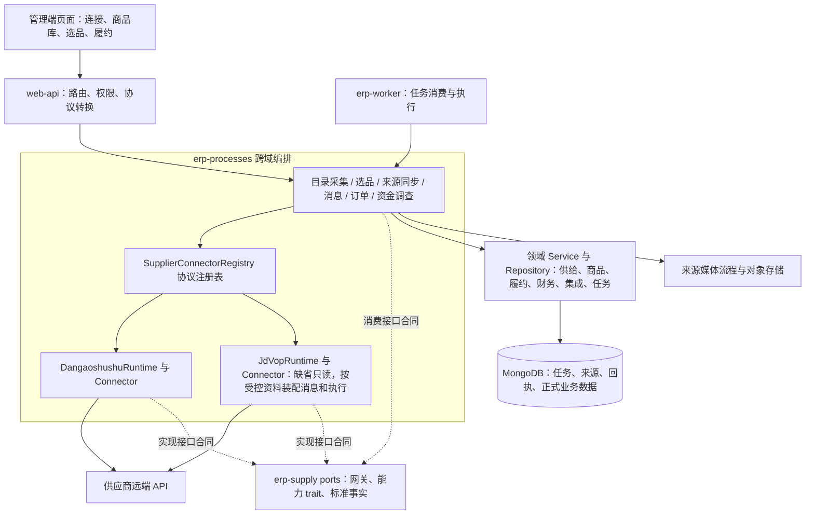
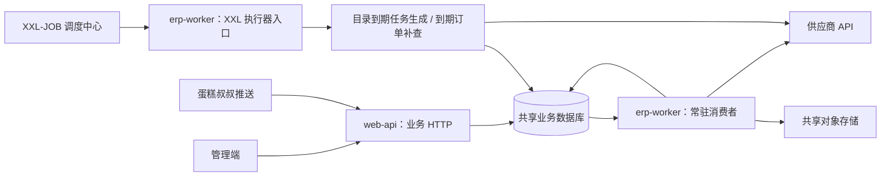
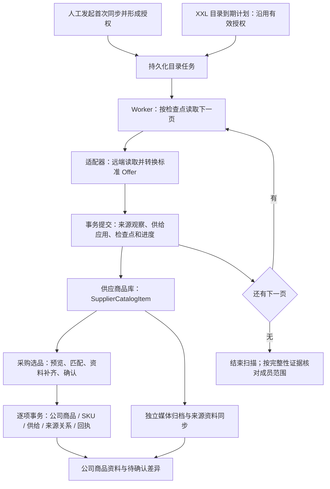
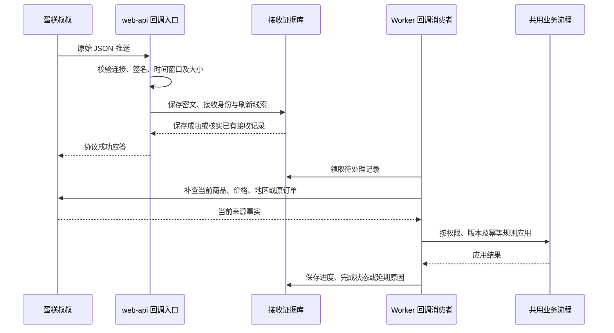

# API 供应商实现架构与接入规范

## 1 适用范围与当前状态

本规范规定 API 供应商的配置装配、商品采集、选品入库、通知处理、订单执行和后台调度职责，适用于蛋糕叔叔、京东 VOP 及后续新增协议。

当前架构采用“供应商协议适配器 + 共用业务流程 + 领域持久化 + 独立 Worker”。商品目录、选品、供给更新和任务执行已具备共用实现；HTTP 推送按注册表选择协议，商品回调按标准刷新语义消费。新增供应商须开发并登记协议适配器，不能仅填写接口地址完成接入。

状态基准为 2026-10-31 工作区代码，包含工作区未提交修改。下述“已装配”指技术配置启用后正常启动代码能够提供相应能力，不代表目标环境已部署、账号授权有效或真实业务验收通过。

| 范围 | 蛋糕叔叔 | 京东 VOP |
| --- | --- | --- |
| 商品目录与报价 | 已实现并纳入正式装配 | 已实现并纳入正式只读装配 |
| 目录同步方式 | 部分增量与周期全量校对 | 全量商品池扫描；时间窗口增量不支持 |
| 选品进入公司商品库 | 复用共用选品流程 | 复用共用选品流程 |
| 变更通知 | HTTP 推送接收、商品补查及订单回调处理已接入代码路径 | 配置已核实的 `jd_vop.messages` 后独立装配拉取与确认能力 |
| 订单与履约 | 创建、查询、配送准备及支付结果通知能力已装配 | 配置完整 `jd_vop.execution` 后装配；资金、健康和新增下单资格仍须分别满足 |
| 凭据维护 | 按部署配置绑定渠道与凭据 | 已装配数据库令牌提供器和后台凭据维护 |

“入库”在本文指来源商品采集及选品进入公司商品库；实物收货、库存入账仍执行仓储和库存领域合同，不因接口商品同步而发生。

## 2 总体架构

### 2.1 分层与调用关系

下图表示代码职责与调用方向。外部事实必须经过 Process 和拥有领域规则后写入业务记录；适配器不得直接建立公司商品、修改订单或记账。

| 层次 | 实现责任 | 必须遵守的边界 |
| --- | --- | --- |
| `apps/web-api` | HTTP、权限、启动装配、Worker 生命周期、XXL 协议入口 | Handler 不直连数据库；业务路由与后台执行职责分离 |
| `erp-supply/ports` | 标准能力、输入输出、错误和同步策略 | 不包含供应商 HTTP 客户端；不执行跨域写入 |
| `erp-processes/connectors` | 认证、请求、供应商 DTO、字段和状态映射、技术账号绑定 | 不直接应用 ERP 业务事实；协议写入不得隐藏重试 |
| `erp-processes` 业务流程 | 授权重验、任务与动作编排、事务边界、幂等、恢复、跨域应用 | 外部 HTTP 与对象存储 I/O 必须位于数据库事务外 |
| 各业务领域 | 本域不变式、正式业务状态、仓储和索引 | 数据通过拥有领域访问；跨域依赖使用窄 Port |

代码入口：[正式装配](../backend/apps/web-api/src/app_state/supplier_connectors.rs)、[注册表](../backend/crates/erp-processes/src/connectors/registry.rs)、[能力合同](../backend/crates/erp-supply/src/ports/connector/mod.rs)。

### 2.2 运行进程与调度

1. `web-api` 固定提供业务 HTTP；`erp-worker` 固定提供后台消费和 XXL 执行器入口，不提供业务路由。两者共用应用装配代码。
2. 两个进程必须连接同一业务数据库和对象存储，并使用一致的供应商配置及业务加密密钥。
3. XXL 负责触发目录到期计划和周期订单补查；已经持久化的目录任务、选品任务、回调、消息等由 Worker 持续消费。
4. XXL 调度成功、任务被领取、回调接收成功均不得作为业务完成证明；完成状态以相应业务回执为准。
5. 当前 Worker 部署合同为单副本及 Recreate。不得依据局部租约实现推定整个 Worker 已支持多副本。

实现入口：[进程职责](../backend/apps/web-api/src/runtime/role.rs)、[Worker 装配](../backend/apps/web-api/src/runtime/workers.rs)。调度执行入口见 [XXL 实现](../backend/apps/web-api/src/runtime/xxl/mod.rs)，进程装配以对应源码入口为准。

## 3 协议注册与能力合同

### 3.1 装配层次

运行时负责协议级部署配置和共享客户端；Connector 负责绑定具体业务连接后提供能力。注册表以 `SupplierConnectorType` 分派，不得按供应商名称或 URL 猜测协议。

当前注册一个运行时须提供以下三个接口：

| 接口 | 责任 |
| --- | --- |
| `SupplierApiGateway` | 健康检查、目录分页、目录范围及同步策略 |
| `SupplierReferenceRegistry` | 部署配置、技术引用及实际能力读取 |
| `SupplierFulfillmentFactory` | 生成绑定连接的 `SupplierConnector`；分别核验新增创建、已有履约和通知消费资格 |

`SupplierConnector` 为能力聚合入口。可选窄 trait 缺失时必须返回 `None`，业务流程须明确拒绝或跳过，不得伪造空结果或成功回执。

### 3.2 标准能力

| 能力 | trait 或类型 | 标准责任 |
| --- | --- | --- |
| 商品与采购报价 | `OfferSource`、`OfferTransform<Source>` | 扫描和定向查询标准 `Offer`；纯映射不得执行外部 I/O |
| 可供与库存 | `AvailabilitySource` | 返回来源可供事实；未知不得表示为零库存或无限库存 |
| 可售地区 | `ServiceAreas` | 返回地区覆盖及其完整性 |
| 地址与配送 | `SupplierAddressSource`、`DeliverySource` | 地址候选、地址准备、配送选项及分组 |
| 下单预检 | `OrderPreflight` | 按实际数量、地址、批准金额核验，不创建订单 |
| 创建与查询 | `Orders` | 创建单组订单、查询原单及恢复步骤 |
| 独立确认 | `OrderConfirmation`、`PaymentConfirmation`、`OrderReceiptConfirmation` | 分别表达预占确认、支付结果通知、实际收货后通知，不得互相代替 |
| 取消与退款 | `Cancellations`、`Refunds` | 独立动作及原动作结果查询 |
| HTTP 推送 | `Callbacks` | 原始报文验签、认证范围、标准通知及协议应答 |
| 拉取消息 | `SupplierMessageSource` | 账号范围、拉取、消息确认 |
| 资金与结算 | `SupplierFundsSource`、`Settlements` | 返回余额、流水和结算证据，不直接形成 ERP 财务凭证 |

`SupplierConnector::capabilities()` 生成管理端操作清单；地址、资金、拉取消息等能力还通过对应方法直接供执行流程判断。不得把页面标签当作所有内部能力的完整枚举。

“允许自动下单”只控制新增创建及尚未发送的独立订单确认。商品采集、选品、原请求调查、取消、消息处理及既有订单跟踪不得因该开关关闭而一并停用。

## 4 商品采集与选品入库

### 4.1 处理流程

### 4.2 执行规则

1. 目录采集统一使用 `SupplierConnectionExecutionProcess`。适配器返回来源事实；共用流程保存目录、应用关联供给变化、维护任务进度与恢复检查点。
2. 适配器必须提供 `CatalogSyncPolicy`，包括映射版本、页长、同步周期、全量校对周期、增量支持及重叠窗口。共用执行器不得写死供应商名称或统一假设增量可用。
3. 来源页面与检查点须原子提交。中断保留已提交页面；恢复须核对连接、技术配置、映射及检查点格式版本，不得用旧检查点解释新协议。
4. 首次人工授权后才允许周期调度。原授权人失效、权限不足或连接版本不一致时须阻断并保留可处理原因。
5. 页面失败、部分增量、单项暂不可见不得解释为商品撤回。按缺项撤回必须具备完整成员范围及独立范围复核证据。
6. 供应商品库与公司商品库分离。只有选品确认才能创建或关联公司商品、SKU 和供给；采集及未知商品通知不得自动建品。
7. 选品统一使用 `SupplierCatalogAdoptionProcess`。单项确认与批量执行复用来源资格、身份匹配及事务规则；批量失败须保留逐项结果和可恢复操作身份。
8. 来源采购报价与公司销售参考价分别保存。同步可更新来源报价和供给修订，不得覆盖公司销售参考价、人工停用状态或历史订单快照。
9. 图片归档不阻断目录采集。选品仅使用已核验素材并提示缺项；后续补齐必须按字段来源责任和人工差异规则执行。

代码入口：[目录执行](../backend/crates/erp-processes/src/supplier_connection_execution/mod.rs)、[分页事务](../backend/crates/erp-processes/src/supplier_connection_execution/catalog_scan.rs)、[选品流程](../backend/crates/erp-processes/src/supplier_catalog_adoption/mod.rs)。业务规则执行[API 商品合同](supplier-api-product-contract.md)及[批量选品合同](supplier-api-batch-adoption-contract.md)。

## 5 通知接收与事实应用

### 5.1 蛋糕叔叔 HTTP 推送

入口为 `POST /callbacks/dangaoshushu/{connection_id}/{kind}`，`kind` 包括 `order`、`status`、`product`、`cities`、`price`。

1. 蛋糕叔叔当前验签认证范围为 `EnvelopeOnly`，签名不覆盖业务正文。正文只作刷新线索，不直接作为价格、库存、地区或订单状态事实。
2. 保存成功后才返回供应商成功应答。成功应答只表示可靠接收，不表示业务已应用。
3. `supplier_callback_receipts` 保存原始正文密文及处理意图。商品回调与订单回调分别消费，失败保留记录、检查点和下次处理时间。
4. 商品回调调用实际 Connector 补查并复用来源应用流程；订单回调通过原单查询和履约应用流程处理。
5. 统一入口为 `/callbacks/{protocol}/{connection_id}/{kind}`，蛋糕叔叔原 URL 保持有效。路由保留原始路径、查询串、请求头和正文，服务端核对协议与连接绑定后调用 `Callbacks`。商品消费者按实际回调及查询能力工作，不再限定蛋糕叔叔类型。

代码入口：[HTTP 路由](../backend/apps/web-api/src/core/routes/supplier_callbacks.rs)、[接收实现](../backend/crates/erp-processes/src/supplier_callbacks/mod.rs)、[商品消费者](../backend/crates/erp-processes/src/supplier_catalog_callbacks/mod.rs)、[订单回调处理](../backend/crates/erp-processes/src/supplier_order_tracking/callbacks.rs)。

### 5.2 拉取消息

1. `SupplierMessageWorker` 按注册表取得连接能力，仅处理 `messages()` 返回实际实现的连接。候选连接扫描使用注册表全部协议，不依赖目录能力。通知连接只核验技术绑定，订单资金准入在对应订单流程独立核验。
2. `SupplierMessageProcess` 先恢复本地队列，再拉取新消息。接收、应用、远端确认分别记录，不得提前删除供应商消息。
3. 相同消息身份的重复接收不得重置完成状态；同号异载荷必须隔离。账号租约和连接归属必须在持久化及外部调用边界重新核验。
4. 消息确认调用结果未知时保留原记录，不得将超时当作未执行并盲目重发。
5. 京东正式装配调用 `from_configured_transport()`。`jd_vop.messages` 提供账号、应用、依据和消息类型后，单独装配消息传输；不要求开票及订单执行资料，也不因此开放创建、取消或订单确认。轮询遵守 `message_poll_interval_seconds`，本地恢复后才拉取新消息。

代码入口：[消息 Worker](../backend/crates/erp-processes/src/supplier_messages/worker.rs)、[消息编排](../backend/crates/erp-processes/src/supplier_messages/mod.rs)、[京东能力条件](../backend/crates/erp-processes/src/connectors/jd_vop/mod.rs)。

## 6 订单执行与履约恢复

订单链路使用 `SupplierApiOrderProcess` 执行地址准备、预检、资金与费用核验、创建及独立确认；`SupplierOrderTrackingProcess` 查询原单并应用来源观察。具体步骤由能力及供应商协议决定。

1. 每次外部写入前必须保存动作身份、请求快照、载荷指纹和执行意图；数据库事务提交后才允许发送请求。
2. 一次协议写调用至多发送一次。结果未知时沿原订单号、原动作及原回执调查，不得生成新单号重试。
3. 预占确认、支付结果通知、实际收货通知分别使用独立能力和动作；HTTP 成功不得直接推导接单、发货、收货或付款完成。
4. 父子单、数量分配、部分发货与多运单必须保留可逆关联和数量守恒；来源事实不足时只保存已知事实并阻断无法确定的应用。
5. 资金余额与消息只提供调查依据。充值、占用、核销、返款必须由财务流程核实并登记，不能根据余额或消息正文直接记账。
6. 蛋糕叔叔提供 `Orders` 和 `PaymentConfirmation` 等能力；未声明取消或退款能力时不得假定具备主动取消或退款。
7. 京东正常启动根据受控执行配置调用 `with_verified_execution()`；缺省保持只读。完整资料开放相应协议能力；缺少原订单确认资金依据时保留查单、取消等能力，禁止创建及独立订单确认。实际发单仍执行采购审批、资金保障、连接健康及开关校验。

代码入口：[订单执行](../backend/crates/erp-processes/src/supplier_api_orders/mod.rs)、[履约跟踪](../backend/crates/erp-processes/src/supplier_order_tracking/mod.rs)、[京东运行时](../backend/crates/erp-processes/src/connectors/jd_vop/runtime.rs)。供应商专项规则执行[蛋糕叔叔接入合同](dangaoshushu-connector-contract.md)及[京东 VOP 接入计划](jd-vop-integration-plan.md)。

## 7 后台任务职责

| 任务 | 触发入口 | 执行责任与完成含义 |
| --- | --- | --- |
| 到期目录计划 | XXL `supplier_catalog_schedule` | 扫描一页连接并创建到期持久任务；成功不等于目录采集完成 |
| 目录采集与恢复 | Worker `BackgroundRunner` | 消费已登记任务，逐页保存及恢复 |
| 批量选品 | Worker `SupplierCatalogAdoptionTaskAdapter` | 准备、匹配及执行已提交批次，保留逐项回执 |
| 到期订单补查 | XXL `supplier_tracking_scan` | 查询一批到期订单并应用来源观察 |
| 自动发单与订单回调 | Worker 本地常驻循环 | 执行持久化动作，处理回调线索及完成确认 |
| 拉取消息、商品回调、资金调查 | Worker 各自独立循环 | 按实际能力和待处理记录有界执行 |
| 京东凭据维护 | Worker 独立维护循环 | 按提供器状态读取或维护令牌；不受新增下单开关控制 |
| 来源媒体 | Worker `SourceMediaWorker` | 下载、核验、归档及关联素材 |

当前 `BackgroundRunner` 以 2 秒为轮询间隔；供应商发单、回调、消息和资金循环通常以 5 秒为间隔；京东凭据维护以 60 秒为间隔。这些数值是进程检查节奏，不是每条连接的全量同步频率、令牌强制刷新频率或业务时效承诺。实际执行受任务到期时间、能力、租约、网络及队列积压约束。

XXL 中的任务触发频率由调度中心配置；每个供应商的目录业务周期仍由 `CatalogSyncPolicy` 控制。调度中心故障时不得自动启用另一套本地周期计划造成双重驱动。

代码入口：[常驻供应商循环](../backend/apps/web-api/src/core/supplier_order_worker.rs)、[目录调度适配器](../backend/crates/erp-processes/src/background/supplier_catalog_adapter.rs)、[XXL 分派](../backend/apps/web-api/src/runtime/xxl/mod.rs)。

## 8 数据归属与恢复约束

| 数据 | 拥有领域 | 用途 |
| --- | --- | --- |
| API 连接、来源目录、扫描检查点、供给及供给修订 | `erp-supply` | 连接治理、来源身份、供给条件及扫描恢复 |
| 回调证据、拉取消息、账号消费状态、技术凭据 | `erp-integration` | 可靠接收、技术认证、去重及通知恢复 |
| 后台任务与进度 | `erp-support` | 调度、执行状态、操作人及错误 |
| 公司商品、SKU、展示资料来源关系 | `erp-catalog` | 公司经营资料与字段同步责任 |
| 供应商履约执行与观察 | `erp-supply` | 原单、动作、查询与供应商侧履约事实 |
| 预存款、支付、核销及返款 | `erp-finance` | 财务依据及资金守恒 |

所有恢复必须沿原身份进行。目录使用连接、来源商品与规格及扫描检查点；消息使用账号和稳定消息身份；外部动作使用原动作、订单号及载荷指纹。ERP 自身的幂等表不能代替供应商远端的幂等保证。

来源更新时间、ERP 观察时间、接收时间和可供有效期分别保存。来源未提供时间时必须保留未知，不得用接收时间伪造来源版本。

## 9 新供应商实现步骤

| 顺序 | 必须交付 | 完成条件 |
| --- | --- | --- |
| 1 协议与能力确认 | 专项接入合同、能力矩阵、认证规则、商品身份、通知模式、订单步骤及恢复规则 | 每项能力有协议依据；未知语义明确阻断，不填造默认事实 |
| 2 配置与身份 | 协议类型、`SafeConfig` 配置、端点和凭据引用、技术账号绑定 | 无效或缺失配置明确拒绝；不借用其他供应商适配器 |
| 3 商品适配 | 原始 DTO、纯转换、`OfferSource`、目录网关及同步策略 | 来源身份稳定；分页、缺项、报价、采购限制及映射异常有明确语义 |
| 4 通知适配 | `Callbacks` 或 `SupplierMessageSource`，以及对应运行入口 | 保存后应答或确认；去重、冲突、补查、恢复及账号隔离可验证 |
| 5 订单与资金 | 按真实范围实现预检、创建、确认、查询、取消及资金证据能力 | 每个写步骤有独立持久意图和未知结果处理；缺失能力准确拒绝 |
| 6 正式注册 | 运行时实现三个注册接口，并加入 `SupplierConnectorRegistry` 及组合根 | 正常启动取得的能力与实际实现一致，不能只在测试构造器中可用 |
| 7 业务接入 | 共用目录、选品、供给、订单及任务入口 | 不另建供应商专属公司商品库、选品业务或财务记账流程 |
| 8 迁移与验收 | 索引或数据迁移、单元与静态检查、真实账号及部署验收记录 | 代码、装配、部署、账号可用及业务验收分别登记 |

新协议优先复用现有窄 trait；确有新业务语义时，先定义供应商无关的输入输出及不变式，再扩展共用流程。不得把供应商原始 JSON、状态码或特定名称传播到通用领域规则。

## 10 当前扩展边界与验收要求

### 10.1 接入前必须处理的扩展边界

| 边界 | 当前事实 | 后续接入要求 |
| --- | --- | --- |
| HTTP 推送接入 | 已按注册表和 `Callbacks` 共用接收 | 新协议实现验签、标准通知及应答；已存在的接收身份可通过 `reception_id` 保留 |
| 商品回调消费 | 已按 `catalog` 语义消费，兼容历史路由类型 | 支持商品、可供、价格、地区的品牌、商品及规格目标；订单通知单独处理 |
| 消息候选发现 | 已遍历所有注册协议，再判断实际消息能力 | 不要求目录能力；适配器必须声明账号范围和轮询间隔 |
| 京东正式执行 | 已具备受控资料到正式读写传输的装配路径 | 部署须填写真实资料并完成账号及资金验收，不得以装配通过代替业务放行 |
| 协议与账号注册 | 协议枚举当前为蛋糕叔叔、京东；注册表每种协议登记一个运行时 | 多技术账号需求须明确运行时内部账号路由和连接隔离，不能仅增加一个 URL |
| 执行器扩容 | 当前部署合同为单 Worker | 多副本须单独验证所有任务的认领、外部副作用及失联恢复 |

### 10.2 验收分层

1. **协议与单元验收**：覆盖字段转换、能力缺失、分页中断、重复与冲突通知、订单结果未知及动作不重复发送；测试必须执行实际生产规则。
2. **正式装配验收**：从正常启动入口核对注册表、配置、能力和 Worker 消费路径；测试专用构造器不能替代正式装配。
3. **数据与恢复验收**：核对唯一约束、页面与检查点原子性、账号租约、原动作恢复和版本冲突。按环境授权执行，不得用替身测试声称真实数据库验收完成。
4. **供应商账号验收**：分别取得实际认证、商品读取、通知、消息确认、下单及履约证据；按已开放能力逐项验收。
5. **部署验收**：核对 API、Worker、调度中心、索引、对象存储与配置一致性；检查 Worker 重启恢复、队列积压及原操作状态。

代码检查遵循 [后端仓库规则](../backend/AGENTS.md)。当前仓库禁止执行依赖真实 MongoDB 或外部服务的集成验收命令；真实环境验收必须在允许的执行环境中单独安排并记录。编译、单元测试、提交、部署和真实业务完成不得互相替代。

## 11 京东执行配置与发布操作

### 11.1 配置来源及启用边界

配置只从服务端 `SafeConfig` 读取，不接受采购页面或回调载荷覆盖。结构定义见 [执行配置](../backend/config/src/jd_vop_execution.rs)，配置示例见 [config.toml.example](../backend/config.toml.example)。不得把证据引用字段当作自动完成验收；填写人必须核对引用对应的真实账号资料。

| 配置节 | 必填资料 | 生效范围 |
| --- | --- | --- |
| `jd_vop.messages` | `evidence_reference`、与主配置一致的 `account_scope/app_key`、非空 `types` | 独立拉取及确认消息；没有订单能力时订单类通知保留待处理，不误删 |
| `jd_vop.execution` | 执行依据、相同账号及应用、`external_funds_account_ref`、`preflight_validity_seconds`、非空普通实物 `ordinary_skus`、`invoice` | 装配预检、订单查询、取消及收货通知等已实现能力 |
| `jd_vop.execution.confirmation_funds_evidence` | 原订单确认不重复扣减资金的核实依据 | 允许适配器声明创建和独立确认能力；不替代业务资金保障 |
| `jd_vop.execution.invoice` | 发票类型、开票方式、抬头类型、内容类型、主体名称及适用税号 | 保留既有电子发票和专票参数校验；资料缺失拒绝启动 |
| `jd_vop.execution.invoice.recipient` | 专票收件人、电话、地址及四级地址编码 | 专票要求同时具备注册、银行及收票资料，不用订单收件资料代填 |
| `jd_vop.execution.funds` | 资金依据、外部账号、`expected_pin/account_type`、币种、时间格式及时区、页长、交易类型规则 | 开放只读资金证据；未配置时不声明资金查询能力 |

资金配置的 `currency` 当前仅接受 `CNY`，`time_format` 仅接受 `LocalDateTimeSeconds`；它们必须显式填写。`trade_types` 以来源业务码为键，每项声明 `direction`（`Recharge/Debit/Return`）及 `sign`（`Positive/Negative`）。可选 `message_effects` 映射消息类型到资金方向。资金账号必须与执行资料一致，实际业务连接的预存款绑定还须独立核验。

`ordinary_skus` 为经过核实的普通实物范围，不支持通配符。范围、发票及执行身份资料变化会影响既有技术绑定；发布前须核对未结订单及连接重绑定流程，不得直接覆盖账号或重新创建原订单。

### 11.2 回调兼容与升级

1. 蛋糕叔叔原回调 URL、协议应答及 `dgss-` 接收身份保持有效。新商品通知保存为通用 `catalog` 路由类型；旧 `status/product/cities/price` 记录继续消费。
2. 接收记录新增可选 `content_fingerprint`。旧记录读取缺省为空，重放时解密原证据比较；新记录使用指纹核验。无需回填旧正文或改写来源事件号，复用既有接收唯一索引和队列索引。
3. 有来源事件号时以连接和来源事件号定位接收记录，同身份异报文必须报冲突并保留原证据；没有事件号时仅提供字节级接收去重。接收身份不作为业务版本。
4. 当前共用消费者支持可补查的商品及订单通知。仅推送完整事实、地址字典通知、独立退款动作、同报文多个来源事件号，以及订单与商品混合通知须先扩展相应消费者；现有入口明确拒绝，不接收后假装完成。
5. 回滚前停止供应商推送和对应消费者，核对仍处于 `received` 的 `catalog` 记录及新增来源事件记录。旧版消费者不能完整处理新语义，不得直接回退后遗弃队列或删除证据；使用保留通用队列能力的版本，或完成受控处理后再回退。

### 11.3 发布与验收步骤

1. 核对真实消息范围、执行资料、预存款账号和发票资料；只需要目录时不配置新增资料节，只需要消息时只配置 `messages`。
2. 在受控配置源登记资料，保持 API 与 Worker 同一版本、同一账号和同一加密密钥；资料修改后重启对应进程，不依赖热更新重新装配协议客户端。
3. 核对连接技术引用。执行资料改变导致绑定不一致时，按现有连接治理流程重新绑定并执行只读健康检查；保留原订单、原消息及原动作记录。
4. 先验证商品消息接收、补查和确认，核对待处理原因与重复消息零重复应用；订单能力未开放时不得将订单类消息人工标记成功。
5. 开放订单前完成实际账号、采购审批和资金保障验收；按受控范围核对创建、确认、查询、取消、收货通知及结果未知调查。
6. 分别登记代码检查、部署配置、进程版本、消息验收、订单验收和资金验收结果。未取得真实环境证据的项目保持待验收。

### 11.4 本轮代码验证记录

验证范围为 2026-10-31 工作区，真实供应商、真实数据库及部署验收继续执行第 10.2 节，不得由以下结果替代。

| 检查 | 结果与适用范围 |
| --- | --- |
| 库单元测试 | `config` 38、`erp-integration` 181、`erp-supply` 595、`erp-processes` 1304、`web-api` 293 项通过；`erp-processes` 另有 6 项既有忽略测试未运行 |
| workspace 编译 | `cargo check --workspace --locked` 通过 |
| Rust 静态检查 | 受影响 crate 的 `cargo clippy --all-targets --locked` 通过；格式与差异空白检查通过 |
| 供应商模块体积 | 使用仓库体积检查器检查供应商相关 69 个源文件，无体积违规；全仓库体积门禁仍报告其他文件超限 |
| 领域边界门禁 | 未通过：检查器依赖的 `backend/docs/superpowers/plans/domain-crate-migration/plan-manifest.json` 已被工作区清理，无法完成工作区检查；未恢复该清理文件或绕过门禁 |

关键行为测试覆盖正式只读装配、独立消息装配且不开放订单、订单执行资料缺失、资金账号不一致、原确认依据缺失、资金映射、通知准入独立于订单资金、通用回调路由、原始查询串及请求头、重复报文、同事件异载荷、旧蛋糕叔叔身份、商品语义补查与轮询间隔。
