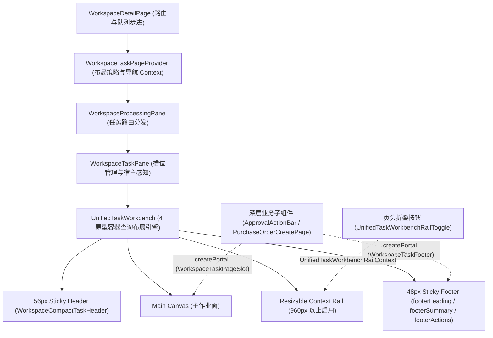
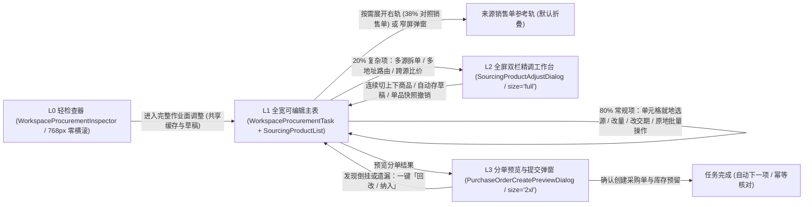

# ERP 任务页设计系统（Task Page Design System）

> **设计基准标杆**：
> - **原型 A（决策审查与双屏对照型）**：采购单审批页 [`erp-client/features/workspace/components/workspace-purchase-approval.tsx`](../erp-client/features/workspace/components/workspace-purchase-approval.tsx) × [`workspace-purchase-source-comparison.tsx`](../erp-client/features/workspace/components/workspace-purchase-source-comparison.tsx) × [`workspace-document-task-detail.tsx`](../erp-client/features/workspace/components/workspace-document-task-detail.tsx) × [`approval-action-bar.tsx`](../erp-client/features/approval-workflow/components/approval-action-bar.tsx)
> - **原型 B（渐进式高密度编制与配平型）**：供给分配页 [`erp-client/features/workspace/components/workspace-procurement-task.tsx`](../erp-client/features/workspace/components/workspace-procurement-task.tsx) × [`purchase-order-create-page.tsx`](../erp-client/features/purchase-orders/pages/purchase-order-create-page.tsx) × [`sourcing-product-adjust-dialog.tsx`](../erp-client/features/purchase-orders/components/sourcing-product-adjust-dialog.tsx) × [`purchase-order-create-preview.tsx`](../erp-client/features/purchase-orders/components/purchase-order-create-preview.tsx)
>
> **主题体系**：飞书 Universe Design / 纯白通栏工作面（与 [`docs/typography-design-system.md`](./typography-design-system.md)、[`docs/list-table-design-system.md`](./list-table-design-system.md)、[`docs/detail-page-design-system.md`](./detail-page-design-system.md) 100% 同源）  
> **适用范围**：工作台（`/workspace/*`）下所有审批决策、业务编制、异常处理与速览任务页，以及嵌入分栏队列检查器（SplitQueue）、768px 抽屉（`TaskActionSheet`）和全屏办理页的多载体作业面。

---

## 1. 设计哲学与双标杆原型模型

任务页（Task Page）与列表页、主数据详情页有本质区别：列表页追求「批量扫描与路由」，详情页追求「完整档案读写」，而**任务页的核心目标是让经办人在最短认知路径内完成一次高确定性的业务判断或状态推进**。

采购单审批页与供给分配页之所以成为当前系统中体验最出色的两个任务页，是因为它们分别把企业级任务的两极推到了极致，同时共享同一套纯白通栏骨架与语义令牌：

| 维度 | 原型 A：决策审查与双屏对照型（标杆：采购单审批页） | 原型 B：渐进式高密度编制与配平型（标杆：供给分配页） |
| --- | --- | --- |
| **工作台原型值** | `archetype="decision"` | `archetype="action"`（`fullWidth: true`） |
| **核心认知闭环** | 一秒识风险 → 指标定口径 → 逐行核明细 → 右轨对依据 → 底栏低摩擦拍板 | 系统预配兜底 → 主表就地微调 → 原地批量提效 → 全屏双栏精调 → 分单预览与回改提交 |
| **主画布拓扑** | 72/28（可拖至 48/52）常驻可折叠双栏；右轨依页签自动扩宽 | 100% 全宽主表；右轨「对照销售单」默认折叠，按需展开（38%）或窄屏回退弹窗 |
| **复杂度消解方式** | **异常优先聚合 + 按需深挖**（顶部风险条直达筛选、合规项默认折叠、多地址收入弹窗） | **四级渐进披露（L0 → L1 → L2 → L3）**（轻检查器 → 主表就地微调 → 全屏精调 → 分单预览） |
| **交互密度控制** | 阈值化显隐控件（`> 8` 行才显筛选，`> 20` 行才分页）；健康行极净，仅风险行附着紧贴风险条 | 7 列零横滚主表预算；上下文变形单行工具栏（筛选态 ↔ 勾选批量态原地替换） |
| **防错与风控哲学** | **分级风控（ADR-1）**：低风险零弹窗一键通过，高风险触发同源风控确认框；驳回自带动态上下文短语 | **实时守恒与自愈**：总量/余额实时配平、一键自动补配/缩减、撤销快照、提交前预览可一键回改任意异常商品 |
| **适用业务场景** | 采购审批、销售审批、付款/收款审批、开票/退票审批、冲销与单据变更审批 | 供给分配与建采购单、批次配货/发运排程、收款核销配平、入库/质检分配、对账勾稽 |

> **与其他两个原型的衔接**：`UnifiedTaskWorkbench` 共定义 4 个工作台原型——除上述两大主战场 `decision` 与 `action` 外，`investigation`（异常排查型，如同步失败/单据异常）复用原型 A 的可折叠右轨架构，将右轨替换为「诊断载荷与重放日志」；`informational`（速览型，如通知确认/轻量确认）复用原型 B 的无右轨精简画布与 L0 检查器模式，常驻分栏队列或 `TaskActionSheet` 内完成闭环。

### 七条黄金法则

1. **纯白通栏零套娃，空间只服务业务判断**
   - 作业面铺满 `bg-card` 纯白通栏，取消浅灰背景画布与多层嵌套白卡边框；页头、分区、双栏分界、底栏统一仅靠 `1px` `border-border/60` 细线与 `--scaffold-px`（`<768px: 16px` / `768~1199px: 20px` / `≥1200px: 24px`）左沿对齐建立秩序。
   - 顶部页头压缩至 `56px` 单行（`min-h-14`），底部操作栏压缩至 `48px` 单行（`min-h-12`）；全宽审批页直接隐藏顶部审批路线进度条（已停靠右侧 `审批记录` 轨），把首屏 100% 让位给风险横幅、决策 KPI 与业务明细。
2. **首屏即真相：异常前置、合规退后、重提讲变化**
   - 没有风险时不占一像素（零空态横幅）；有风险时在最上方以 `border-l-2` 左色条聚合计数，并提供**一键过滤跳转按钮**（如 `仅看风险项（N）›`、`N 项待完善 · 定位`）。
   - 多轮重提任务必须前置 `WorkspaceApprovalResubmissionBanner`，以「上轮驳回原因 + 本轮字段 diff 胶囊（`旧值 → 新值`）」两句话闭环解释「上次为什么打回、这次改了什么」。
   - 核对类清单（如采销商业条款对照）按严重度降序排列，所有 `ok` 合规项自动折叠为单行静音摘要（`✓ 已匹配：资金 · 履约 ∨`）。
3. **渐进式复杂度披露（L0 / L1 / L2 / L3），拒绝一屏堆砌**
   - 80% 的常规操作必须在主表原地完成（单元格内联选源、改量、改交期、选目标仓），无需打开任何弹窗。
   - 20% 的复杂长尾场景（多地址拆单、多供应商比价、50 处收货地址核对）下沉至全屏双栏精调工作台（`Dialog size="full"`）或双视角专题弹窗（`Dialog size="lg"`），且弹窗内必须支持连续切换上下项、原地预览，彻底禁止 Dialog 叠 Sheet 或弹窗套弹窗。
4. **同源色彩与双编码，不靠单一颜色或隐性符号传意**
   - 盈亏金额同时使用中文前缀与语义色（`赚 ¥120.00` 绿色 / `亏 ¥50.00` 红色 / `¥0.00` 中性），不靠极小的 `-` 号赌视力。
   - 多来源编制场景建立「路径色（4 种履约模式）× 来源序号色（5 档 `chart-1..5`）」同源色标体系（[`source-palette.ts`](../erp-client/features/purchase-orders/lib/sourcing/source-palette.ts)），顶部配平堆叠条、左侧来源卡、右侧地址过滤胶囊与行内分配按钮 100% 共用同一索引色，视线扫过即可瞬时建立空间映射。
   - 所有数字、金额、单号、日期、百分比一律挂载 `.num`（`tabular-nums lining-nums slashed-zero`），并使用 `MoneyValue` / `QuantityValue` / `RateValue` 原语输出。
5. **跨区双向定位与原地闭环，拒绝人工肉眼找行**
   - 任何存在「主视图 ↔ 对照视图」或「告警/汇总 ↔ 细项」关系的任务页，必须提供程序化定位能力：点击来源对照行直接定位并脉冲高亮主表对应行（`2.2s` 高亮，自动清筛选、自动切页、平滑滚动）；点击底栏异常胶囊或预览弹窗「回改」按钮直达问题商品。
   - 关联字段修改支持**上下文传播**（如在某行修改目标仓后，就地浮现 `同步目标仓到其余 N 个入仓项`）与**原地自愈**（如供给超配/缺配时直接提供 `自动缩减多余直发 -X` / `直发自动补配 +X`）。
6. **低摩擦队列流转与分级风控**
   - 底部操作栏统一提供 `☑ 处理后自动下一项`（`localStorage` 持久化），配合全局键盘引擎（`J`/`K` 切项、`A` 通过、`R` 驳回、`P` 附件、`H` 记录、`]` 开关右轨、`?` 快捷键面板、`Ctrl/Cmd+Enter` 提交），让高频审单/配货形成无停顿的流水线。
   - 审批通过按风险分级（ADR-1）：常规低风险单零弹窗直接执行并支持自动跳下一项；命中风控规则时才弹出唯一确认弹窗，并复用同一套风控计算引擎列出逐条风险原因。
7. **多宿主同构与确定性容错**
   - 同一业务任务必须优雅适配三种宿主：分栏队列检查器（`SplitQueue`）、768px 抽屉（`TaskActionSheet`）与完整全屏办理页；通过 `WorkspaceInspectorModeProvider` 抑制重复页头，通过专属轻检查器（如 `WorkspaceProcurementInspector`）保证 768px 内零横滚且共享同一份 Query 缓存与草稿状态。
   - 所有正式提交必须具备草稿自动持久化、幂等键锁死（`IdempotencySlot`）、`OUTCOME_UNKNOWN` 核对恢复条与乐观锁冲突刷新，确保网络抖动时不丢数、不重复建单。

---

## 2. 共享任务骨架与空间预算体系

所有任务页统一构建在 [`UnifiedTaskWorkbench`](../erp-client/components/business/unified-task-workbench.tsx) 与 [`WorkspaceTaskPane`](../erp-client/components/business/workspace-task-pane.tsx) 之上，彻底杜绝业务页面自行拼接 `sticky` 页头、手动写两栏分屏或重复造底部按钮栏。

### 2.1 整体空间骨架（ASCII 解剖图）

```text
┌──────────────────────────────────────────────────────────────────────────────────────────────────────────┐
│ [Sticky Header · min-h-14 (56px) · bg-card · border-b border-border/60 · -mx/--scaffold-px]               │
│  [← 返回列表]  任务标题 (15px Semibold)  [状态徽章] [单据类型]  单号(num select-all) · 版本 · 截止        │
│                                                  [第 3/12 项  ↑K  ↓J]  [辅助动作] [转派/关闭] [刷新] [?] [◧]│
├──────────────────────────────────────────────────────────────────────────────────────────────────────────┤
│ [Header Supplement (可选)] 仅嵌入式/非双栏审批页显示精简 ApprovalRouteStepper；全屏双栏审批页隐藏          │
├──────────────────────────────────────────────────────────────────────────────────────────────────────────┤
│ [Alert Banner (条件渲染)] 驳回待修改通知 / 办理限制 Alert / 重提对照横幅（无内容时零占位）                  │
├───────────────────────────────────────────────────────────────────┬──────────────────────────────────────┤
│ [Main Canvas · flex-1 · min-w-0 · bg-card]                        │ [Context Rail · >= 960px 生效]       │
│  • archetype="decision"：默认占 72%（右轨 28%），可拖拽至 48%     │  • 1px 竖细线 + 拖拽手柄 (Resizable) │
│  • archetype="action"  ：默认占 100% 全宽；右轨按需展开（38%）    │  • decision 默认展开，action 默认折叠 │
│                                                                   │  • storageKey 持久化拖拽后宽度        │
│  1. 条件横幅层（重提对比条 / 风险聚合跳转条）                      │  • 切入对照页签自动扩宽至 38% / 42%   │
│  2. 决策指标层（4 格柔底 KPI 栏，或精简摘要槽位）                  │  • 切回审批记录时自动恢复原宽度       │
│  3. 业务核心层（高密度对照表 / 可编辑主表 + 变形工具栏）           │  • <960px 自动降级为底部区块或弹窗    │
│                                                                   │                                      │
├───────────────────────────────────────────────────────────────────┴──────────────────────────────────────┤
│ [Sticky Footer Dock · min-h-12 (48px) · bg-card · border-t border-border/60 · shadow-footer]              │
│  左槽 (footerLeading / footerSummary)                                  右槽 (footerActions / Portal)     │
│  [☑ 处理后自动下一项]   整单汇总指标 / 实时提交计数                      [异常定位] [次要/驳回] [主蓝 CTA] │
└──────────────────────────────────────────────────────────────────────────────────────────────────────────┘
```

### 2.2 骨架层级与 Portal 协作架构

`WorkspaceTaskPageProvider`（页面路由层）、`WorkspaceTaskPane`（任务适配壳）与 `UnifiedTaskWorkbench`（纯布局引擎）通过 React Context + `createPortal` 解耦，使深层业务表单/审批操作栏无需层层透传回调函数即可精准落入底部吸底栏或顶部摘要槽位。



### 2.3 `@container/workspace` 容器查询与响应式断点矩阵

ERP 任务页同时运行于大屏、中屏、768px 抽屉和分栏队列检查器中，**禁止仅依赖 `window` 视口断点（`md:` / `lg:`）决定内部网格列数**，必须优先使用容器查询（`@container/*`）：

| 容器名称 | 声明位置 | 关键宽度阈值 | 响应式行为 |
| --- | --- | --- | --- |
| `@container/workspace` | `<main id="main-content">` | `< 960px` / `>= 960px` | `ResizeObserver` 监听 `#main-content` 宽度：`>= 960px` 启用 `ResizablePanelGroup` 左右分栏；`< 960px` 右轨自动堆叠至主画布下方或回退弹窗 |
| `@container/document` | `WorkspaceDocumentTaskDetail` / `WorkspaceProcurementTask` | 通用任务内层容器 | 驱动任务头部元信息、摘要带与详情块的自适应折行 |
| `@container/purchase-lines` | `WorkspacePurchaseApproval` 主区 | `480px` / `840px` | 决策 KPI 栏：`1 列` → `@[480px]: 2 列` → `@[840px]: 4 列`（纯费用单自动为 `3 列`） |
| `@container/source-comparison` | 右轨 `WorkspacePurchaseSourceComparison` | `360px` / `440px` | 商业条款对照与毛利对比卡片的横向并排与堆叠切换 |
| `@container/procurement-inspector` | L0 检查器 `WorkspaceProcurementInspector` | `360px` / `520px` | 4 项指标卡片在窄检查器内自动 `2×2` → `4×1` 排布，杜绝横向滚动条 |
| `@container/source-card` | L2 精调弹窗单源配置卡 `SourcingSourceRow` | `380px` / `480px` | 单源卡片内数量、单价、税点、交期输入网格随左栏宽度平滑自适应 |

### 2.4 页头与底栏空间规范

#### 顶部紧凑任务页头（`WorkspaceCompactTaskHeader` / `WorkspaceTaskIdentityHeader`）
- **定高与贴边**：`min-h-14 border-b border-border/60 bg-card py-2`，通过 `-mx-(--scaffold-px) px-(--scaffold-px)` 与通栏左沿对齐。
- **单行信息优先级（左 → 右）**：
  1. 返回按钮：仅在存在显式来源队列（`returnTo`）时设 `visibility: "always"`；独立直达页面仅在窄屏显示。
  2. 标题 `<h1>`：`text-section-title`（`15px / 22px font-semibold`），严禁把任务页头写成 `20px+` 巨型横幅。
  3. 身份微标：`StatusBadge`（主状态） + `WorkspaceDocumentBadge`（单据类型胶囊，含语义色）。
  4. 紧凑元信息流 `DetailWorkspaceMeta`：`text-xs text-muted-foreground`，用 `·` 分隔（单号加 `.num select-all` 便于双击复制、版本号、最晚交付/截止时间、经办人）；**禁止与主画布重复渲染相同字段**（例如供给分配页明确避免副标题重复标题文本）。
  5. 队列步进器（仅队列进入时）：`第 X / Y 项` + `上一项 (K)` / `下一项 (J)` + `?` 快捷键速查。
  6. 头部操作簇（`WorkspaceTaskHeaderActions`）：上下文主辅助动作（如 `对照销售单`、`单据纸面`）→ 责任流转（转派/退回/关闭）→ 刷新 → `?` 任务说明浮层 → `[◧]` 右轨开关（`UnifiedTaskWorkbenchRailToggle`）。

#### 底部吸底操作栏（`footer[data-slot="workspace-task-footer"]`）
- **定高与视觉**：`min-h-12 border-t border-border/60 bg-card py-2 shadow-footer`，桌面端固定于滚动容器底部，始终触手可及。
- **严格左右分工**：
  - **左侧槽（状态与偏好）**：`[☑ 处理后自动下一项]`（标签恒定为 `处理后自动下一项`，偏好写入 `localStorage`）+ 实时业务汇总（如供给分配页的 5 项提交计数 `<dl>`，或批量摘要）。
  - **右侧槽（决策与提交）**：按「异常定位（条件） → 退回/次要/驳回 → 唯一主蓝 CTA」从左向右递增视觉权重，确保整个底栏**最多只有一个实心飞书蓝 `variant="default"` 按钮**。

---

## 3. 视觉令牌、排版与信息编码规范

所有样式必须严格消费 [`erp-client/app/globals.css`](../erp-client/app/globals.css) 的语义令牌，严禁硬编码十六进制色值或未授权 Tailwind 原生色板（`red-*` / `amber-*` / `blue-*` 等受静态 theme lint 零容忍门禁约束）。

### 3.1 表面与分割令牌

| 语义用途 | 推荐类名 / CSS Token | 典型场景 |
| --- | --- | --- |
| 任务主表面 / 页头 / 底栏 / 右轨 | `bg-card` | 纯白通栏基础画布，零外层灰底与套娃卡片 |
| 柔底聚焦表面（KPI 栏 / 表头 / 合计行 / 静止内联输入框） | `bg-surface-sunken` | 采购审批 4 格 KPI 带、无框圆角表头、供给分配静止态内联数字输入 |
| 次级工作区侧栏（L2 左栏 / L3 预览导航栏） | `bg-sidebar` | `SourcingProductAdjustDialog` 左侧配平区、`PurchaseOrderCreatePreviewDialog` 左侧分单列表 |
| 结构细线 | `border-border/60` | 页头底线、底栏顶线、双栏竖细线、表格行分隔线 |
| 高亮 / 选中 / 变形批量条 | `bg-info-soft/50 border-info-border/70` | 主表勾选变形后的批量操作栏、跨屏定位目标行高亮（`ring-1 ring-info-border bg-info-soft/25`） |
| 危险 / 倒挂 / 严重异常 | `bg-destructive-soft` / `border-l-destructive` / `text-destructive` | 负毛利风险条、价格倒挂标记、高风险确认提示 |
| 警告 / 缺口 / 待调整 | `bg-warning-soft` / `border-l-warning` / `text-warning-foreground` | 超需求/交期延后风险条、未配平缺口、重提变更提示 |
| 健康 / 盈利 / 已配平 | `bg-success-soft` / `text-success-foreground` | 盈利前缀、已配平状态徽章、合规匹配标记 |

### 3.2 任务页字号与排版角色（严格遵循 5+4 体系）

| 视觉角色 | Token 类 | 字号 / 行高 | 任务页规范 |
| --- | --- | --- | --- |
| 顶级摘要 KPI（如整单含税总额） | `text-value-section` | `24px / 30px` | `font-semibold tracking-tight num`，全页至多 1 个，确立第一视觉锚点 |
| 次级决策 KPI（如毛利额、账期、拆单数） | `text-value-compact` | `20px / 26px` | `font-semibold num`，紧随主 KPI 形成清晰主次梯度 |
| 任务页头标题 / 弹窗主标题 | `text-section-title` | `15px / 22px` | `font-semibold tracking-tight text-foreground` |
| 主表正文 / 商品名 / 金额 / 按钮 / 输入值 | `text-body-compact` | `13px / 20px` | 默认作业面字号；所有数值、单号、日期追加 `.num` |
| 字段标签 / 表头 / 商业元数据 / 风险说明 / 辅助提示 | `text-xs` | `12px / 18px` | 标签退后为 `text-muted-foreground` 或 `text-foreground/75` |
| 微胶囊 / 指标口径副标 / 序号标签 / 价格梯度注脚 | `text-tiny` | `11px / 16px` | 用于 `含税`、`供给 − 采购`、`源1`、`第 2 轮重提` 等超轻辅助标注 |

### 3.3 高信噪比信息编码规范

#### 1. 盈亏双编码（`PurchaseProfitValue`）
禁止仅靠红色或极小的 `-` 号表达亏损。所有利润/价差单元格统一采用「显式中文前缀 + 语义色 + 零值降噪」：
- 正利润：`赚 ¥120.00`（`text-success-foreground`）
- 负利润/倒挂：`亏 ¥50.00`（`text-destructive font-medium`）
- 持平零值：`¥0.00`（`text-muted-foreground`）

#### 2. 同源履约路径与多源色标体系（[`source-palette.ts`](../erp-client/features/purchase-orders/lib/sourcing/source-palette.ts)）
在供给分配等多来源调度页面，将「履约路径语义色」与「多源序号色」解耦并全域复用：
- **4 类履约路径徽章（`FulfillmentRouteBadge`）**：
  - `stock`（现有库存）→ `teal`（`bg-teal-soft text-teal-foreground border-teal-border`）
  - `warehouse`（采购入仓）→ `orange`（`bg-orange-soft text-orange-foreground border-orange-border`）
  - `direct_dropship`（代发直发）→ `info`（`bg-info-soft text-info-foreground border-info-border`）
  - `direct_bulk`（集采直发）→ `violet`（`bg-violet-soft text-violet-foreground border-violet-border`）
- **5 档多源序号色（`sourceAccentForIndex`）**：
  - 源 1 → `chart-1`（飞书蓝 / `info`）
  - 源 2 → `chart-2`（琥珀橙 / `orange`）
  - 源 3 → `chart-4`（青绿 / `teal`）
  - 源 4 → `chart-5`（紫罗兰 / `violet`）
  - 源 5 → `chart-3`（酸橙绿 / `lime`）
  - **一致性规则**：顶部堆叠配平条的区段色、左侧来源卡的左色条与编号徽章、右侧地址表筛选胶囊及行内归属按钮必须读取同一个 `sourceAccentForIndex(index)`，绝不各自配色。

#### 3. 零图表库轻量微可视化（Micro-Visualizations）
任务页拒绝引入重型 ECharts/Recharts 占位大卡片，而是用纯 CSS Flexbox + 语义令牌构建 `4px~8px` 高的微可视化条，紧贴数值本身：
- **覆配覆盖进度条**：`h-1.5` 多段横向条，区分满配（`bg-success`）、部分（`bg-warning`）、超配/不匹配（`bg-destructive`）、未覆盖（`bg-muted`），配圆点图例。
- **成本-毛利结构条**：以销售总额为 `100%`，串联 `bg-primary/75`（货品采购成本）+ `bg-warning`（附加费用）+ `bg-success/75`（毛利空间）；若发生整单亏损则整条转 `bg-destructive` 并标注溢亏比例。
- **三级价格传导链**：单行展示 `采购价 → 供给价 → 对外价`（`text-tiny num`），在节点间用微箭头与红绿差额直接暴露倒挂环节。

---

## 4. 原型 A 规范：决策审查与双屏对照型任务页

> **设计标杆**：采购单审批页（[`workspace-purchase-approval.tsx`](../erp-client/features/workspace/components/workspace-purchase-approval.tsx)、[`workspace-purchase-comparison-table.tsx`](../erp-client/features/workspace/components/workspace-purchase-comparison-table.tsx)、[`workspace-purchase-source-comparison.tsx`](../erp-client/features/workspace/components/workspace-purchase-source-comparison.tsx)、[`workspace-approval-context-rail.tsx`](../erp-client/features/workspace/components/workspace-approval-context-rail.tsx)、[`approval-action-bar.tsx`](../erp-client/features/approval-workflow/components/approval-action-bar.tsx)）

### 4.1 垂直解剖与认知流

```text
┌────────────────────────────────────────────────────────────────┬────────────────────────────────────┐
│ [Left Main Canvas · 默认 72% · @container/purchase-lines]       │ [Right Context Rail · 默认 28%]    │
│                                                                │  TabsList variant="line" (单层页签)│
│ 1. [条件层] 重提对照横幅 (Round >= 2 才渲染)                    │  审批记录 | 附件对照(3) | 采销对照(1)│
│    [第 2 轮重提] 对比基准 V1 · 重提说明：已与供应商重议单价       │  ────────────────────────────────  │
│    Diff 胶囊：含税总额 ¥58,000 → ¥52,400 · 账期 现结 → 月结30天  │  • 审批记录：路线节点 + 审计轨迹   │
│    ──────────────────────────────────────────────────────────  │  • 附件对照：自动扩宽至 42%        │
│    上轮驳回（王主管）：单价高于供给指导价，请重新议价             │    (UnifiedMaterialViewer)         │
│                                                                │  • 采销对照：自动扩宽至 38%        │
│ 2. [条件层] 风险聚合跳转条 (riskCount > 0 才渲染，border-l-2)   │    1) 资金/票税/履约按严重度排序   │
│    ▌ 发现 3 处异常：对外负毛利 1 · 超来源需求 1 · 交期晚 1       │       ✓ 已匹配项折叠为单行静音条   │
│                                        [仅看风险项（3）›]       │    2) 采销覆盖条 + 成本结构条      │
│                                                                │    3) 税前/税后双毛利卡片(税损pp)  │
│ 3. [决策指标层] 柔底 4 格 KPI 带 (bg-surface-sunken rounded-lg) │    4) 逐行价格链 + [采#2 ⌖ 定位]   │
│    ┌────────────┬────────────┬────────────┬─────────────────┐  │                                    │
│    │ 采购含税总额│ 对比供给价 │ 对比销售价  │ 付款与交付      │  │                                    │
│    │ ¥52,400.00 │ 赚 ¥1,200  │ 赚 ¥8,600  │ 月结30天 [先款] │  │                                    │
│    │ 含税 · ?   │ +2.3% · 4/4│ +16.4% · ? │ [配送地址(12处)]│  │                                    │
│    └────────────┴────────────┴────────────┴─────────────────┘  │                                    │
│                                                                │                                    │
│ 4. [商业元数据流] 极平折行流 (flex-wrap gap-x-5 text-xs)        │                                    │
│    供应商评级 ★★★★☆ 4.8 · 采购员 张三 · 税率 13%专票           │                                    │
│    来源销售单：SO-2026-0188 · XX科技 · V1 [采销对照] [预览销售单]│                                    │
│                                                                │                                    │
│ 5. [明细核对层] 阈值化过滤条 + 无框圆角表头 + 双层风险行         │                                    │
│    [全部 12] [仅看风险项 3]                        [搜索商品…] │                                    │
│    商品与规格   数量   采购价/小计   对比供给   对比对外   交期  │                                    │
│    正常商品 A    10    ¥100 / ¥1k    赚 ¥50     赚 ¥300   06-15 │                                    │
│    异常商品 B    25    ¥210 / ¥5.2k  亏 ¥250    亏 ¥100   06-22 │                                    │
│    ▌ 高出供给价 ¥10.00 (+5.0%) · 超来源销售需求 +5 台 [对照本行]│                                    │
│    [合计行 · 柔底圆角 · 整单口径注明]                            │                                    │
├────────────────────────────────────────────────────────────────┴────────────────────────────────────┤
│ [Footer · ApprovalActionBar]                                                                        │
│ [☑ 处理后自动下一项]        [ 输入审批意见（按 R 聚焦并展开驳回短语）… ]    [ 驳回 ]  [ 🛡 通过审批 ]  │
└─────────────────────────────────────────────────────────────────────────────────────────────────────┘
```

### 4.2 六大核心模式详解

#### 模式 A1：零浪费条件顶栏（重提对照 + 风险聚合直达）
1. **重提对照横幅（[`WorkspaceApprovalResubmissionBanner`](../erp-client/features/workspace/components/workspace-approval-resubmission-banner.tsx)）**：
   - 仅在第 `>= 2` 轮提交时出现；将「轮次徽章 + 对比基准版本号 + 经办人重提说明 + 字段级 diff 胶囊（`旧值` 删除线 `→` `新值` 加粗）+ 上轮驳回人及原文」收敛在一个轻量柔底条内。
   - 目的：审批人**无需先翻看历史审批日志**就能确认驳回意见是否已落实。
2. **可操作风险聚合条（`purchase-approval-risk-strip`）**：
   - 仅在 `riskCount > 0` 时渲染；使用 `border-l-2` 区分严重级（`destructive`）与警示级（`warning`），单行汇总分类计数（如 `对外负毛利 2 · 超需求 1 · 交期晚 3`）。
   - 右侧内嵌动作按钮 **`仅看风险项（N）›`**，点击后自动将下方明细表切换为「仅看风险项」过滤态并平滑滚动至表格区域，零额外操作直达病灶。

#### 模式 A2：口径透明的 4 格柔底决策 KPI 栏
- 容器采用 `bg-surface-sunken rounded-lg px-4 py-3.5`，通过 `@[480px]/purchase-lines:grid-cols-2 @[840px]/purchase-lines:grid-cols-4` 响应布局；若为纯费用单（`isPureExpenseOrder`）自动收缩为 3 列，避免出现空白占位格。
- **字号主次分明**：主金额用 `text-value-section`（`24px`），利润/毛利率等辅助决策值用 `text-value-compact`（`20px`），条款类用 `text-body-compact`（`13px`）。
- **强制口径透明**：每个计算类指标必须附带极轻口径副标（`text-tiny`，如 `含税`、`供给 − 采购`、`销售 − 采购`）、`?` 悬浮 `Tooltip` 展示精确公式与明细分解，以及覆盖率脚注（如 `3/5 项`、`不含费用`、`暂无法核算`），杜绝审批人对数字口径产生怀疑。
- **第 4 格收口条款与动作**：聚合付款条件、`先款门禁` 徽章、履约方式，并将多处收货地址收敛为可点击触发器 `配送地址（N 处）`（弹出双视角地址弹窗，绝不把 50 个地址直接铺在主画布上）。

#### 模式 A3：极平商业元数据流（替代沉重双栏属性表）
- 放弃占高度的边框卡片或 `DescriptionList` 网格，改为 `flex-wrap gap-x-5 gap-y-1.5 text-xs` 水平折行流：
  - 集成紧凑供应商星级评分（[`WorkspaceSupplierRating`](../erp-client/features/workspace/components/workspace-supplier-rating.tsx) `compact`）；
  - 自动去重：已在页头或 KPI 栏展示的字段绝不在元数据流重复出现；
  - 来源单据单起一行内联操作：`SO单号 · 客户名 · V1` 紧跟 **`[采销对照]`**（唤起右轨并自动扩宽）与 **`[预览销售单]`**（纸面预览），让跨单溯源只需一次点击。

#### 模式 A4：阈值化高密度明细表与附着式行风险条
- **控件按阈值出现（[`workspace-approval-table-controls.tsx`](../erp-client/features/workspace/components/workspace-approval-table-controls.tsx)）**：
  - 筛选栏（`全部 N` / `仅看风险项 N` 子切换 + 搜索框）：仅在「总行数 `> 8`」或「存在风险项」或「当前处于筛选态」时显示；3 行正常小单保持绝对清爽。
  - 分页条（`20 / 50` 条每页）：仅在过滤后行数 `> 20` 时显示。
- **无框柔底圆角表头与整单口径表尾**：表头与合计行使用 `bg-surface-sunken [&_th:first-child]:rounded-l-md [&_th:last-child]:rounded-r-md [&_tr]:border-b-0`。当处于筛选态时，表尾始终保持**整单合计**并显式标注 `（当前显示 M 项，合计按整单）`，防止误将筛选小计当作整单金额批复。
- **双层行结构（[`workspace-purchase-comparison-row.tsx`](../erp-client/features/workspace/components/workspace-purchase-comparison-row.tsx)）**：
  - 健康行保持单行极致整洁；
  - 风险行或多来源行自动去除主行底边（`border-b-0`），紧贴附着一行 `PurchaseLineRiskStrip`（`border-l-2` 语义色条），直接给出**量化差值**（`高出 ¥12.00 (+8.5%)`、`超来源销售需求 +5 台`、`品规差异：销售「A」→ 采购「B」`）与 **`对照本行`** 联动入口。

#### 模式 A5：智能扩宽且双向联动的右侧上下文轨
由 [`UnifiedTaskWorkbench`](../erp-client/components/business/unified-task-workbench.tsx) + [`WorkspaceApprovalContextRail`](../erp-client/features/workspace/components/workspace-approval-context-rail.tsx) + [`WorkspacePurchaseSourceComparison`](../erp-client/features/workspace/components/workspace-purchase-source-comparison.tsx) 协作完成：
1. **单层线型页签（零嵌套 Tab）**：`审批记录` | `附件对照 (N)` | `采销对照 (N)` | `单据全动态`。
2. **自适应扩宽与自动复原引擎**：
   - 默认宽度 `28%`（持久化至 `localStorage`：`erp.workspace.approvalRailWidth`，折叠态持久化至 `erp.workspace.approvalRailCollapsed`），拖拽范围 `24% ~ 52%`。
   - 切入 `materials`（附件对照）时通过 `preferredMinWidthPercent: 42` 自动扩宽；切入 `source-sales`（采销对照）时自动扩宽至 `38%`。
   - 切回 `trail`（审批记录）时，若用户期间未手动拖拽，自动恢复切换前的宽度；若用户手动拖拽过则尊重用户偏好。
3. **异常优先的商业条款对照**：
   - 资金、票税、履约检查项按 `severe → warning → info → unknown → ok` 排序；所有 `ok` 项默认折叠成一行静音条 `✓ 已匹配：资金 · 履约 ∨`（`Collapsible`）。
   - 差异项使用方向箭头图标 + `销 → 采` 紧凑值 + 量化差值（`账期短 15 天`、`预付高 20 个点`）。
   - 税前/税后双毛利卡片同步展示税负侵蚀（`-X.Xpp`）与 `税后倒挂` 警报。
4. **跨栏双向定位协议**：
   - **左 → 右**：点击左侧明细行 `对照本行`，自动展开右轨、切换至 `采销对照`、滚动并高亮对应销售行（`ring-1 ring-info-border bg-info-soft/25`）、自动展开价格构成。
   - **右 → 左**：点击右侧采销对照中的 `采#N`（`CrosshairIcon`），调用左侧 `locateLine(purchaseLineId)`，自动清除冲突筛选、自动翻至目标页、平滑滚动至该采购行，并触发 **`2.2s`（`2200ms`）脉冲高亮**。

#### 模式 A6：按需专题弹窗与 ADR-1 分级内联决策栏
- **双视角收货地址弹窗（[`WorkspacePurchaseDeliveryDialog`](../erp-client/features/workspace/components/workspace-purchase-delivery-dialog.tsx)，`Dialog size="lg"`）**：
  - 单地址统一收货直接展示精简地址卡 + 一键复制；
  - 多地址自动展示区域分布 Top 5 胶囊、条件搜索（`> 3` 个地址才显）、`按收货地址 / 按商品` 双视角切换，以及从某一行点入时的上下文筛选横幅（带 `查看整单全部地址` 恢复键）。
- **分级内联审批栏（[`ApprovalActionBar`](../erp-client/features/approval-workflow/components/approval-action-bar.tsx)）**：
  - **原地向上展开**：底栏默认仅占 `48px` 单行；点击意见框、点击「驳回」或按快捷键 `R` 时，审批意见区原地向上平滑展开为 `ReasonTextareaField`（实时显示 `UTF-8` 字节计数器，上限 `512` 字节，遵循 `lib/validation/reason-length.ts`）。
  - **动态上下文驳回短语**：基于单据风险状态动态生成高频驳回理由（`buildPurchaseDynamicRejectPhrases`，如命中负毛利自动置顶「部分商品低于销售价或负毛利，请重新核价」），前置在默认通用短语之前，总计上限 6 枚胶囊，一键填入。
  - **肌肉记忆按钮顺序与 ADR-1 风控**：右侧固定 `[驳回]`（`destructive` 描边）→ `[通过审批]`（唯一实心飞书蓝；高风险时自动附加 `ShieldAlertIcon`）。低风险直接提交 + `3s` Toast + 自动下一项；高风险复用同一 `purchaseApprovalRiskReasons` 计算结果，弹出唯一确认框 `FormalActionConfirmDialog`（绝不重复确认）。

---

## 5. 原型 B 规范：渐进式高密度编制与配平型任务页

> **设计标杆**：供给分配页（[`workspace-procurement-task.tsx`](../erp-client/features/workspace/components/workspace-procurement-task.tsx)、[`workspace-procurement-inspector.tsx`](../erp-client/features/workspace/components/workspace-procurement-inspector.tsx)、[`purchase-order-create-page.tsx`](../erp-client/features/purchase-orders/pages/purchase-order-create-page.tsx)、[`sourcing-product-list.tsx`](../erp-client/features/purchase-orders/components/sourcing-product-list.tsx)、[`sourcing-product-adjust-dialog.tsx`](../erp-client/features/purchase-orders/components/sourcing-product-adjust-dialog.tsx)、[`sourcing-address-editor.tsx`](../erp-client/features/purchase-orders/components/sourcing-address-editor.tsx)、[`purchase-order-create-preview.tsx`](../erp-client/features/purchase-orders/components/purchase-order-create-preview.tsx)）

### 5.1 四级渐进披露架构（L0 → L1 → L2 → L3）

高密度编制型任务最大的设计陷阱，是试图把「列表纵览、单行快调、多源拆分、多地址路由、结果预览」全部硬塞进同一个平面。供给分配页通过严格的四级渐进披露彻底化解了这一矛盾：



### 5.2 L1 全宽可编辑主表解剖图

```text
┌────────────────────────────────────────────────────────────────────────────────────────────────────────┐
│ [Sticky Header · 56px] 供给分配 [待处理]  XX科技 · SO-2026-0188 · 合同 HT-09 · 最晚交付 06-20            │
│                                                                      [📄 对照销售单] [转派] [刷新] [?]  │
├────────────────────────────────────────────────────────────────────────────────────────────────────────┤
│ [Contextual Morphing Toolbar · 单行，绝不叠加第二行工具栏]                                              │
│  • 默认态（0 行勾选）：[全部 14] [待调整 2] [价格倒挂 1] [搜索商品…]        [沿用询价] [重算] [列设置]  │
│  • 选中态（≥1 勾选，bg-info-soft/50）：已选 3 项 [全选] [清空]  [更换供应商] [设目标仓(2)] [改交期] [暂不分配]│
├────────────────────────────────────────────────────────────────────────────────────────────────────────┤
│ [7 列零横滚主表 · 1200~1440px 完整直显，低频列收入列设置]                                               │
│  [☐](固定左) 商品与规格(固定左)   供给来源与路径          本次分配量      含税价/毛利      交期    操作(固定右)│
│  ────────────────────────────────────────────────────────────────────────────────────────────────────  │
│  [☐]  A4打印纸 70g             [▾ 华东总代 · 代发直发]   [ 50 ] / 50    ¥18.50 赚¥3.20   [06-18]  [精调]│
│  [☐]  激光打印机               [▾ 智联供应 · 采购入仓]   [ 10 ] / 10    ¥1,290 亏¥40     [06-19]  [精调]│
│                                ↳ [仓：深圳主仓 ▾]  同步目标仓到其余 3 个入仓项                           │
│  [☐]  签字笔 0.5mm             [▸ 已拆 2 个来源 (库存+直发)]  100 / 100   ¥1.15  赚¥0.30   多交期  [精调]│
│       └── 展开子表：源1 现有库存(40) | 源2 晨光直发(60) · ¥1.20 · 06-16                                 │
├────────────────────────────────────────────────────────────────────────────────────────────────────────┤
│ [Sticky Footer · 48px]                                                                                 │
│ 本次提交 12 · 暂不分配 2 · 将创建采购单 3 · 库存预留 1 · 采购含税 ¥84,260   [2 项待完善 · 定位] [预览分单结果]│
└────────────────────────────────────────────────────────────────────────────────────────────────────────┘
```

### 5.3 八大核心模式详解

#### 模式 B1：L0 轻检查器与主作业面无缝接力（[`WorkspaceProcurementInspector`](../erp-client/features/workspace/components/workspace-procurement-inspector.tsx)）
- 重编辑任务（如供给分配）不应强行塞进 768px 分栏检查器里缩成横向滚动灾难，也不应只显示一块干瘪的「点击跳转」占位符。
- 正确范式：提供一个与主作业面**共享同一 TanStack Query（`useCreationBasesQuery`）与同一份 `localStorage` 草稿（监听 `storage` 事件实时同步）**的零横滚精简检查器，呈现 4 项实时状态指标（待分配商品 / 预计拆单 / 预估采购含税 / 当前方案状态）、异常过滤与可展开候选速览，底部用明确主按钮 `进入完整作业面调整` 无缝接力至 L1 全宽页。

#### 模式 B2：100% 全宽主画布 + 按需折叠参考轨
- 主作业面启用 `fullWidth: true`，默认把 100% 宽度留给可编辑主表；
- 通过 `contextRail.allowOnFullWidth: true` 挂载「来源销售单对照轨」（默认折叠，`defaultWidthPercent: 38`，`min: 26%`，`max: 52%`，内嵌 `PaperDocumentViewport fitMode="width"`），实现宽屏（`>= 960px`）零遮挡边看销售单边分单；窄屏（`< 960px`）自动平滑回退为 `SalesOrderPaperPreviewDialog` 弹窗。

#### 模式 B3：7 列零横滚预算与 80% 场景原地微调
- **列数铁律**：主表默认严格控制在 7 列，确保在 `1200px ~ 1440px` 主流分辨率下**零横向滚动条**：
  - 左固定：`batchSelect`（复选框）、`product`（商品与规格）；
  - 中部流式：`source`（供给来源与履约路径）、`quantity`（分配量）、`pricing`（含税采购价与毛利/倒挂）、`delivery`（交期）；
  - 右固定：`statusActions`（状态标识 + 精调/参与开关）。
  - 低频参考列（`sales-prices`、`tax`、`payment`）默认隐藏，收纳于右上角「列设置」。
- **单元格级微编辑原语**：
  - **富信息行内选源器（[`SourcingInlineOptionPicker`](../erp-client/features/purchase-orders/components/sourcing-inline-option-picker.tsx)）**：弹出宽 `w-[min(34rem,calc(100vw-2rem))]`，当候选项 `>= 5` 时自动显示搜索框；每行并列展示履约路径徽章、询价来源、可用量、交期、含税价与相对毛利/倒挂，底部提供直达逃生口 **`拆分 / 精调`**。
  - **上下文目标仓传播**：入仓类来源在来源单元格下方直接提供 `WarehouseSearchCombobox`；当订单内还有其他入仓行时，紧贴浮现一条轻量操作 **`同步目标仓到其余 N 个入仓项`**，一次点击避免重复选仓。
  - **静止柔底无框数值输入**：数量输入框采用 `w-16 h-control-sm bg-surface-sunken hover:bg-card focus-visible:bg-card` + `/ 待分配量` 静态参照；交期选择器（`DatePicker`）自动禁用晚于 `deliveryDeadline` 的日期。
  - **多源行折叠与子表预览（[`SourcingProductExpandedSources`](../erp-client/features/purchase-orders/components/sourcing-product-expanded-sources.tsx)）**：已拆分多来源的商品不强塞多行输入框，而是折叠为 `已拆 N 个来源` 按钮，点击展开轻量只读子表查看配比，需修改时一键进入 L2 精调。

#### 模式 B4：上下文变形单行工具栏 & 勾选与业务参与严格解耦
- **单行变形（[`sourcing-product-list.tsx`](../erp-client/features/purchase-orders/components/sourcing-product-list.tsx) × [`purchase-order-create-batch-bar.tsx`](../erp-client/features/purchase-orders/components/purchase-order-create-batch-bar.tsx)）**：绝不在筛选条上方或下方叠加第二行批量栏。
  - **0 行勾选时**：左侧是按数据动态出现的筛选按钮（`待调整` / `价格倒挂` / `本次分配` / `暂不分配` 仅在计数 `> 0` 时渲染）+ 搜索框；右侧是克制的工具动作（`撤销` 仅可撤销时出现、`沿用询价` 仅存在询价时出现、`重新自动分配` + `列设置`）。
  - **`>= 1` 行勾选时**：整条工具栏原地变形为 `bg-info-soft/50 border-info-border/70`，隐藏列设置，浮现带预演反馈的批量命令：`更换供应商`（预览覆盖率 + 入仓目标仓联选 + 逐项影响清单）、`设目标仓（N）`、`改交期`（附带「自动不超过各行最晚交付日」安全勾选框）以及参与状态切换。
- **双轨状态彻底解耦（铁律）**：左侧 Checkbox **永远只控制瞬态 UI 批量勾选集合（`checkedProductIds`）**，绝不直接切换「该商品是否纳入本次提交（`line.selected`）」。被设为「暂不分配」的行通过 `opacity-60` 降视觉权重并在状态列显式标注，避免用户误把「批量勾选」当成「剔除不买」。

#### 模式 B5：L2 全屏双栏自适应精调工作台（[`SourcingProductAdjustDialog`](../erp-client/features/purchase-orders/components/sourcing-product-adjust-dialog.tsx)）
`DialogContent size="full"` 内采用**数据驱动的自适应双栏拓扑**，彻底消灭右侧空洞：
- **左栏（`bg-sidebar`，宽 `30rem ~ 38rem`）**：实时配平卡（[`SourcingAllocationSummary`](../erp-client/features/purchase-orders/components/sourcing-allocation-summary.tsx)） → 已选来源配置卡列表（[`SourcingSourceRow`](../erp-client/features/purchase-orders/components/sourcing-source-row.tsx)） → 同屏候选比价池（[`SourcingCandidatePool`](../erp-client/features/purchase-orders/components/sourcing-candidate-pool.tsx)）。
- **右栏（`bg-card`，`flex-1`）随业务形态自动变身**：
  1. 有直发来源且有收货地址 → 渲染**常驻收货地址路由分配表（[`SourcingAddressEditor`](../erp-client/features/purchase-orders/components/sourcing-address-editor.tsx)）**；
  2. 仅有入仓/库存来源且有收货地址 → 渲染**收货地址只读概览**（无需无意义的分配下拉框）；
  3. 商品无收货地址 → **右栏自动承接全宽候选比价池**，左栏专注已选来源，零空白死区。

#### 模式 B6：实时守恒配平、价格锚点与一键自愈
- **顶部实时配平卡（`SourcingAllocationSummary`）**：展示 `已分配 / 总需求`、语义状态胶囊（`已配平` / `尚缺 X` / `超出 X`）、与来源序号同色的堆叠比例条，并在失衡时直接提供**原地自愈按钮**（如 `自动缩减多余直发 -X`、`直发自动补配 +X`）。
- **单源卡内联助手（`SourcingSourceRow`）**：
  - 展示价格位次徽章：`最低价` 或可点击的 **`比最低贵 ¥X`**（点击平滑滚至候选比价池）；
  - 商业条款（税率、账期、备注）默认折叠以保整洁；
  - 数量输入旁直接提供上下文配平微按钮：`填余量 (Y)` / `调至 Z` / `缩至` / `+补`，把心算减法变成一次点击。
- **候选比价池（`SourcingCandidatePool`）**：默认按 `低价优先` 排序（支持 `低价 / 交期 / 推荐`），直接展示 `+¥差价`（相对最低价）、毛利/倒挂与地址可配送覆盖率，支持一键 `选用`（新增来源）或 `替换`。

#### 模式 B7：基数自适应地址路由与跨栏救援联动（[`SourcingAddressEditor`](../erp-client/features/purchase-orders/components/sourcing-address-editor.tsx)）
- **控件形态随目标来源数自适应**（绝不千篇一律塞重型下拉框）：
  - `1` 个直发来源 → 单枚切换胶囊（选/不选）；
  - `2 ~ 3` 个可选目标 → 行内分段胶囊组（同源序号色，点击即切归属，自动守恒重算入仓数量）；
  - `>= 4` 个可选目标 → 紧凑 `Select` 下拉选择。
- **拆量与批量路由工具**：多件地址行右侧提供低调 `SplitIcon` 按钮展开按源拆量抽屉；工具区提供动态省/区县标签筛选、`按低价自动分`，以及带实时试算结果的 `按量凑单` 浮层。
- **跨栏救援联动**：当右侧地址表存在「无法配送 / 未分配」地址时，直接提供按钮 **`在左侧找可配低价方案`**——点击后自动向左侧候选比价池注入区域过滤条件并滚至定位，只保留能够覆盖这些死角地址的可行供应商。

#### 模式 B8：连续步进精调、单品撤销快照与 L3 预览回改闭环
- **L2 底部连续作业闭环**：提供 `[上一商品 | X / N | 下一商品]`、`[下一待调整 M]` 快速跳查、`[撤销此商品修改]`（进入或切换商品时自动拍摄独立快照）以及状态定心丸文案（`修改自动存入草稿，整单预览后统一提交`）。
- **L3 预提交分单预览弹窗（[`PurchaseOrderCreatePreviewDialog`](../erp-client/features/purchase-orders/components/purchase-order-create-preview.tsx)，`DialogContent size="2xl" h-[92dvh]`）**：
  - **左固定核验轨（`md:w-76 bg-sidebar`）**：可切换的拟建采购单卡片（含行数、地址数、含税总额、倒挂警示标） + 库存预留汇总卡 + 价格倒挂提醒 + 暂不分配/部分分配清单。
  - **一键回改回路**：左轨每一条异常提醒与暂不分配项均配备 **`回改 / 纳入`** 按钮，点击关闭预览并直接定位/打开对应商品，形成无痛修改闭环。
  - **同层三视角切换（零弹窗套娃）**：右侧用同层 Tab 切换 `采购单纸面` | `收货地址明细（N）` | `分单总览（N）`，彻底杜绝 Dialog 内再弹 Sheet；底部提供供应商版 PNG / 伴随 Excel 地址表 ZIP 打包下载与进度显示。

---

## 6. 多载体流转、键盘效率引擎与健壮性契约

### 6.1 三宿主同构适配规范

ERP 任务项会出现在三种界面载体中，必须通过统一的上下文协议保持体验连贯：

| 宿主载体 | 容器宽度 | 渲染策略 | 页头与chrome处理 |
| --- | --- | --- | --- |
| **分栏队列检查器（`SplitQueue`）** | `420px ~ 680px` | 轻审/速览任务直接渲染（`framed={false}`）；重编制任务渲染专属 L0 轻检查器（`WorkspaceProcurementInspector`） | 启用 `WorkspaceInspectorModeProvider` 抑制重复单据大标题，动作收敛至 `ApprovalRouteStepper` 尾部或紧凑页头 |
| **轻作业抽屉（`TaskActionSheet`）** | `768px` | 与检查器共用组件；遵循 ADR-3 双轨规范（仅承载快速审阅/速办，重编辑一键升格全屏页） | 禁用横向滚动条，确保核心状态与主 CTA 在首屏可见 |
| **全屏任务页（`/workspace/[id]`）** | `>= 960px` 启用双栏 | `WorkspaceTaskPageProvider` 启用通栏 `framed` 模式、`56px` 吸顶头、`48px` 吸底栏、可拖拽右轨与队列步进器 | 显示 `← 返回列表`、`第 X/Y 项` 步进器与 `[☑ 处理后自动下一项]` |

### 6.2 工作台键盘效率引擎（[`use-workspace-hotkeys.ts`](../erp-client/features/workspace/hooks/use-workspace-hotkeys.ts)）

任务页必须原生支持免鼠标高频流转，并严格遵守输入保护守卫：

| 快捷键 | 语义动作 | 生效范围与行为 |
| --- | --- | --- |
| `J` / `K` | 下一项 / 上一项 | 队列内前后步进（等价点击页头步进按钮） |
| `A` | 通过审批 | 聚焦或触发低风险/风控确认通过流程 |
| `R` | 驳回 | 原地展开意见区、聚焦 `ReasonTextareaField` 并露出动态驳回短语 |
| `P` | 附件对照 | 展开右轨并切换至 `materials` 页签（自动扩宽至 `42%`） |
| `H` | 审批记录 | 展开右轨并切换至 `trail` 页签 |
| `]` | 折叠/展开右轨 | 切换 `UnifiedTaskWorkbench` 右侧上下文轨 |
| `?` | 快捷键帮助面板 | 呼出当前任务快捷键速查卡 |
| `Ctrl/Cmd + Enter` | 提交表单 / 审批动作 | 在意见框或决策区直接触发当前确认操作 |

**强制安全守卫（缺一不可）**：
1. **活跃帧检测（`isWorkspaceFrameActive()`）**：多 iframe / 多标签页环境下，非当前激活帧严禁截获按键。
2. **输入法与可编辑区豁免**：处于 IME 组词态（`event.isComposing`）或焦点在 `input` / `textarea` / `select` / `contenteditable` 内时，单字母热键（`J/K/A/R/P/H/]`/`?`）必须放行，仅保留 `Ctrl/Cmd + Enter` 等显式组合键。
3. **阻断浮层豁免**：打开确认 Dialog、Popover 或 Command 面板时暂停底层队列单键快捷键，避免误切任务。

### 6.3 健壮性、草稿、幂等与自动化契约

1. **草稿自动持久化与单步撤销**：
   - 重编制任务必须将未提交编辑状态实时写入本机草稿（如 `writeInquiryLocalValue`），支持刷新不丢、L0 检查器与 L1 全宽页跨窗口同步（`storage` 事件），并提供显式撤销栈（主表全局撤销 + L2 单品快照撤销）。
2. **严格幂等与 `OUTCOME_UNKNOWN` 恢复协议**：
   - 所有审批决定、正式建单、预留等不可逆写接口必须绑定稳定幂等键（`IdempotencySlot` / `FormalCommandKeyLedger`）；
   - 网络超时或响应未知进入 `OUTCOME_UNKNOWN` 时，**锁定当前提交意图与幂等键**，在底栏或弹窗顶部渲染明确恢复横幅，主按钮切换为 **`核对提交结果`**，允许安全重试而不产生重复单据。
3. **并发冲突与权限降级**：
   - 命中版本冲突时给出带「刷新最新数据」按钮的明确提示，不静默覆盖他人改动。
   - 权限校验统一使用 `@/lib/permissions` 的 `hasPermission` / `hasAnyPermission`；无敏感查看权限时退化标题为「业务详情」并隐藏金额/明细，不向 DOM 输出越权字段。
4. **金额精度与字节校验**：
   - 所有金额、税率、毛利、差价计算严格使用 `lib/fixed-decimal`（`FixedDecimal`），禁止 JavaScript 浮点算术。
   - 驳回原因、审批备注等后端受 UTF-8 字节上限约束的文本域，前端必须基于 `lib/validation/reason-length.ts` 实时计数并拦截超长提交。
5. **确定性自动化 DOM ID**：
   - 交互元素（按钮、开关、输入框、Tab、定位锚点）一律提供唯一稳定的原生 `id`，动态实体段使用 `toAutomationIdSegment()` 清洗（如 `workspace-document-${seg}`、`procurement-orders-create-preview-confirm`），并在按钮内为纯装饰图标添加 `aria-hidden="true"`。

---

## 7. 共享原语清册与新任务页实施蓝图

### 7.1 核心复用原语清册

| 层级 | 组件 / 工具 | 源码路径 | 核心职责 |
| --- | --- | --- | --- |
| **骨架层** | `UnifiedTaskWorkbench` & `UnifiedTaskWorkbenchRailToggle` | [`erp-client/components/business/unified-task-workbench.tsx`](../erp-client/components/business/unified-task-workbench.tsx) | 4 原型容器查询布局、56px 头/48px 底、可拖拽/自动扩宽/持久化右轨 |
| **适配层** | `WorkspaceTaskPane` / `WorkspaceTaskFooter` / `WorkspaceInspectorModeProvider` | [`erp-client/components/business/workspace-task-pane.tsx`](../erp-client/components/business/workspace-task-pane.tsx) | 页面级与嵌入式宿主适配、底栏 Portal 注入、检查器去重 |
| **页头层** | `WorkspaceCompactTaskHeader` / `WorkspaceTaskIdentityHeader` / `WorkspaceTaskHeaderActions` | [`erp-client/features/workspace/components/workspace-task-identity-header.tsx`](../erp-client/features/workspace/components/workspace-task-identity-header.tsx)<br>[`erp-client/features/workspace/components/workspace-task-context.tsx`](../erp-client/features/workspace/components/workspace-task-context.tsx) | 56px 单行标题、状态与单据徽章、元信息流、转派/关闭/说明/右轨开关 |
| **审批右轨** | `WorkspaceApprovalContextRail` / `UnifiedMaterialViewer` / `ApprovalRouteStepper` | [`erp-client/features/workspace/components/workspace-approval-context-rail.tsx`](../erp-client/features/workspace/components/workspace-approval-context-rail.tsx)<br>[`erp-client/components/business/unified-material-viewer.tsx`](../erp-client/components/business/unified-material-viewer.tsx)<br>[`erp-client/features/approval-workflow/components/approval-route-stepper.tsx`](../erp-client/features/approval-workflow/components/approval-route-stepper.tsx) | 单层页签右轨（审批记录 / 附件对照 / 来源单据对照 / 单据全动态） |
| **审批决策** | `ApprovalActionBar` / `WorkspaceApprovalResubmissionBanner` / `WorkspaceApprovalTableControls` | [`erp-client/features/approval-workflow/components/approval-action-bar.tsx`](../erp-client/features/approval-workflow/components/approval-action-bar.tsx)<br>[`erp-client/features/workspace/components/workspace-approval-resubmission-banner.tsx`](../erp-client/features/workspace/components/workspace-approval-resubmission-banner.tsx)<br>[`erp-client/features/workspace/components/workspace-approval-table-controls.tsx`](../erp-client/features/workspace/components/workspace-approval-table-controls.tsx) | ADR-1 分级通过、原地展开驳回与动态短语、重提 diff 横幅、阈值化表格筛选与分页 |
| **编制色标与配平** | `source-palette.ts` / `SourcingAllocationSummary` / `SourcingInlineOptionPicker` | [`erp-client/features/purchase-orders/lib/sourcing/source-palette.ts`](../erp-client/features/purchase-orders/lib/sourcing/source-palette.ts)<br>[`erp-client/features/purchase-orders/components/sourcing-allocation-summary.tsx`](../erp-client/features/purchase-orders/components/sourcing-allocation-summary.tsx)<br>[`erp-client/features/purchase-orders/components/sourcing-inline-option-picker.tsx`](../erp-client/features/purchase-orders/components/sourcing-inline-option-picker.tsx) | 4 路径色 + 5 源序号色、实时守恒配平卡与自愈按钮、富信息单元格内联选择器 |
| **预览与纸面** | `PaperDocumentViewport` / `WorkspacePurchaseDeliveryDialog` | [`erp-client/components/business/paper-document-viewport.tsx`](../erp-client/components/business/paper-document-viewport.tsx)<br>[`erp-client/features/workspace/components/workspace-purchase-delivery-dialog.tsx`](../erp-client/features/workspace/components/workspace-purchase-delivery-dialog.tsx) | 右轨/弹窗内单据纸面适配缩放、按地址/按商品双视角收货核对 |
| **快捷键** | `useWorkspaceHotkeys` | [`erp-client/features/workspace/hooks/use-workspace-hotkeys.ts`](../erp-client/features/workspace/hooks/use-workspace-hotkeys.ts) | 全局队列与审批快捷键引擎（含活跃帧与 IME 守卫） |

### 7.2 实施蓝图：新建原型 A（决策审查型）任务页

```tsx
<WorkspaceProcessingPane
    archetype="decision"
    className="@container/document"
    idPrefix={`workspace-doc-${toAutomationIdSegment(item.workItemId)}`}
    header={
        <WorkspaceCompactTaskHeader
            title={headerTitle}
            primaryStatus={{ label: item.statusLabel, tone: item.statusTone }}
            badges={<WorkspaceDocumentBadge item={item} />}
            meta={<DetailWorkspaceMeta items={[docNumberNode, versionLabel, dueLabel]} />}
            actions={headerActions}
        />
    }
    contextRail={{
        defaultTab: "trail",
        collapsible: true,
        resizable: true,
        defaultWidthPercent: 28,
        minWidthPercent: 24,
        maxWidthPercent: 52,
        storageKey: "erp.workspace.approvalRailWidth",
        preferredMinWidthPercent:
            railTab === "materials" ? 42 : railTab === "source-sales" ? 38 : undefined,
        collapsed: railCollapsed,
        onCollapsedChange: setRailCollapsed,
        label: "审批进度、轨迹与对照",
        content: (
            <WorkspaceApprovalContextRail
                activeTab={railTab}
                onActiveTabChange={setRailTab}
                /* 双向定位回调：右轨 -> 左表脉冲高亮 */
            />
        ),
    }}
    footer={
        <ApprovalActionBar
            highRiskReasons={computedRiskReasons}
            dynamicRejectPhrases={computedDynamicRejectPhrases}
            /* 低风险直通，高风险走 FormalActionConfirmDialog */
        />
    }
>
    {/* 1. 条件层：第 >=2 轮重提对照横幅（干净时零渲染） */}
    {resubmission ? <WorkspaceApprovalResubmissionBanner {...resubmission} /> : null}

    {/* 2. 条件层：风险聚合跳转条（一键切至「仅看风险项」并滚至表格） */}
    {riskSummary.total > 0 ? <RiskAggregationStrip onJumpRiskOnly={handleJumpRiskOnly} /> : null}

    {/* 3. 决策指标层：bg-surface-sunken 4 格 KPI 带（带口径副标与 ? 公式 Tooltip） */}
    <DecisionKpiBand />

    {/* 4. 极平商业元数据流（去重 + 来源单据快捷联动） */}
    <FlatCommercialMetaStream onOpenSourceComparison={handleOpenSourceComparison} />

    {/* 5. 阈值化明细对照表（>8行显筛选、>20行显分页、风险行附着紧贴风险条 + 对照本行） */}
    <LineComparisonTable onLocateSourceLine={handleLocateSourceLine} />
</WorkspaceProcessingPane>
```

### 7.3 实施蓝图：新建原型 B（高密度编制与配平型）任务页

```tsx
<WorkspaceProcessingPane
    archetype="action"
    className="@container/document"
    idPrefix={`workspace-action-${toAutomationIdSegment(item.workItemId)}`}
    header={
        <WorkspaceTaskIdentityHeader
            item={item}
            title={resolvedTitle}
            subtitle={<DetailWorkspaceMeta items={[counterparty, docNoNode, deadlineNode]} />}
        >
            {/* 宽屏开关右轨，窄屏回退弹窗 */}
            <Button variant={refRailOpen ? "secondary" : "ghost"} size="sm" onClick={handleToggleRef}>
                {refRailOpen && isWideViewport ? "收起参照单" : "对照参照单"}
            </Button>
        </WorkspaceTaskIdentityHeader>
    }
    contextRail={
        isWideViewport
            ? {
                  collapsible: true,
                  resizable: true,
                  allowOnFullWidth: true,
                  defaultWidthPercent: 38,
                  minWidthPercent: 26,
                  maxWidthPercent: 52,
                  collapsed: !refRailOpen,
                  onCollapsedChange: (c) => setRefRailOpen(!c),
                  label: "对照来源单据",
                  content: <ReferenceDocumentRail enabled={refRailOpen} />,
              }
            : undefined
    }
>
    {/* L1：单行上下文变形工具栏（筛选态 <-> 勾选批量态） + 7 列零横滚可编辑主表 */}
    <EditableAllocationWorkspace
        onOpenPrecisionWorkshop={(lineId) => setActiveAdjustLineId(lineId)} // -> L2 Dialog size="full"
    />

    {/* 通过 WorkspaceTaskFooter Portal 注入底栏左侧实时汇总 + 右侧异常定位 & 主蓝预览按钮 */}
    <WorkspaceTaskFooter summary={<LiveAllocationTotalsDl />}>
        {issueCount > 0 ? (
            <Button variant="ghost" size="sm" onClick={locateFirstIssue}>
                {issueCount} 项待完善 · 定位
            </Button>
        ) : null}
        <Button variant="default" size="sm" onClick={() => setPreviewOpen(true)}>
            预览结果 {/* -> L3 Dialog size="2xl"，内含「回改」回路与同层三视角 */}
        </Button>
    </WorkspaceTaskFooter>
</WorkspaceProcessingPane>
```

### 7.4 反模式红线对照表（禁止事项）

| 反模式（严禁出现） | 标杆正确做法 |
| --- | --- |
| 在纯白作业面外包浅灰底色 + 多层 `Card` 套娃边框 | 全程 `bg-card` 通栏，仅用 `border-border/60` 1px 细线与 `bg-surface-sunken` 区分层次 |
| 全宽任务页常驻 `20rem` 无用右侧静态信息栏 | 原型 B 使用 `fullWidth: true`，参考单据轨默认折叠（`allowOnFullWidth: true`）按需展开 |
| 全屏双栏审批页同时在顶部放 `ApprovalRouteStepper` 又在右侧放 `审批记录` | 全屏审批页右轨已承接审批记录时，自动隐藏顶部冗余进度条，省出垂直首屏 |
| 勾选框既代表「批量选中」又直接代表「是否参与本次提交」 | 复选框严格只控瞬态批量勾选，业务参与状态独立维护并通过 `opacity-60` 与状态列区分 |
| 批量操作栏另起一行堆在筛选栏上方，导致表格剧烈跳动 | 单行工具栏原地变形（默认筛选态 ↔ `bg-info-soft/50` 批量操作态） |
| 风险项/异常项只亮红字提醒，让用户自己翻 50 行去找 | 提供一键定位按钮（`仅看风险项（N）›` / `N 项待完善 · 定位` / `采#N` / `回改`），自动清筛选、切页并高亮目标行 |
| 在 L3 预览 Dialog 内再弹出一个 Sheet 或子 Dialog 查看地址明细 | 在同一 Dialog 右侧使用同层页签（`纸面 | 地址明细 | 总览`）切换，严格零嵌套弹窗 |
| 仅用 `-` 号或纯颜色表达亏损/异常 | 必须双编码：`赚/亏` 显式中文前缀 + 语义色 + 图标/量化差额 |
| 所有审批点击「通过」都弹二次确认框 | 遵循 ADR-1：低风险零弹窗直通（配 Toast + 自动下一项），仅高风险弹同源风控确认框 |
| 硬编码 `bg-red-50`、`#3370ff` 或使用 `window` 媒体查询切内层栅格 | 严格消费 `globals.css` 语义令牌，内层网格一律基于 `@container/*` 容器查询 |

---

## 8. 任务页视觉与交互验收清单（QA Checklist）

上线或重构任意任务页前，逐条核对以下标准：

### 8.1 骨架与空间预算
- [ ] 使用 `UnifiedTaskWorkbench` / `WorkspaceTaskPane` / `WorkspaceProcessingPane`，顶部吸顶头保持 `min-h-14`（`56px`），底部吸底栏保持 `min-h-12`（`48px`）。
- [ ] 作业面全程纯白通栏（`bg-card`），无外层浅灰画布与多层嵌套白卡边框，左外沿严格对齐 `--scaffold-px`。
- [ ] 原型 A 审批页右轨默认 `28%`、支持拖拽（`24%~52%`）与 `localStorage` 记忆、切入对照页签自动扩宽并在切回时复原；全屏审批页不重复显示顶部 `ApprovalRouteStepper`。
- [ ] 原型 B 编制页默认 `100%` 全宽主表，核心列在 `1200px~1440px` 视口下零横向滚动条，参考单据右轨默认折叠。
- [ ] 768px 抽屉与分栏队列检查器内无横向滚动条、无重复大标题；重编辑任务提供同缓存 L0 轻检查器与一键升格入口。

### 8.2 信息层次与视觉编码
- [ ] 严格遵守 5+4 字号体系与 `.num` 数字排版；全页至多 1 个 `text-value-section`（`24px`）主 KPI、底栏至多 1 个实心飞书蓝主按钮。
- [ ] 条件横幅（重提 diff、风险聚合、办理限制）在无异常时零占位；所有计算 KPI 具备口径副标、公式 `Tooltip` 与覆盖率注脚。
- [ ] 盈亏、倒挂与状态采用双编码（显式中文前缀/图标 + 语义色）；多源编制任务全域统一复用 `source-palette.ts` 路径色与序号色。
- [ ] 表格筛选条与分页条按阈值显隐（常规小单不显冗余筛选与分页）；筛选态表尾明确标注整单合计口径。

### 8.3 交互闭环与键盘效率
- [ ] 所有风险/异常计数与对照行均支持一键程序化定位（自动清筛选、自动切页、平滑滚动、脉冲高亮）。
- [ ] 编制页勾选与业务参与解耦；批量操作采用单行上下文变形栏；高频重复配置提供上下文传播或一键配平自愈。
- [ ] L2/L3 弹窗无任何弹窗套弹窗（零 Dialog-on-Sheet）；L2 支持连续切换上下商品与单品快照撤销；L3 异常项支持一键回改。
- [ ] 审批页遵守 ADR-1 风险分级（低风险直通、高风险单层确认）、原地展开驳回意见区、带动态上下文短语与 UTF-8 字节实时计数。
- [ ] 队列流转支持 `[☑ 处理后自动下一项]` 与全套快捷键（`J/K/A/R/P/H/]`/`?`/`Ctrl+Enter`），并已配置活跃帧、IME 与浮层豁免守卫。

### 8.4 健壮性与静态门禁
- [ ] 金额与差价计算全部走 `FixedDecimal`，零 JS 浮点运算。
- [ ] 写操作绑定幂等键并实现 `OUTCOME_UNKNOWN` 核对恢复与并发冲突刷新；重编制任务草稿自动持久化且跨载体同步。
- [ ] 关键交互元素具备确定性原生 `id`（`toAutomationIdSegment`），权限按 `hasPermission` 严格降级。
- [ ] 通过静态校验：零硬编码色值、零未授权原生色板、零无障碍/主题 Lint 违例。
