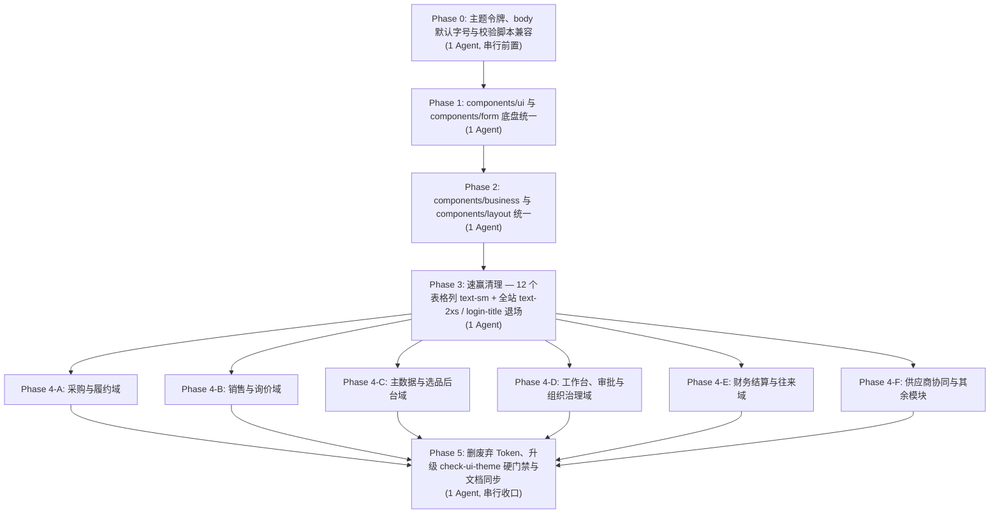

# ERP 字号体系治理与重构执行方案（Multi-Agent Playbook）

> **配套规范**：[`docs/typography-design-system.md`](./typography-design-system.md)（所有 Token、组件契约、豁免区与护栏规则以此文档为唯一真相）。  
> **目标目录**：`/Users/huangjiajiang/Development/erp/erp-client`  
> **设计目的**：将全仓 4,022 处字号用法按**可独立派单、可并行执行、每阶段绿灯交付**的方式分阶段收敛，方便安排多个 Agent 接力或并行落地。

---

## 0. 全局执行铁律（所有执行 Agent 必读）

任何认领本方案某个 Phase 或 Batch 的 Agent，在开始修改前必须遵守以下约束（源自 `erp-client/AGENTS.md`）：

1. **只改字号、行高及与本次阶段直接相关的排版样式**，不得顺手重构业务逻辑、状态管理、表单校验或接口调用。
2. **严格保持自动化 DOM `id`、文案、`data-slot`、权限显隐逻辑不变**；不改动仓库根目录的 `e2e/`。
3. **不新增单元测试文件**（`erp-client` 已移除单元测试体系，禁止新增 `*.test.*` / `*.spec.*`）。
4. **不修改根 `html` 字号**（始终保持 `16px`），只操作 `body` 和语义字号类。
5. **保护移动端防缩放特例**：`components/ui/input.tsx` 与 `components/ui/textarea.tsx` 的 `text-base md:text-body-compact` 必须保留，防止 iOS Safari 聚焦输入框时自动放大页面。
6. **每个 Phase / Batch 完成后必须全量通过前端验证**（在 `erp-client` 目录执行）：
   ```bash
   npm run lint && npm run format:check && npx tsc --noEmit && npm run build
   ```
   若格式未对齐，先执行 `npm run format` 再重新检查。

---

## 1. 阶段总览与依赖拓扑



> **为什么按此顺序？**
> - **Phase 0 先加新令牌、暂不删旧令牌（`--text-2xs` / `--text-login-title`）**，保证中间每个 Phase 合并后都能通过 `lint`、`tsc` 和 `build`。
> - **Phase 1 → Phase 2 先修共享底盘**，一次性修复 5 大视觉倒置（`Label > Input`、`AlertDescription > AlertTitle`、`SheetTitle > PageTitle`、`Badge vs StatusBadge`、`Tabs/InputGroup/Sidebar` 混用），全站页面立即获得最大视觉收益。
> - **Phase 4 按互不重叠的 `features/*` 子目录切分为 6 个独立 Batch**，可同时派给最多 6 个 Agent 并行处理，零文件冲突。
> - **Phase 5 最后拔掉旧 Token 并把 `check-ui-theme.mjs` 升为全仓白名单门禁**，彻底锁死防回流。

---

## 2. 分阶段详细执行说明书

### Phase 0：主题令牌、全局 `body` 基准与过渡期兼容

- **前置依赖**：无
- **推荐指派**：1 个 Agent（预估改动 5 个文件，风险低）
- **目标**：在 `globals.css` 建立完整权威字号阶梯并设置 `body` 默认 13px；为 3 类非桌面豁免表面显式锚定基准字号，防止 `body` 变 13px 后意外缩小豁免区。

#### 具体修改清单

1. **`erp-client/app/globals.css`**
   - 在 `@theme` 块（约 L206–L221）：
     - 为 `--text-tiny` 补齐 `--text-tiny--line-height: 1rem;`（16px）；
     - 显式声明 `--text-xs: 0.75rem;` 与 `--text-xs--line-height: 1.125rem;`（18px，中文多行辅助文案默认行高）；
     - 新增 KPI 数值令牌：
       - `--text-value-compact: 1.25rem;` / `--text-value-compact--line-height: 1.75rem;`
       - `--text-value-section: 1.5rem;` / `--text-value-section--line-height: 2rem;`
     - **暂保留** `--text-2xs` 与 `--text-login-title` 并加注释 `/* @deprecated 将于 Phase 5 删除 */`（待 Phase 3 清零后再删除）。
   - 在 `@layer base`（约 L510）：将 `body` 改为 `@apply bg-background text-foreground text-body-compact;`（`html` 保持不设字号，维持 `1rem = 16px`）。
   - 在高度断点 `@media (min-width: 48rem) and (max-height: 960px)`（约 L1377–L1378）：删除与默认值完全重复的 `--text-page-title` / `--text-page-title--line-height`。
2. **`erp-client/lib/theme-tokens.ts`**
   - 在 `themeTextNames` 中新增 `"value-compact"`、`"value-section"`（暂保留 `"2xs"`、`"login-title"` 至 Phase 5）。
3. **`erp-client/scripts/check-ui-theme.mjs`**（约 L295–L332）
   - 在同步检查 `globals.css` 的 `--text-*` 与 `lib/theme-tokens.ts` 时，跳过 Tailwind 内置字号名集合 `new Set(["xs", "sm", "base", "lg", "xl", "2xl", "3xl", "4xl", "5xl", "6xl", "7xl", "8xl", "9xl"])`，使 `@theme` 中覆写 `--text-xs` 不会误报“全局令牌未注册到类合并器”。
4. **为豁免表面锚定根字号（防止受 `body` 13px 影响）**
   - `erp-client/components/business/paper-document.tsx`：在根 `<article>`（约 L142）显式加入 `text-sm`。
   - `erp-client/features/sales-selection/pages/public-selection-page.tsx`：在最外层容器显式加入 `text-sm`（锚定移动端客户选品页 14px 基线）。
   - `erp-client/features/auth/components/login-layout.tsx`：确认登录舞台外层不受 `body` 13px 影响（按需显式声明 `text-sm`）。

#### 验收标准
- `npm run lint && npm run format:check && npx tsc --noEmit && npm run build` 全部通过。
- `app/globals.css`、`lib/theme-tokens.ts`、`scripts/check-ui-theme.mjs` 协同无报错。

---

### Phase 1：底层 UI 原语与表单原语统一（`components/ui/` + `components/form/`）

- **前置依赖**：Phase 0 完成
- **推荐指派**：1 个 Agent
- **目标**：将 `components/ui/` 中全部 29 个纯 14px 原语、8 个 13px/14px 混用原语以及 `components/form/` 统一到设计系统，彻底消除原语层字号倒置。

#### 逐文件修改清单

**A. 优先修复 5 大倒置/冲突核心原语**

| 文件 | 现状 | 目标修改 |
| :--- | :--- | :--- |
| `components/ui/label.tsx` | L14 `text-sm leading-none font-medium` | 改为 `text-xs leading-none font-medium text-foreground/80`（与表单 13px 输入值拉开主次） |
| `components/ui/field.tsx` | `FieldLegend`(label=sm/legend=base)、`FieldTitle`(sm)、`FieldDescription`(sm)、`FieldSeparator`(sm)、`FieldError`(sm) | `FieldLegend`: `data-[variant=label]:text-xs data-[variant=legend]:text-section-title`；`FieldTitle`: `text-xs font-medium`；`FieldDescription` / `FieldSeparator` / `FieldError`: 全部改为 `text-xs` |
| `components/form/form-error.tsx` & `form-validation-summary.tsx` | `text-sm text-destructive` | 改为 `text-body-compact text-destructive`（整表错误提示保持 13px 正文级） |
| `components/ui/alert.tsx` | 容器 `text-body-compact`，但 `AlertDescription` L64 为 `text-sm` | `AlertDescription` 改为 `text-xs`（或与单段告警协调为 `text-body-compact`——按规范 §4 设为 `text-xs leading-5`，确保描述不大于 13px 标题） |
| `components/ui/dialog.tsx` | 容器 `text-sm`、Title `text-base`、Description `text-sm` | 容器 `text-body-compact`、Title `text-section-title font-semibold`、Description `text-xs` |
| `components/ui/alert-dialog.tsx` | Title `text-lg` (18px)、Description `text-sm` | 容器补 `text-body-compact`、Title 改为 `text-section-title font-semibold`、Description 改为 `text-body-compact`（确认弹窗主说明常为唯一正文，用 13px 更易读） |
| `components/ui/drawer.tsx` | 容器 `text-sm`、Title `text-base`、Description `text-sm` | 容器 `text-body-compact`、Title `text-section-title font-semibold`、Description `text-xs` |
| `components/ui/sheet.tsx` | 容器 `text-sm`、`SheetTitle` L131 `text-xl leading-8`、`SheetDescription` L147 `text-sm leading-6` | 容器 `text-body-compact`、`SheetTitle` 改为 `text-page-title font-semibold`（18px/26px，不高于页面 `h1`）、`SheetDescription` 改为 `text-xs` |
| `components/ui/card.tsx` | 容器 `text-sm`、`CardTitle` `text-base`、`CardDescription` `text-sm` | 容器 `text-body-compact`、`CardTitle` `text-section-title font-semibold tracking-tight`、`CardDescription` `text-xs` |
| `components/ui/popover.tsx` | 容器 `text-sm`、Header `text-sm`、Title `text-base` | 容器 `text-body-compact`、Header 移除冗余 `text-sm`、Title `text-section-title font-semibold` |
| `components/ui/badge.tsx` | L8 `text-tiny` (11px) | 改为 `text-xs` (12px)，与 `status-badge.tsx` 一致（`status-badge.tsx` 中重复的 `text-xs` 可保持或精简；`kbd.tsx` 维持 `text-tiny`） |

**B. 修复 8 个 13px / 14px 混用组件**

| 文件 | 目标修改 |
| :--- | :--- |
| `components/ui/tabs.tsx` | `TabsContent` (L100) 去掉 `text-sm`（改为继承 13px 或 `text-body-compact`） |
| `components/ui/table.tsx` | `TableCaption` (L107) 从 `text-sm` 改为 `text-xs` |
| `components/ui/combobox.tsx` | `ComboboxEmpty` (L210) 从 `text-sm` 改为 `text-xs` |
| `components/ui/command.tsx` | `CommandInput` (L79) 改为 `text-body-compact`；`CommandEmpty` (L115) 改为 `text-xs` |
| `components/ui/input-group.tsx` | `InputGroupText` (L104) 从 `text-sm` 改为 `text-body-compact` |
| `components/ui/input.tsx` | **保留** `text-base ... md:text-body-compact`（iOS 防缩放）；将 `file:text-sm` 改为 `file:text-body-compact` |
| `components/ui/sidebar.tsx` | `SidebarGroupContent` (L477) 改为 `text-body-compact`；`SidebarMenuButton size="lg"` (L518) 改为 `text-body-compact`；`SidebarMenuSubButton` (L717) `data-[size=md]:text-sm` 改为 `data-[size=md]:text-body-compact`；`SidebarGroupLabel` (L431) 从 `text-tiny` 升为 `text-xs`（统一侧栏 3 档：11/12/13px） |
| `components/ui/file-upload.tsx` & `file-upload-selection.tsx` | 消除 `text-2xs` (L418 → `text-tiny`)；将 `text-base sm:text-lg` (L474) 改为 `text-section-title`；其余 `text-sm` 全部改为 `text-body-compact` |

**C. 统一其余 14px 原语为 13px（`text-body-compact`）或对应角色**

逐一检查并替换以下文件中所有 `text-sm`（改为 `text-body-compact`）及标题类 `text-base`/`text-lg`（改为 `text-section-title`）：
- `components/ui/accordion.tsx`（L55、L82）
- `components/ui/attachment.tsx`（L15）
- `components/ui/avatar.tsx`（L49、L94 → `text-body-compact`，保留 `group-data-[size=sm]/avatar:text-xs`）
- `components/ui/breadcrumb.tsx`（L24 → `text-xs` 或 `text-body-compact`，建议与 `DetailWorkspaceMeta` 对齐用 `text-xs`）
- `components/ui/bubble.tsx`（L72、L86）
- `components/ui/calendar.tsx` & `calendar-navigation.tsx`（所有 `text-sm` → `text-body-compact`）
- `components/ui/description-list.tsx`（`DescriptionDetails` L65：`text-sm leading-6` → `text-body-compact`）
- `components/ui/empty.tsx`（`EmptyTitle` L66：`text-lg` → `text-section-title`；`EmptyDescription` L79：`text-sm/relaxed` → `text-body-compact`；`EmptyContent` L92：`text-sm` → `text-body-compact`）
- `components/ui/hover-card.tsx`（L44）
- `components/ui/input-otp.tsx`（L58）
- `components/ui/item.tsx`（L38、L132、L145）
- `components/ui/marker.tsx`（L9）
- `components/ui/menubar.tsx`（L62、L104、L126、L161、L188、L243）
- `components/ui/message.tsx`（L25）
- `components/ui/navigation-menu.tsx`（L59、L135）
- `components/ui/progress.tsx`（L57、L68 → `text-xs` 或 `text-body-compact`，保持标签 `text-xs`、数值 `text-xs num`）
- `components/ui/timeline.tsx`（L55、L78）
- `components/ui/toast.tsx`（`ToastTitle` L86：`text-body-compact font-medium`；`ToastDescription` L102：`text-xs text-muted-foreground`）

#### 验收标准
- `components/ui/` 与 `components/form/` 中：
  - 零 `text-2xs`、零 `text-sm`、零 `text-lg`、零 `text-xl`、零任意 `text-[...]`；
  - `text-base` 仅剩 `input.tsx` 与 `textarea.tsx` 两处移动端防缩放基础类。
- `npm run lint && npm run format:check && npx tsc --noEmit && npm run build` 全部通过。

---

### Phase 2：共享业务组件、布局壳与 CSS 补丁清理（`components/business/` + `components/layout/` + `globals.css`）

- **前置依赖**：Phase 1 完成
- **推荐指派**：1 个 Agent
- **目标**：统一全站共享业务积木与顶栏/侧栏布局的字号，拆除因旧 `Label` 14px 而写的局部 CSS 补丁，修掉 `table-row-actions.tsx` 的硬编码 `text-[13px]`。

#### 具体修改清单

1. **修复高优先级缺陷**
   - `components/business/table-row-actions.tsx` L149：`text-[13px]` → `text-body-compact`。
   - `app/globals.css` L655–L661：检查 `.erp-detail-workspace-page [data-slot="detail-form-grid"] [data-slot="label"]` —— 因 Phase 1 已将 `Label` 统一为 `text-xs`（12px），删除重复的 `font-size` / `line-height` 覆盖（若需保留详情页专属 `color: color-mix(...)` 可只留 color，或已由 `label.tsx` 统一承载则整段移除）。
   - `components/business/list.tsx`：
     - `BusinessTableFrame` 标题（L225）：`text-base` → `text-section-title`；
     - `QuickPreviewSheet` 的 `SheetTitle`（L330）：`headerMedia ? "text-section-title" : undefined`（使无图态 18px `text-page-title`、带图紧凑态 15px `text-section-title`）。
   - `components/business/page.tsx`：
     - `MetricItem` 数值（L201）：`compact ? "text-value-compact" : "text-value-section"`（取代 `text-xl` / `text-2xl`）；
     - `PageScaffold`（L354）：`[&:has(>[data-slot=document-header])>[data-slot=page-header]_h1]:text-sm` → `...:text-body-compact`。
   - `components/business/values.tsx`：
     - `moneyValueSizeClassNames.section`（L374）：`text-2xl` → `text-value-section`；
     - 文件内其余 3 处 `text-sm`（约 L587、L598、L604）：改为 `text-body-compact`（若是小节标题如 `h2` 改为 `text-section-title` 或保持正文加粗 `text-body-compact font-semibold`，按上下文核实）。
   - `components/business/document.tsx`：
     - `DocumentHeader` 元信息区（L126）：统一 `text-xs`（不再区分 `compact ? "text-xs" : "text-sm"`）；版本徽章（L140–L141）统一 `text-xs`；
     - `DocumentSection` 标题（L310）：`text-base` → `text-section-title`；描述（L312）：`text-sm` → `text-xs`；
     - 其余 `text-sm`（共 8 处）全部收敛为 `text-body-compact` 或 `text-xs`。
   - `components/business/detail-presentation.tsx`：
     - `DetailSummaryItem` 标题（L85）：`text-sm` → `text-body-compact`；数值（L89）：`text-2xl` → `text-value-section`；
     - `DetailRecordSection` `<h2>`（L126）：`text-sm font-semibold` → `text-section-title font-semibold`。
   - `components/business/detail-page-header.tsx`：L95 `navigationMeta` 从 `text-sm` 改为 `text-xs`。
   - `components/business/page-header.tsx`：L130 `description` 从 `text-body-compact` 改为 `text-xs`（与 `ListWorkspaceHeader.description` 对齐）。

2. **清理 `components/business/` 其余含 `text-sm` / `text-base` / `text-lg` / `text-2xl` 文件（不动豁免文件 `paper-document.tsx`）**
   - `attachments.tsx`（2 处 `sm`）
   - `audit-import.tsx`（7 处 `sm`、及若有 `base` 标题换 `section-title`）
   - `change-order-section.tsx`（`h3` 的 `text-base` → `text-section-title`）
   - `data-table-body.tsx`（1 处 `sm`）
   - `data-table-controls.tsx`（1 处 `sm`）
   - `domain.tsx`（2 处 `sm`）
   - `domain-interface-errors.tsx`（检查 `text-base` 等）
   - `editor.tsx`（检查 `text-base` / `text-sm`）
   - `feedback.tsx`（4 处 `sm`） & `feedback-states.tsx`（2 处 `sm`）
   - `financial-preview.tsx`（1 处 `sm`）
   - `financial-request-dialog.tsx`（3 处 `sm`）
   - `fixed-option-checkbox-filter.tsx`（1 处 `sm`）
   - `inquiry-customer-template-button.tsx`（1 处 `sm`）
   - `list-workspace-filter-bar.tsx`（L227 1 处 `sm`）
   - `person-picker-dialog.tsx`（2 处 `sm`）
   - `sales-line-price-comparison.tsx`（1 处 `sm`）
   - `selector-query-feedback.tsx`（1 处 `sm`）
   - `workflow-actions.tsx`（3 处 `sm`）
   - `workflow.tsx`（11 处 `sm` → `text-body-compact`；3 处 `text-2xl` 统计数 L138/L150/L162 → `text-value-section`）
   - `components/business/detail-workspace-styles.ts` 与 `list-workspace-styles.ts`：清理现在已由 `text-xs` 默认提供的冗余 `leading-4.5`（可选，保持整洁）。

3. **清理 `components/layout/`（收敛侧栏与顶栏）**
   - `workspace-sidebar-nav.tsx`：L254、L332 的 `text-2xs` → `text-tiny`；L489 分组标题 `text-tiny` → `text-xs`（与 `SidebarGroupLabel` 一致）。
   - `system-feedback-panel.tsx`：L125 `text-2xs` → `text-tiny`；L165/L226/L271/L285 的 `text-sm` → `text-body-compact`。
   - `workspace-quick-search.tsx`：L107 `text-2xs` → `text-tiny`。
   - `workspace-account-menu.tsx`：L105 `text-sm` → `text-body-compact`。
   - `workspace-tabs.tsx`：L389 `text-sm` → `text-body-compact`。
   - `route-loading.tsx`：L3 `text-sm` → `text-body-compact`。

4. **检查 `app/` 目录**
   - 清理 `app/` 中 4 处 `text-sm`（通常在 `not-found.tsx` / `error.tsx` / `loading.tsx`，改为继承 13px 或 `text-body-compact`）。

#### 验收标准
- `components/`（除 `paper-document.tsx`、`input.tsx`/`textarea.tsx` 的移动端 `text-base`）和 `app/` 内：**零 `text-[...]`、零 `text-2xs`、零 `text-sm`、零 `text-base`、零 `text-lg`、零 `text-xl`、零 `text-2xl`、零 `text-3xl`**。
- `npm run lint && npm run format:check && npx tsc --noEmit && npm run build` 全部通过。

---

### Phase 3：速赢清理 — 全站表格列 `text-sm` + 全站 `text-2xs` 与 `text-login-title` 退场

- **前置依赖**：Phase 2 完成
- **推荐指派**：1 个 Agent
- **目标**：清零全站所有表格列里的 14px 杂音、清零全站 52 处 `features/` 中的 `text-2xs`、清零 2 处 `text-login-title`，为 Phase 5 删除废弃 Token 扫清障碍。

#### 具体修改清单

1. **清理 12 个表格/列文件中的 24 处 `text-sm`**（直接删掉 `text-sm` 以继承 `<Table>` 的 13px；表格外状态提示用 `text-body-compact` 或 `text-xs`）：
   - `features/access-audit/hooks/use-user-columns.tsx`（L56、L72、L106、L107）
   - `features/purchase-orders/components/purchase-order-surfaces-lines-table.tsx`（L36）
   - `features/workspace/components/workspace-purchase-comparison-table.tsx`（L184：删掉 `<Table className="... text-sm">` 上的 `text-sm`）
   - `features/customer-receivables/components/receipt-allocation-table.tsx`（L75、L101）
   - `features/supplier-payables/components/invoice-allocation-table.tsx`（L63）
   - `features/sales-orders/components/acceptance-progress-table.tsx`（L51）
   - `features/sales-orders/components/sales-order-create-line-item-columns.tsx`（L42、L86、L164、L309）
   - `features/sales-orders/components/sales-order-create-line-item-table.tsx`（L137）
   - `features/sales-orders/components/sellable-sku-picker-columns.tsx`（L39）
   - `features/sales-inquiries/components/inquiry-feedback-table.tsx`（L266、L681）
   - `features/sales-inquiries/components/inquiry-products-table.tsx`（L163、L182）
   - `features/supplier-api-connections/components/batch/batch-review-table.tsx`（L134、L137、L636、L746）

2. **清零 `features/` 全部 52 处 `text-2xs`**（共 14 个文件，全部替换为 `text-tiny` 或 `text-xs`）：
   - **微标/角标/计数点 → `text-tiny` (11px)**：
     - `features/master-data/components/product/product-detail-navigation.tsx`（1 处）
     - `features/master-data/components/product/product-editor-media.tsx`（7 处）
     - `features/master-data/components/product/product-media-section.tsx`（4 处）
     - `features/master-data/components/product/product-supply-section.tsx`（3 处）
     - `features/inventory/components/inventory-balance-preview.tsx`（1 处）
     - `features/notifications/components/inbox-popover.tsx`（1 处）
     - `features/purchase-orders/components/purchase-order-detail-sections.tsx`（1 处，若挂在 `<Badge>` 上直接删掉继承 `text-xs`）
     - `features/sales-orders/components/sales-order-detail-tabs.tsx`（1 处）
     - `features/supplier-orders/components/supplier-order-preview-center-overview-items.tsx`（1 处，若在 `<Badge>` 上直接删掉）
     - `features/supplier-orders/components/supplier-order-preview-panel.tsx`（1 处，若在 `<Badge>` 上直接删掉）
     - `features/supplier-portal/components/portal-shell.tsx`（1 处）
     - `features/workspace/components/role-workbench-urgent.tsx`（1 处）
   - **商品预览卡片/选品信息 → 升至 `text-xs` (12px)（纯角标升至 `text-tiny` 11px）**：
     - `features/sales-selection/components/preview-grid.tsx`（6 处：正文/列表信息升为 `text-xs`，极小角标用 `text-tiny`）
     - `features/sales-selection/components/public-selection-form.tsx`（9 处：角标用 `text-tiny`，字段/说明信息升为 `text-xs`）
     - `features/sales-selection/components/public-selection-review-center.tsx`（14 处：角标用 `text-tiny`，字段/说明信息升为 `text-xs`）

3. **清零 2 处 `text-login-title`**：
   - `features/auth/components/login-form.tsx`（L48）：`<CardTitle className="text-login-title">` → `<CardTitle className="text-2xl font-semibold tracking-tight">`（登录页属第 5 节展示豁免区；若倾向统一 28px 可改用 `text-value-summary`，两者皆优于维护单页私有 Token，推荐统一为 `text-2xl` 24px 与左侧舞台 30px 形成主次）
   - `features/supplier-portal/pages/login-page.tsx`（L57）：与 `login-form.tsx` 同步修改。

#### 验收标准
- 全仓 `rg 'text-2xs|text-login-title' erp-client/app erp-client/components erp-client/features` 结果为 **0 命中**。
- 全仓 `*column*` / `*table*` 文件（除 `paper-document.tsx`）中 `text-sm` 为 **0 命中**。
- `npm run lint && npm run format:check && npx tsc --noEmit && npm run build` 全部通过。

---

### Phase 4：业务模块存量字号收敛（`features/*` — 支持 6 路并行派单）

- **前置依赖**：Phase 3 完成
- **推荐指派**：**可拆为 6 个独立 Agent 并行执行（Batch A – Batch F）**，目录完全互斥、零合并冲突。
- **目标**：消除桌面业务模块中残留的约 1,500+ 处裸 `text-sm`、`text-base`、`text-lg`、`text-xl`、`text-2xl`、`text-3xl`，统一 `h1`/`h2`/`h3` 视觉层级。

#### 统一机械替换决策树（所有 Batch 严格遵守）

执行 Agent 面对 `features/<module>/` 中的每一处裸物理字号类，按以下顺序判定：

1. **先看是否命中豁免文件**：
   - `features/sales-selection/pages/public-selection-page.tsx` 与 `public-selection-*.tsx` → **跳过**（移动端豁免区）。
   - `features/auth/components/login-stage.tsx`、`login-stage-art.tsx`、`login-form.tsx`、`features/supplier-portal/pages/login-page.tsx` → **跳过**（品牌展示豁免区）。
2. **处理 `text-sm`（14px）**：
   - 若元素是常规正文/段落/表格内容/按钮/描述/列表项：直接**删除 `text-sm`**（已由 `body` 默认继承 13px）；若父容器设了 `text-xs` 等更小字号而子元素需要恢复 13px 正文，则改为 **`text-body-compact`**。
   - 若元素是表单 `<Label>` 或说明性辅助字：删除 `text-sm`（若为原生 `<label>` 则改为 `text-xs font-medium`）。
   - 若元素是 `<h2>`：升级为 **`text-section-title`**（若属于 `QuickPreviewSheet` 内轻分区则保留正文级 `font-semibold`，直接删 `text-sm`）。
   - 若元素是 `<h3>`：直接删除 `text-sm`，保留 `font-semibold`（或 `font-medium`）继承 13px。
   - 若同时写了 `text-sm leading-6` / `text-sm leading-relaxed`：普通短句直接删掉两者使用 13px 默认 20px 行高；大段多行说明保留 `leading-relaxed`。
3. **处理 `text-base`（16px）**：
   - 用在分区标题 / 卡片标题 / 对话框标题 / 区块 `<h2>` → 改为 **`text-section-title`**（15px）。
   - 用在 `<h3>` 或强调正文 → 改为 **`text-body-compact font-semibold`**（13px）。
   - 用在汇总数字 → 改为 **`text-value-compact`**（20px）或保持 `text-body-compact font-semibold num`。
4. **处理 `text-lg`（18px）**：
   - 用在页面主标题 `<h1>` → 改为 **`text-page-title`**（18px）。
   - 用在分区 `<h2>` / `<h3>` / 弹窗标题 / 区块副标题 → 改为 **`text-section-title`**（15px）。
   - 用在较突出的金额/统计值 → 改为 **`text-value-compact`**（20px）配 `.num`。
5. **处理 `text-xl` / `text-2xl` / `text-3xl`**：
   - 用在金额 / 数量 / 占比 / 计数 KPI → 分别映射为 **`text-value-compact`**（20px）/ **`text-value-section`**（24px）/ **`text-value-summary`**（28px）并确保带 `.num`。
   - 用在非豁免页面的 `<h1>`（如详情页、审批材料页）→ 改为 **`text-page-title`**（18px）。
   - 用在非豁免页面的 `<h2>`（如审批材料子标题、分类树详情标题、新建销售单入口标题）→ 改为 **`text-section-title`**（15px）或页面唯一主标题改用 `<h1>` + `text-page-title`（18px）。
6. **顺手清理冗余行高**：
   - 在 `text-xs` 上手写的 `leading-4.5` 可删除（已成 `text-xs` 默认值 18px）；仅保留确有需要的 `leading-none` / `leading-4` / `leading-relaxed`。
   - 检查无字号的裸 `<h2>` / `<h3>`：确保不在 `body` 改 13px 后显得过小（需要分区级标题时显式补 `text-section-title`）。

#### 6 个可并行派单的模块批次（零文件交叉）

| 批次 | 负责目录（`erp-client/features/...`） | 存量工作量基线（Phase 3 前基线参考） | 特别注意点 |
| :--- | :--- | :--- | :--- |
| **Batch A：采购与履约域** | `purchase-orders`、`purchase-payment-requests`、`fulfillment-operations`、`delivery-arrangements` | `sm`≈302，`base+`≈39 | 采购单有多个 `lg`/`xl`/`3xl` 金额和纸质预览辅助组件，注意区分 KPI 数值与普通标题 |
| **Batch B：销售与询价域** | `sales-orders`、`sales-inquiries`、`contracts` | `sm`≈313，`base+`≈35 | `sales-orders` 含新建入口 `sm:text-2xl` 标题需收口；`contracts` 含预览抽屉与审批块 |
| **Batch C：主数据与选品后台域** | `master-data`、`inventory`、`customers`、`companies`、`demo-master-data`、`sales-selection` *(仅后台文件，跳过 `public-selection-*`)* | `sm`≈206（不含选品 C 端），`base+`≈20 | `master-data/pages/product-detail-page.tsx` 为新体系标杆，保持对齐；`sales-selection` 仅处理后台管理页与 `preview-grid.tsx` |
| **Batch D：工作台、审批与组织治理域** | `workspace`、`approval-workflow`、`approval-processes`、`approval-copies`、`admin`、`organization`、`access-audit`、`audit`、`notifications`、`background-jobs`、`integration-errors` | `sm`≈322，`base+`≈35 | `workspace` 含工作台 KPI（`role-workbench-metrics.tsx` 等）统一用 `text-value-*`；`approval-workflow` 含多处 `h2` 写 `text-xl` 需降回 `text-section-title` |
| **Batch E：财务结算与往来域** | `customer-receivables`、`supplier-payables`、`supplier-settlements`、`supplier-deposits`、`invoice-requests`、`actual-profit-loss`、`financial-draft-edit`、`import-opening`、`document-timeline`、`file-assets` | `sm`≈166，`base+`≈25 | 金额汇总统一消费 `MoneyValue` 或 `text-value-section`/`text-value-compact` + `.num` |
| **Batch F：供应商协同与客户质量域** | `supplier-api-connections`、`supplier-offerings`、`supplier-orders`、`supplier-portal` *(跳过 `pages/login-page.tsx`)*、`supplier-portal-admin`、`customer-quality`、`auth` *(仅 `permission-guard.tsx` / `login-mode-switch.tsx`，跳过登录舞台与表单)* | `sm`≈280，`base+`≈20 | `supplier-portal` 其余 8 个工作台页均按桌面规范收敛 |

> **注**：详情页结构从旧 `Card` 迁移到纯白通栏 `DetailWorkspacePage` 属于布局架构升级，继续沿 [`docs/detail-page-design-system.md`](./detail-page-design-system.md#L165-L170) 单独推进；本 Phase 只负责字号与标题角色收敛，不强制改写页面外层卡片布局，以控制回归风险。

#### 每个 Batch 的验收标准
- 运行定向检查确认所辖非豁免目录内无残留裸物理字号：
  ```bash
  rg '\btext-(sm|base|lg|xl|2xl|3xl|4xl|5xl|6xl|2xs)\b' <batch_dirs>
  ```
  （豁免文件除外，结果应为 0）。
- `npm run lint && npm run format:check && npx tsc --noEmit && npm run build` 全部通过。

---

### Phase 5：删除废弃 Token、升级 Lint 硬门禁与文档同步

- **前置依赖**：Phase 4 全部 6 个 Batch 合并完成
- **推荐指派**：1 个 Agent
- **目标**：正式删除废弃 Token，把 `scripts/check-ui-theme.mjs` 升级为全仓字号白名单硬门禁，并同步相关规范文档。

#### 具体修改清单

1. **移除废弃 Token**
   - `erp-client/app/globals.css`：删除 `--text-2xs` 与 `--text-login-title` / `--text-login-title--line-height`。
   - `erp-client/lib/theme-tokens.ts`：从 `themeTextNames` 中删除 `"2xs"` 与 `"login-title"`。
2. **升级 `erp-client/scripts/check-ui-theme.mjs`**
   - **扩大扫描目录**：除 `features/` 外，新增扫描 `app/` 与 `components/`（对纯颜色/原生标签等旧规则保持仅作用 `features/` 或合理分层，但**字号/字体规则同时覆盖 `app/`、`components/`、`features/`**）。
   - **增加字号白名单校验**：
     - 允许的全局字号类白名单：`tiny`、`xs`、`body-compact`、`section-title`、`page-title`、`value-compact`、`value-section`、`value-summary`、`value-hero`。
     - 拦截非豁免文件中的 `text-(sm|base|lg|xl|[2-9]xl)`（含前缀变体如 `sm:text-sm`、`md:text-lg`）以及全部 `text-[...]` 任意字号与 `text-\d+xs`。
     - 显式维护豁免路径配置：
       - `MOBILE_INPUT_ZOOM_GUARD_FILES`：`components/ui/input.tsx`、`components/ui/textarea.tsx`（仅豁免 `text-base`，且仅允许与 `md:text-body-compact` 配对）；
       - `TYPOGRAPHY_EXEMPT_FILES`：`components/business/paper-document.tsx`、`app/s/[token]/**`、`features/sales-selection/pages/public-selection-page.tsx`、`features/sales-selection/components/public-selection-*.tsx`、`features/auth/components/login-stage.tsx`、`features/auth/components/login-stage-art.tsx`、`features/auth/components/login-form.tsx`、`features/supplier-portal/pages/login-page.tsx`（豁免区仍禁止 `text-2xs` 与 `text-[...]`）。
     - 表格/列文件专禁：`*column*` / `*table*` 文件一律禁止 `text-sm`。
   - **同步 `themeTextNames` 校验**：确保 `globals.css` 与 `lib/theme-tokens.ts` 精确匹配（自动忽略 `xs` 等 Tailwind 内置名）。
3. **同步关联文档**
   - `docs/list-table-design-system.md`：
     - 更新 §2.2 表中 `text-xs` 行高为 `12px / 18px`，补充指向 `docs/typography-design-system.md` 的总规范链接；
     - 修正文档示例代码（如 L523 `alerts` 示例里的 `text-sm` → `text-body-compact` 或删除）。
   - `docs/detail-page-design-system.md`：
     - 更新 §3 表中 `text-xs` 行高为 `12px / 18px`，补充指向 `docs/typography-design-system.md` 的总规范链接；
     - 说明 `Label` 已在底层原语统一为 `12px`，不再依赖 `detail-form-grid` 专属字号补丁。
   - `erp-client/AGENTS.md`：
     - 在 §4「数值、模块边界与 UI」补充一条指引：字号与排版统一遵循 `../docs/typography-design-system.md`，由 `npm run lint:ui-theme` 自动校验。

#### 最终验收清单（Definition of Done）
- [ ] `npm run lint`（含升级后的 `lint:ui-theme`）0 警告 0 错误。
- [ ] `npm run format:check` 通过。
- [ ] `npx tsc --noEmit` 通过。
- [ ] `npm run build` 成功产出。
- [ ] 手工抽检以下 6 类关键界面（浅色 + 深色模式，桌面 `1440×900` 及窄窗）：
  1. 列表页（如商品池列表）+ 打开右侧 `QuickPreviewSheet`（确认抽屉标题 ≤ 页面 `h1` 18px、表内无 14px 突兀行）；
  2. 详情页（商品详情 + 1 个未迁移的销售单/采购单详情，确认标签 12px < 输入值 13px）；
  3. 带表单的 `Dialog` 与 `AlertDialog`（确认标题统一 15px、标签 12px、输入值 13px）；
  4. 左侧双栏导航展开与折叠态（确认 60px 窄轨短签 11px 清晰不溢出）；
  5. 纸质单据预览 `PaperDocument` 与登录页（确认豁免区排版完好）；
  6. 移动端客户选品页 `app/s/[token]`（确认 14px 基线与表单输入聚焦不触发异常缩放）。

---

## 3. 给调度者的 Agent 派单提示词模板

后续派发子任务给其他 Agent 时，可直接按下面模板下发：

```text
请先阅读 docs/typography-design-system.md、docs/typography-refactoring-plan.md 和 erp-client/AGENTS.md。
本次任务负责执行【Phase X / Batch Y】：<填写具体阶段名称与范围>。

要求：
1. 严格按照 docs/typography-refactoring-plan.md 对应阶段的清单、替换决策树与禁止越界项执行；
2. 严禁修改职责范围以外的文件，严禁修改自动化 DOM id、业务逻辑、文案及 e2e/，不新增单元测试；
3. 完成后在 erp-client 目录运行 `npm run lint && npm run format:check && npx tsc --noEmit && npm run build` 并汇报修改文件清单与验证结果。
```
